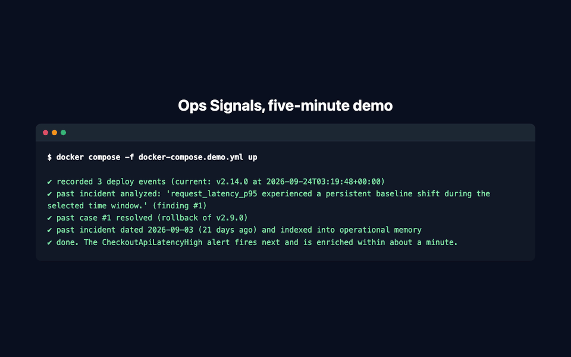
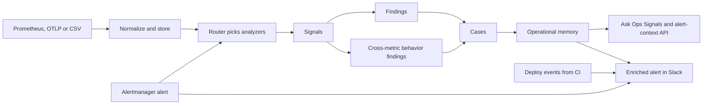

# Ops Signals

[](https://github.com/ramprasadgk9/ops-signals/actions/workflows/ci.yml)
[](LICENSE)
[](https://github.com/ramprasadgk9/ops-signals/releases)

<h2 align="center"><i>"Never debug the same incident twice."</i></h2>

Open-source and self-hosted for Prometheus and OpenTelemetry: Ops Signals explains every metric
change in plain language, links it to the deploy behind it, and remembers how each incident was
fixed.

It sits next to your Prometheus, Grafana and Alertmanager, analyzes metrics with published
detection methods, and needs no LLM. It adds to your observability stack; it doesn't replace it.



### Already on OpenTelemetry?

Point your Collector at Ops Signals; no Prometheus needed. Findings, cases, operational memory and
Slack notifications work from OTLP alone; a few features still need Prometheus.
[What you get with OTLP only →](docs/otlp.md#using-ops-signals-with-otlp-only)


### Try it in one command

A shop with four services already in trouble: a deploy that broke latency (and fired an alert), a
database problem back 9 days after its fix, a release nobody announced, and an OTLP service with a
case in progress. You only need Docker: no Python, Node, Slack workspace or data of your own.

#### Guided tour: Things to try (on by default)

> [!TIP]
> **Every way below opens with a "Things to try" guide in the corner: ten steps through the
> demo (eleven with AI on, which adds Investigate), each with a button that takes you there and
> ticks itself off when you've done it.**
> Nothing to set up. To hide it, put `OPS_SIGNALS_DEMO_TOUR=false` in front of the command.

Get the code once, then pick one of three ways to start it:

```bash
git clone https://github.com/ramprasadgk9/ops-signals.git
cd ops-signals
```

| | AI features | Downloads | Needs | Start with |
|---|---|---|---|---|
| [**1. Demo**](#1-demo-no-ai) | Off | Images only | Docker with 4 GB memory | `up` |
| [**2. Demo + local AI**](#2-demo--local-ai-no-api-key) | A model on your machine | + about 10 GB, once | 8 GB memory, no account | `--profile ai` |
| [**3. Demo + your AI API**](#3-demo--your-ai-api) | The model behind your API | Nothing extra | An API key (usage billed by the provider) | `--env-file demo/ai-api.env` |

A few minutes after start, open **http://localhost:8080** for the full UI (the guide is in its
corner) and **http://localhost:8090** for the enriched alert as it would appear in Slack.
[`docs/demo.md`](docs/demo.md) covers what's running, what to try, and how it works. Each way
downloads the published images of the latest release; add `--build` to build them from your
checkout instead.

##### 1. Demo (no AI)

```bash
docker compose -f docker-compose.demo.yml up
```

Everything except the AI features: findings, the deploy behind each change, matching past cases,
the enriched alert, Recurring Problems and Behavior Intelligence. None of these need an AI model;
AI adds drafts and plain-language explanations on top.

##### 2. Demo + local AI (no API key)

```bash
docker compose -f docker-compose.demo.yml --profile ai up
```

Adds a model server in its own container with the `gemma3:4b` model. No account or key, and
nothing leaves your machine. The AI parts work too: root cause and resolution drafts on a case,
"why might the fix not have held?", runbook drafts, the shift handoff note, and plain explanations
of combined patterns. The first start downloads about 10 GB (once) and needs about 8 GB of memory
for Docker; answers take 5-20 seconds each on CPU.

##### 3. Demo + your AI API

```bash
cp demo/ai-api.env.example demo/ai-api.env
docker compose -f docker-compose.demo.yml --env-file demo/ai-api.env up
```

The same AI features as option 2, from a model API you already have; nothing to download. Before
starting, open `demo/ai-api.env` and fill in **one** of its two blocks:

- **Any server that speaks the OpenAI chat completions API** (a hosted API, a gateway, or a model
  server on your machine): `DEMO_AI_URL`, `DEMO_AI_KEY` and `DEMO_AI_MODEL`.
- **The Anthropic API**: uncomment the `OPS_SIGNALS_*` lines and set your key and a model name,
  e.g. `claude-haiku-5-5`.

API usage is billed by the provider, separately from any chat subscription, and the demo's data is
sent to that API when you use an AI feature. `demo/ai-api.env` is gitignored. More in
[Turn on AI](docs/demo.md#turn-on-ai).

Putting the demo on a server for others to visit? Turn on demo mode as well: a sample-data banner
and view-only settings. See [Host it as a public demo](docs/demo.md#host-it-as-a-public-demo).

> **Run it on a trusted network.** The API has no authentication unless you set
> `OPS_SIGNALS_API_TOKEN`. Don't expose it to the internet. Before others use it, lock it down in
> three steps: [`docs/access.md`](docs/access.md).

New here? [`docs/README.md`](docs/README.md) is a guided path through every doc referenced below,
and the [glossary](docs/glossary.md) says what each word means: a finding is a symptom, a case is a
problem you're working on, a tenant is one team's space in Mimir.

## Contents

- **Why:** [The Problem](#the-problem) · [What Ops Signals Does](#what-ops-signals-does) · [What Makes It Different](#what-makes-it-different) · [How It Works](#how-it-works)
- **Look around:** [See It](#see-it) · [Features](#features)
- **Get started:** [Quick Start](#quick-start) · [Set Up and Run](#set-up-and-run)
- **Project:** [Current Limitations](#current-limitations) · [Contributing](#contributing) · [License](#license)

## The Problem

Most monitoring is reactive: nothing happens until an alert fires, and then the on-call engineer
starts from zero. Ops Signals works on both sides: it answers the first questions when an alert
fires, and it looks for problems before one does.

### When an alert fires (reactive)

`checkout` latency is up. Before anyone can fix anything, the on-call engineer answers the same
three questions by hand:

1. **What happened?** Is it a spike, a new baseline, a slow trend, or noise? A dashboard draws the
   line; it doesn't say which.
2. **What changed?** Was there a deploy or config change just before? That lives in CI, not next to
   the graph.
3. **Have we seen this before?** Last time, the root cause and the fix ended up in a ticket or a
   postmortem that nobody searches, so the investigation starts from zero.

### Before any alert fires (proactive)

Some problems trigger no alert at all, until they turn into an outage:

- **Changes no alert catches.** A latency baseline that moved after a deploy, or a slow climb that
  stays under every threshold. No threshold is crossed, so nobody is told; it's found only if
  someone happens to be looking at the right graph.
- **Blind spots.** Most metrics are on no dashboard and in no alert. A problem in one of them goes
  unseen until it turns into an outage somewhere else.
- **Fixes that don't hold.** The same problem comes back weeks after its fix, and nobody connects it
  to the last incident.
- **Lost lessons.** What one engineer learned in an investigation doesn't reach the next alert or the
  next engineer.

### How Ops Signals closes each gap

| | Today | With Ops Signals |
| --- | --- | --- |
| **Reactive** | A line on a chart, or a threshold that was crossed | A **finding** that names the change in words ("sustained baseline shift ~621 → ~425 ms, started around 23:59 UTC") and shows which analyzers produced it |
| | Change history in a different tool | Findings and alerts name the **deploy or config change** just before the problem and, with drill-down, which pods it came from |
| | Every alert investigated from scratch | **Alert enrichment** posts one Slack message that answers all three questions, with the most similar resolved case and how it was fixed |
| **Proactive** | Problems found when an alert fires, or later | **Autonomous analysis** checks your metrics on a schedule and, with Slack set up, posts high-importance findings there before any alert, so nobody has to be watching a dashboard or Ops Signals itself; if an alert fires later, its message says how much earlier the problem was found |
| | Unwatched metrics fail silently | **Metric Usage** compares your Grafana dashboards and alert rules with every metric, and flags metrics that had problems nothing would have shown |
| | Past fixes buried in tickets | Resolved cases and imported postmortems become **searchable memory**, and a problem back soon after its fix says **Fix didn't hold** |
| | Every alert wakes someone up, even known noise | `GET /api/alert-context` lets your alerting tool ask "seen before, real or noise?" before it notifies anyone |

See [`docs/vision.md`](docs/vision.md) for the longer narrative behind this.

## What Ops Signals Does

**Gets data from where it already is**
- Prometheus, one server or several, including Mimir, Thanos and VictoriaMetrics tenants, pulled on
  demand or on a schedule
- OTLP pushed from an OTel SDK or Collector, CSV upload, and Alertmanager webhooks
- Deploy, config and feature-flag events from your CI through `POST /api/events`, and deploys
  found in Prometheus itself - see [`docs/deploy-discovery.md`](docs/deploy-discovery.md)

**Explains what changed**
- A config-driven router picks analyzers for each metric: baseline shift, change point, anomaly and
  outlier detection, trend, pattern discovery, forecasting and data health
- Each result becomes a **finding** with a title, a plain-language summary, a category and an
  importance score. Rules across several metrics produce **behavior findings**
- Drill-down shows which pods a change came from, and which deploy started them
- **Autonomous analysis** watches Prometheus by itself, once or on a schedule

**Gets the right people moving**
- **Alert enrichment**: one Slack message per Prometheus alert with what happened, what changed and
  whether it's been seen before
- High-importance findings go to Slack, so a problem found at 03:00 doesn't wait for someone to open
  the UI
- **Cases** track an investigation from open to resolved, and link two-way to **Jira Cloud** tickets
- **Metric Usage** finds blind spots and stored series nothing uses

**Remembers**
- Resolved cases become searchable operational memory; past postmortems can be imported
- `GET /api/alert-context` gives other systems prior outcomes, similar resolved cases and recurrence
- **Ask Ops Signals** is a chat over cases, findings, behaviors, analyzers and these docs

**Fits how you work**
- A React web UI, a Grafana plugin and an MCP server for AI clients
- New analyzers are added through config, in Python or as your own HTTP service
- Each team can change analyzer settings for its own services, with a reason for each change
- A benchmark suite measures accuracy against known-answer datasets - see [`benchmark/README.md`](benchmark/README.md)

## What Makes It Different

- **It explains, not just detects.** Every finding says what kind of change it is, in words, and
  shows which analyzers and signals produced it, not just a score.
- **No LLM required.** Analysis, routing, findings and alert enrichment are deterministic. AI is an
  optional add-on that never overrides the deterministic result, and every answer says whether a
  model produced it.
- **It gets better with every resolved incident.** The fix you found last quarter is suggested when
  the pattern returns.
- **It adds to your stack and replaces nothing.** An extra Alertmanager receiver, read-only on
  Prometheus and Grafana, and no Kubernetes needed.
- **Its methods are published and measured.** Every detection analyzer is a peer-reviewed method
  ([citations](docs/analyzer-methodology.md)), benchmarked against known-answer data.
- **It's open and self-hosted.** MIT licensed; your data stays on your network.

## How It Works



PostgreSQL is the system of record; Qdrant is only a search index built from it. Details:
[`docs/architecture.md`](docs/architecture.md).

What it is not: a replacement for Prometheus, Grafana or an incident-management platform.
It doesn't remediate anything by itself, and two similar cases don't prove the same root cause.

## See It

**Findings in plain words.** A badge (Worse, Better, Monitoring gap...), what changed in the
metric's own units, why it matters, and what to check.


**Which pods a change came from.** One bad pod, a few, every pod, or new pods from a rollout.


**Enriched alerts in Slack.** What happened, what changed, and whether it has been seen before.


More: every page in [`docs/ui-tour.md`](docs/ui-tour.md), and the full
[screenshot gallery](docs/screenshots.md), Grafana plugin included.

## Features

What you can do, and where to find it in the app. The docs go deeper.

| Feature | What it does for you | Where in the app | More |
| --- | --- | --- | --- |
| **What needs you now** | The one problem to look at first, this shift's work in order, and a **Shift handoff** note to copy into Slack | **Overview** | [Overview API](docs/standalone-overview-api.md#shift-handoff) |
| **Analyze a metric** | Pick a Prometheus query or upload a CSV; findings come back right away | **New Analysis**; Grafana **Interactive Analysis** | [Prometheus analysis](docs/standalone-prometheus-analysis.md) |
| **Findings** | Each change in plain words, the deploy just before it, and which pods it came from | **Findings** | [Finding anatomy](docs/finding-anatomy.md), [drill-down](docs/finding-drilldown.md) |
| **Watch automatically** | Choose services and metrics; Ops Signals checks them once or on a schedule | **Autonomous Analysis Configure**; Grafana **Autonomous Analysis** | [Autonomous analysis](docs/autonomous-analysis-preview.md) |
| **Metric Usage** | Problems on metrics no dashboard or alert shows (blind spots), dashboards reading metrics that no longer exist, and stored series nothing uses, with **Add to Grafana** and **Drop** for each | **Metric Usage** | [Metric Usage](docs/metric-usage.md) |
| **Combined patterns** | Problems that show up across several metrics, like memory pressure building across services | **Behavior Intelligence** | [Behavior intelligence](docs/behavior-intelligence.md) |
| **Investigate** | With AI on, checks what it can from a finding and suggests where to look next, using what your team wrote down about the service. You confirm the cause | **Findings** → **Investigate** | [Investigate a finding](docs/investigate.md) |
| **Cases** | Track an investigation from open to resolved, with root cause and fix, linked to Jira | **Cases** | [Cases](docs/operational-cases.md) |
| **Recurring problems** | Search past cases and imported postmortems; see when a fix didn't hold | **Recurring problems** | [Operational memory](docs/operational-memory.md), [importing history](docs/importing-incident-history.md) |
| **Enriched alerts** | One Slack message per alert: what happened, what changed, seen before | No page: the Slack message; received alerts on **Alerts** | [Alert enrichment](docs/alert-enrichment.md) |
| **Ask Ops Signals** | Ask about cases, findings, analyzers and these docs, with sources shown. Works with no AI: no API key, no cloud calls | **Ask Ops Signals** | [Assistant](docs/ask-ops-signals-assistant.md) |
| **Analyzers** | See which settings runs use and where each comes from, try analyzers on sample data, see why the router picked one, add your own | **Analyzer Workbench** | [Analyzer framework](docs/analyzer-plugin-framework.md) |
| **Setup check** | Every connection and setting, red or green, with **How to fix** for each | **Setup check** (bottom of the sidebar) | [Getting started](docs/getting-started.md) |
| **AI clients** | Query findings and cases from an MCP client | No page: MCP server | [MCP server](docs/mcp-server.md) |

## Quick Start

### Choose How to Run It

| You want to | Use | Guide |
| --- | --- | --- |
| See it working in a few minutes | `docker compose -f docker-compose.demo.yml up` | [`docs/demo.md`](docs/demo.md) |
| Try it on your laptop, with sample metrics or your own Prometheus | `./scripts/setup.sh`, then `./scripts/run_all.sh` | [below](#try-it-on-your-laptop) |
| Run it for your team on one server | `docker compose -f docker-compose.packaged.yml up -d` | [`docs/deploy.md`](docs/deploy.md) |
| Run it in Kubernetes | `helm upgrade --install ops-signals ./helm/ops-signals` | [`docs/deploy.md`](docs/deploy.md#kubernetes-helm) |
| Use it inside Grafana | the Grafana plugin | [`docs/deploy.md`](docs/deploy.md#add-the-grafana-plugin) |

### Try It on Your Laptop

#### Prerequisites

- **Git**
- **Docker**, with Compose v2 (`docker compose`, not the older `docker-compose`), running
- **Python 3.12** (recommended; 3.11, 3.13 and 3.14 also work)
- **Node.js 20+** and npm
- macOS or Linux (on Windows, use WSL)

#### Run Setup

```bash
git clone https://github.com/ramprasadgk9/ops-signals.git
cd ops-signals
./scripts/setup.sh
```

This installs Python and frontend dependencies, starts PostgreSQL and Qdrant in Docker, and
initializes the database. The first run takes a few minutes and ends with `Setup complete.` If it
stops with an error, see [Troubleshooting](docs/getting-started.md#troubleshooting).

#### Start Ops Signals

```bash
./scripts/run_all.sh
```

This starts the backend (`:8001`), frontend (`:5174`), Postgres, Qdrant, Prometheus and mock
metrics. `Ctrl+C` stops the servers; `docker compose down` stops the containers.

#### Open the Application

Go to **http://localhost:5174**. Findings are empty until something is analyzed; the Overview's
**Get data in** panel shows every way in.

**Next steps** in [`docs/getting-started.md`](docs/getting-started.md): point it at your own
Prometheus or Mimir, connect a data source, turn on local AI, troubleshooting, and every script.

## Set Up and Run

Features are covered [above](#features); this is for connecting, configuring and running it.

| I want to | Read |
| --- | --- |
| Connect Prometheus, Mimir, CSV or deploy events | [`docs/data-sources.md`](docs/data-sources.md) |
| Send metrics over OTLP, or use OTLP only | [`docs/otlp.md`](docs/otlp.md) |
| Link cases to Jira, or see every integration | [`docs/integrations.md`](docs/integrations.md) |
| Configure analyzers and per-service settings | [`docs/configuration.md`](docs/configuration.md) |
| Lock it down: token, sign-in and roles | [`docs/access.md`](docs/access.md) |
| Understand the architecture | [`docs/architecture.md`](docs/architecture.md) |
| See what's planned | [`docs/roadmap.md`](docs/roadmap.md) |

Deploying for a team is in [Choose How to Run It](#choose-how-to-run-it). Every doc, in reading
order: [`docs/README.md`](docs/README.md).

## Current Limitations

- Scripts, CI and receivers share one optional API token, with no names or roles; people get roles
  only through the Grafana plugin or the web UI's sign-in. Run it on a trusted network - see
  [`docs/security-model.md`](docs/security-model.md)
- With OTLP or CSV alone, autonomous analysis, pod drill-down, alert enrichment and Metric Usage are
  off: they need a Prometheus-compatible source (and Grafana, for Metric Usage dashboards). The UI
  says so where you meet them - see [what each source turns on](docs/integrations.md#what-each-source-turns-on)
- No autonomous remediation
- No claim that similarity equals root-cause equivalence
- Historical retrieval depends on the quality of stored summaries and metadata
- Some memory workflows are still evolving and should be treated as operational assistance, not automation
- Analyzer recommendation scoring is deterministic and currently profile-based; it does not yet run deeper analyzer-specific probes
- Alert enrichment analyzes Prometheus-compatible alerts only (Grafana-managed and Loki alerts get
  the change and history sections), uses one Prometheus connection, and posts resolve follow-ups as
  new Slack messages rather than threads - see
  [`docs/alert-enrichment.md`](docs/alert-enrichment.md#current-limitations)
- OTLP metrics ingestion is single-instance only (no distributed queue), OTLP/HTTP only (no gRPC),
  and metrics-only (no logs/traces) - see [`docs/otlp.md`](docs/otlp.md)

## Who's Using Ops Signals?

If you're running Ops Signals somewhere - production, staging, or just evaluating it - we'd like to know. Add yourself to [ADOPTERS.md](ADOPTERS.md) via a short PR, or open an issue if a PR is more than you want to do.

## Contributing

See [CONTRIBUTING.md](CONTRIBUTING.md). Need help? See [SUPPORT.md](SUPPORT.md). Everyone taking part
follows the [Code of Conduct](CODE_OF_CONDUCT.md); how decisions are made is in
[GOVERNANCE.md](GOVERNANCE.md), and who maintains the project is in [MAINTAINERS.md](MAINTAINERS.md).
To cite Ops Signals, use **Cite this repository** on GitHub ([CITATION.cff](CITATION.cff)).

Ops Signals was created, designed and implemented by Ramprasad Goturkarnam ([@ramprasadgk9](https://github.com/ramprasadgk9)), its lead maintainer and primary contributor.

**Maintainers:**

- Ramprasad Goturkarnam ([@ramprasadgk9](https://github.com/ramprasadgk9)), creator and lead maintainer
- Pruthvi Davineni ([@pruthviraja](https://github.com/pruthviraja)), maintainer

**Contributors:** everyone whose pull request is merged is listed here and thanked in the release
notes.

- [@hellohatim](https://github.com/hellohatim) - test coverage for cases, memory and ingestion

## License

Ops Signals is open source under the MIT license: free to use, change and share, including at
work and in commercial products. See [LICENSE](LICENSE).
