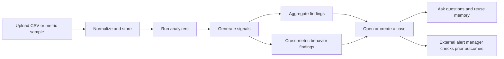
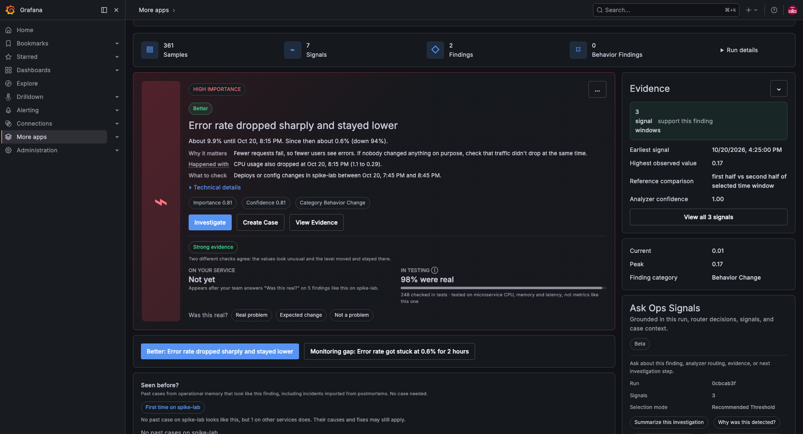

# Ops Signals

[](https://github.com/ramprasadgk9/operational-intelligence/actions/workflows/ci.yml)
[](LICENSE)
[](https://github.com/ramprasadgk9/operational-intelligence/releases)

Ops Signals is a vendor-neutral Operational Intelligence framework that transforms time-series data into explainable findings, investigation cases, and searchable operational memory.

It is designed to help teams move from raw metrics to actionable operational context without replacing existing observability or incident platforms.

Designed and implemented by Ramprasad Goturkarnam ([@ramprasadgk9](https://github.com/ramprasadgk9)), who is also the project's primary contributor and maintainer. See [`docs/original-contribution.md`](docs/original-contribution.md) for a technical writeup of what's original about the architecture.

New here? [`docs/README.md`](docs/README.md) is a guided path through every doc referenced below.

## Table of Contents

- [1. In One Sentence](#1-in-one-sentence)
- [2. The Problem](#2-the-problem)
- [3. What Ops Signals Does](#3-what-ops-signals-does)
  - [3.1 What Makes It Different](#31-what-makes-it-different)
  - [3.2 How It Works](#32-how-it-works)
  - [3.3 Current Capabilities](#33-current-capabilities)
- [4. Product Overview](#4-product-overview)
  - [4.1 Product Preview](#41-product-preview)
  - [4.2 Operational Findings](#42-operational-findings)
  - [4.3 Operational Cases](#43-operational-cases)
  - [4.4 Operational Intelligence Assistant](#44-operational-intelligence-assistant)
  - [4.5 Autonomous Analysis](#45-autonomous-analysis)
- [5. Architecture](#5-architecture)
  - [5.1 High-Level Architecture](#51-high-level-architecture)
  - [5.2 Architecture Deep Dive](#52-architecture-deep-dive)
  - [5.3 Analysis Pipeline](#53-analysis-pipeline)
  - [5.4 Storage Architecture](#54-storage-architecture)
- [6. Quick Start](#6-quick-start)
  - [6.1 Prerequisites](#61-prerequisites)
  - [6.2 Clone the Repository](#62-clone-the-repository)
  - [6.3 Run Setup](#63-run-setup)
  - [6.4 Start Ops Signals](#64-start-ops-signals)
  - [6.5 Open the Application](#65-open-the-application)
  - [6.6 Connect a Data Source](#66-connect-a-data-source)
  - [6.7 Optional: Enable Local AI](#67-optional-enable-local-ai)
  - [6.8 Troubleshooting](#68-troubleshooting)
  - [Scripts Reference](#scripts-reference)
- [7. Using Ops Signals](#7-using-ops-signals)
  - [7.1 UI Tour](#71-ui-tour)
  - [7.2 Interactive Analysis](#72-interactive-analysis)
  - [7.3 Analyzers](#73-analyzers)
  - [7.4 Behavioral Intelligence](#74-behavioral-intelligence)
  - [7.5 Analyzer Workbench](#75-analyzer-workbench)
  - [7.6 Investigations and Cases](#76-investigations-and-cases)
  - [7.7 Operational Intelligence Assistant](#77-operational-intelligence-assistant)
  - [7.8 Historical Analysis](#78-historical-analysis)
- [8. Data, Automation & Configuration](#8-data-automation--configuration)
  - [8.1 Data Sources](#81-data-sources)
    - [8.1.1 Prometheus](#811-prometheus)
    - [8.1.2 CSV Input](#812-csv-input)
  - [8.2 Autonomous Analysis](#82-autonomous-analysis)
    - [8.2.1 Configuring Autonomous Analysis](#821-configuring-autonomous-analysis)
    - [8.2.2 Scheduler](#822-scheduler)
    - [8.2.3 Metric Discovery and Selection](#823-metric-discovery-and-selection)
    - [8.2.4 Multi-Metric Retrieval](#824-multi-metric-retrieval)
    - [8.2.5 Batch Processing](#825-batch-processing)
    - [8.2.6 Continuous Analysis](#826-continuous-analysis)
    - [8.2.7 Run History and Results](#827-run-history-and-results)
  - [8.3 YAML Configuration](#83-yaml-configuration)
    - [8.3.1 Analyzer Configuration](#831-analyzer-configuration)
    - [8.3.2 Behavior Rules](#832-behavior-rules)
    - [8.3.3 Thresholds and Parameters](#833-thresholds-and-parameters)
- [9. Integrations](#9-integrations)
  - [9.1 Grafana Plugin](#91-grafana-plugin)
  - [9.2 MCP Server](#92-mcp-server)
- [10. Storage & Internals](#10-storage--internals)
  - [10.1 PostgreSQL](#101-postgresql)
  - [10.2 Qdrant](#102-qdrant)
  - [10.3 PostgreSQL vs. Qdrant](#103-postgresql-vs-qdrant)
- [11. Examples](#11-examples)
  - [11.1 Example Operational Finding](#111-example-operational-finding)
  - [11.2 Example Operational Case Lifecycle](#112-example-operational-case-lifecycle)
  - [11.3 Example Autonomous Analysis Run](#113-example-autonomous-analysis-run)
- [12. Current Limitations](#12-current-limitations)
- [13. Roadmap](#13-roadmap)
- [Who's Using Ops Signals?](#whos-using-ops-signals)
- [14. Contributing](#14-contributing)
- [15. License](#15-license)

## 1. In One Sentence

Upload a metric time series, let the analyzers explain what changed, promote important findings into cases, and reuse prior cases as searchable operational memory.

## 2. The Problem

Raw time-series points are noisy, high-volume, and hard to reason about directly. A dashboard can
plot them, but plotting them isn't the same as explaining them - and today those two get treated as
if they were the same thing.

Take a concrete example: `payments-api` `cpu_usage` climbs from ~78% to ~95% over an hour.

- **A dashboard shows the line moved, not why that matters.** Grafana renders the series and, at
  best, flags a threshold breach - it doesn't expose what detection logic decided this mattered,
  and there's no way to change that logic without hand-editing dashboard JSON or alert rules.
- **A number isn't an explanation.** "95%" doesn't say whether this is a new baseline, a one-off
  spike, or a slow trend - someone still has to eyeball the graph and decide.
- **Once you know something's wrong, dashboards stop there.** There's no next step - no
  investigation trail, no prompt for what to check first.
- **If you do investigate and file a Jira ticket, the work mostly dies in that ticket.** The root
  cause and the fix that worked sit in a ticket nobody queries again until the same pattern shows
  up on a different service months later, and someone reinvestigates from zero.
- **None of that accumulated experience feeds back into anything.** It doesn't inform the next
  alert, the next dashboard, or the next engineer's triage - it isn't stored anywhere a system (or
  a person) can ask "have we seen this before, and what fixed it?"

Ops Signals is built to close each of those gaps, one to one:

1. **Explainable findings, not just a plotted line.** Analyzers run against the metric and produce
   a stated conclusion ("sustained baseline shift," "anomalous window") - the logic is visible and
   swappable, not a fixed threshold buried in dashboard JSON.
2. **A written explanation, not just a number.** Every finding carries a plain-language summary
   ("CPU spike on payments-api ... sustained elevated utilization") alongside the raw score - see
   [Example Operational Finding](#111-example-operational-finding).
3. **A case gives you the next step.** A finding can be promoted into a case with investigation,
   RCA, and resolution fields - so "something's wrong" turns into "here's what to check and track."
4. **A resolved case becomes golden data, not a dead ticket.** Once a case is resolved, it's
   automatically indexed into Qdrant - the root cause and fix stay retrievable instead of sitting
   in a ticket nobody reopens.
5. **That golden data feeds back into the loop.** `GET /api/alert-context` lets an external
   system - the Intelligent Alert Manager described in
   [Architecture Deep Dive](#52-architecture-deep-dive) - ask "has this happened before, was it
   real, how was it resolved" *before* it pages anyone, instead of starting from zero every time.

See [`docs/01-vision.md`](docs/01-vision.md) for the fuller five-layer narrative behind this.

Ops Signals adds structure around that data by turning canonical CSV inputs into:

- normalized time-series points
- analyzer-generated signals
- aggregated operational findings
- behavior findings from declarative multi-signal rules
- operational cases with investigation and RCA lifecycle fields
- Qdrant-backed semantic retrieval for similar cases
- analyzer recommendations for selecting suitable metric analyzers from a sample

## 3. What Ops Signals Does

- Ingests canonical CSV time-series data
- Normalizes and stores points in PostgreSQL
- Runs pluggable analyzers for baseline shift, anomaly, and trend detection
- Adds optional STUMPY pattern discovery and Prophet forecasting analyzers
- Aggregates signals into operational findings
- Evaluates declarative behavior definitions across multiple signals
- Creates operational cases for investigation, RCA, resolution, and outcome tracking
- Indexes case summaries into Qdrant for historical similarity search
- Serves a React frontend and FastAPI backend for review and exploration

### 3.1 What Makes It Different

- It's open and self-hostable, not a closed black box
- It treats detector output as input to higher-level operational interpretation, not the end product
- It adds a separate behavior reasoning layer for cross-metric patterns, instead of bolting rules onto individual metrics
- It emphasizes deterministic, explainable answers over free-form generation
- It keeps PostgreSQL as the system of record and Qdrant as a semantic retrieval index - never the other way around
- It shows which analyzers and signals contributed to each result, not just a final score

### 3.2 How It Works

```text
CSV / metric sample
  -> normalization
  -> analyzers (router-selected; an optional AI second opinion may flag disagreement, never overrides it)
  -> signals
  -> findings, and separately cross-metric behavior findings
  -> either can become a case (RCA, resolution, recorded outcome)
  -> PostgreSQL (system of record) + Qdrant (semantic index)
  -> consumed by: the in-app assistant, Grafana, or an external alert manager checking prior
     outcomes before it acts
```



This is not a replacement for Prometheus, Datadog, Grafana, or incident-management platforms.
It does not currently perform autonomous remediation.
Historical similarity does not prove two cases share the same root cause.

### 3.3 Current Capabilities

- Canonical CSV ingestion
- Normalization into PostgreSQL
- Config-driven analyzer registry, extensible without touching core code - see [Analyzers](#73-analyzers)
- Signal generation and aggregation into findings
- Behavior intelligence for cross-metric operational patterns, promotable to a case with the same
  RCA/resolution/outcome lifecycle as a single-metric finding
- Operational case lifecycle fields for investigation, RCA, corrective action, and outcome
- Qdrant-based operational memory for similar-case retrieval, with automatic indexing on case create/update
- Analyzer recommendation flow for profiling metric samples and ranking analyzers, with an optional
  AI second opinion that scores independently and surfaces disagreement with the router - it never
  silently overrides the router's pick
- `GET /api/alert-context` - a pre-alert lookup an external system can call for prior outcomes,
  similar resolved cases, and raw recurrence before it acts, not just a human browsing after the fact
- Autonomous Prometheus monitoring - configure scope and policy, run once or on a recurring
  schedule, see results inline
- A benchmark suite validating router accuracy, detection accuracy, false-positive behavior, and Behavior Intelligence against known-answer datasets - see [`benchmark/README.md`](benchmark/README.md)
- React UI for findings, questions, signals, cases, and history

Every detection analyzer is a published, peer-reviewed method, not invented here - see
[`docs/26-analyzer-methodology.md`](docs/26-analyzer-methodology.md) for citations. The router's
suitability *scores* are heuristic and not yet validated against outcomes; that same document says
so plainly and links to the tracking infrastructure built to close that gap.

## 4. Product Overview

Ops Signals ships as a standalone operational intelligence workspace and a Grafana plugin. This
section is what each surface looks like and produces; [Using Ops Signals](#7-using-ops-signals)
below is how to actually work with each piece.

### 4.1 Product Preview

**[View the complete screenshot gallery](docs/screenshots.md)**

#### Standalone Operational Intelligence Workspace


#### Analyze Prometheus Data Directly


#### Investigate and Preserve Operational Knowledge


#### Run Analysis Inside Grafana



#### Two ways to use Ops Signals

- **Standalone Web UI:** Supports CSV upload, direct Prometheus analysis, findings, cases, behavior intelligence, operational memory, and assistant retrieval.
- **Grafana Plugin:** Supports metric analysis within an existing Grafana and Prometheus environment using the active Grafana time range.

### 4.2 Operational Findings

Operational findings are the intermediate interpretation layer between signals and cases - they
group raw analyzer evidence into a human-readable operational statement (title, summary, category,
health status, importance score) instead of leaving you to read raw detector output. See
[Example Operational Finding](#111-example-operational-finding) and
[`docs/06-operational-findings.md`](docs/06-operational-findings.md) for the full model.

### 4.3 Operational Cases

A case turns a finding into a trackable investigation object, moving through
`open -> investigating -> rca_in_progress -> resolved -> closed`. See
[Investigations and Cases](#76-investigations-and-cases),
[Example Operational Case Lifecycle](#112-example-operational-case-lifecycle), and
[`docs/07-operational-cases.md`](docs/07-operational-cases.md) for the full lifecycle.

### 4.4 Operational Intelligence Assistant

Ops Signals includes a single chat interface, **Ask Ops Signals**, for asking natural-language
questions across cases, findings, behaviors, analyzers, and documentation - grounded in retrieval
by default, not free-form generation. See
[Operational Intelligence Assistant](#77-operational-intelligence-assistant) under Using Ops
Signals for exactly what it can and can't do, and how to turn on local AI-assisted answers.

### 4.5 Autonomous Analysis

Configure which services and metrics to watch, preview the resulting Prometheus metric plan, run
it once, or save it as a recurring schedule - available in both the standalone UI
(`Autonomous Analysis Configure`) and the Grafana plugin. See
[Autonomous Analysis](#82-autonomous-analysis) under Data, Automation & Configuration for the full
reference.

## 5. Architecture

How the pieces fit together end to end: the pipeline, the storage split, and the boundary between
interactive and autonomous execution.

### 5.1 High-Level Architecture

```text
Canonical CSV / Prometheus
  -> Validation
  -> Normalization
  -> PostgreSQL
  -> Analyzer Registry (router-selected, bounded, deterministic; optional AI second opinion, advisory only)
  -> Signals
  -> Finding Aggregator, and separately Behavior Intelligence (cross-metric)
  -> Operational Findings, and Behavior Findings
  -> Operational Cases (either can be promoted, same RCA/resolution/outcome lifecycle)
  -> Embedding Service
  -> Qdrant
  -> Similar-Case / Alert-Context Retrieval
  -> Analyzer Recommendation
  -> React UI, Ask Ops Signals, or an external alert manager (via GET /api/alert-context)
```

A more detailed version of this diagram, with per-stage code references, lives in
[`docs/02-architecture.md`](docs/02-architecture.md).

### 5.2 Architecture Deep Dive

The full pipeline, the data model, how operational memory works, and why PostgreSQL and Qdrant are
split the way they are:

- [`docs/02-architecture.md`](docs/02-architecture.md) - the full pipeline, a diagram, and a "Why
  This Reduces MTTR" section connecting it to operational outcomes.
- [`docs/03-core-domain-model.md`](docs/03-core-domain-model.md) - the data model: canonical
  points, signals, and the fields on each.
- [`docs/09-design-decisions.md`](docs/09-design-decisions.md) - the "why," in short ADR-style
  writeups.
- [`docs/17-standalone-overview-api.md`](docs/17-standalone-overview-api.md) - the Overview
  summary and memory statistics endpoint contracts.
- [`docs/18-standalone-prometheus-analysis.md`](docs/18-standalone-prometheus-analysis.md) - the
  direct Prometheus query flow and how it differs from Grafana datasource-based analysis.

### 5.3 Analysis Pipeline

Ops Signals runs two separate pipelines behind the same analyzers and routing logic:
**Interactive Analysis** (`SignalPipeline`, used by Grafana, REST, CSV, and the CLI) and
**Autonomous Analysis** (`MetricAnalysisExecutor`, used by the scheduler). They share the Universal
Router and analyzer implementations but not orchestration code. See
[`docs/autonomous-pipeline-architecture.md`](docs/autonomous-pipeline-architecture.md) for the full
component boundary table.

### 5.4 Storage Architecture

PostgreSQL is the system of record; Qdrant is a semantic retrieval index built from it - never the
reverse. See [PostgreSQL vs. Qdrant](#103-postgresql-vs-qdrant) for the field-level breakdown, and
[`docs/09-design-decisions.md`](docs/09-design-decisions.md) for why they're split this way.

## 6. Quick Start

### 6.1 Prerequisites

- **Git**
- **Docker**, with Compose v2 (the `docker compose` command, not the older standalone `docker-compose`) - runs PostgreSQL/TimescaleDB and Qdrant for you
- **Python 3.11, 3.12, or 3.14** - 3.13 is explicitly not supported by `scripts/setup.sh`
- **Node.js 20+** and npm - for the React frontend
- *(Optional)* **Ollama** - only needed for local AI-assisted answers (see [Enable Local AI](#67-optional-enable-local-ai)); everything works without it
- macOS or Linux (the scripts are bash-based; on Windows, use WSL)

Check what you already have installed:

```bash
docker compose version
python3 --version
node --version
```

### 6.2 Clone the Repository

```bash
git clone https://github.com/ramprasadgk9/operational-intelligence.git
cd operational-intelligence
```

### 6.3 Run Setup

```bash
./scripts/setup.sh
```

This creates a Python virtualenv and installs dependencies, runs `npm install` for the frontend, starts PostgreSQL and Qdrant in Docker, waits for both to report healthy, and initializes the database schema. First run pulls Docker images and packages, so expect it to take a few minutes. You'll see `Setup complete.` printed at the end.

### 6.4 Start Ops Signals

```bash
./scripts/run_all.sh
```

This starts the backend (`:8001`), frontend (`:5174`), Postgres, Qdrant, Prometheus, and mock metrics together, all from one command.

### 6.5 Open the Application

Go to **http://localhost:5174** in your browser. You should see the Overview dashboard:


### 6.6 Connect a Data Source

Findings will be empty on a fresh install - that's expected, nothing has been analyzed yet. Go to
**New Analysis** and either upload a CSV (see [CSV Input](#812-csv-input) for the expected format)
or connect to a Prometheus datasource (see [Prometheus](#811-prometheus)) to generate your first
findings.

### 6.7 Optional: Enable Local AI

By default, Ask Ops Signals and the analyzer recommendation advisor run on deterministic retrieval and templates - no AI, no API key, no network calls out. To add local LLM-assisted answers on top of that (never instead of it - the deterministic behavior stays the fallback):

```bash
docker compose --profile ai up -d
```

This starts a local Ollama container and pulls a small default model (`qwen2.5:3b`, ~2GB, one-time download). Then point the backend at it:

```bash
OPS_SIGNALS_AI_ENABLED=1 OPS_SIGNALS_AI_PROVIDER=ollama ./scripts/run_all.sh
```

See [Operational Intelligence Assistant](#77-operational-intelligence-assistant) for exactly what changes when this is on.

### 6.8 Troubleshooting

| Symptom | Likely cause | Fix |
| --- | --- | --- |
| `docker is required` | Docker isn't installed, or the daemon isn't running | Install/start Docker Desktop (or Docker Engine on Linux) |
| `Unsupported Python version selected: 3.13` | System Python is 3.13, which `setup.sh` rejects | Install 3.11, 3.12, or 3.14, then run `PYTHON_BIN=python3.12 ./scripts/setup.sh` |
| `npm is required to install frontend dependencies` | Node.js/npm isn't installed | Install Node.js 20+ |
| `postgres did not become ready in time` or `qdrant did not become ready in time` | Docker is still starting, or the port is already taken | `docker compose ps` and `docker compose logs postgres` (or `qdrant`); confirm ports `5432`/`6333` are free |
| A port (`8001`, `5174`, `9090`) is already in use | Another process is bound to it | Stop that process, or see `scripts/run_all.sh` for the ports it uses |
| `permission denied` running a script | The script isn't marked executable | `chmod +x scripts/*.sh` |

### Scripts Reference

| Script | What it does | When to use it | Ports |
| --- | --- | --- | --- |
| `./scripts/setup.sh` | Installs Python and frontend deps, starts Postgres and Qdrant, and initializes the database. | First-time setup or after a clean checkout. | Postgres `5432`, Qdrant `6333` |
| `./scripts/run_all.sh` | Starts the standalone backend, frontend, Postgres, Qdrant, Prometheus, and mock metrics for the app. | Daily local development outside Grafana. | Backend `8001`, frontend `5174`, Prometheus `9090` |
| `./scripts/run_grafana_stack.sh` | Builds the Grafana plugin, starts Grafana, Prometheus, mock metrics, and the plugin backend. | Testing the Grafana plugin experience. | Grafana `3000`, Prometheus `9090`, backend `8002` |
| `./scripts/test_mcp.sh` | Starts the MCP server and verifies `initialize` and `tools/list`. | Checking MCP locally without Codex. | None; stdio only |
| `MCP_MODE=mcp-write ./scripts/test_mcp.sh` | Verifies the write-enabled MCP tool list. | Confirming write-capable tools are exposed. | None; stdio only |

`3000` is reserved for Grafana, `8002` for the Grafana/plugin backend - they don't conflict with the standalone app's `8001`/`5174`.

## 7. Using Ops Signals

Where to find each capability once the app is running, and what each surface actually does.

### 7.1 UI Tour

Every tab in the standalone web UI and every mode in the Grafana plugin, one line each - all
eleven standalone tabs (Overview, Autonomous Analysis Configure, Investigations, Findings, Cases,
Behavior Intelligence, Behavior Lab, Operational Memory, Ask Ops Signals, Experiments, New
Analysis) plus both Grafana plugin modes. See [`docs/ui-tour.md`](docs/ui-tour.md).

### 7.2 Interactive Analysis

Investigate one metric at a time: pick a Prometheus query or upload a CSV, run analyzers against
it, and inspect findings immediately - the **New Analysis** tab in the standalone UI, or
**Interactive Analysis** mode in the Grafana plugin. This is the `SignalPipeline` path described in
[Analysis Pipeline](#53-analysis-pipeline).

### 7.3 Analyzers

What an analyzer is, how the router picks one for a given metric, and how much to trust that pick -
covers the six built-in analyzers (Z-Score Anomaly, PyOD Outlier, Prophet Forecast, Ruptures
Change Point, STUMPY Motif, Trend) and the two-registry model that separates what *can* run from
what the router actually picks. See
[`docs/04-analyzer-plugin-framework.md`](docs/04-analyzer-plugin-framework.md) and
[`docs/16-analyzer-recommendation.md`](docs/16-analyzer-recommendation.md).

### 7.4 Behavioral Intelligence

Why cross-metric reasoning exists, and how to configure a behavior definition - includes a full
worked example: flagging memory pressure by correlating a memory trend or baseline-shift signal
with an error-rate anomaly inside the same time window. See
[`docs/14-behavior-intelligence.md`](docs/14-behavior-intelligence.md).

### 7.5 Analyzer Workbench

Running analyzers against sample data directly, adding your own, and previewing router
recommendations - grouped under **Experiments** in the web UI as three tools: **Labs** (run any
built-in analyzer against sample data and inspect its raw output), **Add Analyzer** (the wizard for
registering a new one), and **Recommendations** (the router's live scoring preview for a given
series). See
[`docs/04-analyzer-plugin-framework.md#analyzer-workbench-ui`](docs/04-analyzer-plugin-framework.md#analyzer-workbench-ui).

### 7.6 Investigations and Cases

The **Investigations** tab is an ad-hoc view for digging into a single metric or service outside
the autonomous flow. **Cases** lists every case with its lifecycle state, RCA, and outcome. See
[Operational Cases](#43-operational-cases) and
[`docs/07-operational-cases.md`](docs/07-operational-cases.md).

### 7.7 Operational Intelligence Assistant

Ops Signals includes a single chat interface ("Ask Ops Signals") that routes questions across
historical cases, current findings, behaviors, analyzers, and application documentation. The
assistant should be treated as a retrieval and explanation layer, not as an oracle.

By default it runs on deterministic retrieval and template answers - no AI required. Point it at
a local model (self-hosted via Ollama, `docker compose --profile ai up`; no API key, no cloud
calls) and it additionally gets:

- LLM-synthesized answers grounded in the same retrieved evidence, instead of a fixed template
- LLM-assisted question routing on top of (never instead of) the deterministic keyword router, so
  a weaker model can only add coverage, never lose it
- Semantic search over cases, findings, and behaviors, not just keyword matching

Every response labels which mode produced it (`ai_synthesis_used`), so it's never ambiguous
whether an answer came from a model or from a template.

#### What users can expect

- Ask natural-language questions about findings, cases, signals, behaviors, analyzers, and architecture
- Retrieve relevant cases, documentation, and evidence from vector search
- Get plain-language summaries grounded in stored operational data and repo docs
- Ask follow-up questions like "what changed?", "have we seen this before?", or "what is behavior intelligence?"
- See source links, case IDs, or documentation references used in the answer

#### What users should not expect

- Guaranteed root-cause truth from the chat output alone
- Autoremediation or direct system changes
- Free-form guesses without evidence
- Answers that go beyond the stored data, docs, and retrieval context
- Replacement for the underlying analyzers, rules, or source observability tools

### 7.8 Historical Analysis

Search and browse prior cases and findings semantically instead of starting an investigation from
zero - the **Operational Memory** tab in the standalone UI, which also shows the same
alert-context preview an external alert manager would see. See
[`docs/08-operational-memory.md`](docs/08-operational-memory.md).

## 8. Data, Automation & Configuration

How data gets in, how autonomous scanning decides what to watch, and how to tune analyzer and
behavior config.

### 8.1 Data Sources

#### 8.1.1 Prometheus

Connect Ops Signals to an existing Prometheus datasource for direct or autonomous analysis. See
[`docs/18-standalone-prometheus-analysis.md`](docs/18-standalone-prometheus-analysis.md).

#### 8.1.2 CSV Input

```csv
timestamp,service,metric_name,value,env,host,namespace,pod,unit,metric_type
2026-07-12T14:00:00Z,payments-api,cpu_usage,78.2,prod,ip-10-0-1-5,,payments-7d8c9,percent,gauge
2026-07-12T14:01:00Z,payments-api,cpu_usage,84.6,prod,ip-10-0-1-5,,payments-7d8c9,percent,gauge
```

### 8.2 Autonomous Analysis

Configuring how the autonomous scheduler decides what to watch and when to run. See
[`docs/autonomous-analysis-preview.md`](docs/autonomous-analysis-preview.md) and
[`docs/autonomous-pipeline-architecture.md`](docs/autonomous-pipeline-architecture.md) for the
underlying model.

#### 8.2.1 Configuring Autonomous Analysis

Autonomous analysis previews concrete Prometheus metric jobs from three inputs: monitoring intent
(categories like performance, capacity, availability, or custom), analysis scope (environment,
service, namespace, and the Prometheus labels that identify them), and execution policy (interval,
analysis window, max metrics per run, max parallel jobs - though that last one is currently
reserved rather than enforced, see [Batch Processing](#825-batch-processing)). See
[`docs/autonomous-analysis-preview.md`](docs/autonomous-analysis-preview.md).

#### 8.2.2 Scheduler

A policy can run once on demand or be saved as a recurring schedule (a `Run once` / `Scheduled`
toggle, plus a `Run every` interval) backed by an in-process scheduler. Each policy tracks
`schedule_minutes`, `next_run_at`, `last_run_status`, and `consecutive_failures`, so a failing
schedule surfaces instead of silently going quiet.

#### 8.2.3 Metric Discovery and Selection

Metric classification is layered - custom explicit metrics, custom include patterns, exact known
metric mappings (e.g. `cpu_usage`, `request_latency_p95`), configured name patterns, then
exclusions and selected-category filtering - driven by
`config/prometheus_metric_knowledge.yaml` and `config/autonomous_metric_taxonomy.yaml`. Discovery
pushes label scoping down to Prometheus and uses anti-starvation dynamic quota sampling so one
noisy service can't crowd out the rest of the scope.

#### 8.2.4 Multi-Metric Retrieval

*(Planned - not yet documented separately from
[Metric Discovery and Selection](#823-metric-discovery-and-selection) above.)*

#### 8.2.5 Batch Processing

Execution respects `max_metrics_per_run` (default 500, max 5,000): when classification selects
more metrics than that budget, the top-ranked ones run and the rest are excluded with
`exclusion_reason="budget_limit"`, surfaced as `budget_limited_jobs` and `budget_excluded_metrics`.
Every run is independent - excluded metrics are **not** deferred or carried over to the next run;
for broader coverage, raise `max_metrics_per_run` or narrow scope with service/namespace filters.
`max_parallel_jobs` (default 20, max 200) is stored per policy but not yet enforced - execution
runs sequentially, in a single transaction loop, to keep ordering deterministic and preserve
database transactional safety across SQLite and PostgreSQL. See
[`docs/autonomous-analysis-preview.md`](docs/autonomous-analysis-preview.md#execution-budget--independent-run-model)
and
[`docs/autonomous-pipeline-architecture.md`](docs/autonomous-pipeline-architecture.md#execution-budget--concurrency-policies).

#### 8.2.6 Continuous Analysis

Overlaps with [Scheduler](#822-scheduler) above - a saved schedule is what makes analysis
continuous rather than one-off. *(A dedicated write-up distinguishing the two is planned.)*

#### 8.2.7 Run History and Results

The **Overview** tab (standalone UI) and the Grafana plugin's **Autonomous Analysis** →
**Overview** stage show the latest run's findings, coverage details, and history for a saved
policy - including `budget_limited_jobs` and `budget_excluded_metrics` from the policy's run
history, so a policy that has outgrown its execution budget is visible there, not just in a single
run's response.

### 8.3 YAML Configuration

```yaml
output:
  save_signals: true
  save_findings: true
  save_embeddings: true
memory:
  enabled: true
  provider: qdrant
  vector_store:
    url: http://localhost:6333
    collection_name: operational_cases
  embedding:
    model: sentence-transformers/all-MiniLM-L6-v2
    normalize_embeddings: true
```

#### 8.3.1 Analyzer Configuration

Shared analysis mode, window, and analyzer defaults live in `config/analyzers.yaml`;
provider-specific input mapping lives in `config/providers/*.yaml`. See
[`docs/15-configuration.md`](docs/15-configuration.md) for the merge order and file layout.

#### 8.3.2 Behavior Rules

Cross-metric behavior definitions live in `config/behavior_definitions.d/*.yml` - one file per
behavior, evaluated as facts against analyzer output. See
[`docs/14-behavior-intelligence.md`](docs/14-behavior-intelligence.md) for a full worked example.

#### 8.3.3 Thresholds and Parameters

Per-analyzer defaults (window size, sensitivity) are set in `config/analyzers.yaml`. The Universal
Router's suitability-scoring weights are documented separately since they're heuristic, not a
threshold you tune directly - see
[`docs/16-analyzer-recommendation.md`](docs/16-analyzer-recommendation.md).

## 9. Integrations

Two ways to plug Ops Signals into tools you already use.

### 9.1 Grafana Plugin

```bash
./scripts/run_grafana_stack.sh
```

That script builds the plugin bundle, starts Grafana on `3000`, Prometheus on `9090`, mock metrics, and the backend on `8002`. `8002` is reserved for the Grafana/plugin backend.

See [`docs/grafana-plugin-local-setup.md`](docs/grafana-plugin-local-setup.md) for installing the
plugin specifically, and
[`docs/grafana-plugin-feature-walkthrough.md`](docs/grafana-plugin-feature-walkthrough.md) for a
tour of Interactive Analysis and Autonomous Analysis inside Grafana.

### 9.2 MCP Server

The MCP server runs over stdio from the existing CLI:

```bash
./.venv/bin/python -m intelligence.cli mcp
./.venv/bin/python -m intelligence.cli mcp-write
```

To test it directly:

```bash
./scripts/test_mcp.sh
MCP_MODE=mcp-write ./scripts/test_mcp.sh
```

The test script launches the stdio server and verifies `initialize` plus `tools/list`.

Example MCP client configuration:

```json
{
  "mcpServers": {
    "ops-signals": {
      "command": "python",
      "args": ["-m", "intelligence.cli", "mcp"],
      "cwd": "/path/to/operational-intelligence"
    }
  }
}
```

Use `mcp-write` instead of `mcp` if the client should be allowed to call case update and memory indexing tools.

## 10. Storage & Internals

The two storage layers underneath everything above, and why they're split.

### 10.1 PostgreSQL

PostgreSQL stores analysis runs, normalized points, signals, findings, cases, and investigation
state - it is the system of record for everything Ops Signals writes.

### 10.2 Qdrant

Qdrant stores embeddings and retrieval metadata for semantic lookup - the retrieval index, never
the source of truth.

### 10.3 PostgreSQL vs. Qdrant

- PostgreSQL is the system of record.
- Qdrant is the semantic retrieval index built from it, kept in sync on case create/update.
- Nothing is ever written to Qdrant that isn't also in PostgreSQL first.

See [`docs/09-design-decisions.md`](docs/09-design-decisions.md) for why they're split this way,
and [Storage Architecture](#54-storage-architecture) for how that plays into the pipeline.

## 11. Examples

### 11.1 Example Operational Finding

```json
{
  "title": "CPU spike on payments-api",
  "summary": "The current window is materially above the previous baseline and shows sustained elevated utilization.",
  "category": "anomaly",
  "health_status": "critical",
  "importance_score": 0.93
}
```

### 11.2 Example Operational Case Lifecycle

1. A finding is promoted into a case.
2. Investigation notes are added during review.
3. RCA fields are filled in when a cause is known.
4. Corrective action and outcome are recorded.
5. The case is indexed into Qdrant for future retrieval.

### 11.3 Example Autonomous Analysis Run

*(Planned - not yet documented. Will walk through a saved autonomous policy end to end: scope
configuration, a scheduled run, and the resulting findings/coverage in the Overview tab.)*

## 12. Current Limitations

- No autonomous remediation
- No claim that similarity equals root-cause equivalence
- Historical retrieval depends on the quality of stored summaries and metadata
- Some memory workflows are still evolving and should be treated as operational assistance, not automation
- Analyzer recommendation scoring is deterministic and currently profile-based; it does not yet run deeper analyzer-specific probes

## 13. Roadmap

- Expand analyzer coverage
- Improve operational memory retrieval filters
- Add richer case comparison and retrieval views
- Extend evaluation datasets for regression checks
- Document release and contribution workflows more fully
- Kubernetes, cloud-provider, and OpenTelemetry ingestion; ITSM/automation and generic
  external-system consumers - see the explicitly-labeled roadmap section in
  [`docs/02-architecture.md`](docs/02-architecture.md#roadmap-not-yet-implemented)

## Who's Using Ops Signals?

If you're running Ops Signals somewhere - production, staging, or just evaluating it - we'd like to know. Add yourself to [ADOPTERS.md](ADOPTERS.md) via a short PR, or open an issue if a PR is more than you want to do.

## 14. Contributing

See [CONTRIBUTING.md](CONTRIBUTING.md).

## 15. License

See [LICENSE](LICENSE).
