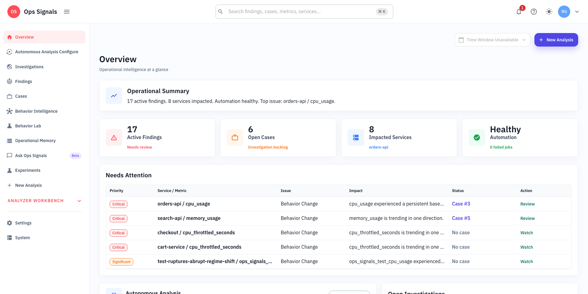
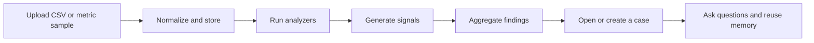

# Ops Signals

Ops Signals is a vendor-neutral Operational Intelligence framework that transforms time-series data into explainable findings, investigation cases, and searchable operational memory.

It is designed to help teams move from raw metrics to actionable operational context without replacing existing observability or incident platforms.

## In One Sentence

Upload a metric time series, let the analyzers explain what changed, promote important findings into cases, and reuse prior cases as searchable operational memory.

## What Users Gain

- Faster triage from raw data to explainable findings
- A consistent path from signal to case to resolution
- Visibility into which analyzers and signals contributed to each result
- A reusable memory layer for similar cases and prior context
- An open, self-hostable workflow instead of a closed black box

## Product Preview

Ops Signals is available through a standalone operational intelligence workspace and a Grafana plugin.

**[View the complete screenshot gallery](docs/screenshots.md)**

### Standalone Operational Intelligence Workspace



### Analyze Prometheus Data Directly


### Investigate and Preserve Operational Knowledge


### Run Analysis Inside Grafana


### Two ways to use Ops Signals

- **Standalone Web UI:** Supports CSV upload, direct Prometheus analysis, findings, cases, behavior intelligence, operational memory, and assistant retrieval.
- **Grafana Plugin:** Supports metric analysis within an existing Grafana and Prometheus environment using the active Grafana time range.

## Problem

Raw time-series points are noisy, high-volume, and hard to reason about directly. Detector outputs alone can tell you that something changed, but not what it means, how severe it is, or how it relates to prior incidents.

Ops Signals adds structure around that data by turning canonical CSV inputs into:

- normalized time-series points
- analyzer-generated signals
- aggregated operational findings
- behavior findings from declarative multi-signal rules
- operational cases with investigation and RCA lifecycle fields
- Qdrant-backed semantic retrieval for similar cases
- analyzer recommendations for selecting suitable metric analyzers from a sample

## What It Does

- Ingests canonical CSV time-series data
- Normalizes and stores points in PostgreSQL
- Runs pluggable analyzers for baseline shift, anomaly, and trend detection
- Adds optional STUMPY pattern discovery and Prophet forecasting analyzers
- Aggregates signals into operational findings
- Evaluates declarative behavior definitions across multiple signals
- Creates operational cases for investigation, RCA, resolution, and outcome tracking
- Indexes case summaries into Qdrant for historical similarity search
- Serves a React frontend and FastAPI backend for review and exploration

## What Makes It Different

- It separates **source of truth** storage from **semantic retrieval**
- It treats detector output as input to higher-level operational interpretation
- It adds a separate behavior reasoning layer for cross-metric patterns
- It emphasizes deterministic, explainable answers over free-form generation
- It keeps PostgreSQL as the system of record and Qdrant as a retrieval index

## How It Works

```text
CSV / metric sample
  -> normalization
  -> analyzers
  -> signals
  -> findings
  -> cases
  -> memory / assistant
```



This is not a replacement for Prometheus, Datadog, Grafana, or incident-management platforms.
It does not currently perform autonomous remediation.
Historical similarity does not prove two cases share the same root cause.

## Current Capabilities

- Canonical CSV ingestion
- Normalization into PostgreSQL
- Config-driven analyzer registry, extensible without touching core code - see [Analyzer Plugin Framework](docs/04-analyzer-plugin-framework.md)
- Signal generation and aggregation into findings
- Behavior intelligence for cross-metric operational patterns
- Operational case lifecycle fields for investigation, RCA, corrective action, and outcome
- Qdrant-based operational memory for similar-case retrieval, with automatic indexing on case create/update
- Analyzer recommendation flow for profiling metric samples and ranking analyzers
- Autonomous Prometheus monitoring - configure scope and policy, run once, see results inline
- A benchmark suite validating router accuracy, detection accuracy, false-positive behavior, and Behavior Intelligence against known-answer datasets - see [`benchmark/README.md`](benchmark/README.md)
- React UI for findings, questions, signals, cases, and history

## Operational Intelligence Assistant

Ops Signals includes a single chat interface ("Ask Ops Signals") that routes questions across
historical cases, current findings, behaviors, analyzers, and application documentation. The
assistant should be treated as a retrieval and explanation layer, not as an oracle.

By default it runs on deterministic retrieval and template answers - no AI required. Point it at
a local model (self-hosted via Ollama, `docker compose --profile ai up`; no API key, no cloud
calls) and it additionally gets:

- LLM-synthesized answers grounded in the same retrieved evidence, instead of a fixed template
- LLM-assisted question routing on top of (never instead of) the deterministic keyword router, so
  a weaker model can only add coverage, never lose it
- Semantic search over cases, findings, and behaviors, not just keyword matching

Every response labels which mode produced it (`ai_synthesis_used`), so it's never ambiguous
whether an answer came from a model or from a template.

### What users can expect

- Ask natural-language questions about findings, cases, signals, behaviors, analyzers, and architecture
- Retrieve relevant cases, documentation, and evidence from vector search
- Get plain-language summaries grounded in stored operational data and repo docs
- Ask follow-up questions like "what changed?", "have we seen this before?", or "what is behavior intelligence?"
- See source links, case IDs, or documentation references used in the answer

### What users should not expect

- Guaranteed root-cause truth from the chat output alone
- Autoremediation or direct system changes
- Free-form guesses without evidence
- Answers that go beyond the stored data, docs, and retrieval context
- Replacement for the underlying analyzers, rules, or source observability tools

## High-Level Architecture

```text
Canonical CSV
  -> Validation
  -> Normalization
  -> PostgreSQL
  -> Analyzer Registry
  -> Signals
  -> Finding Aggregator
  -> Operational Findings
  -> Operational Cases
  -> Embedding Service
  -> Qdrant
  -> Similar-Case Retrieval
  -> Analyzer Recommendation
  -> React UI
```

## Quick Start

### Prerequisites

- **Git**
- **Docker**, with Compose v2 (the `docker compose` command, not the older standalone `docker-compose`) - runs PostgreSQL/TimescaleDB and Qdrant for you
- **Python 3.11, 3.12, or 3.14** - 3.13 is explicitly not supported by `scripts/setup.sh`
- **Node.js 20+** and npm - for the React frontend
- *(Optional)* **Ollama** - only needed for local AI-assisted answers (see [Operational Intelligence Assistant](#operational-intelligence-assistant)); everything works without it
- macOS or Linux (the scripts are bash-based; on Windows, use WSL)

Check what you already have installed:

```bash
docker compose version
python3 --version
node --version
```

### 1. Clone the repository

```bash
git clone https://github.com/ramprasadgk9/operational-intelligence.git
cd operational-intelligence
```

### 2. Run setup

```bash
./scripts/setup.sh
```

This creates a Python virtualenv and installs dependencies, runs `npm install` for the frontend, starts PostgreSQL and Qdrant in Docker, waits for both to report healthy, and initializes the database schema. First run pulls Docker images and packages, so expect it to take a few minutes. You'll see `Setup complete.` printed at the end.

### 3. Start the app

```bash
./scripts/run_all.sh
```

This starts the backend (`:8001`), frontend (`:5174`), Postgres, Qdrant, Prometheus, and mock metrics together, all from one command.

### 4. Open it

Go to **http://localhost:5174** in your browser. You should see the Overview dashboard:


Findings will be empty on a fresh install - that's expected, nothing has been analyzed yet. Go to **New Analysis** to upload a CSV or connect to Prometheus and generate your first findings; see [Canonical CSV Input](#canonical-csv-input) below for the expected format.

### 5. (Optional) Enable local AI

By default, Ask Ops Signals and the analyzer recommendation advisor run on deterministic retrieval and templates - no AI, no API key, no network calls out. To add local LLM-assisted answers on top of that (never instead of it - the deterministic behavior stays the fallback):

```bash
docker compose --profile ai up -d
```

This starts a local Ollama container and pulls a small default model (`qwen2.5:3b`, ~2GB, one-time download). Then point the backend at it:

```bash
OPS_SIGNALS_AI_ENABLED=1 OPS_SIGNALS_AI_PROVIDER=ollama ./scripts/run_all.sh
```

See [Operational Intelligence Assistant](#operational-intelligence-assistant) for exactly what changes when this is on.

### Troubleshooting

| Symptom | Likely cause | Fix |
| --- | --- | --- |
| `docker is required` | Docker isn't installed, or the daemon isn't running | Install/start Docker Desktop (or Docker Engine on Linux) |
| `Unsupported Python version selected: 3.13` | System Python is 3.13, which `setup.sh` rejects | Install 3.11, 3.12, or 3.14, then run `PYTHON_BIN=python3.12 ./scripts/setup.sh` |
| `npm is required to install frontend dependencies` | Node.js/npm isn't installed | Install Node.js 20+ |
| `postgres did not become ready in time` or `qdrant did not become ready in time` | Docker is still starting, or the port is already taken | `docker compose ps` and `docker compose logs postgres` (or `qdrant`); confirm ports `5432`/`6333` are free |
| A port (`8001`, `5174`, `9090`) is already in use | Another process is bound to it | Stop that process, or see `scripts/run_all.sh` for the ports it uses |
| `permission denied` running a script | The script isn't marked executable | `chmod +x scripts/*.sh` |

### Scripts

| Script | What it does | When to use it | Ports |
| --- | --- | --- | --- |
| `./scripts/setup.sh` | Installs Python and frontend deps, starts Postgres and Qdrant, and initializes the database. | First-time setup or after a clean checkout. | Postgres `5432`, Qdrant `6333` |
| `./scripts/run_all.sh` | Starts the standalone backend, frontend, Postgres, Qdrant, Prometheus, and mock metrics for the app. | Daily local development outside Grafana. | Backend `8001`, frontend `5174`, Prometheus `9090` |
| `./scripts/run_grafana_stack.sh` | Builds the Grafana plugin, starts Grafana, Prometheus, mock metrics, and the plugin backend. | Testing the Grafana plugin experience. | Grafana `3000`, Prometheus `9090`, backend `8002` |
| `./scripts/test_mcp.sh` | Starts the MCP server and verifies `initialize` and `tools/list`. | Checking MCP locally without Codex. | None; stdio only |
| `MCP_MODE=mcp-write ./scripts/test_mcp.sh` | Verifies the write-enabled MCP tool list. | Confirming write-capable tools are exposed. | None; stdio only |

`3000` is reserved for Grafana, `8002` for the Grafana/plugin backend - they don't conflict with the standalone app's `8001`/`5174`.

### Grafana / Plugin

Use this path for the Grafana plugin experience:

```bash
./scripts/run_grafana_stack.sh
```

That script builds the plugin bundle, starts Grafana on `3000`, Prometheus on `9090`, mock metrics, and the backend on `8002`.

`8002` is reserved for the Grafana/plugin backend.

### MCP

Use this path to test the MCP server directly:

```bash
./scripts/test_mcp.sh
MCP_MODE=mcp-write ./scripts/test_mcp.sh
```

The test script launches the stdio server and verifies `initialize` plus `tools/list`.

If you want to run the MCP server directly:

```bash
./.venv/bin/python -m intelligence.cli mcp
./.venv/bin/python -m intelligence.cli mcp-write
```

## MCP Server

The MCP server runs over stdio from the existing CLI.

Example MCP client configuration:

```json
{
  "mcpServers": {
    "ops-signals": {
      "command": "python",
      "args": ["-m", "intelligence.cli", "mcp"],
      "cwd": "/Users/ramprasad/Documents/workspace/github/ops-signals"
    }
  }
}
```

Use `mcp-write` instead of `mcp` if the client should be allowed to call case update and memory indexing tools.

## Canonical CSV Input

```csv
timestamp,service,metric_name,value,env,host,namespace,pod,unit,metric_type
2026-07-12T14:00:00Z,payments-api,cpu_usage,78.2,prod,ip-10-0-1-5,,payments-7d8c9,percent,gauge
2026-07-12T14:01:00Z,payments-api,cpu_usage,84.6,prod,ip-10-0-1-5,,payments-7d8c9,percent,gauge
```

## YAML Configuration

```yaml
output:
  save_signals: true
  save_findings: true
  save_embeddings: true
memory:
  enabled: true
  provider: qdrant
  vector_store:
    url: http://localhost:6333
    collection_name: operational_cases
  embedding:
    model: sentence-transformers/all-MiniLM-L6-v2
    normalize_embeddings: true
```

## Example Operational Finding

```json
{
  "title": "CPU spike on payments-api",
  "summary": "The current window is materially above the previous baseline and shows sustained elevated utilization.",
  "category": "anomaly",
  "health_status": "critical",
  "importance_score": 0.93
}
```

## Example Operational Case Lifecycle

1. A finding is promoted into a case.
2. Investigation notes are added during review.
3. RCA fields are filled in when a cause is known.
4. Corrective action and outcome are recorded.
5. The case is indexed into Qdrant for future retrieval.

## PostgreSQL Versus Qdrant

- PostgreSQL stores analysis runs, normalized points, signals, findings, cases, and investigation state.
- Qdrant stores embeddings and retrieval metadata for semantic lookup.
- PostgreSQL is the system of record.
- Qdrant is the semantic retrieval index.

See [Standalone Overview API](docs/17-standalone-overview-api.md) for the Overview summary and memory statistics endpoint contracts.
See [Standalone Prometheus Analysis](docs/18-standalone-prometheus-analysis.md) for the direct Prometheus query flow and how it differs from Grafana datasource-based analysis.

## Screenshots

See [Product Preview](#product-preview) above, or the [complete screenshot gallery](docs/screenshots.md) for every UI surface, standalone and Grafana plugin.

## Current Limitations

- No autonomous remediation
- No claim that similarity equals root-cause equivalence
- Historical retrieval depends on the quality of stored summaries and metadata
- Some memory workflows are still evolving and should be treated as operational assistance, not automation
- Analyzer recommendation scoring is deterministic and currently profile-based; it does not yet run deeper analyzer-specific probes

## Roadmap

- Expand analyzer coverage
- Improve operational memory retrieval filters
- Add richer case comparison and retrieval views
- Extend evaluation datasets for regression checks
- Document release and contribution workflows more fully

## Contributing

See [CONTRIBUTING.md](CONTRIBUTING.md).

## License

See [LICENSE](LICENSE).
