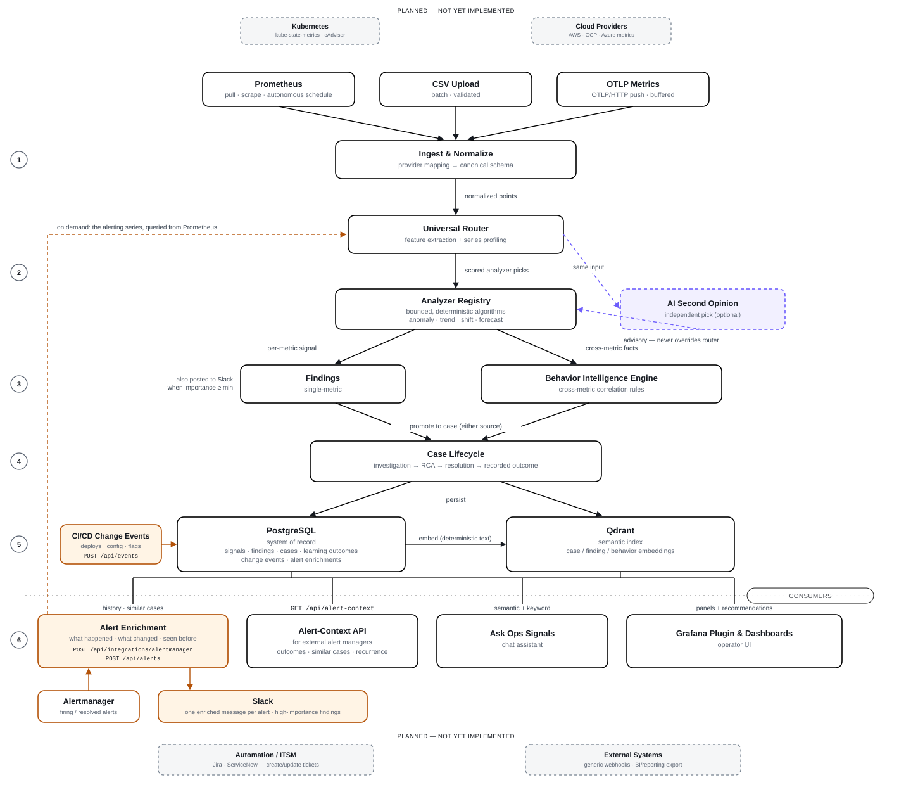
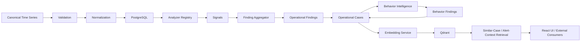

# Architecture

## Overview

**Figure 1.** Signal ingestion (Prometheus, CSV) is normalized, profiled, and routed to a bounded,
deterministic analyzer registry — an optional AI second opinion may diverge from the router's pick, but
only ever surfaces that divergence, never overrides it. Analyzer output becomes single-metric Findings
and, via cross-metric correlation rules, Behavior Findings; both can be promoted to a Case carrying an
RCA, a resolution, and a recorded outcome. Cases persist to PostgreSQL as the system of record and embed
into Qdrant as a semantic index. Three implemented consumers read from that shared store without writing
back to it: an external Intelligent Alert Manager consulting prior outcomes before it pages, the in-app
Ask Ops Signals assistant, and Grafana dashboards. The lighter dashed boxes at the top and bottom of the
figure (Kubernetes, cloud-provider metrics, OpenTelemetry, ITSM/automation, generic external systems) are
**not implemented** — they're kept in the figure as the acknowledged next-step surface, not as a claim
about current capability. See [Roadmap](#roadmap-not-yet-implemented) below.

A simplified, text-diffable version of the same flow (without the AI/consumer detail) lives at
[`diagrams/system-architecture.mmd`](diagrams/system-architecture.mmd):

(`K --> I` is the behavior-to-case promotion path — see [Case Lifecycle](#4-case-lifecycle) below.)

## Pipeline, Stage by Stage

### 1. Ingest

Two real sources today: Prometheus (pull/scrape) and CSV upload (validated batch). Provider-specific
columns are mapped to a canonical schema via `config/providers/*.yaml`, applied in
`intelligence/normalize/normalizer.py`. Counter-type metrics are resampled with `.last()` rather than
averaged, to preserve spikes instead of smoothing them away.

- `intelligence/adapters/csv_adapter.py`, `backend/app/api/ingestion.py`
- `intelligence/normalize/normalizer.py`

### 2. Route & Analyze

The Universal Router extracts features from the normalized series (seasonality, trend, variance, shift
index, ...) and scores which analyzers are eligible and suitable. The Analyzer Registry then runs the
bounded, deterministic analyzers the router picked — anomaly detection, trend regression, baseline-shift
detection, changepoint detection, forecasting — never an open-ended agent loop.

An **optional AI Second Opinion** can independently score the same input and return its own top pick.
When it disagrees with the router, that divergence is surfaced in the response — it never silently
overrides the router's decision. This is deliberate: the AI is a second set of eyes, not a second vote.

- `backend/app/metric_analyzer_recommendations/service.py` (`recommend()`, `recommend_ai_opinion()`)
- `backend/app/metric_analyzer_recommendations/gemma_advisor.py` (the AI second opinion)
- `intelligence/analyzers/*` (the analyzer implementations)

See [`docs/26-analyzer-methodology.md`](26-analyzer-methodology.md) for what each analyzer is
based on (all published methods, cited) versus the router's suitability scoring weights, which are
heuristic and not yet validated against real outcomes - and the tracking infrastructure
(`AnalyzerLearningOutcomeEntity`, `AnalyzerDivergenceEntity`) built to close that gap.

### 3. Find & Correlate

Per-metric analyzer output becomes a **Finding** (single-metric: "this metric had an anomaly/trend/shift").
The **Behavior Intelligence Engine** separately evaluates declarative, cross-metric rules
(`config/behavior_definitions.d/*.yml`) — e.g. "CPU anomaly + rising throttling in the same window" —
producing a **Behavior Finding**, which is generally closer to an actual root-cause story than any single
metric finding is on its own.

- `backend/app/api/findings.py`, `FindingEntity`
- `backend/app/behavior_intelligence/service.py`, `BehaviorFindingEntity`

### 4. Case Lifecycle

Either a Finding or a Behavior Finding can be promoted to a **Case**, which carries investigation notes,
an RCA (status, summary, confidence, verified flag), a corrective action, and a recorded outcome
(confirmed / rejected / partially confirmed / inconclusive). Resolving a case with a final outcome status
also writes an `AnalyzerLearningOutcomeEntity` row — the durable "here's what actually happened" record
downstream consumers query.

- `POST /api/cases/findings/{finding_id}/create`, `POST /api/cases/behaviors/{behavior_finding_id}/create`
- `backend/app/api/cases.py`, `OperationalCaseEntity`
- `backend/app/services/analyzer_learning_service.py`, `AnalyzerLearningOutcomeEntity`

### 5. Persist

**PostgreSQL** is the system of record: normalized points, signals, findings, cases, and learning
outcomes. **Qdrant** is a semantic retrieval index, never the source of truth — each case's deterministic
text representation (built by `CaseDocumentBuilder`, explicitly excluding raw JSON/IDs) is embedded and
upserted into the `operational_cases` collection.

- `backend/app/models/entities.py`
- `backend/app/memory/qdrant_initializer.py`, `backend/app/memory/document_builder.py`

### 6. Consume

Everything below this line only **reads** from PostgreSQL/Qdrant; nothing here writes back into them.

| Consumer | Mechanism | What it gets |
| --- | --- | --- |
| **Intelligent Alert Manager** (external) | `GET /api/alert-context?metric_name=&service=&message=` | Exact-match learning-outcome history, a computed `likely_real` / `likely_noise` / `insufficient_history` recommendation, semantically similar resolved cases, and raw finding/behavior recurrence even when no case was ever filed — meant to be queried **before** an external system fires a page. |
| **Ask Ops Signals** | `POST /api/assistant/chat` | Grounded conversational Q&A over cases, findings, and behaviors — semantic search when memory is enabled, keyword fallback otherwise. |
| **Grafana Plugin & Dashboards** | panel queries + recommendation preview | Operator-facing visualization inside Grafana. See [`grafana-plugin-architecture.md`](grafana-plugin-architecture.md). |

## Why This Reduces MTTR

The "Consume" stage above is where the architecture actually pays off operationally. An external
alert manager querying `GET /api/alert-context` *before* it pages someone gets a `likely_real` /
`likely_noise` recommendation plus similar past cases and their resolutions - so a page that fires
already comes with "here's what this probably is and how it was fixed last time," instead of an
engineer starting from zero. Fewer noise pages, and faster real ones: that's the mean-time-to-resolution
win. See [`docs/01-vision.md`](01-vision.md) for the fuller narrative behind this goal.

## Roadmap (Not Yet Implemented)

Shown as dashed, muted boxes in Figure 1 — explicitly **not** current capability:

- **Kubernetes** ingestion (kube-state-metrics, cAdvisor)
- **Cloud provider** metrics (AWS CloudWatch, GCP Monitoring, Azure Monitor)
- **OpenTelemetry Collector** ingestion
- **ITSM / automation** consumer (Jira, ServiceNow — create/update tickets, trigger workflows)
- Generic **external-system** consumer (arbitrary webhooks, BI/reporting export)

## Layer Responsibilities

- Canonical Time Series: source metric input (Prometheus or CSV today)
- Validation: checks structure and required fields
- Normalization: converts provider-specific inputs into a consistent schema
- PostgreSQL: persistent system of record
- Analyzer Registry: bounded, deterministic analyzers, selected by the Universal Router
- Signals: analyzer outputs
- Finding Aggregator: groups signals into higher-level findings
- Operational Findings: ranked interpretations of signal sets
- Operational Cases: investigation objects with lifecycle state, sourced from either a Finding or a
  Behavior Finding
- Behavior Intelligence: deterministic rule evaluation across multiple signals
- Behavior Findings: higher-level operational conditions produced by behavior rules
- Embedding Service: converts case text into vectors
- Qdrant: semantic retrieval index for similar cases
- Similar-Case / Alert-Context Retrieval: query-time search used by both the in-app assistant and the
  external Intelligent Alert Manager
- React UI / External Consumers: user-facing exploration, plus API-level consumers outside this codebase

## Backend

The FastAPI backend exposes ingestion, analysis, finding, case, capability, memory, and alert-context
routes. It also initializes PostgreSQL and Qdrant services at startup, and applies additive, non-Alembic
schema migrations (`backend/app/models/schema_compat.py`) so existing deployments pick up new nullable
columns without a destructive migration step.

## Frontend

The React frontend presents overview, findings, cases, signals, behavior intelligence, operational memory
(including the alert-context preview), questions, history, and settings pages.

## Source of Truth and Retrieval Index

### PostgreSQL

PostgreSQL stores:

- analysis runs
- normalized points
- signals
- findings
- cases (sourced from either a Finding or a Behavior Finding)
- investigation notes and lifecycle fields
- analyzer learning outcomes (the recorded result of a resolved case)

### Qdrant

Qdrant stores:

- embeddings for case documents (`operational_cases`)
- embeddings for raw findings/behaviors, indexed lazily on first search (`operational_findings`,
  `operational_behaviors`)
- retrieval metadata for semantic search

Qdrant should be treated as a retrieval index, not the authoritative record.

## Current State

Implemented:

- Prometheus and CSV ingestion into PostgreSQL
- analyzer-based signal generation via the Universal Router + Analyzer Registry
- optional AI second opinion on analyzer choice (advisory only, divergence surfaced, never authoritative)
- operational findings and cases
- behavior intelligence rule evaluation
- **behavior finding promotion into cases** (either a Finding or a Behavior Finding can become a Case)
- Qdrant indexing for operational memory (cases, findings, behaviors)
- `GET /api/alert-context` — pre-alert decision support for an external Intelligent Alert Manager
- `POST /api/assistant/chat` — grounded conversational Q&A ("Ask Ops Signals")

Experimental:

- richer retrieval filtering
- similarity-guided RCA assistance (draft-only, never auto-applied)

Planned:

- Kubernetes, cloud-provider, and OpenTelemetry ingestion (see [Roadmap](#roadmap-not-yet-implemented))
- ITSM/automation and generic external-system consumers (see [Roadmap](#roadmap-not-yet-implemented))
- improved UI for case exploration
