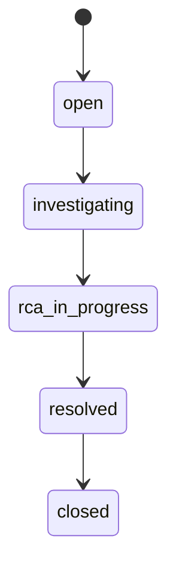

# Operational Cases

Operational cases turn a finding into a trackable investigation object.

## Lifecycle

## Case Fields

- investigation status
- investigation notes
- RCA status
- RCA summary
- RCA confidence
- verification flag
- corrective action
- outcome status
- outcome summary
- memory status

## Purpose

Cases help teams preserve context across investigation, RCA, and post-resolution review.

## Current State

Case tracking exists in the backend models and operational memory pipeline.
