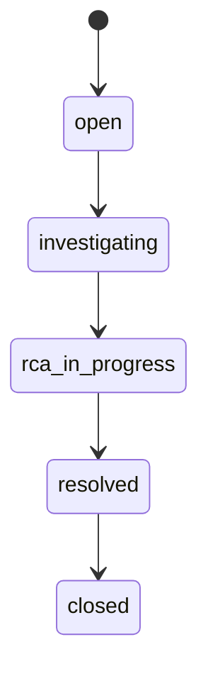

# Operational Cases

Operational cases turn a finding into a trackable investigation object.

## Lifecycle

## Example Lifecycle

1. A finding (or a behavior finding) is promoted into a case.
2. Investigation notes are added during review.
3. RCA fields are filled in when a cause is known.
4. Corrective action and outcome are recorded.
5. The case is indexed into Qdrant for future retrieval.

## Case Fields

- investigation status
- investigation notes
- RCA status
- RCA summary
- RCA confidence
- verification flag
- corrective action
- outcome status
- outcome summary
- memory status

## Purpose

Cases help teams preserve context across investigation, RCA, and post-resolution review.

## Ticketing Integration & Comment Promotion

When an operational case is linked to an external ticketing provider (e.g., Jira Cloud):
1. **Activity Feed Synchronization**: Remote ticket status changes and comments are synced into the case's external activity feed.
2. **1-Click Note Promotion**: Operators can elevate relevant external comments into official `investigation_notes` via `POST /api/cases/{case_id}/ticket/events/{event_id}/promote-to-note`.
   - Attaches provenance: `[{PROVIDER} note from {Author}]: {summary}`.
   - Automatically advances `investigation_status` from `not_started` to `in_progress`.
   - If the case was previously indexed in operational memory, flags `memory_status = "stale"` to ensure vector embeddings stay synchronized with PostgreSQL.
   - Enforces idempotency to prevent duplicate notes.
3. **AI Root Cause & Resolution Enrichment**: AI suggestion endpoints (`/api/cases/{case_id}/rca/suggest` and `/api/cases/{case_id}/resolution/suggest`) dynamically ingest external team observations from ticketing, filtering out already-promoted comments to eliminate duplicate tokens while capturing active incident context.
4. **Zero-Click AI Comment Relevance Triage**:
   - Automated evaluation: When new comments arrive via periodic synchronization or inbound webhooks, `CommentTriageService` evaluates unpromoted comments against case telemetry using structured AI output (`CommentTriageEvaluation`).
   - High-confidence operational clues (`is_relevant_clue=True`, `confidence >= 0.75`) detailing diagnostic discoveries, root cause hypotheses, or remediation actions are automatically promoted into case notes with provenance `[{PROVIDER} clue from {Author} (AI auto-promoted)]: {summary}`.
   - Administrative noise and project management chatter (e.g., sprint assignments, meeting schedules, general acknowledgments) remain in the activity feed without cluttering official case notes.
   - On-demand triage: Operators can trigger immediate AI triage at any time via `POST /api/cases/{case_id}/ticket/triage-comments` or the `[⚡ AI Triage]` button in the UI.
   - Graceful degradation: If AI services are unavailable or fail, comment triage fails closed, leaving comments unpromoted for manual operator review without breaking ticket synchronization.

## Current State

Case tracking exists in the backend models, standalone web frontend, and operational memory pipeline.
