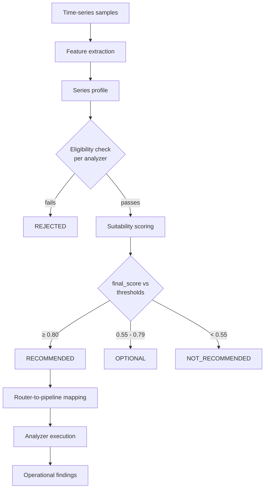
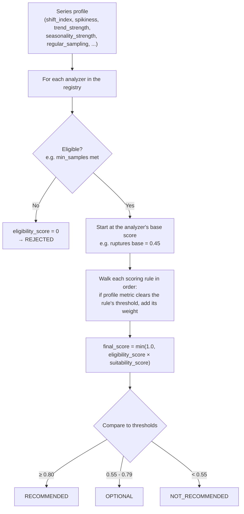

# Analyzer Recommendation & Routing

Ops Signals analyzes operational time-series data such as CPU, memory, request rate, latency, and
network traffic. Different analyzers are designed for different signal shapes - a change-point
analyzer works well for a baseline shift, a motif detector is more appropriate for repeating
patterns. Rather than running every analyzer on every metric, Ops Signals profiles the series
first and routes to the analyzers whose declared strengths match what the profile shows.

This is the single reference for how that works. It replaces five previously-scattered docs (see
[Document History](#document-history) at the bottom).

## Definitions

| Term | Meaning |
| --- | --- |
| **Analyzer** | A component that inspects a time series for a particular kind of behavior (a spike, a trend, a repeating pattern, ...). |
| **Router** | The explainable, rule-based analyzer *selection* engine - not a trained model, not an LLM. |
| **Series profile** | A measurable summary of the signal's shape and data quality (trend strength, seasonality, spikiness, ...). |
| **Eligibility** | Whether an analyzer can *technically* operate on this data (enough samples, regular enough timestamps). |
| **Suitability** | Whether an *eligible* analyzer is a *useful match* for the observed signal shape. |
| **Recommendation** | The category the router assigns an analyzer: `RECOMMENDED`, `OPTIONAL`, `NOT_RECOMMENDED`, or `REJECTED`. |
| **Pipeline analyzer** | The executable analyzer implementation the main analysis pipeline actually runs. |
| **Operational finding** | The user-facing result produced from analyzer signals and evidence. |

> **Important:** recommendation scores are suitability scores used for routing, not probabilities
> or statistical confidence values. A score of `0.86` does not mean the analyzer has an 86% chance
> of being correct. See [`docs/26-analyzer-methodology.md`](26-analyzer-methodology.md) for how
> honest that distinction currently is - the scoring *weights* themselves are hand-authored
> heuristics, not yet validated against real outcomes.

## How it works - the full flow



| Stage | What happens |
| --- | --- |
| Time-series samples | The pipeline receives timestamped numeric observations. |
| Feature extraction | The router calculates measurable properties: sample count, regularity, trend, seasonality, spikes, shifts. |
| Series profile | Those properties are stored as a structured profile. |
| Eligibility check | Each analyzer is checked against technical requirements (minimum samples, regular timestamps). Fails become `REJECTED`. |
| Suitability scoring | Eligible analyzers receive a score from configurable YAML rules. |
| Recommendation category | The score is converted into `RECOMMENDED`, `OPTIONAL`, or `NOT_RECOMMENDED`. |
| Router-to-pipeline mapping | Router analyzer IDs are mapped to executable pipeline analyzer IDs. |
| Analyzer execution | The pipeline executes only the analyzers the configured selection mode allows. |
| Operational findings | Signals from executed analyzers become findings for investigation. |

Implementation references: [`experiments/analyzer_router/router.py`](../experiments/analyzer_router/router.py) ·
[`experiments/analyzer_router/feature_extractor.py`](../experiments/analyzer_router/feature_extractor.py) ·
[`experiments/analyzer_router/eligibility.py`](../experiments/analyzer_router/eligibility.py) ·
[`experiments/analyzer_router/analyzer_registry.yaml`](../experiments/analyzer_router/analyzer_registry.yaml) ·
[`intelligence/pipeline.py`](../intelligence/pipeline.py) · [`config/analyzers.yaml`](../config/analyzers.yaml)

## The scoring algorithm, specifically

This is the part inside the "Suitability scoring" box above, expanded - the actual per-analyzer
calculation.



A concrete worked example - `ruptures`' real formula
(`experiments/analyzer_router/analyzer_registry.yaml`):

```yaml
scoring_rules:
  base: 0.45
  rules:
    - metric: shift_index,      gte: 0.12, add: 0.18
    - metric: shift_index,      gte: 0.22, add: 0.22
    - metric: shift_index,      gte: 0.32, add: 0.08
    - metric: regular_sampling, equals: true, add: 0.08
    - metric: spikiness,        gt: 0.35,  add: 0.04
```

A series with `shift_index = 0.25`, regular sampling, and moderate spikiness scores:
`0.45 (base) + 0.18 (shift_index ≥ 0.12) + 0.22 (shift_index ≥ 0.22) + 0.08 (regular sampling) = 0.93`
→ comfortably `RECOMMENDED`.

**Where the weights come from:** they're expert-defined heuristics, hand-chosen when the registry
was written - not fit against outcome data, not benchmarked against a calibration methodology. See
[`docs/26-analyzer-methodology.md`](26-analyzer-methodology.md) for the full honest accounting of
this, the infrastructure built to validate it, and how to contribute to calibrating it.

## Series profile features

| Property | Simple meaning |
| --- | --- |
| `sample_count` | Number of observations available |
| `regular_sampling` | Whether samples arrive at consistent intervals |
| `irregular_sampling_percentage` | Degree of inconsistent spacing |
| `missing_percentage` | Amount of missing data |
| `trend_strength` | Strength of sustained upward or downward movement |
| `seasonality_strength` | Strength of repeating behavior |
| `spikiness` | Degree of short, sudden, often-reverting changes |
| `shift_index` | Evidence of a real jump between two operating levels (computed by searching for the best split point, not just overall dispersion) |
| `constant_value_percentage` | Portion of the series that remains unchanged |

Additional implementation-only fields: `valid_sample_count`, `duplicate_timestamp_count`,
`sampling_interval_seconds`, `duration_seconds`, `mean`, `stddev`, `minimum`, `maximum`,
`variance`, `trend_slope`, `autocorrelation`.

## Eligibility vs. suitability

| Concept | Question it answers | Example |
| --- | --- | --- |
| Eligibility | Can this analyzer technically operate on the data? | Does Prophet have enough regularly-sampled, timestamped points? |
| Suitability | Is this analyzer a useful match for the signal shape? | Does the series have enough trend/seasonality for forecasting to be informative? |

A series can be eligible for an analyzer (good data quality) while still being a weak *suitability*
match (Prophet has enough data, but the series has no real trend or seasonality to forecast).

## Recommendation categories

| Category | Meaning | Executes in `recommended_only` |
| --- | --- | --- |
| `RECOMMENDED` | Eligible and a strong match | Yes |
| `OPTIONAL` | Eligible, potentially useful, below the strict threshold | No |
| `NOT_RECOMMENDED` | Eligible, but currently a weak match | No |
| `REJECTED` | Technical eligibility requirements failed | No |

Current default thresholds (`experiments/analyzer_router/router.py`):

```text
RECOMMENDED:     final_score >= 0.80
OPTIONAL:        0.55 <= final_score < 0.80
NOT_RECOMMENDED: final_score < 0.55
REJECTED:        eligibility failed
```

## Analyzer library & routing matrix

"Pipeline analyzers" are what the production pipeline can actually execute. "Router-only" entries
are known to the recommendation engine but have no direct runtime implementation - a router
recommendation for one of these executes a mapped fallback instead (see the mapping table below).

| Analyzer name | Library | Used in real execution? | Why used, with example |
| --- | --- | --- | --- |
| `baseline_shift` | [ruptures](https://github.com/deepcharles/ruptures) + pandas preprocessing | Yes - the user-facing/runtime analyzer | Sustained level changes. CPU average moves from 40% to 70% after a deploy. |
| `ruptures` | [ruptures](https://github.com/deepcharles/ruptures) | Implementation concept - router recommendations map to `baseline_shift` | Detection engine behind baseline/regime-shift analysis. |
| `anomaly_zscore` | Internal z-score logic (pandas) | Yes, internal logic, not ADTK/PyOD | Isolated unusual values. Memory normally ~55%, one window jumps to 95%. |
| `trend` | [statsmodels](https://www.statsmodels.org/) OLS | Yes | Gradual directional movement. Disk grows 50% → 85% over days. |
| `stumpy` | [STUMPY](https://stumpy.readthedocs.io/en/latest/) | Yes, when installed (numpy fallback otherwise) | Repeated motifs. Request traffic repeats the same daily shape. |
| `prophet` | [Prophet](https://facebook.github.io/prophet/docs/quick_start.html) | Optional - falls back to `numpy.polyfit` if not installed | Forecastable metrics with trend/seasonality. |
| `pyod_outlier` | [PyOD](https://pyod.readthedocs.io/en/latest/index.html) (KNN) | Yes | Isolated anomalous points when z-score is too simple. |
| `trend_regression` | Concept, maps to `trend` | No separate runtime analyzer | Router's conceptual label for linear movement. |
| `adtk` / `pyod` | [ADTK](https://adtk.readthedocs.io/en/stable/) / [PyOD](https://pyod.readthedocs.io/en/latest/index.html) | No - router maps these to `anomaly_zscore` | Rule-based / outlier-centric anomaly checks. |
| `darts` | [Darts](https://unit8co.github.io/darts/) | No - router maps to `prophet` | Richer, multi-seasonal forecasting. |
| `kats` | [Kats](https://github.com/facebookresearch/Kats) concept | No direct package - maps to `baseline_shift`/`trend`/`anomaly_zscore`/`stumpy`/`prophet` | Mixed-behavior series (shift + trend + seasonality together). |
| `alibi_detect` | [Alibi Detect](https://github.com/SeldonIO/alibi-detect) | No direct implementation | Distribution drift without a clear mean shift. |
| `river` | [River](https://github.com/online-ml/river) | No - pipeline is batch-oriented, not streaming | Online, point-by-point anomaly scoring. |

**Use this table as the source of truth for whether a router recommendation can execute today.**
`baseline_shift` is the product/domain analyzer name; `ruptures` the library underneath it.

## Router-to-pipeline mapping

Router analyzer IDs aren't always one-to-one with executable analyzers
(`intelligence/pipeline.py`):

| Router analyzer | Pipeline analyzer(s) |
| --- | --- |
| `ruptures` | `ruptures`, `baseline_shift` |
| `stumpy` | `stumpy` |
| `prophet` | `prophet` |
| `darts` | `prophet` (fallback) |
| `trend_regression` | `trend` (fallback) |
| `adtk` | `anomaly_zscore` (fallback) |
| `pyod` | `anomaly_zscore` (fallback) |

`river`, `kats`, and `alibi_detect` have no executable mapping today - a `RECOMMENDED` result for
one of these currently has nothing to actually run.

## Optional AI second opinion

An optional LLM advisor (Gemma, via Ollama) can score the same profile independently and return
its own top pick, alongside - never instead of - the deterministic router. Divergence from the
router's pick is surfaced explicitly, never silently substituted.

```yaml
ai:
  enabled: true
  provider: ollama
  temperature: 0.0
  max_tokens: 900
  timeout_seconds: 60
  ollama:
    base_url: http://localhost:11434
    model: gemma3:4b
```

The prompt/response contract lives in
[`backend/app/metric_analyzer_recommendations/gemma_advisor.py`](../backend/app/metric_analyzer_recommendations/gemma_advisor.py).
Every AI-vs-router evaluation is now logged (`AnalyzerDivergenceEntity`,
`GET /api/metric-analyzer-recommendations/divergences`) for later correlation against real
confirmed/rejected outcomes - see [`docs/26-analyzer-methodology.md`](26-analyzer-methodology.md).

## Selection modes

Configured in [`config/analyzers.yaml`](../config/analyzers.yaml):

| Mode | Execution behavior | Recommended use |
| --- | --- | --- |
| `all` | Runs all enabled analyzers | Benchmarking, debugging |
| `recommended_only` | Runs only `RECOMMENDED` analyzers | Normal selective execution |
| `recommended_threshold` | Runs `RECOMMENDED` (and optionally `OPTIONAL`) analyzers up to `max_analyzers`, gated by `min_score` | Normal execution with an execution cap - **this is the current default** |
| `manual_override` | Runs recommended analyzers plus explicitly selected ones | Controlled testing/troubleshooting |

Current production defaults (`config/analyzers.yaml`):
```yaml
selection_mode: recommended_threshold
recommendation_execution:
  min_score: 0.80
  max_analyzers: 3
  include_optional: false
```

An unknown `selection_mode` does not fail validation - it falls back to unrestricted execution
(closer to `all`). Worth tightening later.

## Realistic scenarios

| Scenario | Observed profile | Likely recommendation | Likely execution |
| --- | --- | --- | --- |
| Baseline shift | Regular sampling, clear jump, elevated `shift_index` | `ruptures` RECOMMENDED | `ruptures`, `baseline_shift` |
| Repeating/seasonal pattern | Regular sampling, high `seasonality_strength` | `stumpy` RECOMMENDED, `prophet` maybe OPTIONAL | `stumpy`, maybe `prophet` |
| Irregular spiky stream | Irregular sampling, high `spikiness`, weak seasonality | `river`/`adtk`/`pyod` may score higher | Today, `adtk`/`pyod` fall back to `anomaly_zscore`; `river` has no native path |
| Short/invalid/low-information series | Too few samples, mostly constant, high missingness | Many `REJECTED` | Often nothing, in `recommended_only` |

## No analyzer was executed - is that a bug?

Not automatically. It can mean the data was valid, analyzers passed eligibility, but none reached
the strict `RECOMMENDED` threshold - "data quality: good, analyzer fit: weak" is a legitimate
outcome, often better than forcing a noisy false positive.

It can also genuinely be a problem: insufficient samples, invalid values, a mostly-constant
series, a missing router-to-pipeline mapping, a recommended analyzer disabled in config, or a
config error.

**How to investigate:** inspect the series profile → inspect router decisions/scores → check
eligibility failure reasons → check router-to-pipeline mappings → temporarily use
`manual_override` → use `all` only for debugging.

## Adding a new analyzer

Four contracts: a registry entry (router scoring rules), any new profile features it needs, a
router-to-pipeline execution mapping, and a result compatible with the normalized signal/finding
models. The fastest path is the **Add Analyzer** wizard in the web UI. Full contributor guide,
the two-registry model, and current extensibility limitations:
[`docs/04-analyzer-plugin-framework.md`](04-analyzer-plugin-framework.md).

## Tuning existing recommendation logic

Most tuning needs no Python changes - base scores, threshold comparisons (`gte`/`gt`/`lte`/`lt`),
additive weights, and explanation text all live in
[`experiments/analyzer_router/analyzer_registry.yaml`](../experiments/analyzer_router/analyzer_registry.yaml).
Code changes are only needed for a new profile metric, new eligibility behavior, a new
router-to-pipeline mapping, or a brand-new executable analyzer.

## Testing recommendations

Test controlled series shapes, not just one real CSV: stable, baseline shift, linear trend,
repeating seasonal pattern, isolated spikes, irregular sampling, missing values, mostly-constant,
short series, mixed behavior. For each analyzer, check eligibility outcome, suitability score
movement, recommendation category, explanation text, router-to-pipeline mapping, and actual
execution under every selection mode.

## Known gaps

Verified current, as of this doc:

- **Fixed this cycle:** the Analyzer Recommendation workbench used to feed the router a fake
  `shift_index` (variance/mean) and a hardcoded `spikiness = 0.0` for every series, instead of the
  real per-split calculation the production pipeline uses - see
  [`docs/26-analyzer-methodology.md`](26-analyzer-methodology.md).
- **Confirmed done:** `RupturesAnalyzer` uses the real `ruptures` package (not a hand-rolled scan);
  new analyzers can be registered through `config/analyzer_registry.d/*.yml` without editing
  pipeline construction code.

Still open, not re-verified in this pass - treat as a starting point for filing issues, not a
guarantee of current state:

- Router registry lists analyzers (`river`, `kats`, `alibi_detect`) with no real execution mapping
  at all - a `RECOMMENDED` result for these has nothing to actually run.
- No structured evidence when multiple analyzers agree or conflict on the same finding (currently
  implicit in the summary text, not a structured field).
- No benchmark coverage of score *calibration* (is the magnitude proportional to severity), only
  selection accuracy (was the right analyzer picked).
- `alibi_detect` (drift) and `river` (streaming) are router-recommendable with no decision made on
  whether to implement them or mark them roadmap-only.
- `STUMPY`/`Prophet` fall back to custom logic silently when the library isn't installed - the
  `library`/`library_mode` isn't always surfaced in evidence.

## FAQ

**Is the score a probability?** No. It's a suitability score for routing. `0.86` doesn't mean 86%
confidence.

**Can multiple analyzers be recommended?** Yes - a metric can show multiple behaviors at once.

**Can I force an analyzer?** Yes, via `manual_override` with `selected_analyzers` in
`config/analyzers.yaml`.

**Does `OPTIONAL` execute?** Not in `recommended_only`/`recommended_threshold` - visible for
explanation, not executed.

**Does the router use an LLM?** No - it's explainable and rule-based. An LLM can optionally sit
alongside it as a second opinion (see above), never replacing it.

**Are the YAML rules learned automatically?** No - hand-configured today.
[`docs/26-analyzer-methodology.md`](26-analyzer-methodology.md) covers what's being built to
change that.

## Document history

This consolidates what were previously five separate, overlapping docs:
`recommended-only-selection-mode.md` (the most complete prior version - this doc's backbone),
`20-analyzer-library-routing-matrix.md`, `21-gemma-analyzer-recommendation.md`, and this file's own
prior thin/stale version. `04-analyzer-plugin-framework.md` (adding a new analyzer) and
`26-analyzer-methodology.md` (citations and scoring-weight honesty) remain separate, linked docs -
different audiences, not folded in here.
