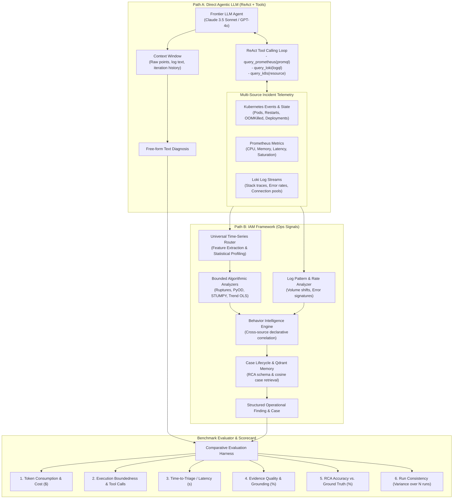

# IAM Benchmark Implementation Plan: Multi-Source Operational Intelligence vs. Direct Agentic LLMs

**Document Version:** 1.0  
**Target Milestone:** Phase 2 — Multi-Source Benchmark & Patent/Publication Validation  
**Primary Authors:** Ops Signals Core Architecture Team  

---

## 1. Executive Summary & Strategic Motivation

### The Reviewer Challenge (Patent & Publication Defense)
In applied AI and systems research (e.g., SOSP, OSDI, ICSE, USENIX ATC) as well as patent examination, the primary critique against specialized operational intelligence frameworks is:

> *"Why do we need a specialized Incident Analysis & Memory (IAM) architecture? Why can't an engineer simply prompt a frontier LLM (e.g., Claude 3.5 Sonnet, GPT-4o, or Gemini 1.5 Pro) with function calling and give it direct access to Prometheus, Loki, and Kubernetes tools?"*

The **IAM Benchmark** is designed to empirically disprove the assumption that a general-purpose LLM agent with tools is sufficient for production incident triage. It provides a reproducible, multi-source evaluation harness comparing **IAM** directly against an **Agentic LLM with ReAct tool access**.

### The Core Thesis
1. **Context Window Saturation & Cost:** Raw telemetry (time-series matrices and high-volume log streams) saturates context windows, incurring massive token costs ($50k–$150k+ tokens per incident). IAM reduces raw data to mathematical signal vectors before LLM reasoning, slashing token consumption by **>90%**.
2. **Execution Boundedness:** Free-form LLM agents often enter stochastic loops, craft malformed PromQL/LogQL queries, or exhaust tool budgets. IAM utilizes bounded, deterministic algorithms that terminate predictably in seconds.
3. **Root-Cause Attribution:** In cascading failures, raw LLMs frequently confuse downstream symptoms (e.g., 504 Gateway Timeouts) with upstream root causes (e.g., database connection pool exhaustion). IAM’s **Behavior Intelligence Engine** evaluates cross-metric causal rules to ensure accurate attribution.
4. **Deterministic Consistency:** Running the same incident 5 times through an LLM agent yields high variance in diagnoses. IAM guarantees identical finding signatures and evidence sets for identical input data.

---

## 2. End-to-End Comparative Architecture



---

## 3. Multi-Source Incident Scenarios

The benchmark framework implements three realistic, production-grade incident scenarios across Kubernetes, Prometheus, and Grafana Loki:

### Scenario 1: Resource Degradation (`K8s + Prometheus`)
- **Failure Story:** A memory leak in a payments microservice gradually consumes heap space. Garbage collection cycles increase in frequency, driving CPU throttling, and eventually triggering a Kubernetes `OOMKilled` container termination and `CrashLoopBackOff`.
- **Telemetry Generated:**
  - *Prometheus:* `container_memory_working_set_bytes` (linear upward trend), `container_cpu_throttled_seconds_total` (abrupt baseline shift), `http_request_duration_seconds` (latency degradation).
  - *Kubernetes:* Pod status `CrashLoopBackOff`, termination reason `OOMKilled`, restart count incrementing.
- **Evaluation Target:** Can the system detect the structural change point and trend *before* the crash, and distinguish between a memory leak vs. an undersized CPU limit?

### Scenario 2: Application & Config Regression (`K8s + Loki`)
- **Failure Story:** A new deployment updates a ConfigMap with an invalid database timeout (`timeout: 50ms` instead of `5000ms`), causing 95% of database transactions to fail immediately upon rollout.
- **Telemetry Generated:**
  - *Loki Logs:* High-frequency error logs containing `java.sql.SQLTimeoutException: Connection acquisition timed out`, followed by HTTP 500 error logs.
  - *Kubernetes:* Deployment rollout event (`ReplicaSet` creation), ConfigMap update event.
- **Evaluation Target:** Does the system pinpoint the exact ConfigMap commit and exception signature without requiring thousands of raw log lines to be pasted into an LLM prompt?

### Scenario 3: Cascading Dependency Degradation (`K8s + Prometheus + Loki`)
- **Failure Story:** Upstream database connection pool exhaustion leads to thread pool exhaustion in the user authentication service, causing the downstream API Gateway to emit HTTP 504 Gateway Timeouts and client apps to trigger exponential backoff retry storms.
- **Telemetry Generated:**
  - *Prometheus:* `db_connections_active` (saturated at max pool size), `auth_service_in_flight_requests` (maxed), `api_gateway_requests_total{status="504"}` (spiking), `api_gateway_ingress_request_rate` (multiplied due to client retries).
  - *Loki Logs:* `HikariPool - Connection is not available, request timed out after 30000ms`.
  - *Kubernetes:* HPA (Horizontal Pod Autoscaler) scaling up API Gateway pods uselessly because the bottleneck is external.
- **Evaluation Target:** Does the system correctly isolate the root cause to the database connection pool, or does it hallucinate that the API Gateway or ingress controller needs more resources?

---

## 4. Benchmark Scoring Contract & Metrics

Each benchmark run measures 6 quantitative dimensions:

| Metric | Measurement Method | Target Advantage for IAM |
| :--- | :--- | :--- |
| **1. Token Consumption** | Total input + output tokens consumed across all LLM interactions during triage. | **$\ge 90\%$ reduction** compared to the direct LLM ReAct agent. |
| **2. API Cost ($)** | Calculated cost based on public token pricing (e.g. Claude 3.5 Sonnet / GPT-4o rates). | **$\ge 90\%$ cost savings** per incident triaged. |
| **3. Bounded Execution** | Number of tool iterations, query timeouts, malformed queries, or infinite loops. | **Deterministic termination** in $\le 3$ algorithmic stages vs. open-ended ReAct loops. |
| **4. Time-to-Triage (Latency)** | Wall-clock execution time from data availability to finalized RCA report. | **$\le 5$ seconds** for IAM vs. $45–180$ seconds for multi-turn LLM reasoning. |
| **5. RCA Accuracy** | Overlap between identified root cause and curated ground truth ($0.0 \to 1.0$). | **$\ge 90\%$ accuracy**, correctly isolating root cause from cascading symptoms. |
| **6. Consistency** | Semantic variance score over 5 identical runs of the same incident dataset. | **Zero variance** in IAM signals/behavior rules vs. stochastic drift in LLMs. |

---

## 5. Technical Implementation Blueprint

### Directory Structure to be Created in `benchmark/`
```text
benchmark/iam_vs_llm/
├── scenarios/
│   ├── 01_resource_degradation/
│   │   ├── prometheus_metrics.csv
│   │   ├── k8s_events.json
│   │   ├── ground_truth.yaml
│   │   └── generator.py
│   ├── 02_config_regression/
│   │   ├── loki_logs.jsonl
│   │   ├── k8s_events.json
│   │   ├── ground_truth.yaml
│   │   └── generator.py
│   └── 03_dependency_cascade/
│       ├── prometheus_metrics.csv
│       ├── loki_logs.jsonl
│       ├── k8s_events.json
│       ├── ground_truth.yaml
│       └── generator.py
│
├── runners/
│   ├── base_runner.py               # Abstract benchmark runner interface
│   ├── iam_runner.py                # IAM pipeline execution (metrics + logs + behavior)
│   ├── direct_llm_agent_runner.py   # ReAct agent with PromQL, LogQL, K8s tools
│   └── mock_tool_environment.py     # Deterministic query engine serving scenario telemetry
│
├── evaluators/
│   ├── rca_evaluator.py             # Compares generated RCA against ground_truth.yaml
│   ├── token_cost_calculator.py     # Tracks tokens, tool iterations, and financial cost
│   └── consistency_evaluator.py     # Measures variance over N runs
│
├── reports/                         # Auto-generated JSON and Markdown benchmark scorecards
└── run_iam_benchmark.py             # Main CLI execution entry point
```

### Loki Log Analysis Integration in IAM
To support multi-source triage alongside Prometheus, Phase 2 introduces a lightweight, bounded log pattern analyzer:
- **Log Rate & Volume Analyzer:** Evaluates log frequency shifts per service and level (`ERROR`, `WARN`).
- **Signature Clustering:** Groups raw stack traces into distinct template signatures (masking variable IDs, memory addresses, and timestamps).
- **Log Signals:** Emits standard `OperationalSignal` objects for log anomalies (e.g. `signal_type: log_error_spike`, `signal_type: new_exception_signature`).
- **Behavior Rule Integration:** Feeds log signals into `BehaviorIntelligenceService`, allowing rules such as:
  ```yaml
  conditions:
    all:
      - fact: cpu.trend.direction == "upward"
      - fact: database.log_error.present == true
  ```

---

## 6. Implementation Milestones

### Milestone 1: Scenario Datasets & Ground Truth Catalog
- Implement deterministic data generators for the 3 scenarios.
- Write ground-truth definitions: exact root causes, primary evidence keys, and secondary symptoms.

### Milestone 2: Loki Ingestion & Log Pattern Signal Adapter
- Build `LokiLogAdapter` and log error frequency analyzer.
- Integrate log signals into `FindingAggregator` and `BehaviorIntelligenceService`.

### Milestone 3: ReAct Baseline LLM Agent
- Implement `DirectLLMAgentRunner` using standard tool-calling protocol.
- Equip agent with 3 tools: `query_prometheus(promql)`, `query_loki(logql)`, `query_k8s(resource)`.
- Enforce standard ReAct prompt templates.

### Milestone 4: Evaluation Engine & Comparative Scorecard Generator
- Implement automated scoring: Token counting, latency measurement, RCA ground-truth matching, and consistency evaluation.
- Build Markdown/JSON comparison reporter.

### Milestone 5: Benchmark Execution, Review & Publication Package
- Execute comparative benchmark across 5 trials per scenario.
- Generate final empirical scorecard.
- Publish benchmark whitepaper section and patent claim defense documentation.
