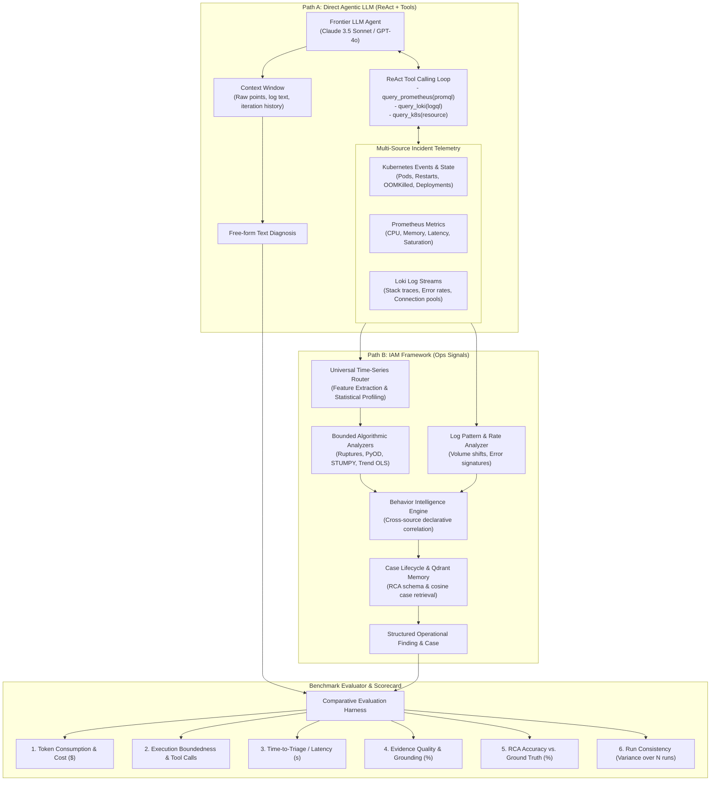

# IAM Benchmark Implementation Plan: Multi-Source Operational Intelligence vs. Direct Agentic LLMs

**Document Version:** 1.0  
**Target Milestone:** Phase 2 — Multi-Source Benchmark & Patent/Publication Validation  
**Primary Authors:** Ops Signals Core Architecture Team  

> **Provenance note:** this plan was carried over from `feature/iam-benchmark` for reference. The
> benchmark harness it describes (`benchmark/iam_vs_llm/`, the ReAct baseline runners, the judge
> evaluator, the Pareto dashboard) is **not** present on this branch - only this planning document
> is. Treat the implementation-status checkboxes below as describing that other branch, not this
> one.

---

## 1. Executive Summary & Strategic Motivation

### The Reviewer Challenge (Patent & Publication Defense)
In applied AI and systems research (e.g., SOSP, OSDI, ICSE, USENIX ATC) as well as patent examination, the primary critique against specialized operational intelligence frameworks is:

> *"Why do we need a specialized Incident Analysis & Memory (IAM) architecture? Why can't an engineer simply prompt a frontier LLM (e.g., Claude 3.5 Sonnet, GPT-4o, or Gemini 1.5 Pro) with function calling and give it direct access to Prometheus, Loki, and Kubernetes tools?"*

The **IAM Benchmark** is designed to empirically disprove the assumption that a general-purpose LLM agent with tools is sufficient for production incident triage. It provides a reproducible, multi-source evaluation harness comparing **IAM** directly against an **Agentic LLM with ReAct tool access**.

### The Core Thesis
1. **Context Window Saturation & Cost:** Raw telemetry (time-series matrices and high-volume log streams) saturates context windows, incurring massive token costs ($50k–$150k+ tokens per incident). IAM reduces raw data to mathematical signal vectors before LLM reasoning, slashing token consumption by **>90%**.
2. **Execution Boundedness:** Free-form LLM agents often enter stochastic loops, craft malformed PromQL/LogQL queries, or exhaust tool budgets. IAM utilizes bounded, deterministic algorithms that terminate predictably in seconds.
3. **Root-Cause Attribution:** In cascading failures, raw LLMs frequently confuse downstream symptoms (e.g., 504 Gateway Timeouts) with upstream root causes (e.g., database connection pool exhaustion). IAM’s **Behavior Intelligence Engine** evaluates cross-metric causal rules to ensure accurate attribution.
4. **Deterministic Consistency:** Running the same incident 5 times through an LLM agent yields high variance in diagnoses. IAM guarantees identical finding signatures and evidence sets for identical input data.

---

## 2. End-to-End Comparative Architecture

---

## 3. Multi-Source Incident Scenarios

The benchmark framework implements three realistic, production-grade incident scenarios across Kubernetes, Prometheus, and Grafana Loki:

### Scenario 1: Resource Degradation (`K8s + Prometheus`)
- **Failure Story:** A memory leak in a payments microservice gradually consumes heap space. Garbage collection cycles increase in frequency, driving CPU throttling, and eventually triggering a Kubernetes `OOMKilled` container termination and `CrashLoopBackOff`.
- **Telemetry Generated:**
  - *Prometheus:* `container_memory_working_set_bytes` (linear upward trend), `container_cpu_throttled_seconds_total` (abrupt baseline shift), `http_request_duration_seconds` (latency degradation).
  - *Kubernetes:* Pod status `CrashLoopBackOff`, termination reason `OOMKilled`, restart count incrementing.
- **Evaluation Target:** Can the system detect the structural change point and trend *before* the crash, and distinguish between a memory leak vs. an undersized CPU limit?

### Scenario 2: Application & Config Regression (`K8s + Loki`)
- **Failure Story:** A new deployment updates a ConfigMap with an invalid database timeout (`timeout: 50ms` instead of `5000ms`), causing 95% of database transactions to fail immediately upon rollout.
- **Telemetry Generated:**
  - *Loki Logs:* High-frequency error logs containing `java.sql.SQLTimeoutException: Connection acquisition timed out`, followed by HTTP 500 error logs.
  - *Kubernetes:* Deployment rollout event (`ReplicaSet` creation), ConfigMap update event.
- **Evaluation Target:** Does the system pinpoint the exact ConfigMap commit and exception signature without requiring thousands of raw log lines to be pasted into an LLM prompt?

### Scenario 3: Cascading Dependency Degradation (`K8s + Prometheus + Loki`)
- **Failure Story:** Upstream database connection pool exhaustion leads to thread pool exhaustion in the user authentication service, causing the downstream API Gateway to emit HTTP 504 Gateway Timeouts and client apps to trigger exponential backoff retry storms.
- **Telemetry Generated:**
  - *Prometheus:* `db_connections_active` (saturated at max pool size), `auth_service_in_flight_requests` (maxed), `api_gateway_requests_total{status="504"}` (spiking), `api_gateway_ingress_request_rate` (multiplied due to client retries).
  - *Loki Logs:* `HikariPool - Connection is not available, request timed out after 30000ms`.
  - *Kubernetes:* HPA (Horizontal Pod Autoscaler) scaling up API Gateway pods uselessly because the bottleneck is external.
- **Evaluation Target:** Does the system correctly isolate the root cause to the database connection pool, or does it hallucinate that the API Gateway or ingress controller needs more resources?

---

## 4. Benchmark Scoring Contract & Metrics (The Pareto Reframe)

Rather than asserting circular advantages by construction, the benchmark measures the **Cost–Accuracy Pareto Frontier**:

### Primary Evaluative Metrics
| Metric | Measurement Method | Target Goal |
| :--- | :--- | :--- |
| **1. Root-Cause Accuracy (Taxonomy F1)** | Overlap between identified root cause class and curated ground truth enum (`MEMORY_LEAK`, `CPU_STARVATION`, etc.). | $\ge 90\%$ accuracy, isolating root cause from downstream symptoms. |
| **2. Culprit Entity Match (Entity F1)** | Precision and recall in identifying the true failing microservice / pod without blaming healthy control services. | $100\%$ precision (zero false accusations on healthy control services). |
| **3. Evidence Grounding & Recall** | Jaccard overlap of cited metrics, signal types, and event timestamps vs. expected ground truth evidence. | $\ge 70\%$ evidence recall without hallucinating non-existent telemetry. |

### Secondary Operational Trade-Off Metrics
| Metric | Measurement Method | Target Goal |
| :--- | :--- | :--- |
| **4. Time-to-Triage (Latency)** | Wall-clock execution time from data availability to finalized RCA. | $\le 1$ second for IAM vs. $30–120$ seconds for multi-turn LLM reasoning. |
| **5. Token Consumption & Cost ($)** | 4 isolated ledgers: IAM Advisor, Baseline A, Baseline B, and Judge (harness overhead). | $\ge 95\%$ cost reduction for IAM vs. unconstrained ReAct agent. |

### Architectural Invariants & Operational Guardrails
- **Per-Run State Isolation:** Ephemeral SQLite and in-memory stores per execution; zero cross-trial memory pollution.
- **Bounded Deterministic Execution:** Fixed algorithmic stages vs. open-ended agent loops.

---

## 5. Technical Implementation & 3-Slice Sequencing

The benchmark is developed and verified in three strictly sequenced vertical slices:

### Slice 1: Deterministic Offline Core (COMPLETED & VERIFIED)
- [x] Canonical benchmark-local taxonomy: `benchmark/iam_vs_llm/evaluators/taxonomy.py` (`RootCauseClass`).
- [x] Scenario 1 Telemetry Generator: `benchmark/iam_vs_llm/scenarios/scenario_01_resource_degradation/generator.py`.
- [x] Dual-paradigm runner base + state isolation: `benchmark/iam_vs_llm/runners/base_runner.py`.
- [x] IAM Slice Runner: `benchmark/iam_vs_llm/runners/iam_slice_runner.py` with `IsolatedInMemoryStore`.
- [x] Deterministic F1 Evaluator: `benchmark/iam_vs_llm/evaluators/f1_evaluator.py`.
- [x] CLI entry point: `benchmark/iam_vs_llm/run_slice.py`.
- [x] Verified via unit test suite: `tests/test_iam_benchmark_slice1.py` (100% green).

### Slice 2: Baseline A (Direct LLM ReAct Agent) + Runtime Manifest
- [ ] Runtime-resolved Model Manifest (`benchmark_manifest.yaml`) with seed pinning and 4 cost ledgers.
- [ ] Interactive mock query environment for Scenario 1 (`query_prometheus`, `query_k8s`).
- [ ] Baseline A runner: ReAct tool-calling loop constrained to emit structured tail (`ROOT_CAUSE: <ENUM> / ENTITY: <service>`).
- [ ] Cost and latency tracker.

### Slice 3: Calibrated Judge Evaluator + Baseline B + Adversarial Coverage
- [ ] Fleiss' $\kappa$ / Krippendorff's $\alpha$ calibrated LLM-as-a-judge (Attribution, Grounding, Actionability).
- [ ] Baseline B (Signals-Augmented LLM) evaluating causal graph value.
- [ ] Adversarial Scenario 1 (Deadlock mis-attribution) and Adversarial Scenario 2 (Benign maintenance suppression).
- [ ] Final Pareto report generator.

