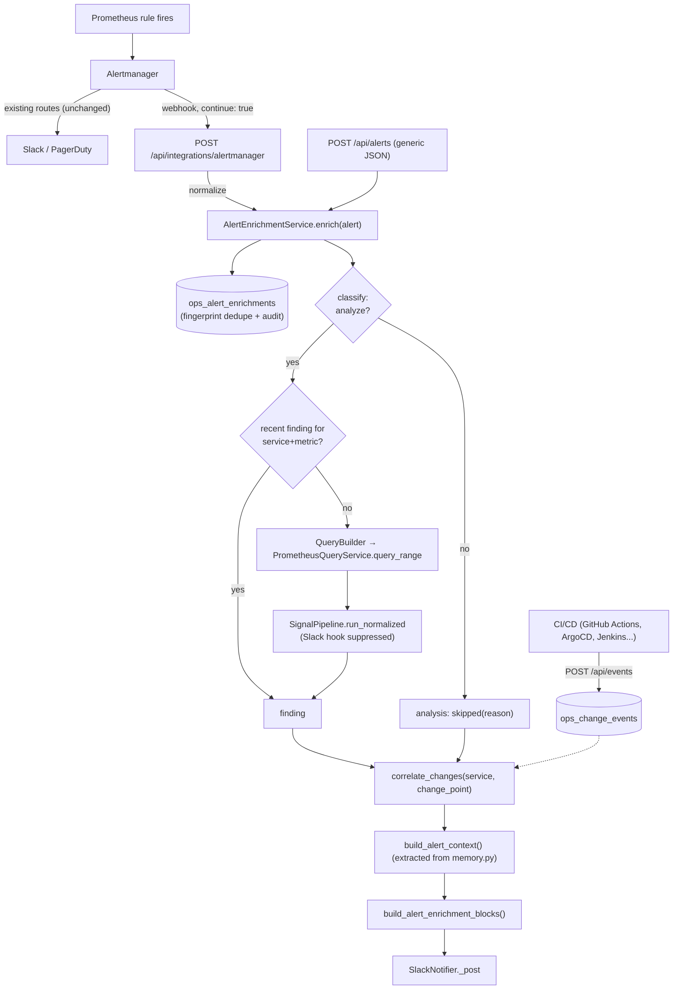

# Alert Enrichment: Alertmanager Receiver + Change Events (Technical Plan)

**Status:** Components A-H (receiver through Slack posting) implemented on branch
`feature/alert-enrichment-receiver`. Not yet built: the read API, retention cleanup, and docs/recipes
(§5 I). Target: public launch, Oct 12, 2026.

**Extends:** [`GET /api/alert-context`](../backend/app/api/memory.py) (history lookup),
[`POST /analysis/prometheus`](../backend/app/api/direct_prometheus.py) (on-demand Prometheus analysis),
[`SlackNotifier`](../backend/app/notifications/slack_client.py) (finding notifications).

---

## 1. Summary

When an existing Prometheus alert fires, Alertmanager sends it to Ops Signals. Ops Signals then:

1. works out which series the alert is about,
2. pulls that series from Prometheus and runs the analyzers (**what happened**),
3. looks for deploys/config changes near the change point (**what changed**),
4. runs the existing alert-context lookup (**seen before / what fixed it**),
5. posts **one** enriched Slack message.

Ops Signals is an *additional* Alertmanager receiver. It never blocks, drops, or delays an alert:
the team's existing routes (Slack, PagerDuty, ...) keep firing as before.

```
Plain alert today:                      Enriched by Ops Signals:
  [FIRING:1] CheckoutHighLatency          CheckoutHighLatency · checkout-api
  checkout-api p95 latency > 300ms        What happened: baseline shift ~180ms → ~420ms since 14:08
                                          What changed:  started 6 min after deploy v2.3.1 (PR #812)
                                          Seen before:   4× (3 confirmed). Similar: case #112, fix: pool 20→50
```

## 2. Why this is the launch priority

- **Easiest way to adopt.** Trying it takes ~5 lines of Alertmanager config on alerts the team already
  has. No CSV upload, no new dashboard, no change to existing routing.
- **Answers the first three triage questions**: is it real, what changed, have we seen it before?
- **Useful on day one.** `alert-context` is empty on a fresh install; the analyzer explanation and
  deploy correlation don't depend on history.
- **Builds the memory.** Every enriched alert invites a case/outcome, which feeds `alert-context` next time.
- **Mostly reuses code we already have**: `PrometheusQueryService`, `SignalPipeline.run_normalized`,
  alert-context logic and the Slack client all exist.

## 3. Scope

### In scope (launch)

| # | Component | New / reused |
|---|---|---|
| A | Change events API (`POST/GET /api/events`) + `ops_change_events` table | New |
| B | Alertmanager receiver (`POST /api/integrations/alertmanager`) + generic `POST /api/alerts` | New |
| C | Alert classification (analyze or not) | New |
| D | Query builder (PromQL from alert, window, step, series selection) | New |
| E | Enrichment service (reuse recent finding or run pipeline, sufficiency check) | New, wraps existing pipeline |
| F | Deploy correlation | New |
| G | Alert-context logic extracted into a reusable function | Refactor of existing |
| H | Enriched Slack message + suppress the duplicate global finding hook | New builder, small change to existing hook |
| I | Docs, Alertmanager/CI recipes, demo scenario | New |

### Explicit non-goals (launch)

- Grafana-managed alerts, Loki/LogQL alerts, Datadog/PagerDuty/Opsgenie adapters. These still get
  deploy + history context; only metric analysis is skipped.
- Editing or threading Slack messages. The current incoming webhook can't; resolve posts a new message.
- Multiple Prometheus connections (only `connection_id == "default"` is supported today).
- Cross-service/dependency correlation (deploys to *upstream* services).
- Durable deferred re-analysis that survives a restart.
- Suppressing or dropping alerts. Ops Signals only *labels* ("likely noise"); it never decides not to notify.

## 4. Architecture



### New module layout

```
backend/app/alerts/
  __init__.py
  schemas.py          # NormalizedAlert, AlertmanagerWebhook (pydantic), EnrichmentResult
  alertmanager.py     # Alertmanager payload → list[NormalizedAlert]
  classifier.py       # analyze-or-not decision + reason
  query_builder.py    # generatorURL parsing, threshold stripping, window/step, series selection
  enrichment.py       # AlertEnrichmentService (orchestrator)
  correlation.py      # change-event lookup around a change point
backend/app/api/alerts.py          # receiver + generic endpoints
backend/app/api/events.py          # change events endpoints
backend/app/memory/alert_context.py  # build_alert_context(), extracted from api/memory.py
backend/app/notifications/message_builder.py  # + build_alert_enrichment_blocks()
backend/migrations/005_change_events_and_alert_enrichments.sql
```

## 5. Components

### A. Change events API

**Endpoint:** `POST /api/events`

```json
{
  "service": "checkout-api",            // required
  "type": "deploy",                     // required: deploy | config | feature_flag | scale | rollback | other
  "timestamp": "2026-09-23T14:02:10Z",  // optional, defaults to now (UTC)
  "version": "v2.3.1",                  // optional
  "env": "prod",                        // optional
  "author": "alice",                    // optional
  "source": "github-actions",           // optional
  "url": "https://github.com/acme/checkout/pull/812",  // optional
  "description": "Release 2.3.1",       // optional
  "attributes": {}                      // optional, free-form
}
```

Returns `201` with the stored event (including `id`).

**Endpoint:** `GET /api/events?service=&type=&since=&until=&limit=` for the UI and debugging.

**Validation:** `service` non-blank, `type` in the enum, `url` must be `http(s)`, `timestamp` no more
than 1h in the future. Accept a batch too (`POST /api/events` with a JSON array), max 100.

**Auth:** optional bearer token `OPS_SIGNALS_EVENTS_TOKEN`; if set, requests without it get `401`.

**Recipes (docs):** GitHub Actions step (`curl`), ArgoCD Notifications webhook template, Helm
post-upgrade hook Job, Jenkins `post { success { sh 'curl ...' } }`.

### B. Receiver endpoints

**`POST /api/integrations/alertmanager`** accepts Alertmanager webhook payload v4:

```json
{
  "version": "4", "status": "firing", "receiver": "ops-signals", "groupKey": "...",
  "externalURL": "http://alertmanager:9093",
  "alerts": [{
    "status": "firing", "fingerprint": "a1b2c3d4e5f60718",
    "startsAt": "2026-09-23T14:13:00Z", "endsAt": "0001-01-01T00:00:00Z",
    "labels": {"alertname": "CheckoutHighLatency", "service": "checkout-api", "severity": "warning"},
    "annotations": {"summary": "checkout-api p95 latency above 300ms"},
    "generatorURL": "http://prometheus:9090/graph?g0.expr=...&g0.tab=1"
  }]
}
```

Each item in `alerts[]` becomes a `NormalizedAlert`:

```python
@dataclass
class NormalizedAlert:
    source: str                 # "alertmanager" | "generic"
    fingerprint: str            # AM fingerprint; generic: sha256(source+alertname+sorted labels)
    status: Literal["firing", "resolved"]
    alert_name: str
    service: str | None         # label from config.alert_enrichment.service_labels, first match
    severity: str | None
    starts_at: datetime
    ends_at: datetime | None
    labels: dict[str, str]
    annotations: dict[str, str]
    expr: str | None            # PromQL, if recoverable
    generator_url: str | None
```

**`POST /api/alerts`** is the vendor-neutral form: a JSON body with the `NormalizedAlert` fields
(`expr` optional). Future adapters (Grafana, Datadog) only have to map into this shape.

**Request handling:**
1. Validate the auth token (`OPS_SIGNALS_ALERT_RECEIVER_TOKEN`, optional; Alertmanager sends it via
   `http_config.authorization.credentials`).
2. Normalize, then for each alert **claim** its row in `ops_alert_enrichments` (see §6) to dedupe.
3. Schedule `AlertEnrichmentService.process(alert_id)` with FastAPI `BackgroundTasks`, which runs the
   sync function in the threadpool.
4. Return `202 {"accepted": n, "duplicates": m}` right away. Alertmanager only needs a 2xx.

Returning quickly matters: Alertmanager retries on timeout, and analysis can take seconds.

**Dedupe rules:**
- `firing` with a fingerprint already `firing` in the last `dedupe_window` (default 6h): ignore. This
  is an Alertmanager `repeat_interval` resend.
- `firing` after a `resolved` for the same fingerprint: a new occurrence gets a new row.
- `resolved`: if a firing row exists and isn't resolved yet, mark it resolved and post the resolve
  message. Otherwise ignore.

### C. Classification (analyze or not)

Every accepted alert gets a Slack message. Classification decides only whether to **run analyzers**.
Rules are evaluated in order and the first match wins. The reason is stored and shown in the message.

| # | Rule | Result | `analysis_status` reason |
|---|---|---|---|
| 1 | annotation `ops_signals_analyze: "false"` | skip | `disabled_by_annotation` |
| 2 | annotation `ops_signals_analyze: "true"` | analyze (still needs a query) | - |
| 3 | no Prometheus connection configured | skip | `no_prometheus` |
| 4 | no expr from `ops_signals_query` annotation or `generatorURL` `g0.expr` | skip | `no_query` (Grafana-managed, unknown source) |
| 5 | expr looks like LogQL (`\|=`, `\|~`, `!=\"`, `\| json`, `\| logfmt`, `\| pattern`, `\| line_format`) | skip | `log_alert` |
| 6 | expr contains `absent(` or `absent_over_time(` | skip | `absence_alert` |
| 7 | expr's metric is status-like: `up`, `kube_.*_status_.*`, `kube_.*_(ready\|phase\|condition)`, `.*_restarts_total`, `ALERTS` | skip (unless rule 2) | `status_alert` |
| 8 | after fetching: too many series, no single matching series, < `min_points` (default 30) points, or ≤ 2 distinct values | skip | `too_many_series` / `ambiguous_series` / `insufficient_data` / `binary_series` |
| 9 | otherwise | analyze | - |

Rules 1-7 need no I/O. Rule 8 runs after the query (§D).

### D. Query builder

**1. Get the expression**, in priority order:
1. annotation `ops_signals_query` (used verbatim; the rule author owns it),
2. `g0.expr` query parameter of `generatorURL` (URL-decoded).

**2. Strip the alert threshold** so the analyzers see the full series, not only the samples above it.
Find the **top-level** comparison operator (`>`, `<`, `>=`, `<=`, `==`, `!=`, optionally followed by
`bool`). "Top-level" means outside `()`, `{}`, `[]` and quotes. Strip it only when the other side is
a numeric scalar (`0.3`, `1e3`, `-5`). Keep the metric side.

| Rule expr | Query used |
|---|---|
| `histogram_quantile(0.95, sum by (le) (rate(x_bucket[5m]))) > 0.3` | `histogram_quantile(0.95, sum by (le) (rate(x_bucket[5m])))` |
| `0.3 < rate(errors_total[5m])` | `rate(errors_total[5m])` |
| `a / b > 0.05 and on() hour() > 8` | not stripped: several top-level operators → `no_query` unless annotated |
| `sum(rate(x[5m])) > sum(rate(y[5m]))` | not stripped: both sides are vectors → `no_query` unless annotated |

This is a small hand-written scanner, not a full PromQL parser. Anything it can't handle falls back to
`no_query`, and the docs tell users to add `ops_signals_query`.

**3. Window and step:**

```
end      = now (UTC)
lookback = annotation ops_signals_lookback  or  config.alert_enrichment.lookback (default 6h)
           clamped to [1h, 7d]
start    = end - lookback
step     = max(config.alert_enrichment.min_step (default 30s), config.alert_enrichment.scrape_interval (default 30s))
           then raised if needed so (lookback / step) <= config.alert_enrichment.max_points (default 2000)
```

Default: 6h at 30s = 720 points, within the existing limits (`max_samples_per_series` 10,000,
`max_window_days` 30). Use `validate_range()` so the existing guards still apply.

**4. Select the series.** Don't rewrite the PromQL. Run the stripped query, then choose among the
returned series:
- 1 series: use it.
- N series: keep those whose labels all match the alert's labels (the alert's labels are the series
  labels plus the rule's static labels, so the firing series is always a subset match).
  Exactly 1 match: use it. 0 or >1: skip with `ambiguous_series`, and record the count.

`PrometheusQueryService.preview()` already returns all series (the "exactly one series" check lives
in the direct-analysis endpoint, not in `preview()`). Two things to handle:
- `preview()` raises `HTTPException(400)` when a query returns more than `max_series` (default 20)
  series, e.g. a per-pod rule on a large deployment. Catch it and skip with `too_many_series`.
  The message then suggests adding `ops_signals_query` with narrower label matchers.
- `preview()` signals every error through `HTTPException` (it was written for request handlers).
  The background task must catch `HTTPException` as well as `Exception` and map it to an
  `analysis_status` (`prometheus_unreachable`, `query_failed`, `too_many_series`, `no_data`).

**5. Enough data after the change?** Count points with `timestamp >= starts_at - post_change_grace`
(default 10m). If fewer than `min_post_change_points` (default 10), wait and re-query:
`retry_delays` default `[180s, 360s]`, as a sleep inside the background task. If it's still short,
analyze anyway and label the result `early_analysis` in the message. A restart loses the retry, which
is acceptable for launch (see non-goals).

### E. Enrichment service

```python
class AlertEnrichmentService:
    def process(self, enrichment_id: int) -> None:
        row = load(enrichment_id)
        alert = row.alert
        if alert.status == "resolved":
            return self._post_resolved(row)

        decision = classify(alert, prometheus_configured)
        finding, analysis = None, AnalysisOutcome.skipped(decision.reason)

        if decision.analyze:
            finding = self._recent_finding(alert.service, metric_key)   # reuse autonomous work
            if finding:
                analysis = AnalysisOutcome.reused(finding, detected_before_alert=...)
            else:
                finding, analysis = self._run_analysis(alert)          # D + pipeline

        changes = correlate_changes(db, alert.service, change_point or alert.starts_at)
        context = build_alert_context(db, metric_name=metric_key, service=alert.service,
                                      message=alert_summary_text, ...)
        payload = build_alert_enrichment_blocks(alert, analysis, finding, changes, context)
        post_ok = slack.post(payload)
        persist(row, finding, analysis, changes, context.recommendation, post_ok)
```

- **Wrapped in a catch-all.** Any exception in analysis, correlation or context is logged and that
  section becomes `unavailable`. The Slack post still happens with whatever sections succeeded. If even
  message building fails, post a minimal fallback: alert name + summary + "enrichment failed".
- **Reuse a recent finding:** look up `FindingEntity` for the same `service` + `metric_name` created in
  the last `reuse_window` (default 30m) with `health_status != "normal"`. If found, skip the pipeline
  and, when its change point is before `starts_at`, render "Ops Signals detected this N min before the
  alert fired."
- **Running the pipeline:**
  - Build the normalized frame with `_prometheus_series_to_normalized` (move it and `_observed_interval`
    out of `api/direct_prometheus.py` into `services/prometheus_service.py` so both callers share it).
  - Config: `build_csv_routing_config(provider="prometheus", ...)` with the same overrides the direct
    endpoint applies.
  - Disable analyzers in `config.alert_enrichment.excluded_analyzers` (default `["prophet"]`: it needs
    days of history to learn seasonality).
  - `run_metadata` includes `trigger: "alert"`, `alert_fingerprint`, `alertname`, `promql`, window, step.
  - Run inside `suppress_findings_hook()` (see §H).
- **Choosing the headline finding:** among this run's findings, take the highest `importance_score`.
  If there are none: analysis status `no_significant_change`.
- **Change point timestamp:** today `baseline_shift`/ruptures only record `change_point_index` (a
  sample index) in evidence. Add `change_point_time` (ISO timestamp from `ordered["timestamp"][idx]`)
  to both analyzers' evidence. It's additive, and existing consumers ignore unknown keys. If there's no
  change point (e.g. zscore spike), use the signal's anomaly start; otherwise use `alert.starts_at`.
- **metric_key:** the metric name for history lookup and finding reuse is, in order: annotation
  `ops_signals_metric`, else the first metric selector name in the stripped expr (e.g.
  `http_request_duration_seconds_bucket`), else `alertname`. It must be stable across occurrences,
  because `alert-context` history is keyed on it.

### F. Deploy correlation

```python
def correlate_changes(db, service, anchor: datetime,
                      before=timedelta(minutes=30), after=timedelta(minutes=5)) -> ChangeCorrelation:
    # events for this service in [anchor - before, anchor + after], nearest first
```

- Result: `matches` (≤ 3, sorted by `|anchor - timestamp|`), `nearest`, `lookback_checked`, and
  `recent_any` (latest event for the service in the last 24h, for the "no changes in the window" line).
- Service matching is an exact string match on `service`. Document that the CI recipe must send the
  same service name as the alert's `service` label. `config.alert_enrichment.service_labels` (default
  `["service", "job", "app", "app_kubernetes_io_name"]`) decides which alert label counts as the service.
- Wording is always "started N min **after** deploy X", never "caused by".
- A zero-match result is still rendered: "No changes recorded for checkout-api in the 30 min before
  the change." If the service has *never* sent an event: "No change events recorded for this service,
  see <docs link>" (setup nudge).

### G. Alert-context extraction

Move the body of `get_alert_context` ([`api/memory.py`](../backend/app/api/memory.py)) into
`backend/app/memory/alert_context.py::build_alert_context(db, metric_name, service, message,
similarity, embedder, assistant) -> AlertContextResponse`. The route becomes a thin wrapper.
**No behavior change**: the existing `tests/api_backend/test_alert_context.py` must pass unchanged.
The enrichment service calls the same function in-process (no HTTP hop).

### H. Slack

**1. Suppress the global hook for alert-triggered runs.** `register_findings_hook` in
[`postgres_store.py`](../intelligence/storage/postgres_store.py) fires `SlackNotifier.notify_findings`
for *every* pipeline run. Without a change, one alert would produce two Slack messages. Add:

```python
_hook_suppressed: ContextVar[bool] = ContextVar("findings_hook_suppressed", default=False)

@contextmanager
def suppress_findings_hook():
    token = _hook_suppressed.set(True)
    try:
        yield
    finally:
        _hook_suppressed.reset(token)
```

`save_findings` skips the hook when `_hook_suppressed.get()` is true. The pipeline runs synchronously
in the background task's thread, so the ContextVar covers it.

**2. Threshold.** Alert enrichment posts **regardless of** `SlackConfig.minimum_importance`, because
the team's alert rule already decided the alert matters. `minimum_importance` keeps applying to
autonomous and manual findings only.

**3. Destination.** `OPS_SIGNALS_ALERT_SLACK_WEBHOOK_URL`, falling back to
`OPS_SIGNALS_SLACK_WEBHOOK_URL`. This lets teams send enrichment to e.g. `#alerts-context`.

**3a. Turning Slack off.** Enrichment and notification are separate: a customer can keep enrichment
(stored, readable via API/UI) and receive no Slack messages at all. Checked in this order:

| Level | Setting | Effect |
|---|---|---|
| Whole feature | `alert_enrichment.enabled: false` | Receiver returns `200 {"disabled": true}`; nothing processed or stored |
| Global | `alert_enrichment.notify: none` (default `slack`) | Enriched and stored, never posted |
| Per rule | annotation `ops_signals_notify: "false"` | That rule's alerts are enriched and stored, not posted |
| Per severity | `alert_enrichment.notify_severities` (default: all) | Only listed severities are posted |
| Resolve follow-ups | `alert_enrichment.notify_on_resolve` (default `true`) | Controls the "✅ Resolved" message |
| No webhook configured | neither Slack URL set | Same as `notify: none`, logged once at startup |

An alert that wasn't posted is stored with `notify_status = suppressed:<reason>`, so "why didn't I get
a Slack message?" can be answered from the API.

**4. Message (`build_alert_enrichment_blocks`)**, Block Kit, header ≤ 150 chars (existing limit).

**Requirement: the message must clearly say it came from an external alert**, so it can never be
confused with Ops Signals' own autonomous-finding messages. Three places carry this: the header
(`[FIRING]` + rule name), the first context line (`🔔 Alertmanager alert · rule X` + links back
to the rule source and Alertmanager), and the footer ("Enriched by Ops Signals from an alertmanager
alert · fingerprint ..."). Generic `/api/alerts` input is labelled "External alert" instead.

```
header:  {icon} [FIRING] {alertname} · {service}
context: 🔔 Alertmanager alert · rule `{alertname}` · severity: {severity} · fired {HH:MM UTC} · view rule source · Alertmanager
section  📈 What happened   one of:
           finding summary + (reused: "detected N min before the alert")
           "No significant change in the last {lookback}"
           "Not analyzed: {human reason}"        (status alert / log alert / no query / ...)
           "Early analysis: only N points since the alert" (suffix)
section  🚀 What changed    nearest change(s) or "No changes recorded ..."
section  🧠 Seen before     verdict (likely_real / likely_noise / insufficient_history),
                            counts, most common root cause, top similar case + fix,
                            or raw_activity fallback, or "First time Ops Signals has seen this alert"
actions: links: Open finding, Create case (UI deep links, config.alert_enrichment.ui_base_url)
context: "Posted by Ops Signals"
```

**Resolved message:** "✅ Resolved: {alertname} · {service} (open {duration})" plus a link to record
the outcome. Posting a separate message is required with incoming webhooks. Interactive buttons
("Real / Noise") need a Slack app with interactivity. That's out of scope for launch; use a UI deep link.

### I. Configuration

```yaml
alert_enrichment:
  enabled: false                 # OPS_SIGNALS_ALERT_ENRICHMENT_ENABLED
  service_labels: [service, job, app, app_kubernetes_io_name]
  lookback: 6h
  min_step: 30s
  scrape_interval: 30s
  max_points: 2000
  min_points: 30
  post_change_grace: 10m
  min_post_change_points: 10
  retry_delays: [180s, 360s]
  reuse_window: 30m
  dedupe_window: 6h
  correlation_before: 30m
  correlation_after: 5m
  excluded_analyzers: [prophet]
  notify: slack                  # slack | none
  notify_severities: []          # empty = all
  notify_on_resolve: true
  retention_days: 30
  change_events_retention_days: 90
  save_series: true
  ui_base_url: http://localhost:3000
  max_concurrent_analyses: 4
```

Env vars: `OPS_SIGNALS_ALERT_ENRICHMENT_ENABLED`, `OPS_SIGNALS_ALERT_RECEIVER_TOKEN`,
`OPS_SIGNALS_EVENTS_TOKEN`, `OPS_SIGNALS_ALERT_SLACK_WEBHOOK_URL`.
Follow the existing `SlackConfig` / `get_slack_config()` pattern in `backend/app/config.py`.

## 6. Data model

New tables, created by `Base.metadata.create_all` at startup, and documented in
`backend/migrations/005_change_events_and_alert_enrichments.sql` (same convention as 003/004).

```sql
CREATE TABLE IF NOT EXISTS ops_change_events (
    id SERIAL PRIMARY KEY,
    service TEXT NOT NULL,
    event_type VARCHAR(32) NOT NULL,
    timestamp TIMESTAMPTZ NOT NULL,
    version TEXT NULL,
    env TEXT NULL,
    author TEXT NULL,
    source TEXT NULL,
    url TEXT NULL,
    description TEXT NULL,
    attributes_json JSON NULL,
    received_at TIMESTAMPTZ NOT NULL DEFAULT now()
);
CREATE INDEX IF NOT EXISTS idx_change_events_service_ts ON ops_change_events(service, timestamp);

CREATE TABLE IF NOT EXISTS ops_alert_enrichments (
    id SERIAL PRIMARY KEY,
    fingerprint TEXT NOT NULL,
    source VARCHAR(32) NOT NULL,
    alert_name TEXT NOT NULL,
    service TEXT NULL,
    metric_key TEXT NULL,
    status VARCHAR(16) NOT NULL,              -- firing | resolved
    starts_at TIMESTAMPTZ NOT NULL,
    ends_at TIMESTAMPTZ NULL,
    labels_json JSON NOT NULL,
    annotations_json JSON NOT NULL,
    promql TEXT NULL,
    analysis_status VARCHAR(32) NULL,         -- analyzed | reused | no_significant_change | skipped:<reason> | failed
    analysis_run_id TEXT NULL,
    finding_id INTEGER NULL,
    change_event_ids JSON NULL,
    recommendation VARCHAR(32) NULL,          -- from alert-context
    enrichment_json JSON NULL,                -- full result: analysis summary, changes, alert-context response
    message_json JSON NULL,                   -- rendered Slack blocks (stored even when not posted)
    notify_status VARCHAR(48) NULL,           -- posted | suppressed:<reason> | failed
    slack_posted_at TIMESTAMPTZ NULL,
    resolved_posted_at TIMESTAMPTZ NULL,
    error TEXT NULL,
    created_at TIMESTAMPTZ NOT NULL DEFAULT now()
);
CREATE INDEX IF NOT EXISTS idx_alert_enrichments_fingerprint ON ops_alert_enrichments(fingerprint, created_at);
```

`ops_alert_enrichments` is both the dedupe store and an audit trail. It stores the **full**
enrichment result (`enrichment_json`) and the rendered message (`message_json`), not just the
verdict. That way the result is fully readable when Slack is off, and a message can be re-rendered
or re-sent later.

### What each alert stores

| Data | Table | Notes |
|---|---|---|
| Alert, analysis/notify status, full result, rendered message | `ops_alert_enrichments` | new |
| Finding, signals, analysis run (router decisions) | existing findings/signals/analysis-run tables | written by the pipeline; `run_metadata.trigger = "alert"` |
| Fetched series (~720 points) | existing normalized-points table | biggest per-alert cost, see retention |
| Deploy/change events | `ops_change_events` | new |

### Read API

- `GET /api/alert-enrichments?service=&alertname=&status=&analysis_status=&since=&limit=`: list, newest first.
- `GET /api/alert-enrichments/{id}`: one row, including `enrichment_json`, `message_json`, linked finding and change events.

A UI "Alerts" page listing these is **post-launch**. For launch the API is enough (and the
finding itself already shows in the existing Findings UI).

### Retention

`alert_enrichment.retention_days` (default 30). A daily cleanup step deletes older
`ops_alert_enrichments` rows **and the normalized points of their analysis runs**. The cleanup runs in
the existing scheduler loop. Findings, cases and learning outcomes are **not** deleted: they're
operational memory. `ops_change_events` has its own `change_events_retention_days` (default 90).
Setting `alert_enrichment.save_series: false` skips storing normalized points for alert runs entirely.

## 7. Failure handling

| Failure | Behavior |
|---|---|
| Auth token wrong/missing (when configured) | `401`; Alertmanager logs it; existing routes unaffected |
| Malformed payload | `422` (pydantic); nothing stored |
| Enrichment disabled | `200 {"accepted": 0, "disabled": true}` so Alertmanager doesn't retry forever |
| Prometheus unreachable / timeout | analysis `failed: prometheus_unreachable`; message still posted with changes + history |
| Pipeline exception | analysis `failed`; same as above |
| Qdrant/embedder down | `build_alert_context` already degrades to Postgres-only outcomes |
| Slack post fails | logged, `slack_posted_at` stays null, `error` recorded; no retry for launch |
| Process restart mid-task | that alert's enrichment is lost; the row stays without `slack_posted_at` (visible in audit) |
| Alert storm (many alerts at once) | cap concurrent analyses with a module-level semaphore (`max_concurrent_analyses`, default 4); extra alerts are processed as slots free up |

## 8. Testing

Unit (`tests/`):
- `test_alertmanager_payload.py`: v4 parsing, multiple alerts, missing labels, service label precedence, zero `endsAt`.
- `test_alert_query_builder.py`: `generatorURL` decoding; threshold stripping table from §D (including
  nested parens, `bool`, strings containing `>`, label matchers `{code!="200"}`, reversed comparison);
  window/step math; series selection (1, N with one match, N with 0/2 matches).
- `test_alert_classifier.py`: every row of the §C table.
- `test_change_correlation.py`: window edges, nearest ordering, no events, other services ignored.
- `test_alert_enrichment_message.py`: each section variant, header truncation, all-sections-failed fallback.
- `test_findings_hook_suppression.py`: hook skipped inside `suppress_findings_hook()`, called outside,
  and reset after an exception.
- Analyzer evidence: `change_point_time` present and matches the index for `baseline_shift` and ruptures.

API (`tests/api_backend/`):
- `test_events_api.py`: create, batch, validation, auth, list filters.
- `test_alert_receiver_api.py`: 202 + dedupe (repeat firing ignored, resolved then firing = new row),
  auth, disabled mode. Use a fake `PrometheusQueryService` returning a synthetic series with a step
  change, and a fake Slack poster capturing payloads. Assert one post per alert, and that the global
  hook did **not** post. Notify matrix: `notify: none`, `ops_signals_notify: "false"`,
  severity filter and no webhook each store the row with the right `notify_status` and post nothing.
- `test_alert_enrichments_read_api.py`: list filters, detail includes `enrichment_json`/`message_json`.
- `test_alert_enrichment_retention.py`: old rows and their normalized points are removed; findings/cases kept.
- `test_alert_context.py`: unchanged, must pass after the extraction (G).

Benchmark/regression: add a known-answer scenario (flat 180ms → 420ms step at a known time plus a
deploy event 6 min before) and assert the message contains the baseline shift, the change time
within ±1 step, and the deploy.

## 9. Implementation order

| Day(s) | Work | Done when |
|---|---|---|
| Sep 24 | G: extract `build_alert_context`; H1: hook suppression | existing alert-context tests pass; hook tests pass |
| Sep 25 | A: change events entity, API, migration doc, tests | `curl` creates/lists events |
| Sep 26-27 | B + C: receiver, normalization, dedupe table, classifier, tests | Alertmanager payload → rows with correct `analysis_status` |
| Sep 28-29 | D: query builder, series selection, sufficiency/retry; move normalization helpers | unit table passes; works against local Prometheus |
| Sep 30-Oct 1 | E + F: enrichment orchestrator, finding reuse, `change_point_time`, correlation | end-to-end in the API test with fakes |
| Oct 2 | H2-H4, 3a: enriched Slack builder, resolve message, notify controls, config | real Slack channel shows the §1 message; `notify: none` posts nothing |
| Oct 3 (AM) | Read API + retention cleanup | `GET /api/alert-enrichments` returns stored results |
| Oct 3 | I: docs (README section, Alertmanager + CI recipes), compose demo scenario | fresh clone → demo in < 10 min |
| Oct 4-5 | buffer: storm test, bug fixes, review | CI green |

That leaves Oct 6-12 for the other launch items (demo polish, README GIF, release).

## 10. Docs to update

- README: new "Alert Enrichment" section under Integrations (9.x) + TOC; Current Capabilities; Limitations.
- `docs/02-architecture.md`: receiver + change events in the architecture.
- `docs/15-configuration.md`: `alert_enrichment` block and env vars.
- New recipes: `docs/recipes/alertmanager.md`, `docs/recipes/change-events-ci.md`.
- CHANGELOG entry.

## 11. Open questions and risks

1. **Metric-key stability.** `alert-context` history is keyed on `metric_name`. An alert-derived key
   (first selector in the expr) may not match what autonomous runs stored for the same metric
   (e.g. `http_request_duration_seconds_bucket` vs a recording-rule name). Decide in step E whether
   finding reuse should also match on `alertname`.
2. **Threshold stripping coverage.** Real-world rule expressions vary. Measure against the
   kube-prometheus-stack default rules (~150 rules) and report the % handled. If it's low, promote the
   `ops_signals_query` annotation more prominently in docs.
3. **Service naming mismatch** between CI events and alert labels is the most likely reason deploy
   correlation shows nothing. Surface "no events ever received for this service" clearly (§F).
4. **Analysis latency.** ruptures + pyod + stumpy on 720 points should take a few seconds. Measure it;
   if p95 > 30s, reduce `max_points` or the analyzer set.
5. **Rate-smoothed expressions** (`rate(x[5m])`) blur the change point by up to the range window.
   The reported change time may be a few minutes early or late; the message should say "around".
6. **Security.** Both new endpoints accept writes. Tokens are optional to keep the demo frictionless,
   and the docs must recommend setting them for any non-local deployment.
