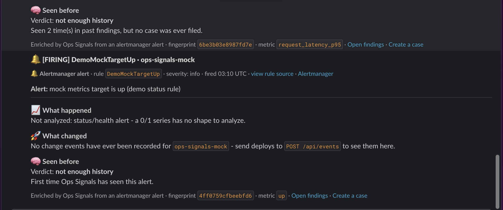

# Slack Notifications and Alert Enrichment

Ops Signals can post to Slack in two ways:

| | **Finding notifications** | **Alert enrichment** |
|---|---|---|
| Triggered by | Ops Signals' own analysis (manual, autonomous, OTLP) | An alert firing in your Prometheus Alertmanager |
| Answers | "Something unusual happened that you may not have an alert for" | "This alert just fired: what happened, what changed, have we seen it before?" |
| Posts when | The finding's importance ≥ `OPS_SIGNALS_SLACK_MIN_IMPORTANCE` | Every alert Alertmanager routes to Ops Signals (you choose which) |
| Turn on with | `OPS_SIGNALS_SLACK_ENABLED=true` | `OPS_SIGNALS_ALERT_ENRICHMENT_ENABLED=true` |

They're independent: use either one, or both.

---

## 1. Finding notifications

### Why it matters

A finding in the UI only helps if someone is looking at the UI. Finding notifications push
high-importance findings to the channel your team already watches, so a baseline shift that
autonomous analysis finds at 03:00 doesn't sit unseen until someone opens the dashboard.

### What you need to do

1. In Slack's app settings (api.slack.com/apps), create an app, turn on **Incoming Webhooks**, and
   add a webhook for your channel. Copy the URL.
2. Add these to `.env` (see `.env.example`):
   ```bash
   OPS_SIGNALS_SLACK_ENABLED=true
   OPS_SIGNALS_SLACK_WEBHOOK_URL=https://hooks.slack.com/services/...
   OPS_SIGNALS_SLACK_MIN_IMPORTANCE=0.7   # only findings at or above this importance (0-1)
   ```
3. Restart the backend (`./scripts/run_all.sh` loads `.env` automatically).
4. Check the wiring without waiting for a real finding:
   ```bash
   ./scripts/send_test_slack_finding.py
   ```

Posting is best-effort: a broken or unreachable webhook is logged and never fails the analysis.

---

## 2. Alert enrichment: Alertmanager → analyzers → Slack



### Why it's needed

When a page fires, the alert says only that a threshold was crossed:

```
[FIRING:1] CheckoutHighLatency
checkout-api p95 latency above 300ms
```

The on-call engineer then spends the first 10-20 minutes working out the same three things:

1. **What happened?** A spike, a sustained shift, or a slow trend? Since when?
2. **What changed?** Was something just deployed?
3. **Have we seen this before?** Was it real last time, and what fixed it?

Ops Signals already has the pieces that answer each one: explainable analyzers, and operational
memory of past cases and outcomes. Until now they only ran when someone opened the UI or on a
schedule. Alert enrichment runs them **at the moment an alert fires** and puts the answers in the
same Slack message.

### What you get

Each alert becomes one message with three sections (see the screenshot above):

- **📈 What happened**: Ops Signals pulls the alerting series from Prometheus, runs the same
  analyzers used everywhere else, and reports the finding in plain language, e.g. "sustained
  baseline shift ~621 → ~425 ms, started around 23:59 UTC". If autonomous analysis already caught
  the problem, it reuses that finding and says how much earlier it was detected.
- **🚀 What changed**: deploys and config changes for the same service shortly before the change,
  e.g. "started 7 min after deploy `v2.0.0`". Your CI sends these to `POST /api/events`. See
  [How changes are timed](#how-changes-are-timed) for how the start time is chosen.
- **🧠 Seen before**: the existing alert-context lookup. How often this alert fired before, how
  many times it was confirmed real or dismissed as noise, the most common root cause, and the most
  similar resolved case with its fix.

The message always says where it came from: `[FIRING]` in the header, an **"Alertmanager alert ·
rule X"** line with links back to the rule and Alertmanager, and an "Enriched by Ops Signals from an
alertmanager alert" footer with the alert's fingerprint. It can't be confused with Ops Signals' own
finding notifications. When the alert resolves, a short **✅ [RESOLVED]** follow-up is posted.

### Advantages

- **Faster triage.** The first questions on every page are answered in the page itself.
- **Nothing to change in your alerting.** Ops Signals is an *extra* Alertmanager receiver. Your
  existing Slack/PagerDuty routes keep working exactly as before, and if Ops Signals is down,
  nothing is lost.
- **Useful from day one.** Analysis and deploy correlation don't need history. Memory
  ("seen before") gets better with every alert your team records an outcome for.
- **Explainable, not a black box.** The "what happened" text comes from the same published analyzer
  methods as the rest of Ops Signals. Deploy matches say "started after", never "caused by".
- **Honest when it can't help.** Alerts that aren't worth analyzing (status/`up == 0`, `absent()`,
  log/LogQL alerts, series too short) say why in the message ("Not analyzed: status/health alert")
  and still get the change and history sections.
- **Never drops or hides an alert.** A history of "likely noise" is shown as a label, not used to
  suppress anything.

### How it fits the architecture

It adds no new analysis logic. It's a new **trigger** in front of the pipeline you already have, and
a new **consumer** at the end of it:

```text
Prometheus rule fires
  -> Alertmanager ------------------------------> your existing routes (unchanged)
  -> POST /api/integrations/alertmanager   (new: returns 202 at once, works in the background)
       -> dedupe by alert fingerprint
       -> decide whether to analyze (PromQL metric alert? or status / log / absent alert?)
       -> query Prometheus for the series (default 6h, 30s step)  <- existing PrometheusQueryService
       -> Analyzer Registry -> Signals -> Findings                <- existing SignalPipeline
       -> change events near the change point                     <- new: POST /api/events
       -> alert-context lookup (history, similar cases)           <- existing GET /api/alert-context logic
  -> one Slack message, stored in ops_alert_enrichments
```

- The analysis run and its finding land in the normal findings/signals tables, so they appear in the
  UI like any other finding and feed operational memory.
- Every processed alert is stored in `ops_alert_enrichments`, including the rendered message and
  whether it was posted, so "why didn't I get a message?" has an answer.
- `GET /api/alert-context` still exists unchanged for tools that want to pull the lookup
  themselves. Alert enrichment is the built-in consumer of the same logic.
- A generic `POST /api/alerts` accepts alerts from non-Alertmanager sources in a simple JSON shape.

Design details, decision tables and trade-offs: [`design/alert-enrichment-plan.md`](design/alert-enrichment-plan.md).

### What you need to do

#### Try it locally (about 5 minutes)

1. Create a Slack incoming webhook (step 1 of [§1](#what-you-need-to-do)).
2. In `.env`:
   ```bash
   OPS_SIGNALS_ALERT_ENRICHMENT_ENABLED=true
   # Optional: a separate channel for alerts. Otherwise OPS_SIGNALS_SLACK_WEBHOOK_URL is used.
   OPS_SIGNALS_ALERT_SLACK_WEBHOOK_URL=https://hooks.slack.com/services/...
   ```
3. Start everything:
   ```bash
   ./scripts/run_all.sh
   ```
   With enrichment on, this also starts a local Alertmanager and two demo alert rules
   (`docker-compose.alerting.yml`). Two messages arrive within a minute or two.
4. Fire more alerts whenever you like:
   ```bash
   ./scripts/send_test_alert.py
   ./scripts/send_test_alert.py --scenario status
   ./scripts/send_test_alert.py --deploy-minutes-ago 5
   ./scripts/send_test_alert.py --resolve --run-id <id printed when firing>
   ```

#### Connect your real Alertmanager

1. **Add Ops Signals as an extra receiver.** Keep your existing routes, and add a route with
   `continue: true` in front of them:
   ```yaml
   route:
     routes:
       - receiver: ops-signals
         matchers: [severity=~"critical|warning"]   # choose which alerts get enriched
         continue: true                             # existing routes still fire
       # ... your existing routes ...
   receivers:
     - name: ops-signals
       webhook_configs:
         - url: http://<ops-signals-host>:8001/api/integrations/alertmanager
           send_resolved: true
           http_config:
             authorization:
               credentials: <OPS_SIGNALS_ALERT_RECEIVER_TOKEN>
   ```
2. **Point Ops Signals at the same Prometheus** your rules run on: `OPS_SIGNALS_PROMETHEUS_URL`.
3. **Make sure alerts carry a service label.** By default the first of `service`, `job`, `app`,
   `app_kubernetes_io_name` is used (`OPS_SIGNALS_ALERT_SERVICE_LABELS`).
4. **Send deploy events from CI** (optional, but it's what fills "What changed"). Use the same
   service name as the alert's service label:
   ```bash
   curl -X POST http://<ops-signals-host>:8001/api/events \
     -H 'Content-Type: application/json' \
     -H "Authorization: Bearer $OPS_SIGNALS_EVENTS_TOKEN" \
     -d '{"service":"checkout-api","type":"deploy","version":"'"$GIT_SHA"'","url":"'"$RUN_URL"'"}'
   ```
   `type` is one of `deploy`, `config`, `feature_flag`, `scale`, `rollback`, `other`.
5. **Set the tokens** for any non-local deployment (`OPS_SIGNALS_ALERT_RECEIVER_TOKEN`,
   `OPS_SIGNALS_EVENTS_TOKEN`). A receiver without its own token uses `OPS_SIGNALS_API_TOKEN`
   instead, and is open only when neither is set. See [security-model.md](security-model.md).

#### Per-rule annotations (optional)

| Annotation | Effect |
|---|---|
| `ops_signals_query: '<PromQL>'` | Series to analyze, when the rule's expression is too complex to reuse automatically (e.g. `a > b`, `and`/`or`) |
| `ops_signals_metric: <name>` | Stable metric name for history lookups |
| `ops_signals_lookback: 24h` | More history before the alert (e.g. for metrics with daily patterns) |
| `ops_signals_analyze: "false"` / `"true"` | Force analysis off or on for this rule |
| `ops_signals_notify: "false"` | Enrich and store, but don't post to Slack |

#### Controlling Slack messages

Enrichment and posting are separate. Every setting below still enriches and stores the alert:

| Setting | Effect |
|---|---|
| `OPS_SIGNALS_ALERT_NOTIFY=none` | Never post |
| `OPS_SIGNALS_ALERT_NOTIFY_SEVERITIES=critical,warning` | Post only these severities |
| `OPS_SIGNALS_ALERT_NOTIFY_ON_RESOLVE=false` | No resolve follow-ups |
| annotation `ops_signals_notify: "false"` | Don't post this rule's alerts |

All settings, with their defaults, are listed in `.env.example`.

#### How changes are timed

Change events are matched against the moment the problem started, and that moment comes from the
pattern the analyzers found. Only a pattern with a real start can say "started N min after":

| Pattern found | Start time used | "What changed" says |
|---|---|---|
| Step change (`baseline_shift`, `ruptures`) | The change point | "Started 6 min after deploy `v2.3.1`", plus where the start time came from |
| Spike (`anomaly_zscore`, `pyod_outlier`, `stumpy`) | When the spike began | "Spike started 2 min after deploy `v4.1`". If the metric is also trending, it says the trend may have another cause |
| Trend only | None | "Gradual upward trend with no clear start time", then nearby changes listed for reference, timed from when the alert fired |
| Nothing usable (not analyzed, no significant change) | None | "No start time found in the metric", then nearby changes timed from when the alert fired |

When both are present, a step change wins over a spike, and among spikes the latest one before
the alert wins. Change events from a different environment than the alert are skipped: the alert's
`env`, `environment` or `deployment_environment` label is compared with the event's `env`, and
events that name no environment still match.

| Setting | Default | Effect |
|---|---|---|
| `OPS_SIGNALS_ALERT_STEP_LOOKBACK` | `window` | How far before the alert a step change still counts as its start. `window` means anywhere in the analysed range (`OPS_SIGNALS_ALERT_LOOKBACK`) |
| `OPS_SIGNALS_ALERT_SPIKE_LOOKBACK` | `1h` | How far before the alert a spike still counts. Older spikes are treated as over |
| `OPS_SIGNALS_ALERT_CHANGE_WINDOW_BEFORE` | `30m` | List change events up to this long before the start time |
| `OPS_SIGNALS_ALERT_CHANGE_WINDOW_AFTER` | `5m` | List change events up to this long after the start time |
| `OPS_SIGNALS_ALERT_MATCH_ENV` | `true` | Skip change events from another environment |

The timing only says what happened when. It never says a change caused the problem.

### Troubleshooting

The **Integrations** page (`/integrations`) lists recent alerts with the finding or case each was
linked to, and its **Send test alert** button pushes one synthetic alert through the whole path
(receive, enrich, Slack). The same list is available from the API:

```bash
curl -s "http://localhost:8001/api/alerts?limit=10"
```

Filters: `status` (`firing`/`resolved`), `service`, `finding_id`, `since`, `limit` (1-500). Like
every read it needs the API token when `OPS_SIGNALS_API_TOKEN` is set - the receiver token only
allows posting alerts. `POST /api/integrations/alertmanager/test` (the button) is not a public
receiver either: it needs the API token.

Every alert Ops Signals receives is stored with its outcome:

```bash
docker exec ops-signals-postgres psql -U ops_signals -d ops_signals -c \
  "select alert_name, analysis_status, notify_status, error from ops_alert_enrichments order by id desc limit 10;"
```

| You see | Meaning |
|---|---|
| No rows at all | Enrichment is off (`OPS_SIGNALS_ALERT_ENRICHMENT_ENABLED`, then restart), or Alertmanager isn't reaching the backend (check the webhook URL/port) |
| `notify_status = suppressed:no_webhook` | No Slack webhook configured |
| `notify_status = suppressed:<reason>` | Posting was turned off by a setting above |
| `notify_status = failed` | Slack rejected the post; see `error` |
| `analysis_status = skipped:<reason>` | Analysis didn't apply (status/log/absent alert, no PromQL, ambiguous series). The message still has changes + history |
| A repeat of the same alert isn't posted | Expected: repeats within 6h of the same firing are deduplicated. A new firing after a resolve is posted |

### Current limitations

- Metric analysis needs Prometheus (or Prometheus-compatible) alerts. Grafana-managed and Loki
  alerts get the change and history sections only.
- One Prometheus connection (the configured default).
- Slack messages are posted as new messages. Resolve follow-ups aren't threaded under the original
  (that needs a Slack app with a bot token rather than an incoming webhook).
- A backend restart while an alert is being processed loses that one enrichment.
- `GET /api/alerts` and the Integrations page list alerts, but not the full stored enrichment or
  Slack message (query `ops_alert_enrichments` for those). No automatic retention cleanup yet.
- Test alerts from **Send test alert** stay `firing` (there is nothing to resolve them); they are
  labelled "Test alert" in the UI and carry the label `ops_signals_test=true`.
