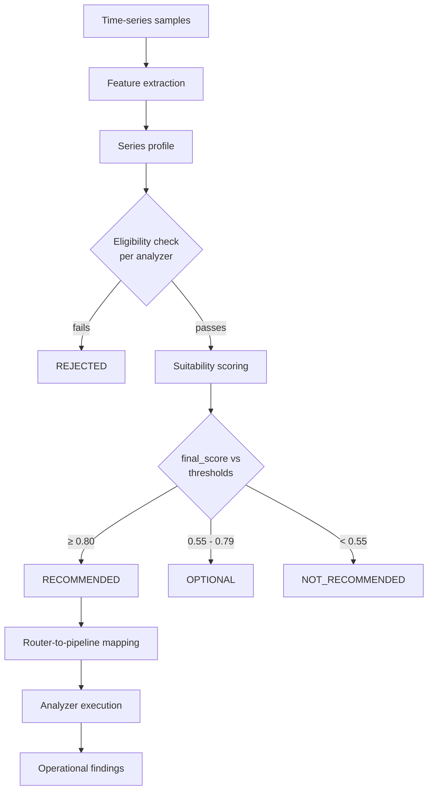
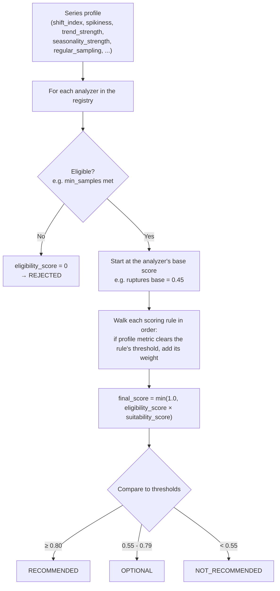

# Analyzer Recommendation & Routing

Ops Signals analyzes operational time-series data such as CPU, memory, request rate, latency, and
network traffic. Different analyzers are designed for different signal shapes - a change-point
analyzer works well for a baseline shift, a motif detector is more appropriate for repeating
patterns. Rather than running every analyzer on every metric, Ops Signals profiles the series
first and routes to the analyzers whose declared strengths match what the profile shows.

This is the single reference for how that works. It replaces five previously-scattered docs (see
[Document History](#document-history) at the bottom).

## Which analyzer fits my metric?

To see which analyzers suit one metric, open **Analyzer Workbench → Which analyzer fits?**, pick the
metric, and click **Find the right analyzer**. Ops Signals scores every analyzer against the
metric's stored data from its latest analysis, with the same router and profile a real run uses,
and shows three columns:

- **Good fit** - the router recommends it for this data.
- **Can help** - optional: it may add something, but it isn't the best match.
- **Not a fit** - not recommended or ruled out for this data.

Each analyzer shows what it looks for in plain words and whether it **ran last time** on this
metric (from that run's record of what ran). **How sure?** shows the score, **Why?** the router's
reasons, **Try in Labs** opens its sandbox Lab, and **Its settings** opens
[Settings in use](configuration.md#see-which-analyzer-settings-are-in-use) for this metric. Tools the router knows about but
that aren't built into Ops Signals are listed under the columns; they can't run here.

A new analyzer shows up on the next check, with no restart, when its registration in
`config/analyzer_registry.d/` has a `router` block with `supported_profiles` or `scoring_rules`
(the Add Analyzer wizard writes one). Registered analyzers without one are never scored, so they
aren't in the columns: the page names them under **Not scored by the router**. They run only when
analysis is set to run every analyzer ([Selection modes](#selection-modes)). Today that's Baseline
Shift, Z-Score Anomaly and Seasonal Anomaly.

The page changes nothing. If an analyzer ran on the metric but is **Not a fit**, the page offers a
per-service setting (`selection.disabled`) to save in `config/analyzer_overrides.d/` that turns it
off for this metric only. Settings can turn analyzers off or tune them, never turn one on: the
router still decides what runs.

A metric that isn't listed has no stored data yet. Analyze it first from **New Analysis** (a data
source or a CSV file), then pick it here. A link such as
`/analyzer-recommendation?service=checkout&metric=http_latency_ms` opens the page with that metric
picked. With AI set up, a separate **Second opinion** box shows the AI model's own pick; it never
changes the columns ([Optional AI second opinion](#optional-ai-second-opinion)).

## Definitions

The routing terms used on this page. The [glossary](glossary.md) has every other Ops Signals term.

| Term | Meaning |
| --- | --- |
| **Analyzer** | A component that inspects a time series for a particular kind of behavior (a spike, a trend, a repeating pattern, ...). |
| **Router** | The explainable, rule-based analyzer *selection* engine - not a trained model, not an LLM. |
| **Series profile** | A measurable summary of the signal's shape and data quality (trend strength, seasonality, spikiness, ...). |
| **Eligibility** | Whether an analyzer can *technically* operate on this data (enough samples, regular enough timestamps). |
| **Suitability** | Whether an *eligible* analyzer is a *useful match* for the observed signal shape. |
| **Recommendation** | The category the router assigns an analyzer: `RECOMMENDED`, `OPTIONAL`, `NOT_RECOMMENDED`, or `REJECTED`. |
| **Pipeline analyzer** | The executable analyzer implementation the main analysis pipeline actually runs. |
| **Operational finding** | The user-facing result produced from analyzer signals and evidence. |

> **Important:** recommendation scores are suitability scores used for routing, not probabilities
> or statistical confidence values. A score of `0.86` does not mean the analyzer has an 86% chance
> of being correct. See [`docs/analyzer-methodology.md`](analyzer-methodology.md) for how
> honest that distinction currently is - the scoring *weights* themselves are hand-authored
> heuristics, not yet validated against real outcomes.

## How it works - the full flow



| Stage | What happens |
| --- | --- |
| Time-series samples | The pipeline receives timestamped numeric observations. |
| Feature extraction | The router calculates measurable properties: sample count, regularity, trend, seasonality, spikes, shifts. |
| Series profile | Those properties are stored as a structured profile. |
| Eligibility check | Each analyzer is checked against technical requirements (minimum samples, regular timestamps). Fails become `REJECTED`. |
| Suitability scoring | Eligible analyzers receive a score from configurable YAML rules. |
| Recommendation category | The score is converted into `RECOMMENDED`, `OPTIONAL`, or `NOT_RECOMMENDED`. |
| Router-to-pipeline mapping | Router analyzer IDs are mapped to executable pipeline analyzer IDs. |
| Analyzer execution | The pipeline executes only the analyzers the configured selection mode allows. |
| Operational findings | Signals from executed analyzers become findings for investigation. |

Implementation references: [`experiments/analyzer_router/router.py`](../experiments/analyzer_router/router.py) ·
[`experiments/analyzer_router/feature_extractor.py`](../experiments/analyzer_router/feature_extractor.py) ·
[`experiments/analyzer_router/eligibility.py`](../experiments/analyzer_router/eligibility.py) ·
[`experiments/analyzer_router/analyzer_registry.yaml`](../experiments/analyzer_router/analyzer_registry.yaml) ·
[`intelligence/pipeline.py`](../intelligence/pipeline.py) · [`config/analyzers.yaml`](../config/analyzers.yaml)

## The scoring algorithm, specifically

This is the part inside the "Suitability scoring" box above, expanded - the actual per-analyzer
calculation.



A concrete worked example - `ruptures`' real formula
(`experiments/analyzer_router/analyzer_registry.yaml`):

```yaml
scoring_rules:
  base: 0.45
  rules:
    - metric: shift_index,      gte: 0.12, add: 0.18
    - metric: shift_index,      gte: 0.22, add: 0.22
    - metric: shift_index,      gte: 0.32, add: 0.08
    - metric: regular_sampling, equals: true, add: 0.08
    - metric: spikiness,        gt: 0.35,  add: 0.04
```

A series with `shift_index = 0.25`, regular sampling, and moderate spikiness scores:
`0.45 (base) + 0.18 (shift_index ≥ 0.12) + 0.22 (shift_index ≥ 0.22) + 0.08 (regular sampling) = 0.93`
→ comfortably `RECOMMENDED`.

### Profile-match bonus/cap, and the shape-vs-irregularity split

On top of the additive scoring rules above, the score is nudged once more based on whether the
analyzer's own declared `supported_profiles` overlap the series' `detected_profiles`
(`experiments/analyzer_router/router.py`, `_suitability_score`):

- **Match** (e.g. `pyod_outlier` supports `anomaly/outlier/spike`, and the series was detected as
  `anomaly`): `+ PROFILE_MATCH_BONUS` (`0.10`).
- **Mismatch** (the series' detected profile shares nothing with what the analyzer claims to
  support): score is capped at `PROFILE_MISMATCH_CAP` (`0.54`) - below the `0.55` `OPTIONAL` floor,
  so a mismatch alone is enough to force `NOT_RECOMMENDED` regardless of the additive rules above.

That mismatch cap is only meaningful for analyzers that actually make a claim about the series'
*shape* (`seasonal`, `repeating_pattern`, `trend`) - `stumpy`, `prophet`, `ruptures`, `kats`. It was
previously applied uniformly, including to analyzers whose *entire* declared purpose is spotting
*irregularities* (`anomaly`, `outlier`, `spike`, `baseline_shift`, `regime_change`) and who never
claimed anything about shape in the first place - `pyod_outlier`, `pyod`. A series labeled purely
`seasonal`/`repeating_pattern` (no irregularity label detected yet - e.g. NYC taxi demand, where
real anomalies exist but the raw `spikiness` metric doesn't cross its threshold, see "Known gaps"
below) would cap these analyzers at `0.54` regardless of what their own `spikiness`/`shift_index`
evidence actually said - the series *being seasonal* was treated as evidence *against* an
irregularity check that never depended on seasonality at all.

The fix (`IRREGULARITY_PROFILES` / `_is_irregularity_only` in `router.py`): an analyzer is exempt
from the mismatch cap only if **both** hold - (a) its behavioral `supported_profiles` are entirely
drawn from the irregularity set, and (b) none of its own `scoring_rules` test a shape metric
(`seasonality_strength`, `trend_strength`, ...). Condition (b) matters because the profile label
alone isn't reliable: `adtk`'s supported-profile list filters down to `{spike, outlier}` (its
`seasonal_anomaly` entry doesn't textually match the fixed vocabulary's `seasonal`), but its own
scoring rules reward `seasonality_strength` directly - it's a genuine seasonal-contradiction
detector, mislabeled by a naming gap, and stays gated on shape as before. Only `pyod_outlier` and
`pyod` currently qualify for the exemption.

**What the fix does on its own**, confirmed against `benchmark/run_router_scenarios` and a real NAB
series (`nab_nyc_taxi`): it removes a false floor - an
irregularity analyzer can no longer be pinned at `0.54`/`NOT_RECOMMENDED` purely for sharing no
label with the series' shape. It does **not**, by itself, manufacture evidence: on `nab_nyc_taxi`
before the feature-extraction fix below, `pyod_outlier`'s own `spikiness`/`shift_index` rules
didn't fire, so its score stayed at `0.46`/`NOT_RECOMMENDED` even with the cap removed - the cap
only matters for a series where the additive rules already score above `0.54` but get knocked back
down by a shape label the analyzer never claimed to care about.

### Seasonal residual: making spikiness/shift_index mean something on seasonal data

`nab_nyc_taxi` exposed a second, independent gap once the shape-mismatch cap stopped hiding it:
`spikiness`/`shift_index` (`experiments/analyzer_router/feature_extractor.py`) measure point-to-
point jumps against the *raw* series. On a strongly seasonal series (taxi demand swings by
thousands of rides every single day just from rush hour), that everyday swing is bigger than a real
anomaly's jump, so the anomaly reads as *quieter* than normal and never crosses either metric's
reward threshold - `spikiness` came back `0.0` on the raw taxi series despite five real,
NAB-labeled demand shocks in the data.

**The fix**: when `seasonality_strength >= 0.42` (the same bar used above) and a dominant period was
found, `spikiness` is computed on `values[t] - values[t - dominant_lag]` - each point compared to
the same point one cycle back - instead of the raw point-to-point jump. Falls back to raw-value
behavior automatically when seasonality isn't detected or there's under one cycle of history, so
non-seasonal series (the majority of the router benchmark scenarios) are unaffected. On
`nab_nyc_taxi` this took `spikiness` from `0.0` to `1.0` (max) and `shift_index` from `~0.05` to
`~1.0`. This one number feeds 8 different analyzers' scoring rules (`ruptures`, `river`, `kats`,
`alibi_detect`, `trend_regression`, `adtk`, `pyod`, `pyod_outlier`), so the fix was verified with a
full `benchmark/run_router_scenarios` diff against the pre-fix baseline, not just unit tests -
zero regressions despite the wide blast radius.

### Two more links in the chain: execution-slot filtering and a config-key typo

Getting `pyod_outlier` to a correctly-computed `RECOMMENDED` (0.86 on `nab_nyc_taxi`, once the two
fixes above are both in place) turned out not to be enough on its own - two more, unrelated bugs
were standing between "correctly recommended" and "actually executes":

- **Execution-slot filtering** (`intelligence/pipeline.py`, `_selected_router_analyzers`):
  `recommended_threshold` mode picks the top `max_analyzers` (3, by default) purely by score, with
  no check that a candidate can actually execute. On `nab_nyc_taxi`, `darts` and `adtk` both tied
  at score `1.0` with zero pipeline analyzer behind either of them (see the routing matrix below),
  and were winning 2 of the 3 execution slots away from `pyod_outlier` (0.86) - a real analyzer
  that could actually produce a finding. Fixed by filtering candidates to those with an available
  pipeline mapping (`_available_pipeline_analyzer_ids`) *before* ranking and capping, not after.
  An existing test, `test_recommended_threshold_selects_top_recommended_executable_analyzers`
  (`tests/test_csv_pipeline.py`), was already named for this promise but its own fixture proved the
  bug - `kats` (no pipeline analyzer) was asserted to win a slot over a real one.
- **A config-key typo** (`config/analyzers.yaml`): the `pyod_outlier` override block used
  `finding_rules` (plural) - almost certainly copy-pasted from the `anomaly_zscore` block just
  above it - but `PyODOutlierAnalyzer.__init__` only accepts `finding_rule` (singular). The extra
  kwarg raised inside `instantiate()`, and `SignalPipeline._build_analyzers`'s try/except silently
  swallowed the error, logging it but returning nothing - `pyod_outlier` never constructed via
  `provider=generic` (the real upload/API path), no matter how the router scored it. This had
  presumably been broken since whenever that override block was written; it was invisible until the
  three fixes above finally got `pyod_outlier` selected for the first time. Fixed by correcting the
  key name; a new regression test constructs every built-in analyzer through the exact same
  override-merge path a real CSV upload uses
  (`test_every_builtin_analyzer_constructs_under_the_real_generic_provider_config`), so a
  reintroduced mismatch fails a test instead of silently vanishing from a live run.

**Combined, verified:** all four fixes together were checked on `nab_nyc_taxi`, re-run against the
actual production API path (`POST /api/ingestion/csv-run`, `provider=generic`) at each step, not
estimated. Precision on that series is the open question - see "Known gaps".

**Where the weights come from:** they're expert-defined heuristics, hand-chosen when the registry
was written - not fit against outcome data, not benchmarked against a calibration methodology. See
[`docs/analyzer-methodology.md`](analyzer-methodology.md) for the full honest accounting of
this, the infrastructure built to validate it, and how to contribute to calibrating it.

## Series profile features

| Property | Simple meaning |
| --- | --- |
| `sample_count` | Number of observations available |
| `regular_sampling` | Whether samples arrive at consistent intervals |
| `irregular_sampling_percentage` | Degree of inconsistent spacing |
| `missing_percentage` | Amount of missing data |
| `trend_strength` | Strength of sustained upward or downward movement |
| `seasonality_strength` | Strength of repeating behavior |
| `spikiness` | Degree of short, sudden, often-reverting changes |
| `shift_index` | Evidence of a real jump between two operating levels (computed by searching for the best split point, not just overall dispersion) |
| `constant_value_percentage` | Portion of the series that remains unchanged |

Additional implementation-only fields: `valid_sample_count`, `duplicate_timestamp_count`,
`sampling_interval_seconds`, `duration_seconds`, `mean`, `stddev`, `minimum`, `maximum`,
`variance`, `trend_slope`, `autocorrelation`.

## Eligibility vs. suitability

| Concept | Question it answers | Example |
| --- | --- | --- |
| Eligibility | Can this analyzer technically operate on the data? | Does Prophet have enough regularly-sampled, timestamped points? |
| Suitability | Is this analyzer a useful match for the signal shape? | Does the series have enough trend/seasonality for forecasting to be informative? |

A series can be eligible for an analyzer (good data quality) while still being a weak *suitability*
match (Prophet has enough data, but the series has no real trend or seasonality to forecast).

## Recommendation categories

| Category | Meaning | Executes in `recommended_only` |
| --- | --- | --- |
| `RECOMMENDED` | Eligible and a strong match | Yes |
| `OPTIONAL` | Eligible, potentially useful, below the strict threshold | No |
| `NOT_RECOMMENDED` | Eligible, but currently a weak match | No |
| `REJECTED` | Technical eligibility requirements failed | No |

Current default thresholds (`experiments/analyzer_router/router.py`):

```text
RECOMMENDED:     final_score >= 0.80
OPTIONAL:        0.55 <= final_score < 0.80
NOT_RECOMMENDED: final_score < 0.55
REJECTED:        eligibility failed
```

## Analyzer library & routing matrix

"Pipeline analyzers" are what the production pipeline can actually execute. "Router-only" entries
are known to the recommendation engine but have no direct runtime implementation - a router
recommendation for one of these executes a mapped fallback instead (see the mapping table below).

| Analyzer name | Library | Used in real execution? | Why used, with example |
| --- | --- | --- | --- |
| `baseline_shift` | [ruptures](https://github.com/deepcharles/ruptures) + pandas preprocessing | Yes, but no router entry: runs in `all`/`manual_override` mode only. `ruptures` finds the same change point | Sustained level changes of at least 25%. CPU average moves from 40% to 70% after a deploy. |
| `ruptures` | [ruptures](https://github.com/deepcharles/ruptures) | Yes - the router's change-point analyzer | Baseline/regime shifts and when they happened. |
| `anomaly_zscore` | Internal z-score logic (pandas) | Yes, but no router entry: runs in `all`/`manual_override` mode only. `pyod_outlier` covers spikes when routed | Isolated unusual values. Memory normally ~55%, one window jumps to 95%. |
| `trend` | [statsmodels](https://www.statsmodels.org/) OLS | Yes | Gradual directional movement. Disk grows 50% → 85% over days. |
| `stumpy` | [STUMPY](https://stumpy.readthedocs.io/en/latest/) | Yes, when installed (numpy fallback otherwise) | Repeated motifs. Request traffic repeats the same daily shape. |
| `prophet` | [Prophet](https://facebook.github.io/prophet/docs/quick_start.html) | Optional - falls back to `numpy.polyfit` if not installed | Forecastable metrics with trend/seasonality. |
| `pyod_outlier` | [PyOD](https://pyod.readthedocs.io/en/latest/index.html) (KNN) | Yes | Isolated anomalous points when z-score is too simple. |
| `trend_regression` | Concept, maps to `trend` | No separate runtime analyzer | Router's conceptual label for linear movement. |
| `adtk` / `pyod` | [ADTK](https://adtk.readthedocs.io/en/stable/) / [PyOD](https://pyod.readthedocs.io/en/latest/index.html) | No - no pipeline analyzer or fallback mapping exists | Rule-based / outlier-centric anomaly checks. |
| `darts` | [Darts](https://unit8co.github.io/darts/) | No - no pipeline analyzer or fallback mapping exists | Richer, multi-seasonal forecasting. |
| `kats` | [Kats](https://github.com/facebookresearch/Kats) concept | No direct package, no fallback mapping | Mixed-behavior series (shift + trend + seasonality together). |
| `alibi_detect` | [Alibi Detect](https://github.com/SeldonIO/alibi-detect) | No direct implementation | Distribution drift without a clear mean shift. |
| `river` | [River](https://github.com/online-ml/river) | No - pipeline is batch-oriented, not streaming | Online, point-by-point anomaly scoring. |

**Use this table as the source of truth for whether a router recommendation can execute today.**
`baseline_shift` and `ruptures` share the same change-point code; `baseline_shift` adds a 25% level
rule. Routing both was measured and rejected (about 29% slower, timeouts on large series, no new
detections), and `anomaly_zscore` stays unrouted because of its false-alarm rate on NAB. Behavior
rules read `ruptures` and `pyod_outlier` facts, so they still match in the default mode.

**Correction (verified against `intelligence/pipeline.py` while investigating the NAB
benchmark):** this table and the mapping below previously
claimed `darts` falls back to `prophet` and `adtk`/`pyod` fall back to `anomaly_zscore`. Those
fallbacks do not exist in code - `_router_to_pipeline_analyzers()` (below) defines exactly one
alias, `trend_regression` -> `trend`. `darts`, `adtk`, and `pyod` have **no** executable path today,
the same as `river`, `kats`, and `alibi_detect` - a `RECOMMENDED` result for any of the six has
nothing to actually run. This is not just a documentation gap: it let `darts`/`adtk` silently win
execution slots away from real analyzers in `recommended_threshold` mode (see "Known gaps" -
"execution-slot filtering").

## Router-to-pipeline mapping

Router analyzer IDs aren't always one-to-one with executable analyzers
(`intelligence/analyzer_selection.py`, `_router_to_pipeline_analyzers` - this is the complete, current
mapping, not illustrative):

| Router analyzer | Pipeline analyzer(s) |
| --- | --- |
| `ruptures` | `ruptures` (identical id, no alias needed) |
| `stumpy` | `stumpy` (identical id) |
| `prophet` | `prophet` (identical id) |
| `pyod_outlier` | `pyod_outlier` (identical id) |
| `trend_regression` | `trend` (the one real alias) |

`darts`, `adtk`, `pyod`, `river`, `kats`, and `alibi_detect` have no executable mapping today - a
`RECOMMENDED` result for any of these currently has nothing to actually run.
`recommended_threshold` selection now filters these out before ranking/capping precisely because of
this (see "Known gaps"), so they no longer occupy an execution slot, but implementing them (or
formally retiring them from the router's candidate registry) remains undecided. The router still
scores them for reference, and the benchmarks rely on those scores; each run records them as
`not_built_in` (below), so the web UI and the Grafana plugin list them apart from real candidates.

## Why an analyzer ran or didn't

Each analyzer execution record in a run (`analyzer_executions`, stored as the run's
`executed_analyzers_json`) carries a `run_reason`, so the web UI's Router Decisions panel and the
Grafana plugin show why an analyzer ran instead of only its router rating. A rating and a run can
disagree: STUMPY rated "not recommended" still runs, because it runs on every series. Codes and
default wording are in `RUN_REASON_TEXT` in
[`intelligence/analyzer_selection.py`](../intelligence/analyzer_selection.py).

| `run_reason` | Ran? | Meaning |
| --- | --- | --- |
| `router_pick` | yes | Scored high enough to take one of the `max_analyzers` slots |
| `covers_shape` | yes | Rated too low to be picked by score, but the best runnable analyzer for a shape the router detected (`cover_detected_profiles`); `shapes` names the shape |
| `spike_fallback` | yes | Spike detector added because the series looks spiky and nothing selected covers spikes |
| `always_run` | yes | `always_run: true` in its registration (STUMPY, Data Health) |
| `runs_all` | yes | Selection mode `all` |
| `chosen_in_settings` | yes | Listed in `selected_analyzers` (`manual_override`) |
| `not_built_in` | no | A router candidate with no pipeline analyzer (`darts`, `adtk`, `pyod`, `river`, `kats`, `alibi_detect`) |
| `library_missing` | no | Its optional library isn't installed; `missing_library` names it. Admins see an install hint |
| `turned_off` | no | Disabled in `config/analyzers.yaml` or its registration |
| `rejected` | no | The router ruled it out for this series |
| `not_selected` | no | Runnable, but not chosen this run |

Each analyzer that ran also gets `in_finding`: `true` when at least one of its signals is part of
one of the run's findings. One finding can merge several analyzers' signals, so this says which
analyzers fed the findings, not how many findings each produced. Runs saved before these fields
existed show the router's own wording instead.

## Optional AI second opinion

An optional LLM advisor (Gemma, via Ollama) can score the same profile independently and return
its own top pick, alongside - never instead of - the deterministic router. Divergence from the
router's pick is surfaced explicitly, never silently substituted.

```yaml
ai:
  enabled: true
  provider: ollama
  temperature: 0.0
  max_tokens: 900
  timeout_seconds: 60
  ollama:
    base_url: http://localhost:11434
    model: gemma3:4b
```

The prompt/response contract lives in
[`backend/app/metric_analyzer_recommendations/gemma_advisor.py`](../backend/app/metric_analyzer_recommendations/gemma_advisor.py).
Every AI-vs-router evaluation is now logged (`AnalyzerDivergenceEntity`,
`GET /api/metric-analyzer-recommendations/divergences`) for later correlation against real
confirmed/rejected outcomes - see [`docs/analyzer-methodology.md`](analyzer-methodology.md).

## Selection modes

Configured in [`config/analyzers.yaml`](../config/analyzers.yaml):

| Mode | Execution behavior | Recommended use |
| --- | --- | --- |
| `all` | Runs all enabled analyzers | Benchmarking, debugging |
| `recommended_only` | Runs only `RECOMMENDED` analyzers | Normal selective execution |
| `recommended_threshold` | Runs `RECOMMENDED` (and optionally `OPTIONAL`) analyzers up to `max_analyzers`, gated by `min_score` | Normal execution with an execution cap - **this is the current default** |
| `manual_override` | Runs recommended analyzers plus explicitly selected ones | Controlled testing/troubleshooting |

Current production defaults (`config/analyzers.yaml`):
```yaml
selection_mode: recommended_threshold
recommendation_execution:
  min_score: 0.80
  max_analyzers: 3
  include_optional: false
  cover_detected_profiles: true
```

How `recommended_threshold` fills its slots:

1. **Every detected problem shape gets an analyzer built for it** (`cover_detected_profiles`). For
   each profile group the feature extractor detected (spikes: anomaly/outlier/spike; level shifts:
   baseline_shift/regime_change; seasonality: seasonal/repeating_pattern; trend), the
   highest-scoring runnable analyzer that claims it and is rated at least `OPTIONAL` gets a slot,
   at most one per group. Before this, slots went purely by score, so broad high scorers
   (`prophet`, `trend_regression`) took all three and a series the profiler had flagged as spiky
   often ran no outlier detector at all. On the UCR archive, `pyod_outlier` alone locates 43
   anomalies but ran on only 14 of those series; with coverage it runs on 38.
2. **The rest go by score**, up to `max_analyzers`, from `RECOMMENDED` candidates at or above
   `min_score`.
3. **Only analyzers that can really run take a slot.** A router candidate with no pipeline
   analyzer (darts, adtk, ...) is skipped, and so is one whose optional library isn't installed
   (`requires_library` in `config/analyzer_registry.d/`): without the `prophet` package,
   `ProphetAnalyzer` fits a straight line, not the model the router scored. The router marks such
   an analyzer `REJECTED`, with the reason "the prophet library is not installed", rather than
   recommending it. Such analyzers still run in `all` mode. The router benchmark scores as if
   every library were installed, since it grades the router's choice, not this machine.

`always_run` analyzers (`data_health`) run outside this contest.

An unknown `selection_mode` does not fail validation - it falls back to unrestricted execution
(closer to `all`). Worth tightening later.

## Realistic scenarios

| Scenario | Observed profile | Likely recommendation | Likely execution |
| --- | --- | --- | --- |
| Baseline shift | Regular sampling, clear jump, elevated `shift_index` | `ruptures` RECOMMENDED | `ruptures` (`baseline_shift` only in `all`/`manual_override`) |
| Repeating/seasonal pattern | Regular sampling, high `seasonality_strength` | `stumpy` RECOMMENDED, `prophet` maybe OPTIONAL | `stumpy`, maybe `prophet` |
| Irregular spiky stream | Irregular sampling, high `spikiness`, weak seasonality | `river`/`adtk`/`pyod` may score higher | Today, none of `river`/`adtk`/`pyod` have an executable path (see "Router-to-pipeline mapping") - `pyod_outlier` is the real analyzer that actually runs for this shape |
| Short/invalid/low-information series | Too few samples, mostly constant, high missingness | Many `REJECTED` | Often nothing, in `recommended_only` |

## No analyzer was executed - is that a bug?

Not automatically. It can mean the data was valid, analyzers passed eligibility, but none reached
the strict `RECOMMENDED` threshold - "data quality: good, analyzer fit: weak" is a legitimate
outcome, often better than forcing a noisy false positive.

It can also genuinely be a problem: insufficient samples, invalid values, a mostly-constant
series, a missing router-to-pipeline mapping, a recommended analyzer disabled in config, or a
config error.

**How to investigate:** inspect the series profile → inspect router decisions/scores → check
eligibility failure reasons → check router-to-pipeline mappings → temporarily use
`manual_override` → use `all` only for debugging.

## Adding a new analyzer

Four contracts: a registry entry (router scoring rules), any new profile features it needs, a
router-to-pipeline execution mapping, and a result compatible with the normalized signal/finding
models. The fastest path is the **Add Analyzer** wizard in the web UI. Full contributor guide,
the two-registry model, and current extensibility limitations:
[`docs/analyzer-plugin-framework.md`](analyzer-plugin-framework.md).

## Tuning existing recommendation logic

Most tuning needs no Python changes - base scores, threshold comparisons (`gte`/`gt`/`lte`/`lt`),
additive weights, and explanation text all live in
[`experiments/analyzer_router/analyzer_registry.yaml`](../experiments/analyzer_router/analyzer_registry.yaml).
Code changes are only needed for a new profile metric, new eligibility behavior, a new
router-to-pipeline mapping, or a brand-new executable analyzer.

## Testing recommendations

Test controlled series shapes, not just one real CSV: stable, baseline shift, linear trend,
repeating seasonal pattern, isolated spikes, irregular sampling, missing values, mostly-constant,
short series, mixed behavior. For each analyzer, check eligibility outcome, suitability score
movement, recommendation category, explanation text, router-to-pipeline mapping, and actual
execution under every selection mode.

## Known gaps

Verified current, as of this doc:

- **Fixed this cycle:** `PROFILE_MISMATCH_CAP` used to apply uniformly to every analyzer with a
  behavioral `supported_profiles` restriction, including `pyod_outlier`/`pyod`, whose only claim is
  irregularity (`anomaly`/`outlier`/`spike`) and who never claimed anything about series shape. A
  purely `seasonal`/`repeating_pattern`-labeled series (no irregularity label detected) capped their
  score at `0.54` regardless of their own `spikiness`/`shift_index` evidence. See "Profile-match
  bonus/cap, and the shape-vs-irregularity split" above; regression test in
  `tests/test_analyzer_router_profile_matching.py::test_pyod_outlier_is_not_shape_gated_on_a_seasonal_profile`.
- **Fixed this cycle:** the Analyzer Recommendation workbench used to feed the router a fake
  `shift_index` (variance/mean) and a hardcoded `spikiness = 0.0` for every series, instead of the
  real per-split calculation the production pipeline uses - see
  [`docs/analyzer-methodology.md`](analyzer-methodology.md).
- **Fixed this cycle:** `spikiness`/`shift_index` were computed against the series' *raw* values,
  not a de-seasonalized residual - on a strongly seasonal real series with genuine anomalies riding
  on top (`nab_nyc_taxi`, five labeled demand shocks), the
  anomalies got averaged away by the series' own seasonal swing before `spikiness` was even
  computed. See "Seasonal residual" above.
- **Fixed this cycle:** `recommended_threshold` mode's `max_analyzers` cap ranked candidates by
  score alone, so a non-executable recommendation (`darts`/`adtk`, no pipeline analyzer behind
  either) could win an execution slot away from a real one. See "Two more links in the chain"
  above.
- **Fixed this cycle:** a `config/analyzers.yaml` key typo (`finding_rules` vs. `finding_rule`)
  silently crashed `pyod_outlier`'s construction on every real `provider=generic` analysis run,
  invisible until the three fixes above finally got it selected. See "Two more links in the chain"
  above.
- **Fixed this cycle (documentation only):** this doc previously claimed `darts` falls back to
  `prophet` and `adtk`/`pyod` fall back to `anomaly_zscore`. Verified against
  `intelligence/pipeline.py`: none of those fallbacks exist in code. Corrected in "Router-to-pipeline
  mapping" above.
- **Combined, verified:** the five fixes above were checked together on `nab_nyc_taxi`, re-run
  against the real `provider=generic` API path at each step (not estimated).
- **Confirmed done:** `RupturesAnalyzer` uses the real `ruptures` package (not a hand-rolled scan);
  new analyzers can be registered through `config/analyzer_registry.d/*.yml` without editing
  pipeline construction code.
- **Fixed this cycle:** `anomaly_zscore` computed mean/std over the entire analysis window on every
  run, so it kept scoring new, now-normal values against the stale pre-shift baseline for as long
  as a real shift stayed in the window - repeatedly re-flagging the same already-known event. It
  now reuses `detect_primary_change_point` (`intelligence/analyzers/ruptures.py`, the same function
  `baseline_shift` already calls) to recursively walk forward to the most recent *settled* regime
  before computing mean/std, falling back to the old whole-window behavior when no shift is found
  or too little data follows it. Regression tests in `tests/test_anomaly_zscore_analyzer.py`.
  - **Verified on real data:** re-run against the actual NAB `realAWSCloudwatch/ec2_cpu_utilization_825cc2.csv`
    (fetched fresh from `github.com/numenta/NAB` - not committed to this repo; see
    `publication/nab-dataset-reproducibility.md`'s note that this specific file has no pinned
    source) under a simulated 7-day rolling-window monitoring cadence, since a single one-shot
    batch analysis over the full history doesn't reproduce the bug at all (the failure only shows
    up when a window is repeatedly re-run with looming pre-shift history still in it). That rolling
    cadence is itself a reasonable stand-in, not a reproduction of this doc's original "20 of 34"
    measurement - the exact window/cadence behind that number isn't documented anywhere, which is
    its own gap. Result: total flagged point-instances across 8 daily rolling runs fell from 905 to
    650 (~28%), and the fix correctly stops re-flagging the same event on the later runs where the
    old code still fired.
  - **Residual limitation found by the same real-data test:** a single change point can land inside
    a still-noisy transition rather than at its true start. The recursive walk-forward mitigates
    this (confirmed with a synthetic regression test replicating the exact pattern found on the
    real EC2 series), but a stateless, single-window analyzer still has no way to tell "I already
    reported this" from "I'm seeing it for the first time." On the very first rolling run after the
    real EC2 event, the fix under-detects (1 point flagged vs. the old code's 129) because it
    correctly walks past the entire noisy transition into the settled tail, which starts after the
    labeled anomaly window ends. Cross-run alert deduplication - if this gap matters in practice -
    is a separate, larger change and was not attempted here.

Still open, not re-verified in this pass - treat as a starting point for filing issues, not a
guarantee of current state:

- `darts`, `adtk`, `pyod`, `river`, `kats`, and `alibi_detect` are router-recommendable with no
  pipeline analyzer or fallback mapping behind any of them. The execution-slot fix above stops them
  from crowding out real analyzers, but they still can't produce a finding themselves. This splits
  into two different situations, not one open question:
  - **`pyod` and `kats` specifically: this is settled, not undecided.** Both are kept deliberately
    inert - they're the canonical fixtures used across ~9 of the 11 `benchmark/*/ground_truth.yaml`
    scenarios and multiple test suites (`tests/test_csv_pipeline.py`,
    `tests/test_router_benchmark.py`, `tests/test_router_analyzer_registry_merge.py`) to verify that
    a recommended-but-non-executable analyzer can never steal an execution slot from a real one -
    see the execution-slot fix referenced above. The analyzer stabilization review already recorded
    this as done: *"Router `darts`, `kats`, and `pyod` cannot silently execute substitute
    implementations."* Removing either would mean rewriting those fixtures for no real user-facing
    gain (the router's own explanation text already says why they're not executing) - not worth it
    unless something else forces the change.
  - **`darts`, `adtk`, `river`, and `alibi_detect` remain a genuine open decision.** Unlike
    `pyod`/`kats`, these aren't standing in for anything - they're just unimplemented. `river` and
    `alibi_detect` are the more interesting candidates if this is ever picked up: implementing
    either would directly resolve one of the two `GAP`-status benchmark scenarios
    (`cpu_online_anomaly_stream_v1` needs `river`'s streaming execution mode,
    `cpu_distribution_drift_v1` needs `alibi_detect`'s drift-profile extraction - see
    [Router-only analyzers](#router-only-analyzers-what-each-one-needs) below), not just add another router entry.
- No structured evidence when multiple analyzers agree or conflict on the same finding (currently
  implicit in the summary text, not a structured field).
- No benchmark coverage of score *calibration* (is the magnitude proportional to severity), only
  selection accuracy (was the right analyzer picked).
- `STUMPY`/`Prophet` fall back to custom logic silently when the library isn't installed - the
  `library`/`library_mode` isn't always surfaced in evidence.
- The seasonal-residual fix (above) improved recall on `nab_nyc_taxi` at the cost of precision:
  many flagged points fall outside a real window once `pyod_outlier` started actually executing. Whether the same post-shift-persistence pattern
  `anomaly_zscore` had (see "Fixed this cycle" above) is at play here too, just on the residual
  instead of the raw value, hasn't been investigated.

### Router-only analyzers: what each one needs

Phase 1 validates behavior-only routing for:

- `ruptures` on pure baseline shift
- `stumpy` on pure seasonality/repeating patterns
- `trend_regression` on pure linear trend
- `pyod` and `adtk` on isolated spikes/outliers

The remaining requested analyzers need task or execution context before they can
be uniquely validated without overfitting synthetic values:

- `prophet`: Behavior overlaps with `stumpy`, `darts`, and `trend_regression`.
  The router needs an explicit forecasting task or forecast horizon to prefer
  Prophet over other seasonal/trend-compatible analyzers.
- `darts`: Behavior overlaps with Prophet for trend plus seasonality. The router
  needs a complex-forecasting task, nonlinear-model preference, or forecast
  constraint to distinguish it cleanly.
- `river`: Streaming and online anomaly detection are execution-mode choices,
  not reliably inferable from a static batch CSV. The router needs an
  `execution_mode: streaming` or online-update requirement.
- `kats`: Mixed behavior can make Kats appropriate, but it intentionally overlaps
  with Ruptures, Prophet, Darts, STUMPY, and Trend Regression. The router needs
  task intent such as "broad multi-method diagnosis" to require Kats as primary.
- `alibi_detect`: Distribution drift needs explicit `distribution_drift` or
  `drift` profile extraction. Mapping slow drift to baseline shift would hide a
  capability gap.

Suggested follow-up request shape:

```yaml
RouterRequest:
  dataframe: ...
  metric_name: cpu.usage_user
  analysis_task: forecast | motif_discovery | trend_summary | change_point | anomaly_detection | drift_detection
  execution_mode: batch | streaming
  forecast_horizon: 12h
  latency_requirement: interactive
```

## FAQ

**Is the score a probability?** No. It's a suitability score for routing. `0.86` doesn't mean 86%
confidence.

**Can multiple analyzers be recommended?** Yes - a metric can show multiple behaviors at once.

**Can I force an analyzer?** Yes, via `manual_override` with `selected_analyzers` in
`config/analyzers.yaml`.

**Can a team change thresholds for its own service?** Yes, in `config/analyzer_overrides.d/`: one
file per team, scoped to services and metrics, within each analyzer's `tunable` ranges - see
[Per-service analyzer settings](configuration.md#per-service-analyzer-settings). `selection` there
can also lower `max_analyzers` or turn analyzers off for those series.

**Does `OPTIONAL` execute?** Not in `recommended_only`. In `recommended_threshold`, only as the
coverage pick for a detected problem shape that no higher-rated runnable analyzer covers (see
"Selection modes"); otherwise it's visible for explanation, not executed.

**Does the router use an LLM?** No - it's explainable and rule-based. An LLM can optionally sit
alongside it as a second opinion (see above), never replacing it.

**Are the YAML rules learned automatically?** No - hand-configured today.
[`docs/analyzer-methodology.md`](analyzer-methodology.md) covers what's being built to
change that.

## Document history

This consolidates what were previously five separate, overlapping docs:
`recommended-only-selection-mode.md` (the most complete prior version - this doc's backbone),
`20-analyzer-library-routing-matrix.md`, `21-gemma-analyzer-recommendation.md`, and this file's own
prior thin/stale version. `analyzer-plugin-framework.md` (adding a new analyzer) and
`analyzer-methodology.md` (citations and scoring-weight honesty) remain separate, linked docs -
different audiences, not folded in here.
