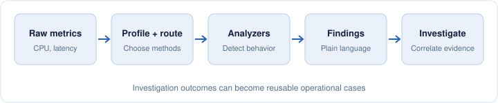
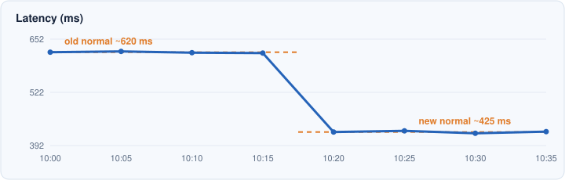
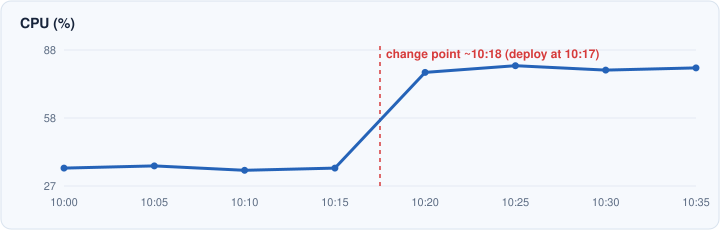
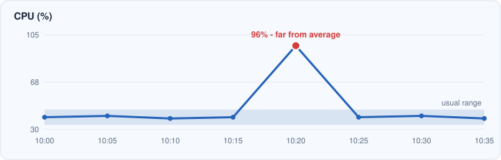
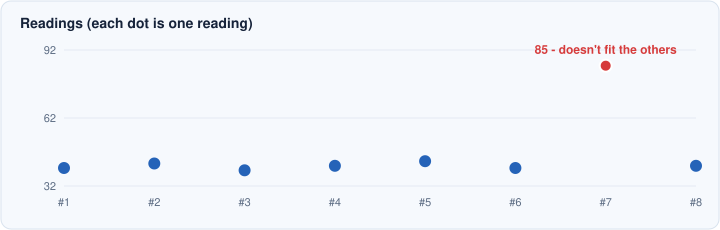
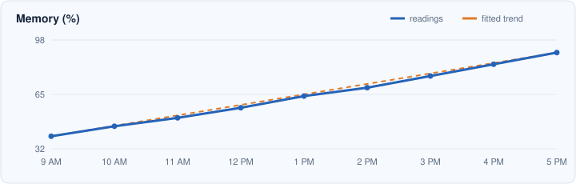
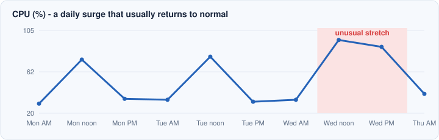
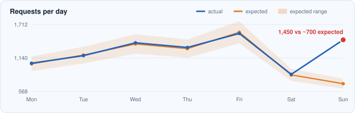
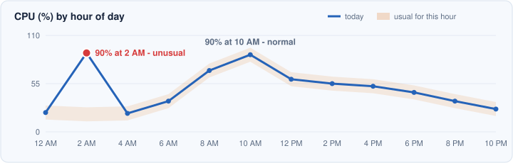
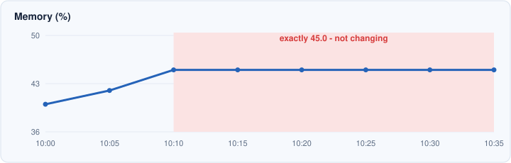

# Analyzers Explained

**The 9 Ops Signals analyzers in simple words, with a picture of each.**

Each analyzer asks a different question about CPU, memory, latency, traffic, or the quality of the
telemetry itself. The charts use illustrative data, not measured production results. For the
published method behind each analyzer and how they're benchmarked, see
[`analyzer-methodology.md`](analyzer-methodology.md).

<!-- The charts are generated: edit scripts/build_analyzer_guide.py and rerun it, don't edit the SVGs. -->

## How to read this guide

An analyzer detects a behavior. A finding explains that behavior in everyday language. Correlation
and investigation are needed before making a root-cause claim.

You don't pick analyzers yourself: the router profiles each metric and chooses the ones that suit
it. Data Health and STUMPY run on every series. Baseline Shift, Z-Score and Seasonal Anomaly run
only when you select them (selection mode `all` or `manual_override`).
The "When it runs" column in the [comparison](#one-page-comparison) has the details.

## 1. Baseline Shift - Has the normal level changed?

**Simple meaning:** detects when a metric settles at a different normal level and stays there.

**Example:** API latency stays around 620 ms, then drops to about 425 ms after a deployment and
remains there.

**What it tells us:** latency has moved to a new, lower baseline.

**Why it's useful:** it tells a lasting improvement or degradation apart from a short-lived spike.

> **Good to know:** the router doesn't choose it. It finds the same change point as Ruptures, which
> the router does choose for shifted series, and adds a rule that the level moved at least 25%.
> Running both doubled the work for no new detections.

## 2. Ruptures - When did the behavior change?

**Simple meaning:** finds the points in time where a series changes behavior.

**Example:** CPU stays near 35% and jumps to about 80% at 10:20. A deployment happened at 10:17.

**What it tells us:** behavior changed at around 10:18.

**Why it's useful:** it gives a timestamp to compare with deployments, config changes and other
events. Ops Signals shows the deploy or change just before it on the finding.

> **Baseline Shift or Ruptures?** Baseline Shift asks whether a new normal formed; Ruptures asks
> *when* behavior changed. A deploy at the same time is a lead, not proof of cause.

## 3. Z-Score Anomaly - Is this far from the average?

**Simple meaning:** flags readings that are unusually far from the recent average, measured against
how much the metric normally varies.

**Example:** CPU usually sits around 40%, briefly jumps to 96%, then returns to normal.

**What it tells us:** this reading is unusually far from the recent average.

**Why it's useful:** it catches isolated spikes and drops.

> **Good to know:** the router doesn't choose it; PyOD Outlier covers spikes in automatic mode.
> Measured on the NAB benchmark, Z-Score raised far more false alarms. It's still useful on short
> series (under 50 points, where PyOD doesn't run), so select it when you need that.

## 4. PyOD Outlier - Does this reading fit the others?

**Simple meaning:** uses a machine-learning outlier method (nearest neighbors) to find readings that
don't look like the rest of the data.

**Example:** the readings are 40, 42, 39, 41, 43, 40, 85, 41. The 85 is the outlier.

**What it tells us:** this reading is unlike the typical ones.

**Why it's useful:** it doesn't assume the data sits neatly around one average, so it still works
when Z-Score's assumption doesn't hold.

> **Z-Score or PyOD?** Z-Score measures distance from the average. PyOD measures how far a reading is
> from its nearest neighbors, which suits data with more than one usual level.

## 5. Trend Analysis - Is it steadily rising or falling?

**Simple meaning:** detects sustained upward or downward movement.

**Example:** memory climbs from 40% to 90% over eight hours.

**What it tells us:** memory use has been increasing steadily.

**Why it's useful:** an early warning of resource exhaustion. A trend alone doesn't prove a memory
leak.

## 6. STUMPY - Is this stretch unlike the rest?

**Simple meaning:** compares every stretch of the series with every other stretch, and reports a
stretch that looks unlike anything else (a *discord*).

**Example:** a daily CPU surge usually returns to normal; on Wednesday it stays high.

**What it tells us:** this stretch doesn't match the usual repeating pattern.

**Why it's useful:** it finds an unusual shape over a period of time, even when no single reading
is extreme.

> **Good to know:** in analysis, STUMPY reports only unusual stretches and stays quiet unless one
> really stands out. Finding *repeated* patterns (motifs) is in the STUMPY page of Analyzer Labs.

## 7. Prophet - What should we expect to see?

**Simple meaning:** forecasts the expected value from the trend and the daily and weekly patterns in
past data, then flags readings outside the expected range.

**Example:** Sunday traffic is normally about 700 requests, but today it reaches 1,450.

**What it tells us:** actual traffic is far above the forecast.

**Why it's useful:** it catches departures from expected demand and helps with planning.

> **Good to know:** Prophet needs the optional `prophet` Python package. Without it, the router
> rejects Prophet with the reason "the prophet library is not installed" instead of recommending it.

## 8. Seasonal Anomaly - Is this unusual for this time of day?

**Simple meaning:** compares each reading with what's usual at the same time of day or week.

**Example:** 90% CPU is normal at 10 AM during a batch job, but unusual at 2 AM.

**What it tells us:** this value is unusual for this time.

**Why it's useful:** it cuts the alerts caused by predictable daily and weekly cycles.

> **Good to know:** it's on, but left out of automatic routing: it runs when you select it. It needs
> at least three full cycles of history (three days for a daily pattern). Unlike Prophet, it doesn't
> forecast.

## 9. Data Health - Can we trust the readings?

**Simple meaning:** checks the data itself: a metric that stopped reporting (a gap) or stopped
changing (a flatline).

**Example:** memory reads exactly 45.0% for hours, probably because an exporter stopped updating.

**What it tells us:** the metric may be stale or stuck.

**Why it's useful:** it warns when bad data could mislead the other analyzers.

> **Good to know:** it runs on every analysis.

## One-page comparison

| Analyzer | Question | Example | When it runs |
| --- | --- | --- | --- |
| Baseline Shift (`baseline_shift`) | Did the normal level change? | Latency 620 → 425 ms | When you select it (Ruptures covers it otherwise) |
| Ruptures (`ruptures`) | When did it change? | CPU jumps after a deploy | Chosen by the router |
| Z-Score Anomaly (`anomaly_zscore`) | Far from the average? | CPU reaches 96% | When you select it (PyOD covers it otherwise) |
| PyOD Outlier (`pyod_outlier`) | Unlike the other readings? | One reading of 85 among ~40s | Chosen by the router |
| Trend Analysis (`trend`) | Steadily rising or falling? | Memory grows every hour | Chosen by the router |
| STUMPY (`stumpy`) | Is a stretch unlike the rest? | Wednesday's CPU surge doesn't end | Every series |
| Prophet (`prophet`) | What should we expect? | Sunday traffic double the forecast | Chosen by the router, when `prophet` is installed |
| Seasonal Anomaly (`seasonal_anomaly`) | Unusual for this time? | High CPU at 2 AM | When you select it |
| Data Health (`data_health`) | Can we trust the data? | Metric stops updating | Every analysis |

<!-- pdf: page break -->

## How the analyzers work together

For the same payment service, Trend may flag steadily rising memory, Ruptures may find a CPU change
right after a deploy, Baseline Shift may find latency settled higher, STUMPY may find an unusual CPU
stretch, and Data Health may warn that one metric stopped updating.

**What users see:** "Memory has risen for six hours", "CPU behavior changed after the deploy", or
"This workload pattern is new" - not algorithm names.

**The core idea:** different behaviors need different techniques. Ops Signals picks the right ones,
so your team doesn't have to.

**The boundary:** analyzers detect behaviors, not proven root causes. An investigation needs more
evidence: other metrics, logs, changes, and similar past cases.
