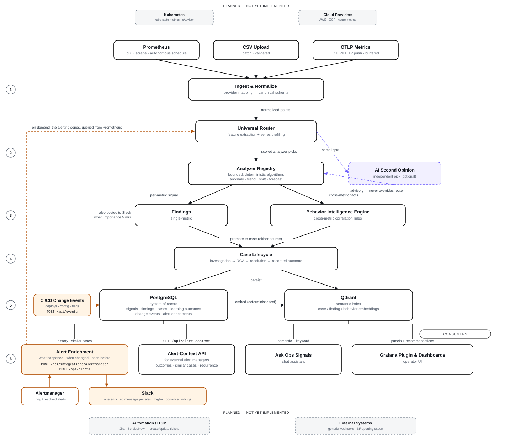
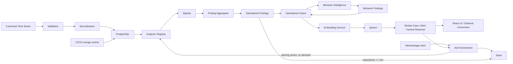
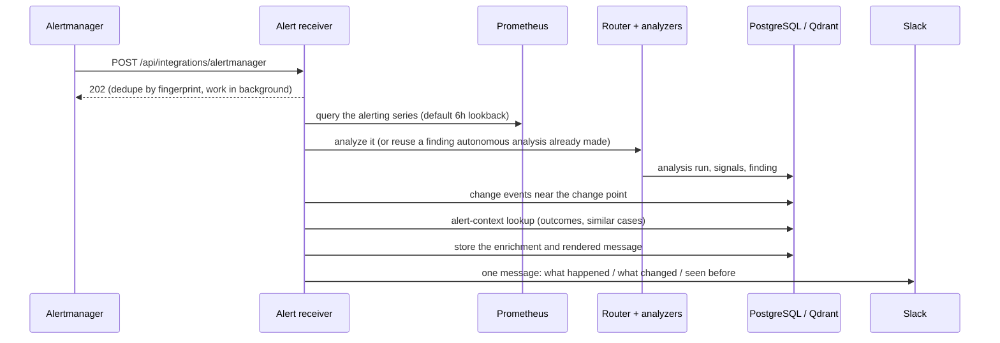

# Architecture

## Overview

**Figure 1.** Metrics from Prometheus, CSV upload, and OTLP push are normalized, profiled, and routed
to a bounded, deterministic analyzer registry — an optional AI second opinion may diverge from the
router's pick, but only ever surfaces that divergence, never overrides it. Analyzer output becomes
single-metric Findings and, via cross-metric correlation rules, Behavior Findings; both can be promoted
to a Case carrying an RCA, a resolution, and a recorded outcome. Cases persist to PostgreSQL as the
system of record and embed into Qdrant as a semantic index; deploy and other change events from CI/CD
are recorded in PostgreSQL too. Four consumers read from that shared store: built-in **Alert
Enrichment** (orange: Alertmanager alerts in, one enriched Slack message out), the **Alert-Context API**
for external alert managers, the in-app **Ask Ops Signals** assistant, and the **Grafana plugin**. Alert
Enrichment is the one consumer that also writes: its dashed line is the on-demand analysis of the
alerting series. High-importance findings are posted to Slack as they're saved. The lighter dashed boxes
at the top and bottom of the figure (Kubernetes, cloud-provider metrics, ITSM/automation, generic
external systems) are **not implemented** — they're kept in the figure as the acknowledged next-step
surface, not as a claim about current capability. See [Roadmap](#roadmap-not-yet-implemented) below.

A simplified, text-diffable version of the same flow (without the AI/consumer detail) lives at
[`diagrams/system-architecture.mmd`](diagrams/system-architecture.mmd):

(`K --> I` is the behavior-to-case promotion path — see [Case Lifecycle](#4-case-lifecycle) below.
The `Q` branch is [alert enrichment](#alert-enrichment-alertmanager--slack).)

## Pipeline, Stage by Stage

### 1. Ingest

Three metric sources today: Prometheus (pull/scrape, interactive or on the autonomous schedule), CSV
upload (validated batch), and OTLP/HTTP push (buffered, then folded into analysis runs on the
scheduler cycle). Provider-specific columns are mapped to a canonical schema via
`config/providers/*.yaml`, applied in `intelligence/normalize/normalizer.py`. Counter-type metrics are
resampled with `.last()` rather than averaged, to preserve spikes instead of smoothing them away.

Two event inputs sit alongside the metrics: **change events** (deploys, config changes, feature flags)
posted by CI/CD to `POST /api/events` and stored as-is, and **alerts** from Alertmanager, which start
an on-demand analysis — see [Alert Enrichment](#alert-enrichment-alertmanager--slack).

- `intelligence/adapters/csv_adapter.py`, `backend/app/api/ingestion.py`
- `backend/app/api/otlp.py`, `backend/app/otlp/` — see [`design/otlp-metrics-ingestion-plan.md`](design/otlp-metrics-ingestion-plan.md)
- `backend/app/api/events.py`, `ChangeEventEntity`
- `intelligence/normalize/normalizer.py`

### 2. Route & Analyze

The Universal Router extracts features from the normalized series (seasonality, trend, variance, shift
index, ...) and scores which analyzers are eligible and suitable. The Analyzer Registry then runs the
bounded, deterministic analyzers the router picked — anomaly detection, trend regression, baseline-shift
detection, changepoint detection, forecasting — never an open-ended agent loop.

An **optional AI Second Opinion** can independently score the same input and return its own top pick.
When it disagrees with the router, that divergence is surfaced in the response — it never silently
overrides the router's decision. This is deliberate: the AI is a second set of eyes, not a second vote.

- `backend/app/metric_analyzer_recommendations/service.py` (`recommend()`, `recommend_ai_opinion()`)
- `backend/app/metric_analyzer_recommendations/gemma_advisor.py` (the AI second opinion)
- `intelligence/analyzers/*` (the analyzer implementations)

See [`docs/analyzer-methodology.md`](analyzer-methodology.md) for what each analyzer is
based on (all published methods, cited) versus the router's suitability scoring weights, which are
heuristic and not yet validated against real outcomes - and the tracking infrastructure
(`AnalyzerLearningOutcomeEntity`, `AnalyzerDivergenceEntity`) built to close that gap.

### 3. Find & Correlate

Per-metric analyzer output becomes a **Finding** (single-metric: "this metric had an anomaly/trend/shift").
The **Behavior Intelligence Engine** separately evaluates declarative, cross-metric rules
(`config/behavior_definitions.d/*.yml`) — e.g. "CPU anomaly + rising throttling in the same window" —
producing a **Behavior Finding**, which is generally closer to an actual root-cause story than any single
metric finding is on its own.

- `backend/app/api/findings.py`, `FindingEntity`
- `backend/app/behavior_intelligence/service.py`, `BehaviorFindingEntity`

### 4. Case Lifecycle

Either a Finding or a Behavior Finding can be promoted to a **Case**, which carries investigation notes,
an RCA (status, summary, confidence, verified flag), a corrective action, and a recorded outcome
(confirmed / rejected / partially confirmed / inconclusive). Resolving a case with a final outcome status
also writes an `AnalyzerLearningOutcomeEntity` row — the durable "here's what actually happened" record
downstream consumers query.

- `POST /api/cases/findings/{finding_id}/create`, `POST /api/cases/behaviors/{behavior_finding_id}/create`
- `backend/app/api/cases.py`, `OperationalCaseEntity`
- `backend/app/services/analyzer_learning_service.py`, `AnalyzerLearningOutcomeEntity`

**Pluggable Ticketing Integration**: Cases can be linked to external issue tracking platforms (reference provider: Jira Cloud REST API v3) via a durable transactional outbox (`ticket_operations`). External comments and status changes sync bidirectionally into `case_ticket_events`. Operators can promote diagnostic clues into `investigation_notes` with 1 click, or enable zero-click AI triage to automatically elevate substantive operational observations into case notes. See [`docs/operational-cases.md`](operational-cases.md).

### 5. Persist

**PostgreSQL** is the system of record: normalized points, signals, findings, cases, and learning
outcomes. **Qdrant** is a semantic retrieval index, never the source of truth — each case's deterministic
text representation (built by `CaseDocumentBuilder`, explicitly excluding raw JSON/IDs) is embedded and
upserted into the `operational_cases` collection as named vectors (`backend/app/memory/vector_names.py`):
`full` (the whole document), `symptom` (what was seen), `resolution` (cause and fix, once there is one),
and a keyword (BM25-style sparse) vector of the whole document. A finding is matched symptom to symptom
(Seen before?, Similar Cases), free text - alert messages, chat questions - against the full document,
fixes against fixes. Recall ranks candidates with one Qdrant score formula: cosine similarity plus capped
bonuses for shared keywords, the same service, a verified root cause and recency
(`backend/app/memory/recall_scoring.py`), then folds near-copies of a higher match under it
(`backend/app/memory/diversity.py`). The similarity shown and every score threshold stay plain cosine
similarity. A collection created before this is recreated with these vectors on startup, keeping its
points (the old vector becomes `full`); the others are backfilled from PostgreSQL in the background, and
symptom searches use the full document until that is done.

- `backend/app/models/entities.py`
- `backend/app/memory/qdrant_initializer.py`, `backend/app/memory/document_builder.py`
- `backend/app/memory/sparse_encoder.py`, `backend/app/memory/recall_scoring.py`, `backend/app/memory/diversity.py`

Two read-only views are built on the same index. **Novelty** (`backend/app/memory/novelty.py`) labels
a finding or case New pattern / First time on a service / Seen before / Recurring from the matches
recall already returned. **Recurring problems** (`backend/app/memory/recurring.py`,
`GET /api/memory/recurring-problems`) groups the cases in a time window with Qdrant's distance matrix -
by symptom (80%) or by cause and fix (60%): the most-connected case centres a group of cases at least that
alike, so groups don't chain. **Fix outcomes** (`backend/app/memory/fix_outcomes.py`) infer whether a fix
held: no case with the same symptom on the same service within 30 days. They feed **Same fix elsewhere**
(`GET /api/cases/{id}/same-fix`, resolution vectors) and **Suggested fixes** for a finding
(`backend/app/memory/suggested_fixes.py`, `GET /api/findings/{id}/suggested-fixes`, with a draft-only
runbook from the configured LLM). **Monitoring coverage** (`backend/app/memory/coverage.py`,
`GET /api/memory/coverage`) checks each imported incident against analysis runs on its service that
overlapped it and the findings they raised whose anomalies overlapped it, scoring each finding's text
against the incident's symptom - detected, flagged something else, missed, or not watched.

### 6. Consume

These read from PostgreSQL/Qdrant. All but Alert Enrichment are read-only; Alert Enrichment also runs
an analysis of the alerting series and records each alert it processes.

| Consumer | Mechanism | What it gets |
| --- | --- | --- |
| **Alert Enrichment** (built in) | `POST /api/integrations/alertmanager` (Alertmanager webhook), `POST /api/alerts` (generic) | For each firing alert: the analyzers' reading of the alerting series (what happened, when it started), change events near the change point (what changed), and the alert-context lookup below (seen before) — posted to Slack as one message. See [Alert Enrichment](#alert-enrichment-alertmanager--slack). |
| **Alert-Context API** (for external alert managers) | `GET /api/alert-context?metric_name=&service=&message=` | Exact-match learning-outcome history, a computed `likely_real` / `likely_noise` / `insufficient_history` recommendation, semantically similar resolved cases, and raw finding/behavior recurrence even when no case was ever filed — meant to be queried **before** an external system fires a page. Alert Enrichment uses the same lookup. |
| **Ask Ops Signals** | `POST /api/assistant/chat` | Grounded conversational Q&A over cases, findings, and behaviors — semantic search when memory is enabled, keyword fallback otherwise. |
| **Grafana Plugin & Dashboards** | panel queries + recommendation preview | Operator-facing visualization inside Grafana. See [`grafana-plugin-architecture.md`](grafana-plugin-architecture.md). |

**Slack** is an output, not a consumer that queries: it receives the enriched alert messages above,
and — separately, when `OPS_SIGNALS_SLACK_ENABLED` is on — a short notification for each saved finding
whose importance is at or above `OPS_SIGNALS_SLACK_MIN_IMPORTANCE`. Both are best-effort: a failed
post is logged and never fails an analysis or drops an alert.

### Alert Enrichment: Alertmanager → Slack

Alert enrichment adds no new analysis logic. It's a new **trigger** in front of the pipeline above and
a new **consumer** at the end of it, answering the three questions an on-call engineer otherwise works
out by hand: what happened, what changed, have we seen this before.

Status, log, and absence alerts skip the analysis step (there's no series with a shape to analyze) but
still get the change and history sections. Every step degrades to "unavailable" rather than blocking
the message.

- `backend/app/api/alerts.py`, `backend/app/alerts/` (receiver, classifier, query builder, correlation, enrichment)
- `backend/app/memory/alert_context.py` (the shared history lookup)
- `backend/app/notifications/message_builder.py`, `backend/app/notifications/slack_client.py`
- `AlertEnrichmentEntity`, `ChangeEventEntity`

User guide: [`alert-enrichment.md`](alert-enrichment.md). Design and trade-offs:
[`design/alert-enrichment-plan.md`](design/alert-enrichment-plan.md). To see it run end to end with no setup:
[`demo.md`](demo.md).

## Why This Reduces MTTR

The "Consume" stage above is where the architecture actually pays off operationally. With alert
enrichment, the page itself arrives already answering the first questions an on-call engineer asks:
what the series did and when it started, which deploy landed just before, and whether this was seen
before and how it was fixed — instead of an engineer spending the first 10-20 minutes working that out.
An external alert manager can get the same history *before* it pages someone, via
`GET /api/alert-context`, including a `likely_real` / `likely_noise` recommendation. Fewer noise pages,
and faster real ones: that's the mean-time-to-resolution win. See [`docs/vision.md`](vision.md)
for the fuller narrative behind this goal.

## Roadmap (Not Yet Implemented)

Shown as dashed, muted boxes in Figure 1 — explicitly **not** current capability:

- **Kubernetes** ingestion (kube-state-metrics, cAdvisor)
- **Cloud provider** metrics (AWS CloudWatch, GCP Monitoring, Azure Monitor)
- **ITSM / automation** consumers (Jira Cloud ticketing integration is implemented with transactional outbox ticket creation, comment sync, outbound resolution closing comments, and webhooks; ServiceNow and generic workflow automation remain roadmap)
- Generic **external-system** consumer (arbitrary webhooks, BI/reporting export). Slack is implemented
  (see [Consume](#6-consume)); a general-purpose outbound webhook is not.

OTLP metrics ingestion (`POST /api/otlp/v1/metrics`) is implemented — see
[`docs/design/otlp-metrics-ingestion-plan.md`](design/otlp-metrics-ingestion-plan.md). OTLP logs and traces are
not yet implemented and remain a future extension of that same design.

## Layer Responsibilities

- Canonical Time Series: source metric input (Prometheus, CSV, or OTLP push today)
- Change Events: deploys, config changes, and feature flags posted by CI/CD, correlated with alerts
- Validation: checks structure and required fields
- Normalization: converts provider-specific inputs into a consistent schema
- PostgreSQL: persistent system of record
- Analyzer Registry: bounded, deterministic analyzers, selected by the Universal Router
- Signals: analyzer outputs
- Finding Aggregator: groups signals into higher-level findings
- Operational Findings: ranked interpretations of signal sets
- Operational Cases: investigation objects with lifecycle state, sourced from either a Finding or a
  Behavior Finding
- Behavior Intelligence: deterministic rule evaluation across multiple signals
- Behavior Findings: higher-level operational conditions produced by behavior rules
- Embedding Service: converts case text into vectors
- Qdrant: semantic retrieval index for similar cases
- Similar-Case / Alert-Context Retrieval: query-time search used by the in-app assistant, alert
  enrichment, and external alert managers
- Alert Enrichment: turns an incoming alert into one Slack message (analysis, change correlation,
  history)
- React UI / External Consumers: user-facing exploration, plus API-level consumers outside this codebase

## Backend

The FastAPI backend exposes ingestion (CSV, Prometheus, OTLP), analysis, finding, case, capability,
memory, alert-context, change-event, and alert-receiver routes. It also initializes PostgreSQL and Qdrant services at startup, and applies additive, non-Alembic
schema migrations (`backend/app/models/schema_compat.py`) so existing deployments pick up new nullable
columns without a destructive migration step.

## Frontend

The React frontend presents overview, findings, cases, signals, behavior intelligence, operational memory
(including the alert-context preview), questions, history, and settings pages.

## Source of Truth and Retrieval Index

### PostgreSQL

PostgreSQL stores:

- analysis runs
- normalized points
- signals
- findings
- cases (sourced from either a Finding or a Behavior Finding)
- investigation notes and lifecycle fields
- analyzer learning outcomes (the recorded result of a resolved case)
- change events (`ops_change_events`)
- processed alerts, with the enrichment and the rendered Slack message (`ops_alert_enrichments`)

### Qdrant

Qdrant stores:

- embeddings for case documents (`operational_cases`)
- embeddings for raw findings/behaviors, indexed lazily on first search (`operational_findings`,
  `operational_behaviors`)
- retrieval metadata for semantic search

Qdrant should be treated as a retrieval index, not the authoritative record.

## Current State

Implemented:

- Prometheus, CSV, and OTLP metrics ingestion into PostgreSQL
- analyzer-based signal generation via the Universal Router + Analyzer Registry
- optional AI second opinion on analyzer choice (advisory only, divergence surfaced, never authoritative)
- operational findings and cases
- behavior intelligence rule evaluation
- **behavior finding promotion into cases** (either a Finding or a Behavior Finding can become a Case)
- Qdrant indexing for operational memory (cases, findings, behaviors)
- `GET /api/alert-context` — pre-alert decision support for an external alert manager
- alert enrichment — Alertmanager alerts analyzed on arrival and posted to Slack with what happened,
  what changed, and seen before; change events via `POST /api/events`
- Slack notifications for high-importance findings
- `POST /api/assistant/chat` — grounded conversational Q&A ("Ask Ops Signals")

Experimental:

- richer retrieval filtering
- similarity-guided RCA assistance (draft-only, never auto-applied)

Planned:

- Kubernetes and cloud-provider ingestion, and OTLP logs/traces (see [Roadmap](#roadmap-not-yet-implemented))
- ITSM/automation and generic external-system consumers (see [Roadmap](#roadmap-not-yet-implemented))
- improved UI for case exploration
