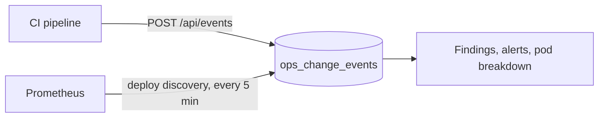

# Deploys found automatically

Findings and enriched alerts say what changed just before a problem: "started 4 min after deploy
`1.4.2`". Your CI can send deploys to `POST /api/events` ([alert-enrichment.md](alert-enrichment.md)).
Ops Signals also finds deploys in the metrics Prometheus already has, so this works before anyone
sets up CI.

## How it finds them

Every 5 minutes, Ops Signals looks at the last 6 hours on each Prometheus connection, in two ways:

1. **A new version on a `build_info` metric.** Most apps and exporters report their version as a
   metric, for example `checkout_build_info{version="1.4.2"} 1`. When a service reports a version it
   didn't report just before, that's a deploy, at the minute the new version first showed up.
   - Versions already there when the 6 hours start are not counted, since nothing says when they
     were deployed. A new install therefore doesn't fill up with old "deploys".
   - A pod restarting on the same version, or a gap in scraping, is not a deploy. A gap followed by
     a *different* version is: the version before the gap is compared with the one after it.
   - During a rollout old and new pods run side by side. That's one deploy.
   - Going back to an earlier version is a deploy too.
   - Works without Kubernetes.
2. **A new Kubernetes ReplicaSet** (needs kube-state-metrics). A Deployment rollout creates a new
   ReplicaSet, and `kube_replicaset_created` says when. The service is the Deployment's name and the
   version is the ReplicaSet's name. Scaling doesn't create a ReplicaSet, so it isn't counted.
   Rolling back to the previous revision reuses an old ReplicaSet, so the build_info way is the one
   that sees that.

A found deploy looks like this in `GET /api/events`:

```json
{
  "service": "checkout",
  "type": "deploy",
  "timestamp": "2026-10-23T14:17:43Z",
  "version": "1.0.1",
  "author": null,
  "url": null,
  "source": "ops-signals:build_info",
  "description": "Found automatically: version changed from 1.0.0 to 1.0.1 (build_info metric).",
  "attributes": {"previous_versions": ["1.0.0"]},
  "received_at": "2026-10-23T14:18:43Z"
}
```

`timestamp` is when the new version first showed up in Prometheus, and it's what findings are
matched against. `received_at` is when Ops Signals stored it, on its next look. `author` and `url`
are empty: a metric doesn't say who deployed.

## Stored next to CI's deploys

Found deploys and CI's deploys are rows in the same PostgreSQL table, `ops_change_events`. The
`source` column tells them apart:

| How it arrived | `source` | Who deployed, link |
| --- | --- | --- |
| CI, through `POST /api/events` | What CI sends, e.g. `github-actions`, or empty | When CI sends them |
| Found from a `build_info` metric | `ops-signals:build_info` | No |
| Found from a Kubernetes ReplicaSet | `ops-signals:kube_replicaset` | No |



Findings and alerts don't look at `source`: a found deploy is used exactly like one from CI. How a
deploy is picked for a finding is in [finding-drilldown.md](finding-drilldown.md).

On screen, a found deploy under **What changed** (finding details, the Alerts page, the Grafana
plugin's alerts) carries a **Found automatically** tag; hovering it says how the deploy was found.
In Slack it reads "deploy `1.0.1` (found automatically)".

## Duplicates

One deploy is never shown twice:

- When the same rollout is seen both ways, it's stored once, with the app's version from build_info.
- A deploy CI already sent for the service within 10 minutes isn't stored again.
- When CI sends a deploy after one was found (CI ran late), CI's replaces it, because it says more:
  who deployed and a link. Only deploys and rollbacks replace; a config or feature-flag event from
  CI doesn't.
- Two different versions found minutes apart are two deploys.
- Running every 5 minutes over the same 6 hours never stores a deploy twice.
- When the web UI and Grafana plugin backends share a database, only one of them looks at a time.
- CI can't send a `source` that starts with `ops-signals:` (the request is rejected with 422), so
  CI's own events are never mistaken for found ones.

Service names come from the same labels alert enrichment uses (`service`, `job`, `app`,
`app_kubernetes_io_name`, set with `OPS_SIGNALS_ALERT_SERVICE_LABELS`). If the service name in
build_info differs from the one on your findings, list both in `OPS_SIGNALS_SERVICE_ALIASES`.

## Deploys without a version

The version is optional everywhere, and nothing breaks without it:

- **From CI:** only `service` and `type` are required. An event without `version` is stored as
  usual.
- **On screen and in Slack:** a deploy is named by its version, else its description, else
  "unversioned".
- **In build_info:** a series with none of the version labels (`version`, `app_version`,
  `service_version`, or your own list) is skipped. The version is how a deploy is seen there, so
  without one there is nothing to find, and nothing is stored.
- **ReplicaSets** don't need a version label.

## If a look in Prometheus fails

Deploy discovery runs in the background, apart from everything else:

- If Prometheus can't be reached, a query times out, or a query returns more than 500 series, that
  look is skipped and logged ("Deploy discovery failed ..."). If one of the two ways fails, the
  other still runs.
- The Setup check's **Deploy events** line turns yellow and says why.
- Findings, alerts, the UI and CI's `POST /api/events` keep working as before. Deploys already
  stored stay.
- To turn it off: `OPS_SIGNALS_DEPLOY_DISCOVERY_ENABLED=false`.

## Check it

The **Setup check** page (left menu), line **Deploy events**, says how many deploys were found in
the last 7 days, or that none were, or that the last look failed and why. `GET /api/events` lists
them; `GET /api/events?service=checkout` lists one service's.

To see what Ops Signals sees, run the metric in Prometheus (for example `checkout_build_info`) and
open the **Graph** tab: one line per version. Where one version's line ends and another's starts is
the deploy.

## Settings

| Variable | Default | Meaning |
| --- | --- | --- |
| `OPS_SIGNALS_DEPLOY_DISCOVERY_ENABLED` | `true` | Look for deploys in Prometheus |
| `OPS_SIGNALS_DEPLOY_DISCOVERY_INTERVAL_MINUTES` | `5` | How often |
| `OPS_SIGNALS_DEPLOY_DISCOVERY_LOOKBACK_HOURS` | `6` | How far back each look goes |
| `OPS_SIGNALS_DEPLOY_DISCOVERY_VERSION_LABELS` | `version,app_version,service_version` | Labels that hold the version, tried in order |
| `OPS_SIGNALS_DEPLOY_DISCOVERY_KUBE_REPLICASETS` | `true` | Also use kube-state-metrics ReplicaSets |

Each look is two small queries per connection: one range query over `*_build_info`, grouped by
service and version, and one instant query over ReplicaSets.

## Limits

- Only services that report a version metric, or run as Kubernetes Deployments, are covered.
  Config changes and feature flags still need CI to send them.
- The time is accurate to about a minute: when the new version was first scraped.
- A deploy made while Ops Signals was stopped for longer than the lookback (6 hours) isn't found:
  by the next look, the new version was already there when its window starts.
- Two deploys from different detectors within 10 minutes count as one.
- It doesn't know who deployed or where the pipeline run is. Send deploys from CI for that.
