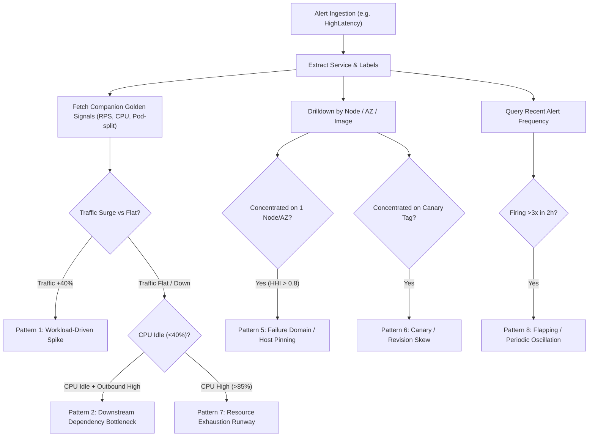
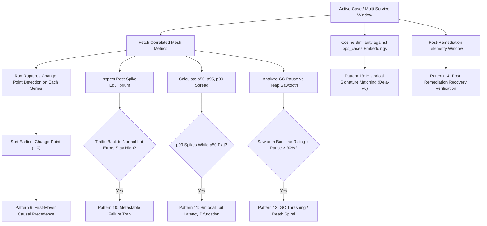

# Operational Patterns Research: Alert Arrival Triage & Investigation Analysis

**Author:** Ops Signals Engineering & Architecture  
**Status:** Research & Technical Proposal  
**Branch:** `feature/alert-investigation-patterns`  
**Related Components:**  
- Alert Ingestion & Enrichment: [`backend/app/alerts/enrichment.py`](../../backend/app/alerts/enrichment.py), [`backend/app/alerts/query_builder.py`](../../backend/app/alerts/query_builder.py), [`backend/app/alerts/classifier.py`](../../backend/app/alerts/classifier.py)  
- Multi-Signal Behavior Intelligence: [`backend/app/behavior_intelligence/fact_catalog.py`](../../backend/app/behavior_intelligence/fact_catalog.py), [`condition_evaluator.py`](../../backend/app/behavior_intelligence/condition_evaluator.py)  
- Core Intelligence & Breakdown: [`intelligence/drilldown.py`](../../intelligence/drilldown.py), [`intelligence/pipeline.py`](../../intelligence/pipeline.py), [`intelligence/analyzers/`](../../intelligence/analyzers/)  
- Case Workbench & Assistant: [`backend/app/api/cases.py`](../../backend/app/api/cases.py), [`backend/app/api/assistant.py`](../../backend/app/api/assistant.py)

---

## 1. Executive Summary & Problem Space

### 1.1 The Symptom vs. Cause Gap in Modern Observability
Current monitoring systems (Prometheus, Alertmanager, Datadog) are fundamentally **symptom-oriented**. When a threshold or anomaly rule fires (e.g. `CheckoutService p95 latency > 300ms`), the on-call engineer receives an alert stating *what metric is broken*, but lacks the operational context needed to determine:
1. **Is this an intrinsic code/dependency bug or an external capacity shock?**
2. **Is the blast radius widespread across all pods, or pinned to a faulty hardware node or canary version?**
3. **In a cascade where 10 services fired simultaneously, which service broke first?**
4. **Is the system in a self-sustaining metastable failure trap that will not recover on its own?**

### 1.2 Two Operational Windows
Ops Signals separates pattern identification into two distinct temporal regimes:

```
+---------------------------------------------------------------------------------------------------+
|                                 TEMPORAL OPERATIONAL PHASES                                       |
+---------------------------------------------------------------------------------------------------+
|  [PHASE 1: ALERT ARRIVAL TRIAGE]                  [PHASE 2: INVESTIGATION WORKBENCH]              |
|  - Latency budget: < 2.0 seconds                  - Latency budget: 1.0 - 10.0 seconds            |
|  - Context: Single firing alert + labels          - Context: Multi-service case incident window   |
|  - Goal: Immediate Slack/ticket triage            - Goal: Root cause analysis (RCA), causal graph |
|  - Strategy: Companion Golden Signals,            - Strategy: Change-point temporal ordering,     |
|    drilldown concentration, deploy proximity      metastable trap tests, signature matching       |
+---------------------------------------------------------------------------------------------------+
```

---

## 2. Theoretical Grounding & Primary Sources

The patterns cataloged in this document are grounded in core systems engineering literature:

1. **Google Site Reliability Engineering (SRE) Book**:
   - *The Four Golden Signals*: Latency, Traffic, Errors, and Saturation. Triage should never evaluate Latency or Errors in isolation without cross-referencing Traffic (RPS) and Saturation (CPU/memory/queue).
   - *Bimodal Distribution Analysis*: Masking of catastrophic subpopulation regressions by percentile aggregation ($p_{50}$ vs $p_{99}$).

2. **Brendan Gregg (Systems Performance & USE Method)**:
   - *USE Method*: Utilization (% time busy), Saturation (queue depth/backlog), Errors. Evaluated across all bounded software and hardware resources (threads, connections, sockets, memory).

3. **Tom Wilkie (RED Method)**:
   - *RED Method*: Rate (requests/sec), Errors (failed requests/sec), Duration (request latency). Tailored for microservices and request-driven distributed architectures.

4. **USENIX NSDI '22 / ACM SIGOPS '21 (Metastable Failures)**:
   - *Metastable Failure Loops*: Sustaining feedback loops (retry amplification, cache invalidation stampedes, GC death spirals) where a temporary trigger has vanished, but the system remains trapped in a degraded equilibrium with near-zero goodput.

---

## 3. Phase 1: Alert-Arrival Patterns (Fast Ingestion Triage)

Execution budget: **$\le 2.0\text{ seconds}$**.  
Trigger: Ingestion of an Alertmanager webhook at `POST /api/integrations/alertmanager` or generic alert at `POST /api/alerts`.



### Pattern 1: Workload-Driven Surge vs. Code/Intrinsic Degradation
* **Problem**: An alert fires for `HighLatency` or `ErrorSpike`. Triage engineers often jump to code rollbacks when the system simply experienced an abrupt organic traffic wave, or spend 30 minutes looking at traffic when a database query regression occurred at flat traffic.
* **Mechanism**:
  - Triangulate the alerting signal with companion `request_rate` ($R$).
  - Compute change-point shift on $R$ over the pre-alert baseline $[-30m, 0m]$.
  - If $\Delta R \ge +30\%$ and Pearson correlation $r(\text{latency}, R) \ge 0.75$, the degradation is **Workload-Driven**.
  - If $\Delta R \le +5\%$ (flat) or declining while latency/errors surge, the degradation is **Intrinsic Code or Dependency Regression**.
* **PromQL Companion Queries**:
  ```promql
  sum(rate(http_requests_total{service="$service"}[2m]))
  ```
* **Declarative Fact Key**: `workload.is_traffic_driven: boolean`, `workload.traffic_shift_percent: float`.
* **Operator Takeaway**:
  - *Traffic-driven*: "Latency rose 210% directly driven by a 65% traffic surge (RPS: 1.2k -> 2.0k). Recommend scaling replicas or checking upstream traffic source."
  - *Intrinsic*: "Latency rose 210% under FLAT traffic (RPS: 1.2k +/- 2%). Code regression, lock contention, or dependency slowdown suspected."

---

### Pattern 2: Downstream Dependency Bottleneck
* **Problem**: A service is reporting severe latency, but its own compute instances are idling. The engineering team inspects the service's code in vain while the real culprit is an unmonitored downstream database or third-party API.
* **Mechanism**:
  - Service CPU utilization is low ($< 40\%$).
  - Service p95 request latency is anomalous ($> 3\times$ baseline).
  - Outbound RPC duration (`http_client_request_duration_seconds` or DB connection pool wait `hikaricp_connection_acquisition_seconds`) accounts for $\ge 80\%$ of total server request latency.
* **PromQL Companion Queries**:
  ```promql
  # Service CPU
  avg(rate(container_cpu_usage_seconds_total{container="$service"}[2m])) / avg(kube_pod_container_resource_limits{resource="cpu",container="$service"})
  # Outbound client latency vs Inbound server latency
  sum(rate(http_client_request_duration_seconds_sum{service="$service"}[2m])) / sum(rate(http_client_request_duration_seconds_count{service="$service"}[2m]))
  ```
* **Declarative Fact Key**: `dependency.is_downstream_bottleneck: boolean`, `dependency.client_latency_share: float`.
* **Operator Takeaway**: "Service `order-service` is idle (CPU 18%), but requests are blocked waiting on downstream `payment-gateway` (outbound latency explains 92% of response time)."

---

### Pattern 3: Retry Storm & Traffic Amplification Loop
* **Problem**: A transient 500 error causes upstream clients or API gateways to aggressively retry requests with no jitter or backoff, generating a 3x-10x synthetic traffic spike that overwhelms downstream services (NSDI '22 metastable failure mode).
* **Mechanism**:
  - Primary error rate surges ($E \ge 10\%$).
  - Within $1-3$ minutes, request rate ($R$) jumps dramatically ($\ge +100\%$).
  - HTTP 499 (Client Closed Request) and HTTP 503 (Service Unavailable) proportions spike.
* **PromQL Companion Queries**:
  ```promql
  sum(rate(http_requests_total{service="$service",status=~"5.*|499"}[2m])) / sum(rate(http_requests_total{service="$service"}[2m]))
  ```
* **Declarative Fact Key**: `traffic.is_retry_storm: boolean`, `traffic.amplification_ratio: float`.
* **Operator Takeaway**: "Retry storm detected: 5xx errors at 14:02 triggered a 320% traffic surge within 2 minutes. Enable ingress rate limiting or shed non-critical retries."

---

### Pattern 4: Traffic Evaporation ("Silent Failure" / Dead Man's Drop)
* **Problem**: Application metrics show 0 errors and latency drops to zero. Everything looks "healthy" on standard error dashboards, but revenue is halted because an upstream DNS change, CDN routing error, or ingress TLS certificate expired.
* **Mechanism**:
  - Request rate ($R$) drops by $\ge 80\%$ within a 3-minute window.
  - Local application error rate remains at or near 0.
  - CPU utilization drops to idle baseline.
* **PromQL Companion Queries**:
  ```promql
  sum(rate(http_requests_total{service="$service"}[2m]))
  ```
* **Declarative Fact Key**: `traffic.is_evaporated: boolean`, `traffic.drop_percentage: float`.
* **Operator Takeaway**: "Traffic Evaporation: Inbound requests dropped 94% with zero local application errors. Check upstream CDN, Edge Ingress Gateway, or DNS."

---

### Pattern 5: Failure Domain / Node & AZ Pinning
* **Problem**: A service running 20 pods has high error rates, but only 2 pods are failing. Traditional service-level dashboards aggregate them, hiding that both failing pods are scheduled on the same Kubernetes worker node with a failing NVMe disk or NIC packet loss.
* **Mechanism**:
  - Run `intelligence/drilldown.py` across pod dimensions (`node`, `zone`, `instance`).
  - Calculate concentration ratio using Herfindahl-Hirschman Index (HHI) or max-to-total contribution.
  - If $\ge 85\%$ of anomalies originate from pods on a single `node` or `zone`, classify as **Failure Domain Pinning**.
* **Declarative Fact Key**: `drilldown.is_host_pinned: boolean`, `drilldown.pinned_label_key: str`, `drilldown.pinned_label_value: str`.
* **Operator Takeaway**: "Failure localized: 93% of error spikes originate from 2 pods co-located on node `k8s-worker-us-east-1a-04`. Service code is healthy; cordoning node recommended."

---

### Pattern 6: Canary & Revision Skew
* **Problem**: A progressive rollout (Argo Rollouts, Flagger) deployed a new version to 10% of pods. Errors at the service level increase modestly (+3%), failing to trigger high-severity alerts until 100% rollout, or causing confusion over whether the new version is at fault.
* **Mechanism**:
  - Group series by `pod_template_hash`, `image_tag`, or `version`.
  - Compare error rate and p95 latency between canary pods and baseline pods.
  - If canary pods show an error rate $\ge 5\times$ baseline pods while baseline remains normal, trigger **Canary Skew**.
* **Declarative Fact Key**: `release.is_canary_skew: boolean`, `release.canary_version: str`, `release.skew_ratio: float`.
* **Operator Takeaway**: "Canary regression: Pods running image `v2.4.0-rc1` have an 8.4% error rate compared to 0.05% on `v2.3.9` (168x ratio). Rollback canary immediately."

---

### Pattern 7: Predictive Saturation Runway & Burn Rate
* **Problem**: Disk or memory usage crosses an 80% warning threshold. The operator doesn't know if they have 4 days or 12 minutes before the node crashes or the container is OOM-killed.
* **Mechanism**:
  - Fit a linear ordinary least squares (OLS) regression or Theil-Sen estimator on memory working set or disk space over the past 30 minutes:
    $$U(t) = m \cdot t + c$$
  - Calculate coefficient of determination $R^2$. If $R^2 \ge 0.85$ and slope $m > 0$:
    $$T_{\text{exhaustion}} = \frac{U_{\text{limit}} - U_{\text{current}}}{m}$$
* **PromQL Companion Queries**:
  ```promql
  container_memory_working_set_bytes{container="$service"} / kube_pod_container_resource_limits{resource="memory",container="$service"}
  ```
* **Declarative Fact Key**: `runway.burn_rate_slope: float`, `runway.minutes_to_exhaustion: float`.
* **Operator Takeaway**: "Memory leak runway: Memory growing steadily at +42 MB/min ($R^2=0.96$). Pod OOM-kill estimated in **17 minutes**."

---

### Pattern 8: Alert Flapping & Periodic Duty-Cycle Oscillation
* **Problem**: An alert fires, pages on-call, and automatically resolves 4 minutes later. This repeats every hour, inducing alert fatigue and masking real degradations.
* **Mechanism**:
  - Inspect `ops_alert_enrichments` history for identical fingerprint within past 12 hours.
  - Apply Fast Fourier Transform (FFT) or STUMPY matrix profile recurrence on the metric signal to detect periodic autocorrelation spikes (e.g. at 60m, 15m, 24h).
  - Correlate with scheduled Kubernetes CronJobs or cloud backup schedules.
* **Declarative Fact Key**: `alert.is_flapping: boolean`, `alert.recurrence_period_minutes: float`.
* **Operator Takeaway**: "Flapping alert: Fired 6 times in the past 6 hours with a strict 60-minute periodicity. Matches scheduled CronJob `report-generator`."

---

## 4. Phase 2: Investigation Patterns (Case Workbench & Deep RCA)

Execution budget: **$1.0 - 10.0\text{ seconds}$**.  
Context: Opened incident case in `ops_cases`, containing multiple impacted services, multi-metric time series, and deployment events.



### Pattern 9: First-Mover Causal Precedence (Temporal Lag Ordering)
* **Problem**: In a microservice mesh, a failure in a database cascades into `account-service`, which cascades into `cart-service`, which cascades into `frontend-api`. All 4 services alert within 90 seconds. Human operators don't know who caused what.
* **Mechanism**:
  - Run the existing `ruptures_change_point` analyzer across all member series in the incident case.
  - Extract the exact change-point timestamp $t_0$ for each metric:
    $$t_{0}(\text{metric}_i) = \text{timestamp of first statistically significant regime shift}$$
  - Construct a directed acyclic temporal precedence graph:
    $$t_0(\text{postgres.pool\_waiting}) < t_0(\text{account.rpc\_latency}) < t_0(\text{cart.p95}) < t_0(\text{frontend.500\_rate})$$
* **Declarative Fact Key**: `temporal.first_mover_service: str`, `temporal.lead_time_seconds: float`.
* **Investigation Output**:
  ```
  Causal Precedence Timeline:
  - 14:02:11 (+00s): postgres db_connection_wait shifted 5ms -> 250ms  <-- ROOT FIRST MOVER
  - 14:02:48 (+37s): account-service outbound rpc latency shifted 15ms -> 310ms
  - 14:03:15 (+64s): cart-service p95 latency shifted 45ms -> 620ms
  - 14:03:40 (+89s): frontend-api HTTP 504 Gateway Timeout rate spiked
  ```

---

### Pattern 10: Metastable Failure Trap
* **Problem**: A sudden external traffic spike (e.g. flash sale) pushed the service past capacity. The traffic spike ended 15 minutes ago, but the service is still down with 100% CPU and 90% errors. The system is trapped in a self-sustaining feedback loop (USENIX NSDI '22).
* **Mechanism**:
  - Verify that external traffic has returned to normal:
    $$R_{\text{current}} \le 1.10 \times R_{\text{baseline}}$$
  - Verify that internal queue depth, latency, or error rate remain saturated:
    $$E_{\text{current}} \ge 5.0 \times E_{\text{baseline}} \quad \text{and} \quad \text{Goodput} \ll R_{\text{baseline}}$$
  - Identify the sustaining feedback loop:
    1. *Cache Invalidation Loop*: Cache hit rate dropped from 95% to 5% and cannot warm because every backend query times out.
    2. *Work Queue Avalanche*: Queue length $> 10,000$; workers spend all CPU processing requests that have already timed out on the client.
* **Declarative Fact Key**: `metastable.is_trapped: boolean`, `metastable.sustaining_mechanism: str`.
* **Investigation Output**: "Metastable failure trap confirmed: Inbound traffic returned to normal baseline 18 minutes ago, but error rate remains at 82%. Service cannot self-recover without shedding traffic or dropping unserviced queues."

---

### Pattern 11: Bimodal Tail Latency Bifurcation
* **Problem**: Median latency ($p_{50}$) is 25ms (completely normal), but $p_{99}$ latency jumped from 150ms to 4,800ms. An alert on average latency never fired, but high-value checkout transactions are failing.
* **Mechanism**:
  - Measure percentile spread ratio:
    $$\text{Ratio} = \frac{p_{99} - p_{50}}{p_{50}}$$
  - If $\text{Ratio} \ge 20.0$ and $p_{99} \ge \text{SLO threshold}$, test for distribution bimodality using Hartigan's Dip Test or histogram bucket divergence.
  - Drill down by query parameters, tenant ID, or cache status.
* **Declarative Fact Key**: `distribution.is_bimodal: boolean`, `distribution.tail_divergence_ratio: float`.
* **Investigation Output**: "Bimodal latency bifurcation: 95% of traffic responds in <30ms; 5% of traffic blocks for >4.2s. Correlated with cache misses on unindexed tenant queries."

---

### Pattern 12: Garbage Collection (GC) Thrashing & Heap Sawtooth Decay
* **Problem**: Application encounters periodic freezes and eventual OOM crash. Standard memory metric shows average memory at 85%, which looks acceptable, but the internal JVM/Go/V8 runtime is spending 40% of its CPU cycles in Stop-the-World garbage collection.
* **Mechanism**:
  - Track heap memory *immediately after* GC collection cycles (post-collection trough).
  - If the post-collection trough increases monotonically over time while collection frequency and GC pause duration (`jvm_gc_pause_seconds_sum`) scale non-linearly:
    $$\frac{d(\text{Heap}_{\text{trough}})}{dt} > 0 \quad \text{and} \quad \text{GC\_CPU\_Ratio} \ge 0.30$$
* **Declarative Fact Key**: `runtime.is_gc_thrashing: boolean`, `runtime.gc_cpu_overhead_percent: float`.
* **Investigation Output**: "GC thrashing detected: Stop-the-World pauses consuming 38% of container CPU. Heap trough rising +25MB/cycle, pointing to uncollected thread-local memory leak."

---

### Pattern 13: Historical Signature Matching ("Incident Deja-Vu")
* **Problem**: The on-call engineer spends 45 minutes diagnosing an incident that was already diagnosed, debugged, and resolved by another team member 3 weeks ago.
* **Mechanism**:
  - Construct a multi-metric behavioral embedding vector representing the incident:
    - Involved service types, alerted metric classes, magnitude and direction of shifts, companion saturation levels, and change events.
  - Query Qdrant and PostgreSQL `ops_cases` for cosine similarity $\ge 0.85$.
  - Rank top 3 historical cases and extract their recorded remediations.
* **Declarative Fact Key**: `memory.has_historical_match: boolean`, `memory.matched_case_id: int`, `memory.similarity_score: float`.
* **Investigation Output**: "Incident Deja-Vu: 92% similarity to **Case #104** (resolved 14 days ago). Root cause was HikariCP connection pool starvation. Verified fix was `export DB_POOL_SIZE=50`."

---

### Pattern 14: Post-Remediation Recovery Verification
* **Problem**: An engineer applies a hotfix or restarts pods, marks the incident "resolved", and leaves. However, cold-start latency or cache warmup storms immediately trigger a secondary incident 10 minutes later.
* **Mechanism**:
  - Automatically instantiate a 10-minute post-remediation verification window:
    $$W_{\text{post}} = [t_{\text{remediation}}, t_{\text{remediation}} + 10m]$$
  - Perform window comparison against pre-incident baseline $W_{\text{baseline}}$ across all Golden Signals.
  - Run Welch's t-test or Mann-Whitney U test to confirm metrics have returned to the nominal distribution ($p > 0.05$).
* **Declarative Fact Key**: `remediation.is_verified_recovered: boolean`, `remediation.residual_anomaly_count: int`.
* **Investigation Output**: "Post-remediation verified: Error rate returned to 0.01% (matches baseline), p95 latency stabilized at 120ms. Zero secondary anomalies detected over 10m window."

---

## 5. Summary Taxonomy: 14 Operational Patterns

| # | Pattern Name | Phase | Key Input Metrics | Primary Algorithm / Heuristic | Primary Actionable Output |
|---|---|---|---|---|---|
| 1 | **Workload-Driven vs Intrinsic** | Alert Arrival | Latency/Errors + RPS | Co-change point + Pearson correlation | Scale up vs investigate code/dependency |
| 2 | **Downstream Bottleneck** | Alert Arrival | Service CPU + RPC/DB Latency | CPU idle test + Outbound latency ratio | Redirect triage to downstream dependency |
| 3 | **Retry Storm Cascade** | Alert Arrival | 5xx Errors + Rapid RPS Surge | Lagged cross-correlation + 499/503 ratio | Enable ingress backoff / load shedding |
| 4 | **Traffic Evaporation** | Alert Arrival | RPS Drop + Zero Errors | Negative step-function + zero error test | Inspect CDN, Edge Ingress, DNS |
| 5 | **Host / Node Pinning** | Alert Arrival | Per-pod metrics + Node/AZ labels | Herfindahl-Hirschman Index on drilldown | Cordon/drain faulty Kubernetes node |
| 6 | **Canary / Revision Skew** | Alert Arrival | Per-image/version metrics | Grouped ratio test (Canary vs Baseline) | Abort canary rollout immediately |
| 7 | **Saturation Runway** | Alert Arrival | Memory / Disk / Queue depth | OLS regression slope + Time-to-exhaustion | "OOM kill in 17 minutes" |
| 8 | **Alert Flapping** | Alert Arrival | Alert history + Series periodicity | FFT / Matrix Profile recurrence detection | Suppress noise / Fix CronJob collision |
| 9 | **Causal Precedence** | Investigation | Multi-service mesh metrics | Ruptures change-point timestamp ordering | Topological root-cause sequence timeline |
| 10 | **Metastable Trap** | Investigation | External RPS + Internal Latency/Err | Equilibrium hysteresis test (NSDI '22) | Drop queues / Hard reboot to reset state |
| 11 | **Bimodal Bifurcation** | Investigation | Percentiles (p50, p90, p99) | Percentile spread ratio + Dip test | Isolate cache miss / heavy tenant query |
| 12 | **GC Death Spiral** | Investigation | GC pauses + Post-GC heap trough | Decaying sawtooth slope + GC CPU % | Tune heap size / Fix heap memory leak |
| 13 | **Incident Deja-Vu** | Investigation | Case behavioral fingerprint | Vector cosine similarity in Qdrant/Postgres | "92% match to Case #104; run playbook X" |
| 14 | **Recovery Verification** | Investigation | Golden signals post-fix vs baseline | Two-sample statistical hypothesis tests | Validate true recovery vs cold-start stall |

---

## 6. Architecture Integration in Ops Signals

### 6.1 Extending the Fact Catalog (`fact_catalog.py`)
To enable users and built-in packs to write declarative YAML rules for these patterns, `backend/app/behavior_intelligence/fact_catalog.py` will be extended with the following descriptors:

```python
FACT_DESCRIPTORS: list[FactDescriptor] = [
    # Existing core facts (anomaly, trend, ruptures)...
    
    # Workload & Golden Signals triangulation
    FactDescriptor("workload.traffic_shift_percent", "Percentage shift in request rate across the window.", 45.2),
    FactDescriptor("workload.is_traffic_correlated", "Whether latency/errors correlate with traffic (r > 0.7).", True),
    
    # Resource & Dependency Bottleneck
    FactDescriptor("resource.cpu_utilization_avg", "Average container CPU utilization as a fraction of limit (0-1).", 0.18),
    FactDescriptor("dependency.client_latency_share", "Fraction of total latency spent in outbound calls (0-1).", 0.92),
    
    # Drilldown & Failure Domains
    FactDescriptor("drilldown.is_concentrated", "Whether change is concentrated in a subset of parts.", True),
    FactDescriptor("drilldown.dominant_dimension", "Label dimension where change is concentrated (e.g. node, zone).", "node"),
    FactDescriptor("drilldown.dominant_value", "The specific label value carrying the majority change.", "k8s-worker-04"),
    
    # Predictive Runway
    FactDescriptor("runway.minutes_to_exhaustion", "Estimated minutes until resource exhaustion (OOM/disk full).", 17.5),
    FactDescriptor("runway.slope_per_minute", "Resource growth rate per minute.", 42.0),
    
    # Investigation & Temporal Causal Order
    FactDescriptor("temporal.causal_order_index", "0-based rank of when this metric changed relative to others.", 0),
    FactDescriptor("temporal.lead_time_seconds", "Seconds this metric led the primary alert.", 74.0),
    FactDescriptor("distribution.tail_spread_ratio", "Ratio of (p99 - p50) / p50.", 24.5),
]
```

### 6.2 Example Declarative Rule: Downstream Bottleneck Pack
A new pattern pack in `config/behavior_definitions.d/downstream_bottleneck.yml`:

```yaml
behavior_definitions:
  downstream_dependency_bottleneck:
    enabled: true
    version: 1
    title: Downstream Dependency Bottleneck
    description: >
      Detects when high request latency is accompanied by low service CPU, indicating
      the service is healthy but blocked waiting on a downstream dependency or database.
    scope:
      service: "*"
    inputs:
      - alias: latency
        metric_name: request_latency_p95
        analyzers: [anomaly_zscore, trend]
      - alias: cpu
        metric_name: cpu_utilization
        analyzers: [trend]
    conditions:
      all:
        - fact: latency.anomaly.present
          operator: equals
          value: true
        - fact: cpu.trend.present
          operator: equals
          value: false
        - fact: cpu.resource.cpu_utilization_avg
          operator: less_than
          value: 0.40
    output:
      category: performance
      severity: medium
      title: Downstream dependency bottleneck detected
      summary: >
        Service latency increased significantly while local CPU utilization remained idle (<40%).
        This indicates the service is waiting on a slow database, lock, or remote dependency.
      evidence:
        - latency.anomaly.max_score
        - cpu.resource.cpu_utilization_avg
```

### 6.3 Alert Enrichment Companion Queries (`enrichment.py`)
In `backend/app/alerts/enrichment.py`, when an alert fires for metric $M$ on service $S$:
1. The `QueryBuilder` detects the service name from alert labels.
2. It fetches companion series for $S$ with a lightweight single-vector range query:
   - Request rate: `sum(rate(http_requests_total{service="$service"}[2m]))`
   - CPU utilization: `avg(rate(container_cpu_usage_seconds_total{container="$service"}[2m]))`
3. Runs the lightweight triage rules (<50ms execution overhead).
4. Generates an enriched Slack block:
   ```
   *Operational Pattern:* Downstream Dependency Bottleneck
   • Local CPU: 18% (idle)
   • Outbound DB wait: 88% of request latency
   • Primary First Mover: postgres-cluster (pool acquisition timeout)
   ```

---

## 7. Incremental Implementation Roadmap

We propose implementing these patterns across four discrete pull requests:

### Slice 1: Golden Signals Triangulation at Alert Arrival (PR #1)
- Fetch companion request rate and CPU utilization in `AlertEnrichmentService`.
- Implement **Pattern 1 (Workload vs. Intrinsic Code Degradation)** and **Pattern 2 (Downstream Dependency Bottleneck)**.
- Enrich Slack alert card with pattern badge and traffic/CPU context.

### Slice 2: Predictive Resource Runway & Failure Domain Drilldown (PR #2)
- Implement **Pattern 7 (Predictive Saturation Runway & Burn Rate)** using OLS linear regression on memory/disk.
- Enhance `intelligence/drilldown.py` to automatically evaluate node and AZ pinning (**Pattern 5**) and canary skew (**Pattern 6**).
- Emit `runway.minutes_to_exhaustion` and `drilldown.dominant_dimension` facts into `fact_catalog.py`.

### Slice 3: Investigation Workbench Causal Precedence & Metastable Trap (PR #3)
- Implement multi-series change-point alignment using `ruptures` across active incident cases.
- Expose **Pattern 9 (First-Mover Causal Precedence Timeline)** in `GET /api/cases/{case_id}/causal-timeline`.
- Implement **Pattern 10 (Metastable Failure Trap)** heuristic for cases where traffic subsided but errors remain.

### Slice 4: Historical Signature Deja-Vu & Post-Fix Recovery Verification (PR #4)
- Implement multi-metric vector embedding generation for cases in Qdrant.
- Surface **Pattern 13 (Incident Deja-Vu)** with past case resolution links.
- Implement **Pattern 14 (Post-Remediation Recovery Verification)** endpoint and automated check.

---

## 8. Conclusion

By shifting Ops Signals from isolated single-metric anomaly detection to **multi-signal operational patterns**, we bridge the gap between "something is wrong" and "here is what is happening, where it is isolated, and what caused it." This research provides a direct, deterministic, and explainable path forward that honors Ops Signals' core principles: zero black-box LLM hallucinations, fast deterministic math, and actionable operator guidance.

---

## 9. Interface Design & Seam Placement (Definitive Architecture)

This section enshrines the definitive design resulting from the `codebase-design` review. It resolves both critical architectural tensions:
1. **The Companion Fetch Precondition:** Locking down the fetch-layer contract so multi-signal inputs actually reach the evaluator at alert arrival.
2. **Unified Deep Module (Path B):** Deepening the existing `BehaviorIntelligenceService` rather than creating a competing sibling engine, recognizing the distinct expressiveness boundaries of declarative YAML vs. algorithmic analysis.

---

### 9.1 The Hard Precondition: Companion Telemetry Fetch Contract

A pure evaluator over signals is only as good as the signals handed to it. Today in [`backend/app/alerts/enrichment.py:413, :473`](../../backend/app/alerts/enrichment.py):
- `_fetch_series()` executes exactly one alerting PromQL query.
- `select_series()` collapses the result to a single series (`series_count: 1`).
- `SignalPipeline.run_normalized()` analyzes only that single metric.

If the evaluator is handed single-metric signals, **Patterns 1–8 can never fire at alert arrival** because companion signals (RPS, CPU, outbound latency, pod spread) do not exist in `signals`.

**The Locked Fetch-Layer Precondition:**
- [`QueryBuilder`](../../backend/app/alerts/query_builder.py) must construct companion queries for the service (`request_rate`, `cpu_utilization`, and pod-grouped breakdown).
- `AlertEnrichmentService._fetch_series()` expands from a single query to a **companion bundle** (primary metric + Golden Signals triad).
- `SignalPipeline` normalizes and analyzes the bundle, so `signals` naturally contains the multi-metric signals required by the evaluator.

---

### 9.2 The Expressiveness Split: YAML Rules vs. Imperative Methods

Rather than introducing a parallel `OperationalPatternModule` that fragments locality and creates dual mental models, we **deepen the existing `BehaviorIntelligenceService`**.

However, unification does not mean "make everything YAML." The engine's declarative expressiveness (`BehaviorCondition`) is strictly `fact operator value` with boolean combinations (`equals`, `greater_than`, `less_than`, `contains`), producing a single boolean finding ([`condition_evaluator.py:17`](../../backend/app/behavior_intelligence/condition_evaluator.py), [`models.py:6`](../../backend/app/behavior_intelligence/models.py)).

This creates a clean, principled boundary:

| Phase | Patterns | Expressiveness Requirement | Where It Lives |
|---|---|---|---|
| **Phase 1: Alert Arrival** | **Patterns 1–8** (Workload vs. Code, Downstream Bottleneck, Retry Storm, Host Pinning, Runway, Flapping) | **Boolean threshold & ratio tests** over multi-metric facts | **Declarative YAML definition packs** in `config/behavior_definitions.d/` evaluated over an extended [`fact_catalog.py`](../../backend/app/behavior_intelligence/fact_catalog.py). |
| **Phase 2: Case Investigation** | **Patterns 9–14** (Causal Precedence, Metastable Trap, Bimodal Tail, GC Decay, Deja-Vu, Recovery) | **Algorithms & Remote I/O**: Topological sort of change-point timestamps ($t_0$), vector similarity search, two-sample stat tests | **Imperative method `investigate_case()`** on the same deepened `BehaviorIntelligenceService`, utilizing `CaseHistoryPort`. |

---

### 9.3 Unified Interface & Seam Definition

The deepened module presents two evaluation surfaces, eliminates the `db: Session` leak, and owns exactly one remote port (`CaseHistoryPort`):

```python
from dataclasses import dataclass, field
from datetime import datetime
from pathlib import Path
from typing import Any, Protocol


@dataclass(frozen=True, slots=True)
class CausalPrecedenceStep:
    timestamp: datetime
    service: str
    metric: str
    detail: str


@dataclass(frozen=True, slots=True)
class CaseInvestigationReport:
    primary_failure_mode: Any | None  # BehaviorFindingEntity / unified finding
    correlated_findings: list[Any]
    causal_timeline: list[CausalPrecedenceStep]
    is_metastable_trap: bool = False
    recovery_verified: bool | None = None


# The ONE remote dependency the module legitimately owns: historical case lookup
# (patterns 13 & 14). Wraps the existing SimilarityService / vector_store.search.
class CaseHistoryPort(Protocol):
    def find_similar_cases(self, embedding: list[float], limit: int) -> list[dict[str, Any]]: ...
    def count_recent(self, fingerprint: str, since: datetime) -> int: ...


class BehaviorIntelligenceService:
    """Deep module: unified evaluator for operational patterns and behaviors.

    - Phase 1 (Alert Arrival): Evaluates declarative YAML packs over signals via fact extraction.
    - Phase 2 (Investigation): Evaluates causal sequencing, metastable traps, and case history.
    Pure in-process domain logic: zero telemetry fetching, zero leaked db sessions.
    """

    def __init__(
        self,
        definitions_path: str | Path,
        history: CaseHistoryPort | None = None,
    ) -> None:
        self.definitions_path = Path(definitions_path)
        self._definitions = load_definitions(self.definitions_path)
        self._history = history

    def evaluate(
        self,
        signals: list[dict[str, Any]],
    ) -> list[Any]:
        """Fast (<2s) triage at alert arrival. Evaluates declarative YAML behavior

        definitions (Patterns 1–8) over already-analyzed signal dicts.
        NOTE: db: Session is removed from the signature. Persistence is handled
        by the caller or repository adapter.
        """
        ...

    def investigate_case(
        self,
        signals: list[dict[str, Any]],
        case_embedding: list[float] | None = None,
    ) -> CaseInvestigationReport:
        """Deep (1-10s) multi-service investigation (Patterns 9–14): ruptures

        change-point temporal sequencing, metastable failure tests, bimodal
        distribution checks, and historical Deja-Vu matching via CaseHistoryPort.
        """
        ...
```

---

### 9.4 Dependency Strategy & Seams

| Dependency | Where the seam goes | Why |
|---|---|---|
| **Prometheus companion queries** (RPS, CPU, pod-split) | Stays in the **fetch layer** (`QueryBuilder` + `AlertEnrichmentService._fetch_series()`) | Preserves the single telemetry path. The pipeline fetches and normalizes; the evaluator consumes signals. |
| **Statistical math & algorithms** (Pearson $r$, OLS runway, HHI, ruptures sorting, stat tests) | **In-process**, hidden inside the module implementation | Matches `DEEPENING.md` "in-process" category; zero adapters needed. |
| **Case history & embeddings** (Qdrant / Postgres `ops_cases`) | **`CaseHistoryPort`** injected at the module seam | Exactly two adapters satisfy the seam: `SimilarityServiceAdapter` (prod, wraps `vector_store.search`) vs `FakeCaseAdapter` (test). |
| **`db: Session`** | **Removed** from the evaluator's signature | Leaking a live SQLAlchemy session into domain evaluation violates seam discipline. Evaluator returns pure findings; callers persist. |

---

### 9.5 The Two Real Call Sites

1. **Alert Arrival (`pipeline.py:305`):**
   - The existing `SignalPipeline._evaluate_behavior_intelligence(signals, analysis_run_id)` hook.
   - Now that the pipeline normalizes the companion bundle, `service.evaluate(signal_dicts)` evaluates Patterns 1–8 via YAML definitions. Caller persists findings via `BehaviorFindingRepository`.
2. **Investigation (`backend/app/api/cases.py`):**
   - The Root Cause Analysis (RCA) surface: `PATCH /{case_id}/investigation`, `/rca`, and `POST /rca/suggest`.
   - `service.investigate_case(signals, case_embedding)` is invoked from the RCA-suggest path to compute the causal timeline and Deja-Vu matches, returning domain findings that the RCA route persists.
   - Presentation logic (Slack cards, UI badges) remains completely decoupled in [`message_builder.py`](../../backend/app/notifications/message_builder.py).

---

### 9.6 Why This Is Truly the Final Design

- **One Single Evaluator (Maximum Locality):** Engineers have a single mental model. Alert-time patterns are authored as YAML packs; deep investigation algorithms are methods on the same service.
- **Respects Computational Reality:** Does not force complex graph algorithms (Pattern 9) or vector lookups (Pattern 13) into boolean YAML syntax, nor does it hardcode simple threshold checks into opaque Python classes.
- **Zero Parallel Telemetry Paths:** Companion metric acquisition belongs to the fetch layer; evaluation belongs to the signal layer.
- **100% Testable in Milliseconds:** Without Prometheus or PostgreSQL, the entire engine runs with canned signal dicts and a `FakeCaseAdapter`.
