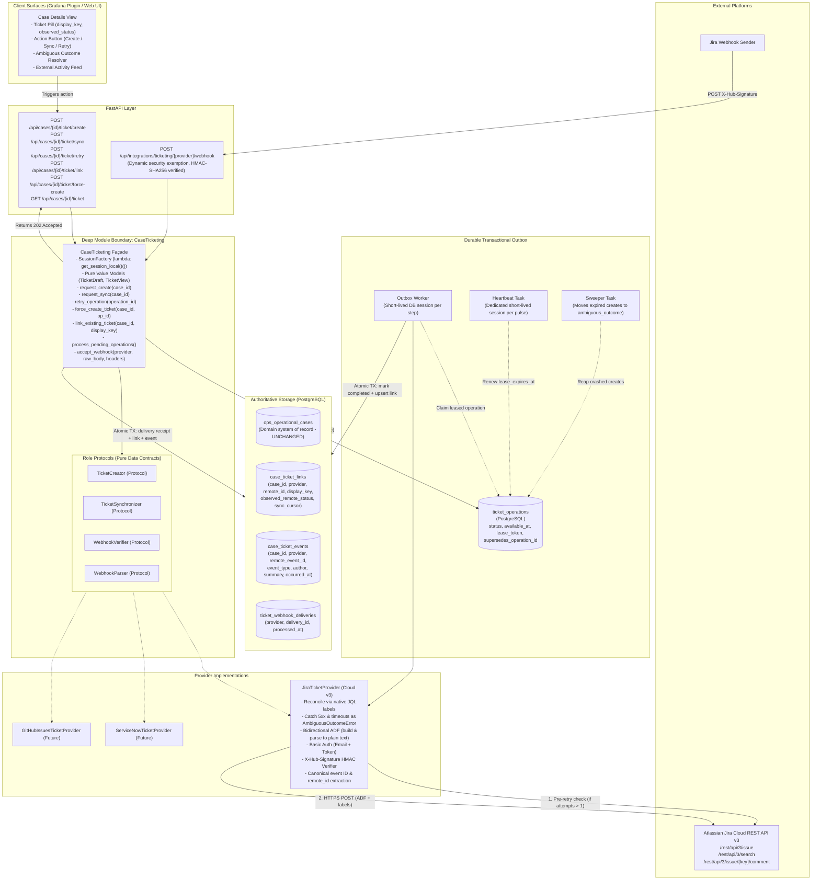

# Pluggable Case Ticketing Architecture Plan (Jira Cloud Reference Implementation)

**Status:** Proposed (Technical Design Document)  
**Extends:** [`docs/07-operational-cases.md`](../../07-operational-cases.md) (operational case lifecycle),  
[`ADR-004`](../../adr/ADR-004-postgresql-system-of-record.md) (PostgreSQL as system of record),  
[`ADR-005`](../../adr/ADR-005-qdrant-retrieval-index.md) (Qdrant as derived retrieval index),  
[`backend/app/models/db.py`](../../../backend/app/models/db.py) (`get_session_local`),  
[`backend/app/security.py`](../../../backend/app/security.py) (API token & public routes).  

---

## 1. Executive Summary & Vision

Ops Signals analyzes telemetry anomalies, generates findings, and drives operational cases to root-cause investigation and resolution. Today, cases live in PostgreSQL as the authoritative system of record and are indexed into Qdrant for semantic similarity retrieval. However, enterprise operations teams collaborate across external issue-tracking and ITSM platforms—predominantly **Jira Cloud**, **ServiceNow**, **GitHub Issues**, and **Linear**.

### The Vision: Plug-and-Play Ticketing Architecture
Instead of coupling Ops Signals to a bespoke, one-off Jira script that mixes delivery state into case models and breaks when another tool is introduced, Ops Signals establishes a **pluggable ticketing architecture**:
1. **Strict Single-Authority Model:** PostgreSQL remains the immutable system of record. Case lifecycle status is derived exclusively from internal case domain milestones (investigation, RCA verification, corrective action). External ticket updates are captured as non-destructive link metadata and external timeline events—never modifying internal case status or notes.
2. **Durable Transactional Outbox with Ambiguous-Outcome Circuit Breakers (`ticket_operations`):** Outbound operations return `202 Accepted` immediately and process reliably through a durable outbox table with idempotency keys, explicit retry backoff (`available_at`), and per-claim random lease tokens with active heartbeat renewal via independent database sessions (`session_factory = lambda: get_session_local()()`).
3. **Crashed & Uncertain Creates Never Auto-Retry (P0):** Expired leases for `create_ticket` operations and uncertain network/gateway responses (including HTTP 500, 502, 503, 504) transition directly to `ambiguous_outcome`. Negative JQL lookups are never treated as proof of absence, completely eliminating automated duplicate ticket creation.
4. **Atomic Operations Everywhere:** 
   - Outbox completion and `case_ticket_links` upserts commit in a single database transaction.
   - Webhook delivery receipts (`ticket_webhook_deliveries`), canonical event appends (`case_ticket_events`), and status updates commit in a single database transaction.
5. **Successor Operations for Forced Creation:** Forcing ticket creation after an ambiguous outcome creates a distinct successor operation (`supersedes_operation_id`) with its own unique ID, idempotency key, and Jira tracking label, preserving complete audit trails without label collisions.
6. **Deep Module Façade (`CaseTicketing`) & Role Protocols:** Granular role protocols (`TicketCreator`, `TicketSynchronizer`, `WebhookVerifier`, `WebhookParser`) operate on pure value models (`TicketDraft`, `TicketView`, `TicketOperationView`, `TicketEventView`, `RemoteEventDraft`), hiding persistence and ORM entities from providers and callers.
7. **Jira Cloud v3 Reference Adapter:** Phase 1 delivers an end-to-end Jira Cloud adapter using bidirectional Atlassian Document Format (ADF) handling (`build_case_adf_description` outbound and `adf_to_plain_text` inbound), REST API v3, and native label indexing for distributed idempotency, secured with authentic HMAC-SHA256 webhook signatures integrated via a provider-agnostic dynamic security exemption.

---

## 2. Core Architectural Principles & Authority Model (P0)

### A. Strict Lifecycle Integrity & Zero Mutation
In Ops Signals, `case_status` and `investigation_status` are computed dynamically via `_compute_case_status` in [`backend/app/api/cases.py`](../../../backend/app/api/cases.py):
- Any item in `case.investigation_notes` $\rightarrow$ `investigation_status = "in_progress"`
- `root_cause_summary` AND `corrective_action` present $\rightarrow$ `case_status = "in_progress"`
- `root_cause_verified` AND `corrective_action` AND `outcome_summary` present $\rightarrow$ `case_status = "resolved"`, `investigation_status = "completed"`

A design that appends remote Jira comments to `case.investigation_notes` or maps Jira status directly to `case.case_status` directly violates domain integrity:
- Inbound comments would prematurely flip a case's `investigation_status` from `"not_started"` to `"in_progress"`.
- Inbound statuses would dual-master conflict and be wiped out on subsequent case saves.

**Architectural Decision:**
- **Phase 1 (Outbound-Only):** External tickets are derived projections *from* the operational case.
- **Phases 2 & 3 (Inbound Sync & Webhooks):** External changes do **not** write to `ops_operational_cases`. Instead:
  1. Remote workflow status is stored in `case_ticket_links.observed_remote_status` (e.g., `"In Progress"`, `"Done"`).
  2. Remote comments and updates are stored in a dedicated, deduplicated `case_ticket_events` table keyed by `(provider, remote_event_id)`.
  3. Inbound events are presented in the UI as external activity. Promoting a remote resolution to an Ops Signals resolved case requires explicit operator action with required RCA verification fields.

### B. Isolated Qdrant Memory Pipeline
The semantic memory pipeline (`CaseMemoryIndexer` $\rightarrow$ Qdrant `operational_cases` collection) continues reading exclusively from PostgreSQL. Ticketing integration touches neither vector embeddings nor Qdrant storage.

---

## 3. High-Level System Architecture



---

## 4. Durable Transactional Outbox & Reliability Engine (P0 & P1)

### A. Schema: `ticket_operations`
```sql
CREATE TABLE ticket_operations (
    id VARCHAR(64) PRIMARY KEY,                  -- UUID
    case_id INTEGER NOT NULL REFERENCES ops_operational_cases(id) ON DELETE CASCADE,
    provider VARCHAR(32) NOT NULL,              -- 'jira', 'servicenow', etc.
    operation_type VARCHAR(32) NOT NULL,        -- 'create_ticket', 'sync_ticket'
    idempotency_key VARCHAR(128) NOT NULL,      -- Unique per logical operation
    status VARCHAR(32) NOT NULL DEFAULT 'pending', -- pending, processing, ambiguous_outcome, completed, failed, dead_letter, superseded
    attempts INTEGER NOT NULL DEFAULT 0,
    max_attempts INTEGER NOT NULL DEFAULT 5,
    available_at TIMESTAMP WITH TIME ZONE NOT NULL DEFAULT NOW(), -- Retry timing backoff
    lease_token VARCHAR(64),                    -- Cryptographically random UUID per claim
    lease_expires_at TIMESTAMP WITH TIME ZONE,  -- Worker lease timeout
    supersedes_operation_id VARCHAR(64) REFERENCES ticket_operations(id) ON DELETE SET NULL, -- Audit pointer for forced creates
    payload JSONB NOT NULL DEFAULT '{}'::jsonb,
    error_message TEXT,
    created_at TIMESTAMP WITH TIME ZONE NOT NULL DEFAULT NOW(),
    updated_at TIMESTAMP WITH TIME ZONE NOT NULL DEFAULT NOW()
);

CREATE UNIQUE INDEX uq_ticket_ops_idempotency ON ticket_operations(idempotency_key);
CREATE INDEX idx_ticket_ops_claimable ON ticket_operations(status, available_at, lease_expires_at);
CREATE INDEX idx_ticket_ops_case_id ON ticket_operations(case_id);
```

### B. Crashed Creates Never Auto-Retry (P0)
A worker crash during an in-flight `create_ticket` is inherently an uncertain outcome: Jira may have received the POST and created the issue, while Jira's asynchronous search indexing has not yet finished. If another worker immediately reclaims that row and issues another POST, a duplicate issue is created.

**Recovery Rules:**
1. **Sweeper Routine for Expired `create_ticket` Operations:**
   Any `create_ticket` operation whose lease expires while in `'processing'` is immediately transitioned to `'ambiguous_outcome'`. It is **never** automatically retried:
   ```sql
   UPDATE ticket_operations
   SET status = 'ambiguous_outcome',
       lease_token = NULL,
       lease_expires_at = NULL,
       error_message = 'Worker process terminated or lease expired during in-flight ticket creation; outcome is uncertain.',
       updated_at = NOW()
   WHERE status = 'processing'
     AND operation_type = 'create_ticket'
     AND lease_expires_at < NOW();
   ```
2. **Safe Automated Claim Predicate:**
   The automated worker loop only claims pending/failed jobs past their backoff, or expired idempotent pull operations (`sync_ticket`):
   ```sql
   UPDATE ticket_operations
   SET status = 'processing',
       lease_token = :random_claim_uuid,           -- Fresh UUID per claim (uuid.uuid4())
       lease_expires_at = NOW() + INTERVAL '60 seconds',
       attempts = attempts + 1,
       updated_at = NOW()
   WHERE id = (
       SELECT id FROM ticket_operations
       WHERE (
           (status IN ('pending', 'failed') AND available_at <= NOW())
           OR (status = 'processing' AND operation_type = 'sync_ticket' AND lease_expires_at < NOW())
       )
       AND attempts < max_attempts
       ORDER BY created_at ASC
       LIMIT 1
       FOR UPDATE SKIP LOCKED
   )
   RETURNING *;
   ```

### C. Session Ownership & Heartbeat Lease Renewal (P1)
In FastAPI / SQLAlchemy, a single request-scoped `Session` cannot be concurrently accessed by an async heartbeat task while the worker executes external HTTP calls.

**Architecture:**
- In `backend/app/models/db.py`, `get_session_local()` returns a `sessionmaker` instance. Calling `get_session_local()()` constructs an active `Session`.
- `CaseTicketing` is injected with `session_factory = lambda: get_session_local()()`.
- The worker invokes `with self.session_factory() as session:` to obtain a short-lived `Session` for claiming operations, and another short-lived `Session` for final completion.
- The heartbeat runs as an independent coroutine using its own short-lived session per pulse:
  ```python
  async def _heartbeat_loop(session_factory: Callable[[], Session], op_id: str, lease_token: str, stop_event: asyncio.Event):
      while not stop_event.is_set():
          try:
              await asyncio.wait_for(stop_event.wait(), timeout=20.0)
              break
          except asyncio.TimeoutError:
              with session_factory() as session:
                  session.execute(
                      text("""
                          UPDATE ticket_operations
                          SET lease_expires_at = NOW() + INTERVAL '60 seconds',
                              updated_at = NOW()
                          WHERE id = :op_id
                            AND lease_token = :token
                            AND status = 'processing'
                      """),
                      {"op_id": op_id, "token": lease_token}
                  )
                  session.commit()
  ```

### D. Single Atomic Transaction: Completion & Link Persistence (P0)
Marking an operation completed and inserting `case_ticket_links` must occur within a **single database transaction**. If completion is written first and the process crashes before writing the link, the system is left with a completed outbox row but no ticket link, permanently preventing reconciliation.

**Single Transaction Contract:**
```python
with session_factory() as session:
    with session.begin():
        # 1. Conditional lease ownership check and completion update
        result = session.execute(
            text("""
                UPDATE ticket_operations
                SET status = 'completed',
                    lease_token = NULL,
                    lease_expires_at = NULL,
                    updated_at = NOW()
                WHERE id = :op_id
                  AND lease_token = :lease_token
                  AND lease_expires_at > NOW()
                  AND status = 'processing'
            """),
            {"op_id": operation_id, "lease_token": claim_uuid}
        )
        if result.rowcount == 0:
            # Lease expired or claimed by another worker; roll back immediately
            raise LeaseLostError(f"Lease lost for operation {operation_id}; rolling back.")

        # 2. Upsert ticket link in the EXACT SAME database transaction
        session.execute(
            text("""
                INSERT INTO case_ticket_links (
                    case_id, provider, remote_id, display_key, ticket_url,
                    observed_remote_status, updated_at
                )
                VALUES (
                    :case_id, :provider, :remote_id, :display_key, :ticket_url,
                    :observed_status, NOW()
                )
                ON CONFLICT (case_id, provider) DO UPDATE SET
                    remote_id = EXCLUDED.remote_id,
                    display_key = EXCLUDED.display_key,
                    ticket_url = EXCLUDED.ticket_url,
                    observed_remote_status = EXCLUDED.observed_remote_status,
                    updated_at = NOW()
            """),
            {
                "case_id": draft.case_id,
                "provider": "jira",
                "remote_id": result_ticket.remote_id,
                "display_key": result_ticket.display_key,
                "ticket_url": result_ticket.ticket_url,
                "observed_status": result_ticket.observed_remote_status or "To Do",
            }
        )
        # Commit guarantees both succeed or both roll back together
```

### E. Comprehensive Uncertain Outcome Handling (P0)

#### 1. Searchable Origin Labels
Jira Cloud natively indexes the `labels` field for instant JQL search out of the box with zero app installation. When creating an issue, `JiraTicketProvider` tags the issue with deterministic labels:
```json
{
  "fields": {
    "project": {"key": "OPS"},
    "summary": "[Ops Signals] Telemetry Anomaly in checkout-service",
    "issuetype": {"name": "Task"},
    "labels": [
      "ops-signals",
      "ops-signals-case-14",
      "ops-signals-op-op_9f8d1c7e2b"
    ],
    "description": { ... }
  }
}
```

#### 2. Negative JQL Lookup is NOT Proof of Absence (P0)
Jira search indexing operates asynchronously with variable latency (eventual consistency). During load spikes, an issue may take several seconds or minutes to be indexed and return in JQL search results.
- **Rule:** A negative search result (`issues == []`) **never** authorizes an automated worker to retry a `POST /rest/api/3/issue` call after an uncertain outcome.
- **Uncertain Outcomes Defined:**
  - Network timeout (`httpx.TimeoutException`)
  - Connection drop or reset (`httpx.NetworkError`)
  - HTTP 500 Internal Server Error (Jira may have written to its database before crashing)
  - HTTP 502 Bad Gateway, 503 Service Unavailable, 504 Gateway Timeout (Atlassian gateway error where upstream creation state is unknown)
  - Worker process crash while in `'processing'`
- **Circuit Breaker:** Whenever an uncertain outcome occurs:
  1. The operation transitions to `status = 'ambiguous_outcome'`.
  2. The automated worker **immediately stops** retrying.
  3. The UI presents an operator resolution modal with explicit manual choices:
     - **Check Jira Again:** Queries JQL search again after indexing has had time to catch up.
     - **Link Manually:** Operator pastes the issue key (e.g. `OPS-143`) directly.
     - **Force Create:** Triggers a successor operation via `POST /api/cases/{case_id}/ticket/force-create`.

### F. Successor Operations for Forced Creation (P1)
When an operator resolves an ambiguous outcome with **Force Create New Ticket**, reusing the ambiguous operation's ID, idempotency key, or Jira label is prohibited because:
- The previous in-flight POST might eventually complete and index with `ops-signals-op-{old_id}`, creating label collisions.
- Reusing the key breaks audit trail tracking.

**Successor Operation Protocol:**
1. The ambiguous operation is marked `status = 'superseded'`.
2. A new successor operation is created:
   - `id = str(uuid.uuid4())` (e.g. `op_successor_7a1b...`)
   - `idempotency_key = f"{case_id}:create:successor:{id}"`
   - `supersedes_operation_id = old_op_id`
   - `status = 'pending'`
   - Jira label: `ops-signals-op-{new_id}`
3. The original operation remains in PostgreSQL as an immutable audit record, while the new operation executes safely with its own unique tracking identity.

---

## 5. Normalized Link, Event and Delivery Data Models (P0 & P1)

### Table 1: `case_ticket_links` (Active Ticket Association)
```sql
CREATE TABLE case_ticket_links (
    id SERIAL PRIMARY KEY,
    case_id INTEGER NOT NULL REFERENCES ops_operational_cases(id) ON DELETE CASCADE,
    provider VARCHAR(32) NOT NULL,              -- 'jira', 'servicenow', 'github'
    remote_id VARCHAR(64) NOT NULL,             -- Jira numeric ID (e.g. "10042")
    display_key VARCHAR(64) NOT NULL,           -- Jira human key (e.g. "OPS-142")
    ticket_url TEXT NOT NULL,                   -- Clickable URL
    observed_remote_status VARCHAR(64),         -- e.g. "To Do", "In Progress", "Done"
    sync_cursor VARCHAR(255),                   -- Cursor/timestamp for incremental pull
    last_synced_at TIMESTAMP WITH TIME ZONE,
    created_at TIMESTAMP WITH TIME ZONE NOT NULL DEFAULT NOW(),
    updated_at TIMESTAMP WITH TIME ZONE NOT NULL DEFAULT NOW(),
    CONSTRAINT uq_case_provider UNIQUE (case_id, provider)
);

CREATE INDEX idx_case_ticket_links_remote ON case_ticket_links(provider, remote_id);
```

### Table 2: `case_ticket_events` (Immutable Canonical Timeline Events) (P0 & P1)
```sql
CREATE TABLE case_ticket_events (
    id SERIAL PRIMARY KEY,
    case_id INTEGER NOT NULL REFERENCES ops_operational_cases(id) ON DELETE CASCADE,
    provider VARCHAR(32) NOT NULL,
    remote_event_id VARCHAR(128) NOT NULL,      -- Canonical domain ID (e.g. 'jira_comment_10042')
    event_type VARCHAR(32) NOT NULL,            -- 'comment_created', 'status_changed', 'issue_updated'
    author VARCHAR(255),                        -- Remote author name / email
    summary TEXT NOT NULL,                      -- Plain-text comment or change summary
    payload JSONB NOT NULL DEFAULT '{}'::jsonb, -- Raw provider payload
    occurred_at TIMESTAMP WITH TIME ZONE NOT NULL,
    created_at TIMESTAMP WITH TIME ZONE NOT NULL DEFAULT NOW(),
    CONSTRAINT uq_ticket_event_provider_remote_id UNIQUE (provider, remote_event_id)
);

CREATE INDEX idx_ticket_events_case_timeline ON case_ticket_events(case_id, occurred_at DESC);
```

### Table 3: `ticket_webhook_deliveries` (Webhook Delivery Receipts) (P1)
```sql
CREATE TABLE ticket_webhook_deliveries (
    id SERIAL PRIMARY KEY,
    provider VARCHAR(32) NOT NULL,
    delivery_id VARCHAR(128) NOT NULL,          -- e.g. X-Atlassian-Webhook-Identifier header
    processed_at TIMESTAMP WITH TIME ZONE NOT NULL DEFAULT NOW(),
    CONSTRAINT uq_webhook_delivery UNIQUE (provider, delivery_id)
);
```

### Atomic Webhook Resolution & Handling of Unlinked Tickets (P1)
Because webhooks are sent to a single HTTP endpoint for the whole external project, Jira will dispatch webhooks for issues not created by Ops Signals.

**Webhook Resolution Pipeline:**
1. **Delivery Deduplication:** Check `ticket_webhook_deliveries(provider, delivery_id)`. If receipt exists, return HTTP `200 OK` immediately (idempotent receipt ack).
2. **Event Parsing:** Parse raw body into `RemoteEventDraft`, converting ADF comment bodies to readable plain text via `adf_to_plain_text`, and extracting `remote_id` (e.g. `"10042"`), `display_key` (`"OPS-142"`), and canonical `remote_event_id` (`"jira_comment_501"`).
3. **Link Resolution:** Query `case_ticket_links` by `(provider, remote_id)`.
   - **Case A: Unlinked Ticket (Outcome: Acknowledge & Ignore):** If no matching link exists, the webhook belongs to an external issue not tracked by Ops Signals. Commit the delivery receipt to prevent redundant re-deliveries and return HTTP `200 OK`. Do not raise an error or insert orphan events.
   - **Case B: Linked Case Found:** Execute atomic insert of delivery receipt, append canonical event to `case_ticket_events`, and update `observed_remote_status` on `case_ticket_links`:
```python
with session_factory() as session:
    with session.begin():
        # 1. Insert delivery receipt with ON CONFLICT DO NOTHING
        res = session.execute(
            text("""
                INSERT INTO ticket_webhook_deliveries (provider, delivery_id, processed_at)
                VALUES (:provider, :delivery_id, NOW())
                ON CONFLICT (provider, delivery_id) DO NOTHING
                RETURNING id;
            """),
            {"provider": provider_name, "delivery_id": delivery_id}
        )
        if res.rowcount == 0:
            return True  # Already delivered; idempotent ack

        # 2. Check for linked case
        link = session.execute(
            text("""
                SELECT case_id FROM case_ticket_links
                WHERE provider = :provider AND remote_id = :remote_id
            """),
            {"provider": provider_name, "remote_id": event_draft.remote_id}
        ).fetchone()

        if not link:
            # Valid webhook for unlinked issue: acknowledge and ignore
            return True

        case_id = link.case_id

        # 3. In the EXACT SAME transaction, insert canonical domain event
        session.execute(
            text("""
                INSERT INTO case_ticket_events (
                    case_id, provider, remote_event_id, event_type,
                    author, summary, payload, occurred_at, created_at
                )
                VALUES (
                    :case_id, :provider, :remote_event_id, :event_type,
                    :author, :summary, :payload, :occurred_at, NOW()
                )
                ON CONFLICT (provider, remote_event_id) DO NOTHING;
            """),
            {
                "case_id": case_id,
                "provider": provider_name,
                "remote_event_id": event_draft.remote_event_id,
                "event_type": event_draft.event_type,
                "author": event_draft.author,
                "summary": event_draft.summary,
                "payload": json.dumps(event_draft.raw_payload),
                "occurred_at": event_draft.occurred_at,
            }
        )

        # 4. In the EXACT SAME transaction, update link observed_remote_status
        if event_draft.observed_remote_status:
            session.execute(
                text("""
                    UPDATE case_ticket_links
                    SET observed_remote_status = :status, updated_at = NOW()
                    WHERE case_id = :case_id AND provider = :provider;
                """),
                {"case_id": case_id, "provider": provider_name, "status": event_draft.observed_remote_status}
            )
        # Commit guarantees receipt + event + link succeed or roll back together
```

---

## 6. Deep Module Boundary: `CaseTicketing` Façade (P1)

All module boundaries use **pure value models** (Pydantic / dataclasses) to isolate external callers and adapters from database models and transaction sessions.

### Pure Value Models (`backend/app/integrations/ticketing/models.py`)
```python
from datetime import datetime
from pydantic import BaseModel, Field

class TicketDraft(BaseModel):
    case_id: int
    case_title: str
    analysis_run_id: str
    root_cause_summary: str | None = None
    finding_summary: str | None = None
    extra_context: dict[str, str] = Field(default_factory=dict)

class TicketCreationResult(BaseModel):
    remote_id: str
    display_key: str
    ticket_url: str
    observed_remote_status: str | None = None

class RemoteTicketSnapshot(BaseModel):
    remote_id: str
    display_key: str
    observed_remote_status: str
    remote_events: list["RemoteEventDraft"]
    sync_cursor: str | None = None

class RemoteEventDraft(BaseModel):
    remote_id: str                          # Canonical remote ticket ID (e.g. Jira issue ID '10042')
    display_key: str | None = None          # Jira issue key (e.g. 'OPS-142')
    remote_event_id: str                    # Canonical event ID (e.g. 'jira_comment_10042')
    event_type: str                         # "comment_created", "status_changed"
    author: str | None = None
    summary: str                            # Human-readable plain text string (converted from ADF)
    observed_remote_status: str | None = None
    occurred_at: datetime
    raw_payload: dict = Field(default_factory=dict)

class TicketView(BaseModel):
    case_id: int
    provider: str
    remote_id: str
    display_key: str
    ticket_url: str
    observed_remote_status: str | None = None
    last_synced_at: datetime | None = None

class TicketOperationView(BaseModel):
    operation_id: str
    case_id: int
    provider: str
    operation_type: str
    status: str                             # pending, processing, ambiguous_outcome, completed, failed, dead_letter, superseded
    attempts: int
    available_at: datetime
    supersedes_operation_id: str | None = None
    error_message: str | None = None

class TicketEventView(BaseModel):
    id: int
    case_id: int
    provider: str
    remote_event_id: str
    event_type: str
    author: str | None
    summary: str
    occurred_at: datetime
```

### Granular Role Protocols (`backend/app/integrations/ticketing/protocols.py`)
```python
from typing import Mapping, Protocol, runtime_checkable

@runtime_checkable
class TicketCreator(Protocol):
    """Outbound ticket creation and pre-retry reconciliation."""
    def reconcile_or_create(self, draft: TicketDraft, operation_id: str) -> TicketCreationResult: ...

@runtime_checkable
class TicketSynchronizer(Protocol):
    """Inbound polling of remote ticket status and timeline activity."""
    def pull_remote_ticket(self, remote_id: str, display_key: str, cursor: str | None = None) -> RemoteTicketSnapshot: ...

@runtime_checkable
class WebhookVerifier(Protocol):
    """Cryptographic signature verification on raw request bodies."""
    def verify_signature(self, raw_body: bytes, headers: Mapping[str, str], secret: str) -> bool: ...

@runtime_checkable
class WebhookParser(Protocol):
    """Parsing inbound provider webhook payloads into canonical events and delivery receipt."""
    def extract_delivery_id(self, headers: Mapping[str, str]) -> str | None: ...
    def parse_webhook_event(self, raw_body: bytes, headers: Mapping[str, str]) -> RemoteEventDraft | None: ...
```

### Deep Façade: `CaseTicketing` (`backend/app/integrations/ticketing/service.py`)
```python
from typing import Callable
from sqlalchemy.orm import Session

class CaseTicketing:
    """Deep module façade orchestrating ticketing outbox, adapters, links, and events."""

    def __init__(self, session_factory: Callable[[], Session], config: TicketingConfig, providers: dict[str, Any]):
        self.session_factory = session_factory
        self.config = config
        self.providers = providers

    def request_create(self, case_id: int, idempotency_key: str | None = None) -> TicketOperationView:
        """Enqueues an idempotent ticket creation operation in the outbox."""

    def request_sync(self, case_id: int) -> TicketOperationView:
        """Enqueues an idempotent ticket sync operation in the outbox."""

    def retry_operation(self, operation_id: str) -> TicketOperationView:
        """Reopens a failed or dead-letter outbox operation for immediate retry."""

    def link_existing_ticket(self, case_id: int, provider: str, display_key: str) -> TicketView:
        """Operator resolution: manually links an existing remote ticket."""

    def force_create_ticket(self, case_id: int, operation_id: str) -> TicketOperationView:
        """Operator resolution: spawns successor operation for forced creation after an ambiguous outcome."""

    def get_ticket_view(self, case_id: int) -> TicketView | None:
        """Fetches active ticket link projection for a case."""

    def get_operation_view(self, operation_id: str) -> TicketOperationView | None:
        """Fetches outbox operation state."""

    def list_ticket_events(self, case_id: int, limit: int = 50) -> list[TicketEventView]:
        """Fetches immutable external timeline events for a case."""

    def process_pending_operations(self, limit: int = 10) -> int:
        """Outbox worker step: claims jobs with lease locking, heartbeats, and executes them."""

    def sweep_expired_creates(self) -> int:
        """Sweeper step: marks expired create_ticket tasks as ambiguous_outcome."""

    def accept_webhook(self, provider_name: str, raw_body: bytes, headers: Mapping[str, str]) -> bool:
        """Verifies signature, records delivery receipt, resolves link, updates status, and appends event."""
```

---

## 7. Jira Cloud Reference Adapter Details (P0, P1 & P2)

### A. Jira Cloud REST API v3 & Bidirectional ADF Handling (P1 & P2)
Ops Signals targets **Jira Cloud REST API v3** exclusively. Rich-text fields in Jira v3 (`description`, `comment`) are Atlassian Document Format (ADF) JSON structures rather than plain strings.

Encapsulated in `backend/app/integrations/ticketing/jira/adf.py`:
```python
from typing import Any

def build_case_adf_description(draft: TicketDraft) -> dict:
    """Builds a compliant Atlassian Document Format (ADF) structure for outbound ticket creation."""
    content = [
        {
            "type": "heading",
            "attrs": {"level": 2},
            "content": [{"type": "text", "text": "Ops Signals Incident Investigation"}]
        },
        {
            "type": "paragraph",
            "content": [
                {"type": "text", "text": "Case Title: ", "marks": [{"type": "strong"}]},
                {"type": "text", "text": draft.case_title}
            ]
        },
        {
            "type": "paragraph",
            "content": [
                {"type": "text", "text": "Analysis Run ID: ", "marks": [{"type": "strong"}]},
                {"type": "text", "text": draft.analysis_run_id}
            ]
        }
    ]
    if draft.root_cause_summary:
        content.extend([
            {
                "type": "heading",
                "attrs": {"level": 3},
                "content": [{"type": "text", "text": "Root Cause Analysis"}]
            },
            {
                "type": "paragraph",
                "content": [{"type": "text", "text": draft.root_cause_summary}]
            }
        ])
    return {"type": "doc", "version": 1, "content": content}

def adf_to_plain_text(node: Any) -> str:
    """Recursively extracts readable plain text from Jira Cloud v3 ADF comment/description bodies."""
    if not node:
        return ""
    if isinstance(node, str):
        return node
    if isinstance(node, dict):
        if node.get("type") == "text":
            return node.get("text", "")
        content = node.get("content", [])
        rendered = "".join(adf_to_plain_text(c) for c in content)
        if node.get("type") in ("paragraph", "heading"):
            return rendered.strip() + "\n\n"
        return rendered
    if isinstance(node, list):
        return "".join(adf_to_plain_text(item) for item in node)
    return str(node)
```

### B. Reconciliation & Comprehensive Uncertain Error Handling (P0)
```python
class JiraTicketProvider:
    def reconcile_or_create(self, draft: TicketDraft, operation_id: str) -> TicketCreationResult:
        op_label = f"ops-signals-op-{operation_id}"
        
        # Step 1: Pre-reconciliation search via native label
        existing = self._find_issue_by_label(op_label)
        if existing:
            return existing

        # Step 2: Fresh issue creation with ADF description and labels
        payload = {
            "fields": {
                "project": {"key": self.config.project_key},
                "summary": f"[Ops Signals] {draft.case_title}",
                "issuetype": {"name": self.config.issue_type},
                "labels": [
                    "ops-signals",
                    f"ops-signals-case-{draft.case_id}",
                    op_label,
                ],
                "description": build_case_adf_description(draft),
            }
        }
        try:
            res = self._post("/rest/api/3/issue", payload)
            return TicketCreationResult(
                remote_id=res["id"],
                display_key=res["key"],
                ticket_url=f"{self.config.base_url.rstrip('/')}/browse/{res['key']}",
                observed_remote_status="To Do"
            )
        except httpx.HTTPStatusError as exc:
            # 500, 502, 503, 504: Atlassian gateway/server failure where creation state is uncertain
            if exc.response.status_code in (500, 502, 503, 504):
                raise AmbiguousOutcomeError(
                    f"Jira returned server/gateway error {exc.response.status_code}; ticket creation state is uncertain."
                ) from exc
            # Definitive 4xx client errors (400, 401, 403, 404): Jira definitively rejected the request
            raise
        except (httpx.TimeoutException, httpx.NetworkError) as exc:
            # In-flight network failure: creation state is uncertain
            raise AmbiguousOutcomeError(f"In-flight Jira create encountered network exception: {exc}") from exc

    def _find_issue_by_label(self, label: str) -> TicketCreationResult | None:
        jql = f'project = "{self.config.project_key}" AND labels = "{label}"'
        data = self._get("/rest/api/3/search", params={"jql": jql, "maxResults": 1})
        issues = data.get("issues", [])
        if not issues:
            return None
        issue = issues[0]
        return TicketCreationResult(
            remote_id=issue["id"],
            display_key=issue["key"],
            ticket_url=f"{self.config.base_url.rstrip('/')}/browse/{issue['key']}",
            observed_remote_status=issue.get("fields", {}).get("status", {}).get("name"),
        )
```

### C. Provider-Agnostic Dynamic Webhook Security Exemption (P1)
In Ops Signals, [`backend/app/security.py`](../../../backend/app/security.py) protects all API routes with a global bearer token check (`require_api_token`).

Instead of hardcoding Jira-specific URLs into static sets (which would force modifying core security files whenever ServiceNow or GitHub is added in Phase 4), `backend/app/security.py` defines a narrow **dynamic public route exemption**:
```python
def is_public_route(method: str, path: str) -> bool:
    if (method, path) in PUBLIC_ROUTES:
        return True
    # Dynamic exemption: Inbound ticketing webhooks are exempt from bearer auth;
    # authentication is delegated entirely to the provider's cryptographic verifier.
    if method == "POST" and path.startswith("/api/integrations/ticketing/") and path.endswith("/webhook"):
        return True
    return False

def require_api_token(
    request: Request,
    authorization: str | None = Header(default=None),
    config: SecurityConfig = Depends(get_security_config),
) -> None:
    if is_public_route(request.method, request.url.path.rstrip("/")):
        return
    check_bearer_token(authorization, config.api_token)
```

The webhook endpoint itself enforces authentication via `WebhookVerifier.verify_signature`:
```python
class JiraTicketProvider:
    def verify_signature(self, raw_body: bytes, headers: Mapping[str, str], secret: str) -> bool:
        sig = headers.get("X-Hub-Signature") or headers.get("x-hub-signature")
        if not sig or not secret:
            return False
        expected = "sha256=" + hmac.new(secret.encode("utf-8"), raw_body, hashlib.sha256).hexdigest()
        return hmac.compare_digest(expected, sig)

    def extract_delivery_id(self, headers: Mapping[str, str]) -> str | None:
        return headers.get("X-Atlassian-Webhook-Identifier") or headers.get("x-atlassian-webhook-identifier")

    def parse_webhook_event(self, raw_body: bytes, headers: Mapping[str, str]) -> RemoteEventDraft | None:
        data = json.loads(raw_body.decode("utf-8"))
        issue = data.get("issue")
        if not issue:
            return None

        remote_id = issue["id"]
        display_key = issue.get("key")
        
        # Parse comment events
        if "comment" in data:
            comment = data["comment"]
            # Convert Jira v3 ADF dictionary to human-readable plain text
            plain_summary = adf_to_plain_text(comment.get("body"))
            return RemoteEventDraft(
                remote_id=remote_id,
                display_key=display_key,
                remote_event_id=f"jira_comment_{comment['id']}",
                event_type="comment_created",
                author=comment.get("author", {}).get("displayName"),
                summary=plain_summary.strip(),
                occurred_at=datetime.fromisoformat(comment.get("updated", datetime.utcnow().isoformat())),
                raw_payload=data
            )
            
        # Parse issue status transition events
        if "changelog" in data:
            changelog = data["changelog"]
            for item in changelog.get("items", []):
                if item.get("field") == "status":
                    return RemoteEventDraft(
                        remote_id=remote_id,
                        display_key=display_key,
                        remote_event_id=f"jira_changelog_{changelog['id']}",
                        event_type="status_changed",
                        author=data.get("user", {}).get("displayName"),
                        summary=f"Status changed to {item.get('toString')}",
                        observed_remote_status=item.get("toString"),
                        occurred_at=datetime.utcnow(),
                        raw_payload=data
                    )
        return None
```
If the provider is unconfigured, unknown, or the HMAC signature fails, the endpoint immediately returns `401 Unauthorized` (or `404 Not Found`).

---

## 8. Configuration Model & Dependency Injection

### Configuration Schema (`backend/app/config.py`)
```python
class JiraConfig(BaseModel):
    base_url: str | None = None               # e.g. "https://example.atlassian.net"
    email: str | None = None                  # service account email
    api_token: str | None = None              # Atlassian API token
    project_key: str | None = None            # e.g. "OPS"
    issue_type: str = "Task"                  # "Task", "Incident", "Bug"
    webhook_secret: str | None = None         # Shared HMAC secret for webhooks
    request_timeout_seconds: float = 10.0

class TicketingConfig(BaseModel):
    enabled: bool = False
    active_provider: str = "jira"             # "jira" | "servicenow" | "github"
    automatic_on_case_creation: bool = False  # opt-in auto-creation
    outbox_lease_seconds: int = 60
    outbox_max_attempts: int = 5
    jira: JiraConfig = Field(default_factory=JiraConfig)

def get_ticketing_config() -> TicketingConfig:
    return TicketingConfig(
        enabled=_parse_bool(_env("OPS_SIGNALS_TICKETING_ENABLED"), False),
        active_provider=_env("OPS_SIGNALS_TICKETING_PROVIDER") or "jira",
        automatic_on_case_creation=_parse_bool(_env("OPS_SIGNALS_TICKETING_AUTO_CREATE"), False),
        jira=JiraConfig(
            base_url=_env("OPS_SIGNALS_JIRA_URL"),
            email=_env("OPS_SIGNALS_JIRA_EMAIL"),
            api_token=_env("OPS_SIGNALS_JIRA_API_TOKEN"),
            project_key=_env("OPS_SIGNALS_JIRA_PROJECT_KEY"),
            issue_type=_env("OPS_SIGNALS_JIRA_ISSUE_TYPE") or "Task",
            webhook_secret=_env("OPS_SIGNALS_JIRA_WEBHOOK_SECRET"),
        )
    )
```

### FastAPI Dependency Injection (`backend/app/api/ticketing.py`)
In [`backend/app/models/db.py`](../../../backend/app/models/db.py), `get_session_local()` returns the `sessionmaker` instance. Calling `get_session_local()()` constructs an active `Session`. We inject `lambda: get_session_local()()` so that `with self.session_factory() as session:` receives a live `Session`:
```python
from backend.app.models.db import get_session_local

def get_case_ticketing(
    config: TicketingConfig = Depends(get_ticketing_config)
) -> CaseTicketing:
    providers = {}
    if config.jira.base_url and config.jira.api_token:
        providers["jira"] = JiraTicketProvider(config.jira)
    return CaseTicketing(
        session_factory=lambda: get_session_local()(),
        config=config,
        providers=providers
    )
```

---

## 9. REST API Endpoints Contract

| Method & Path | Auth / Status | Purpose | Details |
|---|---|---|---|
| `POST /api/cases/{case_id}/ticket/create` | Bearer / `202 Accepted` | Idempotent trigger for ticket creation | Returns `{"status": "accepted", "operation_id": "...", "poll_url": "..."}` |
| `POST /api/cases/{case_id}/ticket/sync` | Bearer / `202 Accepted` | Idempotent trigger for manual ticket sync | Enqueues sync outbox task. |
| `POST /api/cases/{case_id}/ticket/retry` | Bearer / `202 Accepted` | Reopens failed/dead-letter outbox operation | Resets attempts and triggers immediate retry. |
| `POST /api/cases/{case_id}/ticket/link` | Bearer / `200 OK` | Manually link existing external ticket | Body: `{"provider": "jira", "display_key": "OPS-143"}` |
| `POST /api/cases/{case_id}/ticket/force-create` | Bearer / `202 Accepted` | Operator forces fresh create after ambiguous outcome | Spawns successor operation with `supersedes_operation_id`. |
| `GET /api/cases/{case_id}/ticket` | Bearer / `200 OK` | Fetch ticket link, active operation & events | Returns `TicketView`, active `TicketOperationView`, and recent `TicketEventView` items. |
| `GET /api/cases/{case_id}/ticket/operations/{operation_id}` | Bearer / `200 OK` | Check operation execution status | Returns `TicketOperationView`. |
| `POST /api/integrations/ticketing/{provider}/webhook` | Public + `X-Hub-Signature` / `200 OK` | Inbound webhook receiver | Cryptographically verified on raw bytes; atomic transaction resolves link, ignores unlinked issues, and persists receipt + event. |

---

## 10. Frontend User Experience (Grafana & Standalone UI)

The Case Details view features a dedicated **Ticketing Card**:
1. **Unlinked Case:**
   - Primary Action: `[Create Jira Ticket]` button.
   - When operation is `pending` or `processing`: Spinner with disabled button `[Creating Ticket... ⏳]`.
2. **Linked Case:**
   - Ticket Badge: `[JIRA: OPS-142 ↗]` opening the Jira ticket in a new browser tab.
   - Status Chip: Displays `observed_remote_status` (e.g., `In Progress`, `Done`).
   - Refresh Action: `[Sync Now 🔄]` button.
   - **External Activity Feed:** Displays recent comments from `case_ticket_events` with remote author and timestamp, completely separate from the internal RCA notes.
3. **Ambiguous Outcome State:**
   - Diagnostic banner: *"Ticket creation was interrupted by an uncertain gateway/network event. Ops Signals could not confirm whether Jira created the ticket."*
   - Actions: `[Check Jira Again]`, `[Link Existing Ticket]`, or `[Force Create New Ticket]`.
4. **Failed / Dead-Letter State:**
   - Error banner with failure explanation and `[Retry Ticket Action]` button calling `POST /api/cases/{id}/ticket/retry`.

---

## 11. Phased Rollout Plan

### Phase 1: Outbound Jira Cloud v3 with Durable Outbox & Reconciliation
- **Migration `004_add_ticketing_tables.sql`:**
  - Create `case_ticket_links`.
  - Create `case_ticket_events`.
  - Create `ticket_webhook_deliveries`.
  - Create `ticket_operations` with `supersedes_operation_id`.
- **Core Engine:**
  - Value models (`models.py`), role protocols (`protocols.py`), and `CaseTicketing` façade (`service.py`).
  - `JiraTicketProvider` with bidirectional ADF processing (`build_case_adf_description`, `adf_to_plain_text`), JQL label reconciliation, and 5xx/timeout uncertain outcome handling.
  - Outbox worker loop with per-claim UUID leases, `lambda: get_session_local()()` heartbeat, and sweeper routing crashed creates to `ambiguous_outcome`.
  - Single atomic transaction for outbox completion and link persistence.
- **Security & Routes:**
  - Add dynamic webhook route exemption to `backend/app/security.py`.
  - Add `TicketingConfig` and `JiraConfig` to `config.py`.
  - Expose case ticket endpoints (including `force-create`).
- **UI:** Integrate ticketing widget into Grafana plugin and web UI with ambiguous outcome resolver.

### Phase 2: Inbound Poll & External Activity Feed
- Implement `pull_remote_ticket` in `JiraTicketProvider` using `adf_to_plain_text` and `f"jira_comment_{id}"` / `f"jira_changelog_{id}"`.
- Expose `POST /api/cases/{id}/ticket/sync`.
- Ingest remote comments into `case_ticket_events` and update `observed_remote_status`.

### Phase 3: Real-Time Inbound Webhooks via HMAC-SHA256
- Implement `verify_signature` using `X-Hub-Signature` and constant-time `hmac.compare_digest`.
- Ingest delivery receipts into `ticket_webhook_deliveries`, resolve `case_ticket_links` by `remote_id`, ignore unlinked issues with 200 OK, and append canonical domain events in a single atomic transaction.

### Phase 4: Additional Adapters (ServiceNow, GitHub, Linear)
- Add `ServiceNowTicketProvider` and `GitHubIssuesTicketProvider`.
- Zero schema migrations and zero core security edits; purely additive provider classes implementing role protocols.

---

## 12. Explicit Non-Goals

1. **No Dual-Master Status Overwriting:** Ops Signals' computed `case_status` is never replaced by Jira status.
2. **No Ingestion into `investigation_notes`:** Remote comments live in `case_ticket_events` to preserve case lifecycle rules.
3. **No Automated Creation After Uncertain Outcomes:** Crashed creates and 5xx/timeout outcomes transition to `ambiguous_outcome`; negative JQL is never treated as proof of absence.
4. **No Direct Qdrant Access:** External systems cannot query or index directly into Qdrant vector memory.
5. **No Legacy Jira v2 Wiki Markup:** We do not support Jira Server or Jira Cloud REST v2 fallback.
6. **No Insecure Query-String Webhook Secrets:** Webhooks require authentic HTTP header HMAC signatures.
