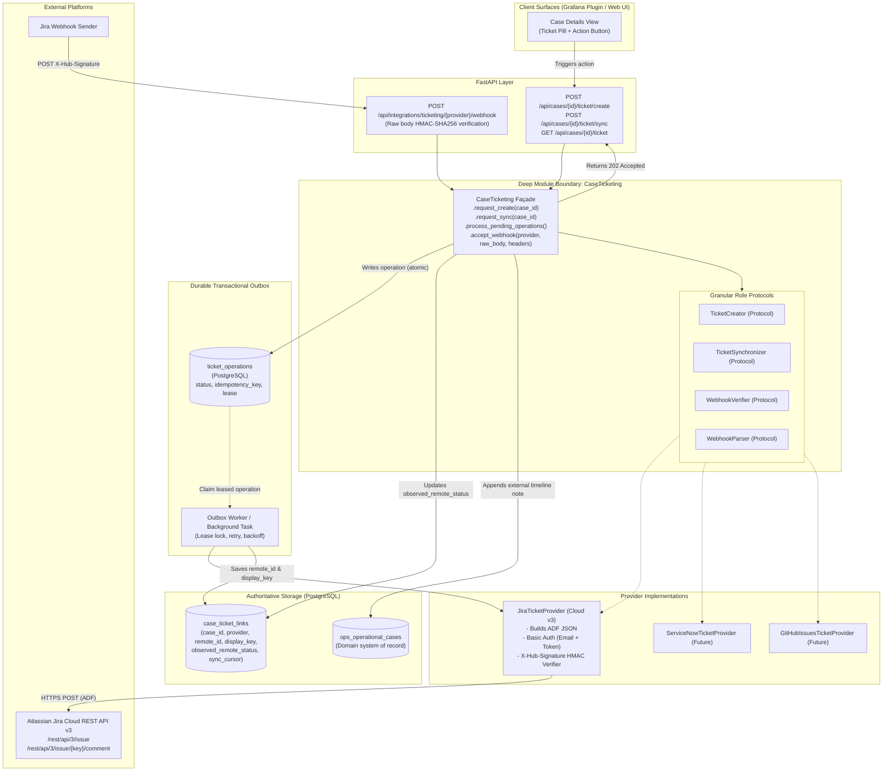

# Pluggable Case Ticketing Architecture Plan (Jira Cloud Reference Implementation)

**Status:** Proposed (Technical Design Document)  
**Extends:** [`docs/07-operational-cases.md`](../../07-operational-cases.md) (operational case lifecycle),  
[`ADR-004`](../../adr/ADR-004-postgresql-system-of-record.md) (PostgreSQL as system of record),  
[`ADR-005`](../../adr/ADR-005-qdrant-retrieval-index.md) (Qdrant as derived retrieval index).  

---

## 1. Executive Summary & Vision

Ops Signals analyzes telemetry anomalies, generates findings, and drives operational cases to root-cause investigation and resolution. Today, cases live in PostgreSQL as the authoritative system of record and are indexed into Qdrant for semantic similarity retrieval. However, enterprise operations teams collaborate across external issue-tracking and ITSM platforms—predominantly **Jira Cloud**, **ServiceNow**, **GitHub Issues**, and **Linear**.

### The Vision: Plug-and-Play Ticketing Architecture
Instead of coupling Ops Signals to a bespoke, one-off Jira script that mixes delivery state into case models and breaks when another tool is introduced, Ops Signals establishes a **pluggable ticketing architecture**:
1. **Strict Single-Authority Model:** PostgreSQL remains the immutable system of record. Case lifecycle status is derived from case investigation and RCA milestones—external ticket updates never silently clobber internal case status.
2. **Durable Transactional Outbox (`ticket_operations`):** Outbound operations return `202 Accepted` immediately and process reliably through a durable outbox table with idempotency keys and lease locking, eliminating duplicate tickets from double-clicks or worker crashes.
3. **Normalized Link Entity (`case_ticket_links`):** Case identity and ticketing identity are strictly separated. The `ops_operational_cases` table remains pristine, while provider links, display keys (`OPS-142`), and observed remote statuses are managed in a dedicated link table.
4. **Deep Module Façade (`CaseTicketing`) & Role Protocols:** Granular role protocols (`TicketCreator`, `TicketSynchronizer`, `WebhookVerifier`, `WebhookParser`) hide provider mechanics behind a single deep façade.
5. **Jira Cloud v3 Reference Adapter:** Phase 1 delivers an end-to-end Jira Cloud adapter using Atlassian Document Format (ADF) and REST API v3, secured with authentic HMAC-SHA256 webhook signatures. Future providers (ServiceNow, GitHub, Linear) implement the same role protocols with zero schema migrations.

---

## 2. Core Architectural Principles & Authority Model

### A. Authority Model & Lifecycle Integrity (P0)
In Ops Signals, `case_status` is computed dynamically from domain milestones via `_compute_case_status` in `backend/app/api/cases.py`:
- `investigation_notes` present $\rightarrow$ `investigation_status = "in_progress"`
- `root_cause_summary` AND `corrective_action` present $\rightarrow$ `case_status = "in_progress"`
- `root_cause_verified` AND `corrective_action` AND `outcome_summary` present $\rightarrow$ `case_status = "resolved"`, `investigation_status = "completed"`

A dual-master design where external tickets directly overwrite `case_status` creates dual-master drift: any subsequent case edit or re-indexing recomputes and clobbers the external status.

**Architectural Decision:**
- **Phase 1 (Outbound-Only):** External tickets are derived views projected *from* the operational case. The case creates the ticket; external changes are not pulled.
- **Phases 2 & 3 (Inbound Sync & Webhooks):** External changes do **not** write directly to `ops_operational_cases.case_status`. Instead:
  1. The remote workflow status is recorded as `observed_remote_status` on `case_ticket_links` (e.g., `observed_remote_status = "Done"`).
  2. Inbound Jira comments and status transitions are recorded as reviewable external timeline events (or structured investigation notes tagged with `[Jira OPS-142]`).
  3. Promoting an external resolution into an Ops Signals resolved case requires an explicit operator confirmation that satisfies required RCA verification fields.

### B. Isolated Qdrant Memory Pipeline
The semantic memory pipeline (`CaseMemoryIndexer` $\rightarrow$ Qdrant `operational_cases` collection) continues reading exclusively from PostgreSQL. Ticketing integration touches neither vector embeddings nor Qdrant storage.

---

## 3. High-Level System Architecture



---

## 4. Durable Transactional Outbox Pattern (P0)

### Why "Async, Best-Effort" Needs Durable Infrastructure
Firing background tasks directly from HTTP handlers without persistence fails under realistic conditions:
- **Worker Crash:** If the API worker process terminates midway through ticket creation, the request is lost without trace.
- **Double-Clicks & Race Conditions:** Two operators clicking "Create Ticket" simultaneously create duplicate tickets in Jira.
- **Transient Network Glitches:** External API timeouts drop the ticket, leaving the user with an indeterminate UI state.

### Outbox Schema: `ticket_operations`
```sql
CREATE TABLE ticket_operations (
    id VARCHAR(64) PRIMARY KEY,                  -- UUID
    case_id INTEGER NOT NULL REFERENCES ops_operational_cases(id) ON DELETE CASCADE,
    provider VARCHAR(32) NOT NULL,              -- 'jira', 'servicenow', etc.
    operation_type VARCHAR(32) NOT NULL,        -- 'create_ticket', 'sync_ticket'
    idempotency_key VARCHAR(128) NOT NULL,      -- Unique per case+operation+attempt
    status VARCHAR(32) NOT NULL DEFAULT 'pending', -- pending, processing, completed, failed, dead_letter
    attempts INTEGER NOT NULL DEFAULT 0,
    max_attempts INTEGER NOT NULL DEFAULT 5,
    lease_token VARCHAR(64),                    -- Worker instance identifier
    lease_expires_at TIMESTAMP WITH TIME ZONE,  -- Worker lease timeout
    payload JSONB NOT NULL DEFAULT '{}'::jsonb,
    error_message TEXT,
    created_at TIMESTAMP WITH TIME ZONE NOT NULL DEFAULT NOW(),
    updated_at TIMESTAMP WITH TIME ZONE NOT NULL DEFAULT NOW()
);

CREATE UNIQUE INDEX uq_ticket_ops_idempotency ON ticket_operations(idempotency_key);
CREATE INDEX idx_ticket_ops_status_lease ON ticket_operations(status, lease_expires_at);
CREATE INDEX idx_ticket_ops_case_id ON ticket_operations(case_id);
```

### The `202 Accepted` Request Flow
1. **Client POST:** `POST /api/cases/{case_id}/ticket/create`
2. **Transaction Entry:**
   - Compute default idempotency key: `f"{case_id}:create"` (or accept client `Idempotency-Key` header).
   - Check if an active (`pending` or `processing`) or completed operation exists for this key.
   - If found and `completed`, return the existing ticket link (`200 OK`).
   - If found and `pending`/`processing`, return `202 Accepted` with existing operation details.
   - If none found, insert row into `ticket_operations` with `status = 'pending'` and commit the transaction.
3. **Response:** Return HTTP `202 Accepted`:
   ```json
   {
     "status": "accepted",
     "operation_id": "op_9f8d1c7e2b",
     "case_id": 14,
     "provider": "jira",
     "poll_url": "/api/cases/14/ticket/operations/op_9f8d1c7e2b"
   }
   ```
4. **Durable Worker Execution & Lease Mechanics:**
   - Background worker claims ready jobs using an atomic update with lease expiration:
     ```sql
     UPDATE ticket_operations
     SET status = 'processing',
         lease_token = :worker_id,
         lease_expires_at = NOW() + INTERVAL '60 seconds',
         attempts = attempts + 1,
         updated_at = NOW()
     WHERE id = (
         SELECT id FROM ticket_operations
         WHERE status IN ('pending', 'failed')
           AND attempts < max_attempts
           AND (lease_expires_at IS NULL OR lease_expires_at < NOW())
         ORDER BY created_at ASC
         LIMIT 1
         FOR UPDATE SKIP LOCKED
     )
     RETURNING *;
     ```
   - Worker queries `case_ticket_links` to confirm ticket doesn't already exist.
   - Calls `provider.create_ticket(case)`.
   - On success:
     - Inserts record into `case_ticket_links`.
     - Updates `ticket_operations` row to `status = 'completed'`, clears lease.
   - On error:
     - Logs error message and sets `status = 'failed'` with exponential backoff delay.
     - If `attempts >= max_attempts`, sets `status = 'dead_letter'`.
   - **Crash Recovery:** If a worker dies while processing, `lease_expires_at` lapses, allowing another worker to safely reclaim the task without leaving the operation stuck.

---

## 5. Normalized Link Entity (`case_ticket_links`) (P1)

Directly adding `external_ticket_*` columns to `ops_operational_cases` pollutes the core domain model and entangles delivery execution (`creating`, `failed`) with remote ticket identity (`OPS-142`).

### Table Schema: `case_ticket_links`
```sql
CREATE TABLE case_ticket_links (
    id SERIAL PRIMARY KEY,
    case_id INTEGER NOT NULL REFERENCES ops_operational_cases(id) ON DELETE CASCADE,
    provider VARCHAR(32) NOT NULL,              -- 'jira', 'servicenow', 'github'
    remote_id VARCHAR(64) NOT NULL,             -- Provider internal ID (e.g. Jira numeric ID "10042")
    display_key VARCHAR(64) NOT NULL,           -- Human-facing key (e.g. "OPS-142")
    ticket_url TEXT NOT NULL,                   -- Clickable web URL to ticket
    observed_remote_status VARCHAR(64),         -- Remote workflow status (e.g. "To Do", "In Progress", "Done")
    sync_cursor VARCHAR(255),                   -- Cursor/timestamp for incremental pull
    last_synced_at TIMESTAMP WITH TIME ZONE,
    created_at TIMESTAMP WITH TIME ZONE NOT NULL DEFAULT NOW(),
    updated_at TIMESTAMP WITH TIME ZONE NOT NULL DEFAULT NOW(),
    CONSTRAINT uq_case_provider UNIQUE (case_id, provider)
);

CREATE INDEX idx_case_ticket_links_remote ON case_ticket_links(provider, remote_id);
```

### Clean Separation of Concerns
| Dimension | Table | Fields |
|---|---|---|
| **Incident Domain State** | `ops_operational_cases` | `case_status`, `root_cause_summary`, `investigation_notes` |
| **Delivery / Outbox State** | `ticket_operations` | `status` (`pending`, `processing`, `completed`, `failed`), `attempts`, `lease_expires_at`, `error_message` |
| **Remote Ticket Identity** | `case_ticket_links` | `remote_id`, `display_key`, `ticket_url`, `observed_remote_status`, `last_synced_at` |

---

## 6. Deep Module Boundary: `CaseTicketing` Façade & Role Protocols (P1)

Monolithic interfaces force providers that only support outbound creation or lack webhooks to implement empty stubs. We use Python `typing.Protocol` role boundaries behind a cohesive `CaseTicketing` façade.

### Granular Role Protocols (`backend/app/integrations/ticketing/protocols.py`)
```python
from typing import Mapping, Protocol, runtime_checkable
from pydantic import BaseModel

class TicketCreationResult(BaseModel):
    remote_id: str
    display_key: str
    ticket_url: str
    observed_remote_status: str | None = None

class RemoteTicketSnapshot(BaseModel):
    remote_id: str
    display_key: str
    observed_remote_status: str
    remote_comments: list[dict]
    sync_cursor: str | None = None

class RemoteTicketEvent(BaseModel):
    event_type: str                         # "issue_updated", "comment_created"
    remote_id: str
    display_key: str
    observed_remote_status: str | None
    comment_body: str | None
    author: str | None

@runtime_checkable
class TicketCreator(Protocol):
    """Implemented by providers capable of outbound ticket creation."""
    def create_ticket(self, case: OperationalCaseEntity) -> TicketCreationResult: ...

@runtime_checkable
class TicketSynchronizer(Protocol):
    """Implemented by providers capable of polling remote ticket status/comments."""
    def pull_remote_ticket(self, link: CaseTicketLinkEntity) -> RemoteTicketSnapshot: ...

@runtime_checkable
class WebhookVerifier(Protocol):
    """Implemented by providers supporting cryptographically signed inbound webhooks."""
    def verify_signature(self, raw_body: bytes, headers: Mapping[str, str], secret: str) -> bool: ...

@runtime_checkable
class WebhookParser(Protocol):
    """Implemented by providers supporting inbound webhook event parsing."""
    def parse_webhook_event(self, raw_body: bytes, headers: Mapping[str, str]) -> RemoteTicketEvent: ...
```

### Deep Façade: `CaseTicketing` (`backend/app/integrations/ticketing/service.py`)
The rest of the application (FastAPI routes, background workers) interacts *only* with `CaseTicketing`:
```python
class CaseTicketing:
    """Deep module façade orchestrating case ticketing outbox, adapters, and link records."""

    def __init__(self, db: Session, config: TicketingConfig, provider_registry: dict[str, Any]):
        self.db = db
        self.config = config
        self.providers = provider_registry

    def request_create(self, case_id: int, idempotency_key: str | None = None) -> TicketOperationEntity:
        """Enqueues an idempotent ticket creation operation in the outbox."""

    def request_sync(self, case_id: int) -> TicketOperationEntity:
        """Enqueues an idempotent ticket sync operation in the outbox."""

    def get_ticket_link(self, case_id: int) -> CaseTicketLinkEntity | None:
        """Retrieves active ticket link metadata for a case."""

    def get_operation(self, operation_id: str) -> TicketOperationEntity | None:
        """Retrieves outbox operation status."""

    def process_pending_operations(self, limit: int = 10) -> int:
        """Worker loop step: claims and executes pending outbox tasks with leases."""

    def accept_webhook(self, provider_name: str, raw_body: bytes, headers: Mapping[str, str]) -> WebhookResult:
        """Cryptographically verifies inbound webhook, parses event, and updates link/notes."""
```

---

## 7. Jira Cloud Reference Adapter Details (P1 / P2)

### A. Jira Cloud REST API v3 Only (P2)
We drop all legacy Jira v2 / wiki-markup fallback plans. Ops Signals targets **Jira Cloud REST API v3** directly (`https://{org}.atlassian.net/rest/api/3/issue`). Jira Cloud v3 strictly requires Atlassian Document Format (ADF) for all multiline rich text fields (`description`, `comment`).

### B. Encapsulated ADF Document Builder
`JiraTicketProvider` delegates formatting to `backend/app/integrations/ticketing/jira/adf.py`:
```python
def build_case_adf_description(case: OperationalCaseEntity) -> dict:
    """Builds a compliant Atlassian Document Format (ADF) structure for Jira v3."""
    content = [
        {
            "type": "heading",
            "attrs": {"level": 2},
            "content": [{"type": "text", "text": "Ops Signals Incident Investigation"}]
        },
        {
            "type": "paragraph",
            "content": [
                {"type": "text", "text": "Case Title: ", "marks": [{"type": "strong"}]},
                {"type": "text", "text": case.case_title}
            ]
        },
        {
            "type": "paragraph",
            "content": [
                {"type": "text", "text": "Analysis Run ID: ", "marks": [{"type": "strong"}]},
                {"type": "text", "text": case.analysis_run_id}
            ]
        }
    ]
    
    if case.root_cause_summary:
        content.extend([
            {
                "type": "heading",
                "attrs": {"level": 3},
                "content": [{"type": "text", "text": "Root Cause Analysis"}]
            },
            {
                "type": "paragraph",
                "content": [{"type": "text", "text": case.root_cause_summary}]
            }
        ])

    return {
        "type": "doc",
        "version": 1,
        "content": content
    }
```

### C. Secure Webhook Verification (`X-Hub-Signature`) (P1)
Jira Cloud webhooks are signed using HMAC-SHA256 across the raw request body. Query parameter secrets are rejected as insecure.
- The webhook endpoint extracts the raw binary request payload (`await request.body()`).
- The `JiraTicketProvider` implements `WebhookVerifier`:
```python
import hashlib
import hmac

class JiraTicketProvider:
    def verify_signature(self, raw_body: bytes, headers: Mapping[str, str], secret: str) -> bool:
        signature_header = headers.get("X-Hub-Signature") or headers.get("x-hub-signature")
        if not signature_header:
            return False
            
        # Jira X-Hub-Signature format: sha256=<hex_digest>
        prefix = "sha256="
        if signature_header.startswith(prefix):
            provided_hash = signature_header[len(prefix):]
        else:
            provided_hash = signature_header
            
        computed_hash = hmac.new(
            secret.encode("utf-8"),
            raw_body,
            hashlib.sha256
        ).hexdigest()
        
        return hmac.compare_digest(computed_hash, provided_hash)
```

---

## 8. Configuration Model & Dependency Injection

### Configuration Schema (`backend/app/config.py`)
```python
class JiraConfig(BaseModel):
    base_url: str | None = None               # e.g. "https://example.atlassian.net"
    email: str | None = None                  # service account email
    api_token: str | None = None              # Atlassian API token
    project_key: str | None = None            # e.g. "OPS"
    issue_type: str = "Task"                  # "Task", "Incident", "Bug"
    webhook_secret: str | None = None         # Shared HMAC secret for webhooks
    request_timeout_seconds: float = 10.0

class TicketingConfig(BaseModel):
    enabled: bool = False
    active_provider: str = "jira"             # "jira" | "servicenow" | "github"
    automatic_on_case_creation: bool = False  # opt-in auto-creation
    outbox_lease_seconds: int = 60
    outbox_max_attempts: int = 5
    jira: JiraConfig = Field(default_factory=JiraConfig)

def get_ticketing_config() -> TicketingConfig:
    return TicketingConfig(
        enabled=_parse_bool(_env("OPS_SIGNALS_TICKETING_ENABLED"), False),
        active_provider=_env("OPS_SIGNALS_TICKETING_PROVIDER") or "jira",
        automatic_on_case_creation=_parse_bool(_env("OPS_SIGNALS_TICKETING_AUTO_CREATE"), False),
        jira=JiraConfig(
            base_url=_env("OPS_SIGNALS_JIRA_URL"),
            email=_env("OPS_SIGNALS_JIRA_EMAIL"),
            api_token=_env("OPS_SIGNALS_JIRA_API_TOKEN"),
            project_key=_env("OPS_SIGNALS_JIRA_PROJECT_KEY"),
            issue_type=_env("OPS_SIGNALS_JIRA_ISSUE_TYPE") or "Task",
            webhook_secret=_env("OPS_SIGNALS_JIRA_WEBHOOK_SECRET"),
        )
    )
```

### FastAPI Dependency Injection (`backend/app/api/ticketing.py`)
```python
def get_case_ticketing(
    db: Session = Depends(get_db),
    config: TicketingConfig = Depends(get_ticketing_config)
) -> CaseTicketing:
    providers = {}
    if config.jira.base_url and config.jira.api_token:
        providers["jira"] = JiraTicketProvider(config.jira)
    return CaseTicketing(db=db, config=config, provider_registry=providers)
```

---

## 9. REST API Endpoints Contract

| Method & Path | Status | Purpose | Request / Response Details |
|---|---|---|---|
| `POST /api/cases/{case_id}/ticket/create` | `202 Accepted` | Idempotent trigger for ticket creation | Header: `Idempotency-Key` (optional)<br>Returns: `{"status": "accepted", "operation_id": "...", "poll_url": "..."}` |
| `POST /api/cases/{case_id}/ticket/sync` | `202 Accepted` | Idempotent trigger for manual ticket sync | Returns: `{"status": "accepted", "operation_id": "...", "poll_url": "..."}` |
| `GET /api/cases/{case_id}/ticket` | `200 OK` | Fetch ticket link and recent operation state | Returns: `{"linked": true, "provider": "jira", "display_key": "OPS-142", "ticket_url": "...", "observed_remote_status": "In Progress", "last_synced_at": "...", "pending_operation": null}` |
| `GET /api/cases/{case_id}/ticket/operations/{operation_id}` | `200 OK` | Check outbox operation completion status | Returns: `{"id": "...", "status": "completed", "attempts": 1, "error": null}` |
| `POST /api/integrations/ticketing/{provider}/webhook` | `200 OK` / `401 Unauthorized` | Secure inbound webhook receiver | Verifies `X-Hub-Signature` HMAC over raw request body; records remote status & notes. |

---

## 10. Frontend User Experience (Grafana & Standalone UI)

The Case Details view displays a distinct **Ticketing Widget**:
1. **Unlinked Case (`case_ticket_links` has no row):**
   - Renders button: `[Create Jira Ticket]`.
   - If an operation is currently `pending` or `processing` in `ticket_operations`, the button enters a disabled loading state: `[Creating Ticket... ⏳]`.
2. **Linked Case:**
   - Displays clickable badge: `[JIRA: OPS-142 ↗]` with a status chip indicating `observed_remote_status` (e.g. `In Progress`).
   - Renders secondary action button: `[Sync Now 🔄]`.
3. **Failed Operation State:**
   - If an outbox operation exhausts retries and transitions to `failed` or `dead_letter`:
   - Displays alert banner with `error_message` and a `[Retry]` button that submits a fresh outbox operation.

---

## 11. Implementation Phases

### Phase 1: Outbound Jira Cloud v3 Integration with Transactional Outbox
- **Migration `004_add_ticketing_tables.sql`:**
  - Create `case_ticket_links` table.
  - Create `ticket_operations` outbox table.
- **Ticketing Core:**
  - Implement role protocols (`protocols.py`) and `CaseTicketing` façade (`service.py`).
  - Implement `JiraTicketProvider` with REST v3 client and ADF generator (`adf.py`).
  - Implement durable outbox lease runner.
- **API & Configuration:**
  - Add `TicketingConfig` and `JiraConfig` to `config.py`.
  - Expose `POST /api/cases/{id}/ticket/create`, `GET /api/cases/{id}/ticket`, and `GET /api/cases/{id}/ticket/operations/{id}`.
- **UI:** Add ticket creation button and link pill to Case Details view.

### Phase 2: Inbound Poll & Non-Destructive Status Sync
- Implement `pull_remote_ticket` in `JiraTicketProvider`.
- Expose `POST /api/cases/{id}/ticket/sync`.
- Save updated `observed_remote_status` to `case_ticket_links`.
- Ingest new Jira comments as tagged external timeline events, preserving `case_status` integrity.

### Phase 3: Real-Time Inbound Webhooks via HMAC-SHA256
- Implement `verify_signature` using `X-Hub-Signature` and constant-time `hmac.compare_digest`.
- Implement `parse_webhook_event` for Jira `jira:issue_updated` events.
- Expose `POST /api/integrations/ticketing/{provider}/webhook`.

### Phase 4: Additional Adapters (ServiceNow, GitHub, Linear)
- Add `ServiceNowTicketProvider` implementing `TicketCreator` and `TicketSynchronizer`.
- Add `GitHubIssuesTicketProvider` implementing `TicketCreator` and `WebhookVerifier`.
- Zero database migrations or core API changes required.

---

## 12. Explicit Non-Goals

1. **No Dual-Master Status Overwriting:** Ops Signals' computed `case_status` will never be blindly replaced by external ticket status.
2. **No Unbounded Two-Way Sync:** We do not sync attachments, sprint assignments, estimation points, or sub-task hierarchies.
3. **No Direct Qdrant Access:** External systems cannot query or index directly into Qdrant vector memory.
4. **No Legacy Jira v2 Wiki Markup:** We do not support Jira Server or Jira Cloud REST v2 fallback.
5. **No Insecure Query-String Webhook Secrets:** Webhooks require authentic HTTP header HMAC signatures.
