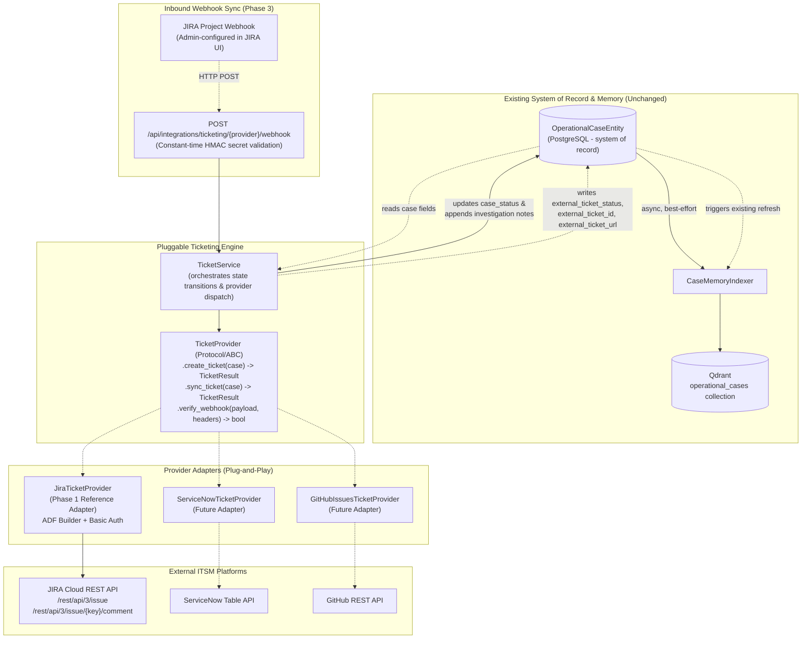

# Pluggable Ticketing Integration Plan (JIRA Reference Implementation)

**Status:** Proposed (Technical Design Document)  
**Extends:** [`docs/07-operational-cases.md`](../../07-operational-cases.md) (operational case lifecycle),  
[`ADR-004`](../../adr/ADR-004-postgresql-system-of-record.md) (PostgreSQL as system of record),  
[`ADR-005`](../../adr/ADR-005-qdrant-retrieval-index.md) (Qdrant as derived retrieval index).  

---

## 1. Executive Summary & Vision

Ops Signals cases currently live in PostgreSQL as the system of record and are indexed into Qdrant for semantic similarity retrieval. However, enterprise operations teams universally track incidents, investigations, and remediation workflows in external issue-tracking and ITSM platforms.

### The Vision: Plug-and-Play Ticketing
Instead of hardcoding a bespoke, one-off JIRA integration that would require database migrations and code rewrites whenever a team uses **ServiceNow**, **GitHub Issues**, **Linear**, or **PagerDuty**, Ops Signals establishes a **pluggable `TicketProvider` architecture**:
1. **Generic data model and API contracts:** All cases interact with a provider-agnostic ticketing interface (`external_ticket_*`).
2. **JIRA as reference implementation #1:** The initial implementation delivers an end-to-end JIRA Cloud adapter to satisfy real-world demand immediately.
3. **Zero schema rewrites for future providers:** Adding ServiceNow, GitHub Issues, or Linear in the future requires only implementing a new Python provider class and zero database migrations or frontend rewrites.

---

## 2. Core Architectural Principles

1. **PostgreSQL Remains the System of Record:**  
   Every external ticket (summary, description, status, comments) is derived *from* the operational case. External systems never become the source of truth for Ops Signals cases.
2. **Qdrant Pipeline Remains Isolated and Unchanged:**  
   The semantic memory and case retrieval pipeline (`CaseMemoryIndexer` -> Qdrant `operational_cases`) continues reading directly from PostgreSQL as it does today. External ticketing does not touch Qdrant.
3. **Ticketing as an Asynchronous Derived Sink:**  
   External ticket creation and synchronization run asynchronously and best-effort. Outbound ticket operations are non-blocking and will **never** fail or roll back the case creation/update transaction.
4. **Provider-Agnostic Seams, Provider-Specific Adapters:**  
   Core case models and API endpoints use generic ticketing concepts (`ticket_id`, `ticket_url`, `ticket_status`). Provider-specific nuances (such as JIRA's Atlassian Document Format or ServiceNow's sys_id) are strictly encapsulated inside the provider adapter.

---

## 3. Architecture & Pluggable Provider Seam



---

## 4. Generic Data Model (`OperationalCaseEntity`)

Rather than hardcoding JIRA-specific column names, `OperationalCaseEntity` in `backend/app/models/entities.py` gains generic ticketing columns:

| Column | Type | Default | Description |
|---|---|---|---|
| `external_ticket_provider` | `String(32)` | `None` | Active provider identifier (e.g., `"jira"`, `"servicenow"`, `"github"`) |
| `external_ticket_id` | `String(64)` | `None` | External issue/ticket identifier (e.g., `"OPS-142"`, `"INC0019283"`, `"#42"`) |
| `external_ticket_url` | `Text` | `None` | Direct clickable web link to the ticket |
| `external_ticket_status` | `String(32)` | `"not_created"` | State machine: `not_created`, `creating`, `created`, `syncing`, `stale`, `failed` |
| `external_ticket_synced_at` | `DateTime(timezone=True)` | `None` | Timestamp of last successful sync with the external platform |
| `external_ticket_error` | `Text` | `None` | Error details if ticket creation or sync failed |

### State Machine Transitions
```
                ┌──────────────┐
                │ not_created  │
                └──────┬───────┘
                       │ trigger create
                       ▼
                ┌──────────────┐
         ┌─────►│   creating   │
         │      └──────┬───────┘
         │             │
   retry │      ┌──────┴────────┐
         │      │               │
         │      ▼               ▼
         │  ┌───────┐       ┌────────┐
         └──┤ failed│       │created │◄─────────┐
            └───┬───┘       └───┬────┘          │
                ▲               │ trigger sync  │ sync ok
                │               ▼               │
                │         ┌───────────┐         │
                └─────────┤  syncing  ├─────────┘
                 sync fail└───────────┘
```

---

## 5. Configuration Model (`config.py`)

Configuration is structured with an active provider selector and provider-specific configuration blocks:

```python
class JiraProviderConfig(BaseModel):
    base_url: str | None = None          # e.g. "https://yourorg.atlassian.net"
    project_key: str | None = None       # e.g. "OPS"
    issue_type: str = "Task"             # e.g. "Task", "Incident", "Bug"
    api_version: str = "3"               # "3" (ADF format) or "2" (plain text wiki markup)
    status_mapping: dict[str, str] = Field(default_factory=lambda: {
        "open": "To Do",
        "investigating": "In Progress",
        "rca_in_progress": "In Progress",
        "resolved": "Done",
        "closed": "Done",
    })

class TicketingConfig(BaseModel):
    enabled: bool = False
    active_provider: str = "jira"        # "jira" | "servicenow" | "github"
    automatic_on_case_creation: bool = False  # opt-in; defaults to manual user trigger
    jira: JiraProviderConfig = Field(default_factory=JiraProviderConfig)
```

### Environment Variables & Credentials
- `OPS_SIGNALS_TICKETING_ENABLED`: `true` / `false`
- `OPS_SIGNALS_TICKETING_PROVIDER`: `jira`
- `OPS_SIGNALS_JIRA_EMAIL`: Service account email
- `OPS_SIGNALS_JIRA_API_TOKEN`: Atlassian API token (from `id.atlassian.com/manage/api-tokens`)
- `OPS_SIGNALS_JIRA_WEBHOOK_SECRET`: Shared secret for inbound webhook validation

---

## 6. JIRA Reference Implementation Details

### A. Atlassian Document Format (ADF) Handling
**Crucial API v3 Requirement:** JIRA Cloud REST API v3 (`/rest/api/3/issue`) **strictly rejects plain strings** for `description` and `comment` bodies. Sending a string results in `400 Bad Request: Operation value must be an Atlassian Document (ADF)`.

The `JiraTicketProvider` encapsulates an ADF builder:
```python
def text_to_adf(text: str) -> dict:
    """Converts multiline markdown/text into valid Atlassian Document Format (ADF)."""
    paragraphs = []
    for line in text.split("\n\n"):
        clean = line.strip()
        if clean:
            paragraphs.append({
                "type": "paragraph",
                "content": [{"type": "text", "text": clean}]
            })
    return {
        "type": "doc",
        "version": 1,
        "content": paragraphs or [{"type": "paragraph", "content": [{"type": "text", "text": "No details provided."}]}]
    }
```
*Fallback:* If `api_version: "2"` is configured, plain string description is used against `/rest/api/2/issue`.

### B. Authentication Protocol & Resilience
- **Auth Header:** Standard HTTP Basic Auth:
  `Authorization: Basic base64(f"{email}:{api_token}")`
- **Timeouts:** 10-second request timeout to prevent hanging on unresponsive endpoints.
- **Rate-Limiting (HTTP 429):** Respects `Retry-After` headers with exponential backoff up to 3 retries.

### C. Inbound Webhook Cryptographic Verification
- JIRA admin-configured webhooks pass a shared secret either via query string (`?secret=...`) or custom header (`X-Atlassian-Webhook-Secret`).
- **Timing-Attack Protection:** The endpoint verifies the secret using constant-time comparison:
  ```python
  import hmac
  if not hmac.compare_digest(provided_secret, config.jira_webhook_secret):
      raise HTTPException(status_code=401, detail="Invalid webhook secret")
  ```
- **Idempotency:** Webhook requests store `(external_ticket_id, webhook_timestamp)` to prevent re-processing duplicated events.

---

## 7. REST Endpoints Contract

| Method & Path | Phase | Description |
|---|---|---|
| `POST /api/cases/{case_id}/ticket/create` | 1 | Explicit user trigger: dispatches ticket creation to active provider (e.g. JIRA) and saves `external_ticket_id` & `url`. |
| `POST /api/cases/{case_id}/ticket/sync` | 2 | Manual pull: pulls latest status and comments from external ticket into Ops Signals case. |
| `POST /api/integrations/ticketing/{provider}/webhook` | 3 | Inbound receiver for external webhooks (e.g. JIRA status changes or new comments). Validates secret, updates case, and triggers Qdrant memory refresh. |

`GET /api/cases/{case_id}` (existing) automatically includes the `external_ticket_*` fields.

---

## 8. Frontend UI Contracts & User Experience

Both the Grafana plugin (`PanelPreview.tsx` / `PluginApp.tsx`) and Standalone Web UI (`CaseDetailsPage.tsx`) use a consistent ticketing component:

### 1. Ticket Pill / Link
When `external_ticket_id` is present and status is `created`:
```tsx
<a href={case.external_ticket_url} target="_blank" rel="noopener noreferrer" style={styles.ticketPill}>
  
  <span>{case.external_ticket_provider.toUpperCase()}: {case.external_ticket_id} ↗</span>
</a>
```

### 2. Action Button State Machine
- `external_ticket_status == "not_created"`:
  Button: **"Create Ticket (Jira)"** (or provider display name).
- `external_ticket_status == "creating"`:
  Button: **"Creating Ticket..."** (disabled, spinner).
- `external_ticket_status == "created"`:
  Button: **"Sync Ticket"** (manual pull refresh).
- `external_ticket_status == "failed"`:
  Renders alert banner showing `external_ticket_error` with a **"Retry Ticket Creation"** button.

---

## 9. Implementation Phases

### Phase 1: Outbound Ticket Creation (JIRA Reference Implementation)
- **Database Migration:** `backend/migrations/004_add_external_ticket_case_fields.sql` adding `external_ticket_*` columns to `operational_cases`.
- **Domain Layer:** Define `TicketProvider` protocol in `backend/app/integrations/ticketing/base.py`.
- **JIRA Adapter:** Implement `JiraTicketProvider` in `backend/app/integrations/ticketing/jira.py` with ADF formatting and Basic Auth.
- **API Endpoint:** `POST /api/cases/{case_id}/ticket/create`.
- **UI Integration:** Add "Create Ticket" action and ticket badge to Case Details UI.

### Phase 2: Manual Pull & Bidirectional Synchronization
- Implement `sync_ticket()` in `JiraTicketProvider` to fetch issue status and latest comments.
- Endpoint: `POST /api/cases/{case_id}/ticket/sync`.
- Ingest new JIRA comments as `investigation_notes` and update `case_status` based on configurable `status_mapping`.
- Add "Sync Ticket" button in Case Details UI.

### Phase 3: Real-Time Inbound Webhooks
- Endpoint: `POST /api/integrations/ticketing/{provider}/webhook`.
- Shared-secret authentication with `hmac.compare_digest`.
- Case status update and investigation note ingestion automatically triggers existing `_refresh_case_memory()` to update Qdrant.

### Phase 4: Additional Providers Extension
- Add `ServiceNowTicketProvider` (`/api/now/table/incident`).
- Add `GitHubIssuesTicketProvider` (`/repos/{owner}/{repo}/issues`).
- Purely additive: zero changes to `operational_cases` table or core case API endpoints.

---

## 10. Explicit Non-Goals

- **No Multi-Master Ownership:** JIRA and ServiceNow never become the system of record. PostgreSQL remains the authoritative store; external changes only flow in through explicit sync or validated webhooks.
- **No Unbounded Two-Way Field Synchronization:** Ops Signals does not attempt to synchronize custom fields, attachments, time-tracking, or sub-task hierarchies. Scope is strictly focused on title, description, status, and investigation notes/comments.
- **No Direct Qdrant Access from External Systems:** External tickets never interact directly with Qdrant. All memory indexing occurs exclusively via `CaseMemoryIndexer` through PostgreSQL.
