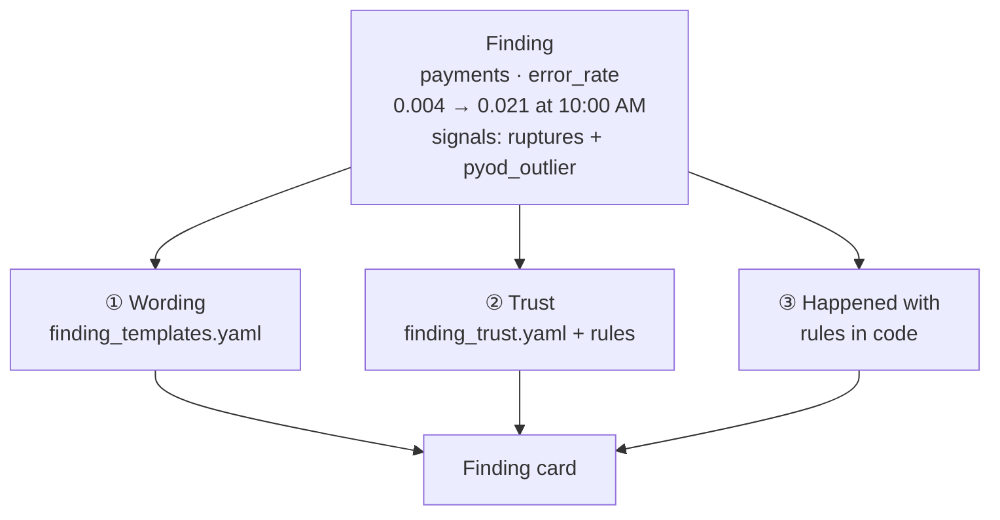

# How a finding becomes a card

An analyzer saves a bare finding: a service, a metric, some values and the signals behind it. When
the card is shown, three separate steps read that same finding, and each answers one question:

| Part | Question it answers | Comes from |
|---|---|---|
| ① Wording | What happened, in plain words? | `config/finding_templates.yaml` |
| ② Trust | How much should I believe it? | `config/finding_trust.yaml` and three rules in `backend/app/services/finding_trust.py` |
| ③ Happened with | What else changed at the same moment? | Rules in `backend/app/services/finding_plain.py` (no YAML) |



This page follows one example through all three. The details of each part are in
[Finding wording](finding-wording.md) and [Finding trust](finding-trust.md).

## The example finding

```
service:   payments
metric:    error_rate
values:    about 0.004 before 10:00 AM, about 0.021 after
signals:   ruptures (the level moved and stayed)  +  pyod_outlier (the values look unusual)
```

## ① Wording

**1. Look up the metric** under `metrics` in `config/finding_templates.yaml`:

```yaml
metrics:
  error_rate: {plain_name: Error rate, concept: error_rate, unit: ratio}
```

The card calls it "Error rate", and `ratio` shows 0.021 as 2.1%.

**2. The concept decides the badge:**

```yaml
concepts:
  error_rate:
    bad_when: up
    worse: More requests fail, so more users see errors or failed actions.
```

The value went up and `bad_when` is `up`, so the badge is **Worse** and "Why it matters" is the
`worse` sentence. A metric with no concept always gets **Changed**.

**3. Fill in the template.** A ruptures signal is a lasting step, so `level_change` is used:

```yaml
templates:
  level_change:
    headline: "{plain_name} {rose_or_dropped}{sharply} and stayed {higher_or_lower}"
    what: About {before} until {change_time}. Since then about {after} ({change}).
```

The value changed by more than 50%, so `{sharply}` is filled in: "Error rate rose sharply and
stayed higher".

**4. Add the service and its target**, when the service is described under `services` (the shipped
file has none; this one is an example):

```yaml
services:
  payments:
    about: Customers pay for their orders here.
    importance: critical
    targets:
      error_rate: {below: 0.01}
```

2.1% is above 1%, so the `targets.breach_ongoing` line is used: "Above your 1% target since
10:00 AM (2 hours so far)". The card also gets the **Critical service** label.

## ② Trust

**1. Sort each signal into a kind of check.** `ruptures` and `baseline_shift` are the *change*
check; `data_gap` and `flatline` are the *data* check; any other analyzer is a check of its own.

| Signal | Kind of check |
|---|---|
| ruptures | change |
| pyod_outlier | pyod_outlier |

**2. Pick the group.** The first rule that fits wins:

| Rule | Group | This finding |
|---|---|---|
| A data gap or flatline | `data_problem` | |
| A change check plus a different check | `level_change_agree` | ✅ |
| A change check alone | `level_change_single` | |
| Unusual values only | `spike` | |
| Trends, forecasts, repeating patterns | `pattern` | |

**3. Look up the tested number** in `config/finding_trust.yaml`:

```yaml
groups:
  level_change_agree:
    tested: {real: 0.98, checked: 248, random: 0.61, dataset: RCAEval RE1}
```

The card shows **Strong evidence** and the finding goes to **Needs attention**. These numbers come
from the run recorded in that file and change when it's regenerated; the file is the source, not
this page.

**4. Your team's answers override the tests.** After 5 "Was this real?" answers on this service and
group, fewer than 1 in 5 real moves it down to Context only. A Context only group that's real at
least half the time moves up.

## ③ Happened with

Say CPU usage on payments also stepped from 0.3 to 0.9 at 9:56 AM. That finding is linked when it
passes every check:

| Check | This pair |
|---|---|
| Same service | payments ✅ |
| A different metric | cpu_usage, not error_rate ✅ |
| Both are step changes | ✅ |
| At most 10 minutes apart (`RELATED_WINDOW`) | 4 minutes ✅ |
| Saved in the last 24 hours (`RELATED_SEARCH`) | ✅ |

The line is the CPU finding's own `level_change.related` sentence:

```yaml
templates:
  level_change:
    related: "{plain_name} also {rose_or_dropped} at {change_time} ({before} to {after})."
```

## The finished card

> **Worse** · **Critical service** · Error rate rose sharply and stayed higher ← ①\
> About 0.4% until 10:00 AM. Since then about 2.1% (about 5 times as high). ← ①\
> **Your target:** Above your 1% target since 10:00 AM (2 hours so far). ← ①\
> **Why it matters:** More requests fail, so more users see errors or failed actions. ← ①\
> **Happened with:** CPU usage also rose at 9:56 AM (0.3 to 0.9). ← ③\
> **Strong evidence** · In testing: 98% real (a random alert: 61%) · Needs attention ← ②

In one line each:

- **Wording**: the metric points to a concept, the concept decides Better or Worse, and a template
  fills in the numbers.
- **Trust**: the kinds of checks behind the finding decide its group, and the group has a measured
  rate.
- **Happened with**: another step change on the same service within 10 minutes.

Nothing above is stored. All three parts are worked out each time the card is read, so a change to
either YAML file applies to old findings too.
