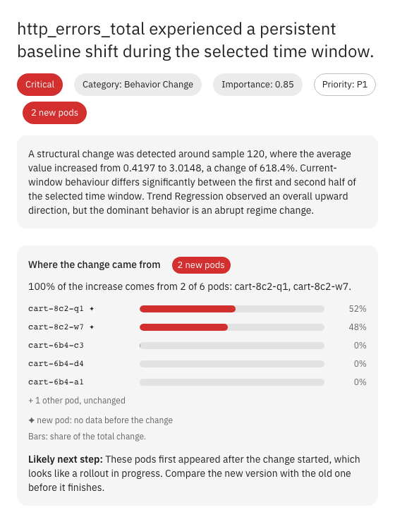

# Finding Drill-down

A finding says *what* changed at service level: "checkout errors rose 308% at 14:08". Drill-down
adds *where* it came from: "91% of the increase comes from pod checkout-x2, 1 of 6 pods". It also
says whether the change is in one pod, a few, or all of them. The service-level finding looks the
same in each case, but the response differs:

| Spread | Usually means | Likely next step |
|---|---|---|
| **Concentrated** (one pod) | a bad node, disk or instance | check that pod; a rollback is probably not needed |
| **Partial** (a few pods) | something those pods share | check what they have in common (node, zone, version) |
| **Partial or concentrated, all new pods** | a rollout in progress | compare the new version with the old one |
| **Widespread** (most pods) | code, config, traffic or a shared dependency | look at recent changes or dependencies |



Drill-down is **off by default**. It runs for **autonomous Prometheus runs** and for
**alert-triggered analysis** ([`alert-enrichment.md`](alert-enrichment.md)), using the alert's query.

## Where it shows

- **Web UI**: a scope chip on finding cards ("1 of 6 pods"; hover for the pods, click for
  details) and a "Where the change came from" section in the finding details.
- **Slack alert messages**: a "📍 Where" line in the "What happened" section, with the same
  sentence and next step as the UI.
- **Grafana plugin**, Autonomous Analysis: the same chip on Related Symptoms and in the findings
  lookup, and the same section in the finding's evidence panel.

Both use the same wording (`frontend/src/utils/findingBreakdown.ts`).

## The chips on a finding card

A finding card can carry two chips next to its summary, for example **2 new pods** and **After
deploy v1.4.2**. They answer different questions: the pod chip says *where* the change is, the
deploy chip says *what happened just before it*. Both open the finding's details when clicked.
Neither changes the finding's title, summary, importance or priority.

### What does the "2 new pods" chip mean?

"2 new pods" means the whole change came from 2 pods that started around the change, usually in a
rollout. The pod chip summarizes the drill-down, which pods the service-level change came from:

- **"2 new pods"**: every pod that moved is new, meaning it had fewer than 3 points before the
  change.
- **"1 of 6 pods"**: the pods that moved, out of all pods reporting the metric.
- Red when the change is in one pod or a few (concentrated, partial); orange when it's in most
  pods (widespread).

It shows only when the drill-down worked (`breakdown.status` is `ok`). Hover for the full sentence,
e.g. "100% of the increase comes from 2 of 6 pods: cart-8c2-q1, cart-8c2-w7".

### What does the "After deploy v1.4.2" chip mean?

"After deploy v1.4.2" means deploy v1.4.2 was the nearest change recorded for the service before
the finding's change started. It is a timing match, not proof of cause. Other change types read
"After config …", "After feature_flag …". It comes from the events your CI
sends to `POST /api/events`, for the finding's service or its aliases (`OPS_SIGNALS_SERVICE_ALIASES`),
from 30 min before the change (`OPS_SIGNALS_ALERT_CHANGE_WINDOW_BEFORE`).

There is no chip when no event came before the change, when the only events came after it, or when
the finding has no service or no single start time. The details then say why under **What
changed**.

### Do the two chips mean the deploy caused the change?

No. The "After deploy" chip only says a deploy came shortly before the change. The stronger link is in the details: when the pod chip
says new pods and those pods first reported within 15 min after the deploy
(`OPS_SIGNALS_DEPLOY_ROLLOUT_WINDOW`), the breakdown says the new pods "started with" that deploy
and the next step points at its version. With both chips but no such line, the deploy and
the new pods may be unrelated, for example when pods were added by scaling.

## Turning it on

```bash
OPS_SIGNALS_DRILLDOWN_ENABLED=true
```

| Setting | Default | Meaning |
|---|---|---|
| `OPS_SIGNALS_DRILLDOWN_ENABLED` | `false` | Turn drill-down on |
| `OPS_SIGNALS_DRILLDOWN_LABELS` | `pod,instance` | Labels to split by, tried in order; the first that gives at least 2 parts is used |
| `OPS_SIGNALS_DRILLDOWN_MAX_FINDINGS` | `3` | Most findings per job to drill into (most important first) |

## How it works

1. An autonomous job runs as usual: one service-level query, the analyzers, findings saved.
2. For each of the job's top findings, the same PromQL is run again with the label added to its
   grouping, e.g. `sum by (service) (...)` becomes `sum by (service, pod) (...)`.
3. The finding's signals set the window. A change point (ruptures, baseline_shift) splits the series
   into before and after. An anomaly is compared with the stretch just before it.
4. Each pod's average before and after is compared, and the result is stored in the finding's
   `comparison_json.breakdown`.

Nothing else on the finding changes: title, summary, importance score and priority are exactly as
the analyzers produced them. If the per-pod query fails, the finding is still saved and the
breakdown records why.

## Two modes

- **share**, for counts and rates (`sum`/`count` queries). Pod values add up to the service value,
  so each pod gets a share of the total change, and the shares sum to 100%.
- **changed_parts**, for latency percentiles, averages, maxima and CPU %. Pod values don't add up,
  so a percentage share would be misleading. Instead the breakdown shows which pods changed and by
  how much, compared with their own normal level.

In both modes, **spread is judged by how far each pod moved from its own normal level, not by its
share**. Pods carry different amounts of traffic. If every pod's errors double, the busiest pod
still holds the biggest share of the increase, and a share-based rule would wrongly call that
"concentrated".

A pod with no data before the change, or fewer than 3 points, is marked **new**, for example a pod
started by a rollout. The "fewer than 3" part matters because a change point often lands a scrape
or two after a rollout's new pods come up.

## When there is no breakdown

The finding shows "Breakdown by pod not available" and the reason:

| Reason | Meaning |
|---|---|
| `no_change_time` | No single moment to compare around, e.g. a slow trend |
| `query_shape_not_supported` | The query isn't one of the shapes the planner builds (`AGG by (...) (...)`, `histogram_quantile(q, sum by (le, ...) (...))`) |
| `single_part` | Only one pod or instance reports the metric |
| `too_many_parts` | More series than `OPS_SIGNALS_PROMETHEUS_MAX_SERIES` |
| `query_failed` | Prometheus returned an error |
| `not_enough_baseline` / `no_data` / `no_net_change` | Not enough per-pod data to say anything |

Data-health findings ("stopped reporting", "flatline") never get a breakdown, because they are
about the data, not the service's behavior.

## Which deploy started the new pods

When a finding's new pods (✦) started soon after a deploy for the same service, the breakdown says
so: "These 2 new pods started with deploy v1.4.2 (14:06), 4 min before the change", and the next
step points at that version. The finding also gets an "After deploy v1.4.2" chip and a **What
changed** line in its details.

It is looked up when the finding is shown, from the deploy events your CI sends to `POST
/api/events` (see [alert-enrichment.md](alert-enrichment.md), "Send deploy events from CI"). So a
deploy that arrives after the run still shows up, and older findings get the deploy line too.

### How is deploy data received from CI (the webhook)?

Your CI pipeline calls the webhook `POST /api/events` once per deploy (Integrations → **Send
deploy events** has a ready-made `curl` step):

```json
{"service": "cart", "type": "deploy", "version": "v1.4.2", "env": "prod",
 "timestamp": "2026-10-01T14:06:00Z", "author": "ci", "url": "https://ci.example/run/42"}
```

Only `service` and `type` are required; `type` is `deploy`, `config`, `feature_flag`, `scale`,
`rollback` or `other`, and a missing `timestamp` means now. Each event is one row in the
`ops_change_events` table. Nothing is joined when the event arrives: deploy data and metric data
stay separate until a finding or an alert is shown. With `OPS_SIGNALS_EVENTS_TOKEN` set, CI must
send `Authorization: Bearer <token>`.

### How are deploy events joined to metrics and findings?

Deploys and metrics share no ID, so a finding is joined on service, environment and time
(`services/finding_changes.py`):

1. **Service**: the finding's service (the metric's `service` label) must equal the event's
   `service`, or be in the same `OPS_SIGNALS_SERVICE_ALIASES` group.
2. **Environment**: events from another `env` than the finding's run are skipped, so a staging
   deploy never matches a prod finding. Events with no `env` match any.
3. **Change time**: where the breakdown splits before and after, else the earliest change point
   among the finding's signals, else the start of its earliest short spike. A slow trend has none.
4. **Window**: events 30 min before to 5 min after the change time
   (`OPS_SIGNALS_ALERT_CHANGE_WINDOW_BEFORE` / `_AFTER`), nearest first, at most 3.
5. **Pods**: the nearest `deploy` or `rollback` is compared with the new pods' start times, below.

### How is a new pod matched to a deploy?

The breakdown records when each new pod first reported
(`new_parts_first_seen`). A new pod that first reported between 2 min before and
`OPS_SIGNALS_DEPLOY_ROLLOUT_WINDOW` (default 15m) after a `deploy` or `rollback` event counts as
started by it. This is a timing match, not proof that the deploy caused the change. The message says
how it was matched, and whether the older pods were replaced or are still running (a canary or a
partial rollout).

### What if CI uses a different service name?

When CI calls the service something else than the metrics' `service` label (`cart` vs
`cart-service`), list the names that mean the same service in `OPS_SIGNALS_SERVICE_ALIASES`, e.g.
`cart,cart-service;checkout,checkout-api`. Alerts use the same aliases.

### What if deploy data is missing?

Nothing here can fail a finding. When the data isn't there, the finding says why:

| Situation | What the finding says |
|---|---|
| No deploys ever recorded for the service | "No deploys … recorded for cart yet", and how to send them |
| Deploys exist, none near this change | "No deploys or other changes for cart between 13:40 and 14:15" |
| Only a config change or flag flip | Listed under What changed; the new pods aren't credited to it |
| New pods started outside the rollout window | "…may come from something else, such as scaling" |
| Finding analyzed before start times were recorded | The deploy is listed; a note says its pods can't be matched |
| No breakdown (drill-down off, or no pod label) | Timing only: "Started 4 min after deploy v1.4.2" |
| No single start time (a slow trend) or no service | "Not checked", with the reason |
| The lookup itself fails | "Could not check for deploys right now"; the rest of the finding is unchanged |

### Trying it locally

`python dev/drilldown_scenario.py` records a deploy for the cart story after the
backfill (`--deploys` records it for history loaded earlier), then run Autonomous Analysis again.

## Accuracy

`python -m benchmark.drilldown_benchmark` runs 990 synthetic cases (results go to the gitignored
`benchmark/reports/drilldown/`). The cases cover one, two, all or new pods changing; both modes;
3, 6 and 12 pods; 2%, 10% and 25% noise; and 1.5×, 3× and 10× changes, with pods at different
normal levels.

| Situation | Right pods ranked first | Right spread |
|---|---|---|
| One pod | 100% | 100% |
| Two pods | 100% | 100% |
| All pods | 100% | 100% |
| New pods | 98.9% | 91.1% |

**Known limit:** with a small change (1.5×), a new pod can land within the normal variation
between existing pods. Drill-down then reports only the more extreme new pod as moved
("concentrated" instead of "partial"). Every miss in the run above is a new-pods case with a
1.5× change.

Synthetic cases test the arithmetic, not real clusters. Real pods also differ in load balancing,
restarts and scrape gaps.

## Limits

- Prometheus autonomous runs only. CSV, OTLP, manual Prometheus ingestion and the plugin's
  Interactive Analysis don't have it yet.
- Slack messages don't include the breakdown yet, because they are sent before drill-down runs.
- New pods are matched to a deploy by start time only. Matching by a `version` label on the
  metric, by kube-state-metrics (`kube_pod_created`, image tag), or by
  `process_start_time_seconds` for hosts without pods isn't done yet.
- Each drill-down is one or two extra range queries per finding, capped by
  `OPS_SIGNALS_DRILLDOWN_MAX_FINDINGS` and by the existing Prometheus series and sample limits.
