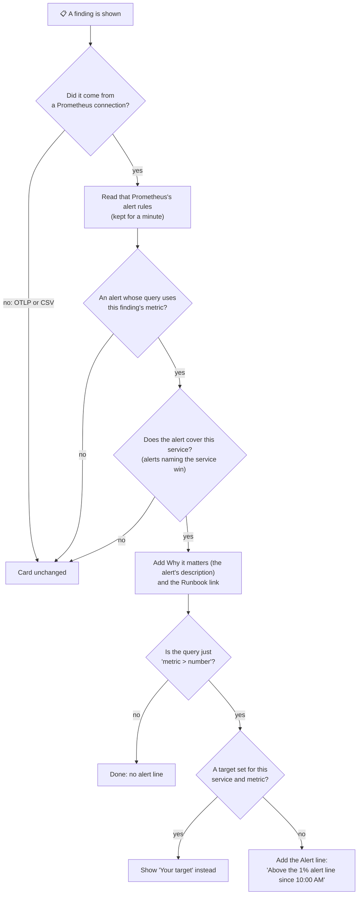

# Finding wording

New to finding cards? [How a finding becomes a card](finding-anatomy.md) follows one finding
through wording, trust and "Happened with".

Finding cards (web UI, Grafana plugin) and Slack messages describe each finding in plain words:

> **Better** · Error rate dropped sharply and stayed lower
> About 11.3% until Oct 19, 10:54 PM. Since then about 1.2% (down 89%).
> **Why it matters:** Fewer requests fail, so fewer users see errors. If nobody changed anything on
> purpose, check that traffic didn't drop at the same time.
> **Happened with:** Slow-request time (p95) also dropped at Oct 19, 10:54 PM (571 ms to 357 ms).
> **What to check:** Deploys or config changes in spike-lab between Oct 19, 10:24 PM and 11:24 PM.
> ▸ Technical details

The wording comes from **`config/finding_templates.yaml`**. Change it there and save. The backend
reads the file again on the next request, so there's no need to restart it (restarting works too).

Nothing is stored. The wording is built from the finding and its signals' evidence each time a
finding is read (`backend/app/services/finding_plain.py`), so a change applies to old findings as
well. A finding's `title` and `summary` never change; they're under **Technical details**, and
alerts, cases, search and the assistant keep reading them.

## What you can change

| Section | What it does |
|---|---|
| `badges` | The badge labels: `worse`, `better`, `changed`, `gap`, `noise`, `blip`. |
| `services` | What each service does, how important it is, and the targets it's held to. See below. |
| `service_importance` | The label each importance gets on the card ("Critical service"). |
| `concepts` | One block per kind of metric (error rate, latency, CPU...): `bad_when` (`up`, `down` or `either`) decides Worse or Better, `worse` and `better` are the "Why it matters" sentences, `check` is "What to check". |
| `unknown_meaning` | The "Why it matters" sentence for a metric with no concept. Such a metric always gets the **Changed** badge, never a guess. |
| `metrics` | Per metric name: `plain_name` (what the card calls it), `concept`, `unit`. |
| `patterns` | For metrics not listed by name: regular expressions that set a `concept` or `unit`. |
| `templates` | The headline and lines for each kind of finding. |

Units: `ratio` (0.113 is shown as 11.3%), `percent`, `ms`, `s`, `bytes`, `per_second`, `count`,
`cores`. Leave `unit` out when you don't know it; values are then plain numbers (243, 0.53).

### Describe a metric

A metric nobody described reads "We don't know what this metric means for your users". To fix that,
add it under `metrics`:

```yaml
metrics:
  checkout_orders_total: {plain_name: Orders placed, concept: request_rate}
```

Or add a new kind of metric under `concepts` and point the metric at it:

```yaml
concepts:
  orders:
    bad_when: down
    worse: Fewer orders are coming in. Customers may not be able to check out.
    better: More orders are coming in.
    check: The checkout page, payment provider errors, and recent releases.
metrics:
  checkout_orders_total: {plain_name: Orders placed, concept: orders}
```

## Describe a service and its targets

With a service described, its findings say who they affect and how they stand against the target
the team holds the service to:

> **Worse** · **Critical service** · Error rate rose sharply and stayed higher
> About 0.4% until 10:00 AM. Since then about 2.1% (about 5 times as high).
> **Your target:** Above your 1% target since 10:00 AM (2 hours so far).
> **Why it matters:** More requests fail, so more users see errors or failed actions.
> **This service:** Customers pay for their orders here.

```yaml
services:
  payments:
    about: Customers pay for their orders here.
    importance: critical
    targets:
      error_rate: {below: 0.01}
      request_latency_p95: {below: 500}
  search:
    about: Customers find products here.
    targets:
      http_requests_total: {above: 100}
```

- Service names match the finding's service, ignoring case. Services that aren't listed read as
  before.
- `importance` is `critical`, `normal` or `low`. It's a label on the card and in Slack; it doesn't
  change a finding's importance score, priority or which list it's in.
- A target is per metric name: `below` for values that should stay under it (errors, latency),
  `above` for values that should stay over it (requests, free disk). Write it in the metric's raw
  value, the same number the analyzers see: an `error_rate` of 1% is `0.01`, a
  `request_latency_p95` of 500 ms is `500`.
- The target line uses the values the card already shows: the averages before and after a change,
  the two halves of a trend, a spike's peak, a forecast's actual value. It says "Above your 1% target
  since ...", "Back within your 1% target since ...", "Still within your 500 ms target" and so on.
  A data gap or a stuck value has no target line.
- An entry that isn't right (an unknown importance, a target written `{under: 0.01}`) is left out
  and logged; the rest of the service stays.

## What does a Prometheus alert on the metric add to a finding?

When a Prometheus alerting rule uses the finding's metric, the finding shows what the team wrote in
that alert: its description as **Why it matters**, its `runbook_url` as a **Runbook** link, and,
for a plain `metric > N` query, where the finding stands against that line. You don't set
anything up: Ops Signals reads the alerting rules of the Prometheus connection the finding came
from.

> **Worse** · Error rate rose sharply and stayed higher
> About 0.4% until 10:00 AM. Since then about 2.1% (about 5 times as high).
> **Alert line:** Above the 1% alert line since 10:00 AM (2 hours so far). Alert CheckoutErrors fires once it stays past the line for 5 minutes.
> **Why it matters:** Orders fail at checkout; customers see "Payment could not be processed".
> **Runbook:** Open the runbook (from alert CheckoutErrors)

```yaml
# In your Prometheus rules file, not in Ops Signals:
- alert: CheckoutErrors
  expr: error_rate{service="checkout"} > 0.01
  for: 5m
  annotations:
    description: Orders fail at checkout; customers see "Payment could not be processed".
    runbook_url: https://wiki.example.com/runbooks/checkout-errors
```

How a finding picks its alert:



- **Which alerts count.** An alert counts when its query names the metric (a raw metric or a
  recording rule such as `service:error_rate:percent`) and its label matchers select the finding's
  service. A matcher on `service`, `job`, `app` or `app_kubernetes_io_name` (the alert enrichment
  service labels) has to match; an alert without one covers every service. When some alerts name
  the service, only those count.
- **The alert line** needs the query to be just `metric > N` (or `<`, `>=`, `<=`, or `N < metric`).
  A query with a function, maths or `and` still gives its text and runbook, without a line. With
  several lines (a warning at 5% and a critical at 10%), the card uses the most severe one the
  value went past, or else the nearest one. `N` is in the metric's raw value, like a target.
- **"Fires once it stays past the line"** is added only when the change itself crossed the line:
  a level change that was on the safe side before, is past the line after, and is still going on.
  A value that was already past the line before the change gets no such sentence (the alert has
  been firing all along), and neither does a spike or a trend average.
- **A target wins.** When the wording file sets a target for the service and metric, the card shows
  "Your target" and no alert line; the alert's text and runbook still show.
- **The text is shown as written.** `{{ $labels.service }}` and labels the alert's query pins are
  filled in. A sentence with anything else in braces, such as `{{ $value }}`, is left out: a finding
  can't know the value the alert would show. Text is cut at 300 characters. Only `http` and `https`
  runbook links are shown.
- **Only the description becomes Why it matters.** It replaces both the template's and the AI's
  line. An alert's `summary` is a title that usually restates the condition ("p95 latency above
  300ms"), so it never does: an alert with only a summary keeps the template's Why it matters, and
  the summary shows in the Alert line tooltip, which names the alert.
- **Nothing is stored.** The rules are read when findings are shown, kept a minute per connection.
  An edited alert shows on old findings too. If Prometheus doesn't answer within 2 seconds, findings
  show without alert lines, and Ops Signals asks again 30 seconds later.
- **Where it shows:** Findings (list and details) and the New Analysis result, in the web UI and the
  Grafana plugin. Slack messages, cases, Shift handoff and Ask Ops Signals don't use it yet, and
  "Seen before?" searches still match on the stored title and summary.

## How "Happened with" is chosen

"Happened with" points to **another finding**. When the card is shown, it looks through the other
saved findings and keeps those that pass every check:

| Check | Why |
|---|---|
| Same service | A change in another service is a different story. |
| A different metric | Another finding on the same metric is the same change found again by another run, not a second clue. |
| Both are a step change ("rose / dropped and stayed") | Only a step has one exact moment to compare. Spikes, trends, stuck values and gaps don't, so they're never matched. |
| The two changes are at most 10 minutes apart | Changes in the same few minutes often share one cause: a deploy, a restart, a traffic move. |
| The other finding was saved in the last 24 hours | Keeps the search small. |

When several findings on one metric pass, the closest in time is kept, so there's at most one line
per metric. The line itself is the other finding's `templates.level_change.related` sentence,
written with that finding's own metric name and values. The finding's Technical details don't
mention it: they describe only its own metric. On the web UI the line links to the other finding;
on both screens, hovering the "Happened with" label shows a short version of these rules.

Nothing about the link is stored. It's worked out each time the card is read, so the order of the
runs doesn't matter, and a later run that finds a closer change replaces the earlier one.

Example: spike-lab's error rate dropped from 9.1% to 0.6% at 8:15 PM. Its CPU usage dropped from 1.1
to 0.28 at 8:14 PM. The error-rate card says "Happened with: CPU usage also dropped at 8:14 PM (1.1
to 0.28)". Latency on spike-lab only had slow trends that day, so it isn't listed.

The 10 minutes and the 24 hours are `RELATED_WINDOW` and `RELATED_SEARCH` in
`backend/app/services/finding_plain.py`, not settings in the wording file. If you change the 10
minutes, change `RELATED_HINT` in `frontend/src/utils/findingPlain.ts` (the tooltip) too.

## Templates and their placeholders

Every line may also use `{plain_name}`, `{service}` and `{metric}`. A concept's lines may use only
those three.

| Template | Used when | Placeholders |
|---|---|---|
| `level_change` | A lasting step up or down (ruptures, baseline_shift) | `rose_or_dropped`, `sharply`, `higher_or_lower`, `before`, `after`, `change`, `change_time`, `window_start`, `window_end`; in `over_headline`, `over_what` and `partly` also `duration`, `during`, `now`, `back_time` |
| `trend` | A slow climb or fall. When the two halves of the window average within 5% of each other, the badge is **Changed** and `small` is the only line under the headline, so a 1% drift isn't called Better or Worse. | `climbing_or_falling`, `steadily_or_unevenly`, `first_half`, `second_half`, `half`, `change`, `peak`, `down_or_up` |
| `spikes` | Short bursts outside the normal range (pyod_outlier, anomaly_zscore) | `above_or_below`, `times`, `up_or_down`, `peak`, `first_time`, `last_time`, `normal_low`, `normal_high`, `duration`, `typical`, `count`, `end_time` |
| `odd_stretch` | A stretch unlike the rest of the series (stumpy) | `first_time`, `last_time` |
| `data_gap` | Data stopped arriving | `duration`, `first_time`, `last_time`, `missing_points`, `gap_count`, `end_time` |
| `flatline` | The value stopped changing | `stuck_value`, `duration`, `first_time`, `last_time`, `normal_change`, `end_time` |
| `forecast` | Ran away from the forecast | `higher_or_lower`, `actual`, `expected`, `off` |
| `targets` | The "Your target" line, for a service with a target on the metric | `target`, `breach_side`, `safe_side`, `since`, `until`, `duration`, `half`, `peak`, `value` |
| `alerts` | The "Alert line", for a metric a Prometheus alert compares to a number ([above](#what-does-a-prometheus-alert-on-the-metric-add-to-a-finding)) | the `targets` placeholders, plus `alert` and `wait` |

Times (`change_time`, `first_time`...) are shown in each reader's own time zone.

When a spike, data gap or stuck value is over (the analysis saw data after its last bad reading),
its `over` line is added to `what`: "Normal again since 09:45", "Data has been arriving again since
10:12", "Changing again since 10:12". `end_time` is when it ended. The card, the details and Slack
show the same sentence. See [when a problem is over](finding-trust.md#when-a-problem-is-over).

A level change whose level came back uses `over_headline` and `over_what` instead of `headline` and
`what` ("Latency rose sharply for 4 hours, then came back"; "About 200 ms until 07:30, then about
1.8 s. Back to about 200 ms since 11:30."). `during` is the level between the jump and the way back,
`now` the level since, `back_time` when it came back and `duration` how long it was up. One only
partly back keeps its lines and adds `partly` ("Partly back: about 700 ms since 11:30.").

## The chart in a finding's details

The chart under **What the readings show** in a finding's details marks the times its sentence names, so
the picture shows what the words say:

| Template | What the chart marks |
|---|---|
| `flatline`, `odd_stretch` | A shaded stretch from `first_time` to `last_time` |
| `spikes` | One shaded stretch per burst, all between `first_time` and `last_time` |
| `data_gap` | A grey **No data** stretch from `first_time` to `last_time` (the longest gap) |
| `level_change` | A line at `change_time`, and at `back_time` when it came back or partly back |
| `trend`, `forecast` | Nothing; a trend says it is about the whole time shown |

A single stretch is labelled with its times and length, or "Started ... · still happening" when the
problem was still going at the end of the data. The marks come from the same times the template is
filled with, not from the text, so editing a template's words doesn't move them. Times outside the
charted readings aren't drawn. Findings saved before this have no marks and show the plain line.

## AI wording

With an AI provider on ([Enabling Local AI](ask-ops-signals-assistant.md#enabling-local-ai)), a
finding's **details** (web UI drawer, Grafana plugin evidence panel) get lines written for that
metric and service. Cards, Slack messages and the assistant keep the template wording.

| Line | What AI adds |
|---|---|
| **Why it matters** | Only for a metric with no `concept`: in place of the `unknown_meaning` sentence, what the metric likely is and what the change can mean. A metric with a concept keeps its template sentence. |
| **What to check** | One more thing to check, after the template's own line. |
| **Happened with** | One sentence after the first line, on what changes at the same moment often mean. The link to the other finding stays. |

Each line the AI wrote has an **AI** chip, and **Show template wording** under the lines switches
back. The lines are written the first time the details open (`GET /api/findings/{id}/ai-wording`),
then saved with the finding (`ai_wording`), so later opens are instant and need no model call. The
page shows the template while they're written and never waits for them.

Before a line is kept it's checked against the finding's facts (`backend/app/services/finding_ai_wording.py`).
A line is dropped, and the template stays, when it has a number, metric name or version that isn't
in the facts, a time, a statistics word ("baseline", "anomaly") or "root cause", fewer than 4 or more
than 45 words, or says nearly the same as the template. A failed call isn't saved, so the next open
tries again.

With AI off, nothing changes. Admins (everyone, with no sign-in) see a note under the lines once,
with **How to turn it on** next to it, until they choose **Not now**.

Why only metrics with no concept get a new "Why it matters": tried on real findings with a 4B local
model, the rewrite of a known metric's sentence was often worse than the template (it described p95
as the slowest request and guessed causes). For a metric the file doesn't describe, the template
has nothing to say, and the AI's line was clearly better.

## When something is wrong

- **A placeholder that isn't on the template's list** (a typo like `{befor}`) switches that template
  off. Its findings show the stored summary, and the backend log says which template and
  placeholder: `finding_templates: template 'level_change' is switched off (unknown placeholders ...)`.
  Other templates keep working.
- **A concept line with a wrong placeholder** is left out; the rest of the card stays.
- **A file that isn't valid YAML** turns plain wording off everywhere until it's fixed, and the log
  says so. Cards show the stored title and summary, as before this feature.
- **A finding without enough evidence** (for example one saved before spike signals kept their
  normal range) shows its stored summary.

After changing the file, run the wording tests. They check the shipped file loads with every
template on, and they show what ten real findings read like:

```
.venv/bin/python -m pytest tests/test_finding_plain.py -q
```

If you changed wording on purpose, the golden texts in that test change with it. Update them.
