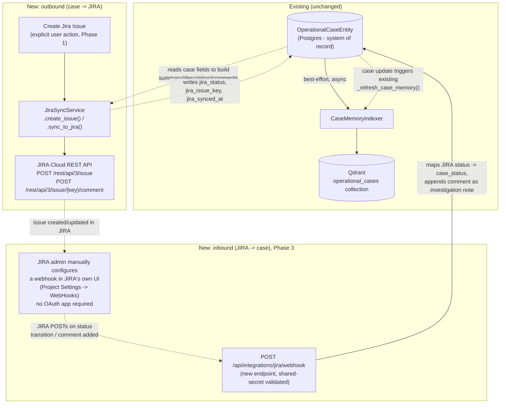

# JIRA Integration Plan (Proposed — Not Implemented)

**Status:** Proposed. No code from this document exists in the repository yet - this is a
future-work plan only, written so the work can be picked up in one shot when there's real demand
for it (see "Why this isn't built yet" below). Treat every endpoint, field name, and payload shape
here as a design intent to be verified against a live JIRA instance at implementation time, not as
already-tested fact.

**Extends:** [`docs/07-operational-cases.md`](07-operational-cases.md) (current case lifecycle),
[`ADR-004`](adr/ADR-004-postgresql-system-of-record.md) (Postgres as system of record),
[`ADR-005`](adr/ADR-005-qdrant-retrieval-index.md) (Qdrant as a derived retrieval index).

---

## 1. Why this isn't built yet

JIRA is close to universal for tracking ops/incident work in companies, so a case that only lives
in this tool's own Postgres+Qdrant is a real adoption blocker for teams that already mandate JIRA
for everything - the demand for this is real, not hypothetical. But as of this writing, no user has
asked for it, and the project has higher-priority, unfinished work (Grafana marketplace publishing,
core detection-accuracy fixes). Building the integration now would mean maintaining untested,
unused code paths. This document exists so that the *next* time this is picked up, the design
decisions are already made and reviewed - only the code is missing.

---

## 2. Design principle: JIRA is a second Qdrant, not a second Postgres

The case lifecycle already has a proven template for exactly this kind of integration:
`CaseMemoryIndexer` (`backend/app/memory/indexer.py`) syncs a case into Qdrant, tracked by a
`memory_status` state machine (`not_indexed` / `indexing` / `indexed` / `stale` / `failed`) on
`OperationalCaseEntity`, triggered best-effort from `backend/app/api/cases.py` and **never** allowed
to block or fail the case operation it's attached to.

JIRA should be built as a sibling to that, not a replacement for anything:

- **Postgres stays the system of record.** Every field a JIRA issue would show (title, status, RCA,
  resolution) is derived *from* the case, never *the* case.
- **Qdrant's pipeline doesn't change.** It keeps reading from Postgres exactly as it does today.
- **JIRA is a second, independent derived integration**, with its own `jira_status` state machine,
  same best-effort discipline as `memory_status`.

This directly answers the "keep Qdrant for the knowledge base" part of the original ask: nothing
about the retrieval/knowledge-base pipeline needs to touch JIRA at all.

---

## 3. Architecture



Key point visible in the diagram: an inbound JIRA update lands on the **same** `OperationalCaseEntity`
row the UI already edits directly, so it flows through the **existing** `_refresh_case_memory()` /
Qdrant re-indexing path automatically - no new memory-sync code needed, only new *case-update*
code that happens to originate from JIRA instead of the plugin UI.

---

## 4. Data model changes

Add a `jira_*` field block to `OperationalCaseEntity`, mirroring the existing `memory_*` block
exactly (`backend/app/models/entities.py`):

| Field | Type | Mirrors |
|---|---|---|
| `jira_status` | `String(32)`, default `"not_created"` | `memory_status` |
| `jira_issue_key` | `String(32)`, nullable | — (e.g. `"OPS-142"`) |
| `jira_issue_url` | `Text`, nullable | — |
| `jira_synced_at` | `DateTime(timezone=True)`, nullable | `memory_indexed_at` |
| `jira_sync_error` | `Text`, nullable | `memory_error` |

`jira_status` values: `not_created` -> `creating` -> `created` -> (`syncing` <-> `stale`) -> `failed`
(retryable from any state).

---

## 5. Config

New `JiraConfig` in `backend/app/config.py`, same shape as `MemoryConfig`/`PrometheusConnectionConfig`:

```python
class JiraConfig(BaseModel):
    enabled: bool = False
    base_url: str | None = None          # https://yourorg.atlassian.net
    project_key: str | None = None       # e.g. "OPS"
    issue_type: str = "Task"
    automatic_on_case_creation: bool = False   # opt-in, see Section 8
    status_mapping: dict[str, str] = Field(default_factory=dict)  # see Section 7
```

Credentials via env vars, same pattern as Prometheus's `OPS_SIGNALS_PROMETHEUS_BEARER_TOKEN`:

- `OPS_SIGNALS_JIRA_EMAIL`
- `OPS_SIGNALS_JIRA_API_TOKEN` (generated at `id.atlassian.com/manage/api-tokens`)
- `OPS_SIGNALS_JIRA_WEBHOOK_SECRET` (shared secret for inbound webhook validation, Section 9)

---

## 6. New/changed endpoints

| Method & Path | Phase | Purpose |
|---|---|---|
| `POST /api/cases/{case_id}/jira/create` | 1 | Explicit user action: build a JIRA issue from the case, store `jira_issue_key`. Mirrors the existing `POST /api/cases/{case_id}/memory/index`-style manual trigger already used for Qdrant. |
| `POST /api/cases/{case_id}/jira/sync` | 2 | Manual pull: fetch the linked issue's current status/comments from JIRA and apply them to the case, same effect as the webhook path but user-triggered. Useful before the webhook exists, and as a fallback if a webhook delivery is missed. |
| `POST /api/integrations/jira/webhook` | 3 | Inbound receiver for JIRA's admin-configured webhook. Validates a shared secret (Section 9), looks up the case by `jira_issue_key`, applies the update. |

`GET /api/cases/{case_id}` (existing) gains the five new `jira_*` fields in its response so the UI
can show link/status - no new read endpoint needed.

---

## 7. Field & status mapping

**Outbound (case -> JIRA issue), built by `JiraSyncService._build_issue_payload()`:**

| Case field(s) | JIRA field |
|---|---|
| `case_title` | `summary` |
| `finding_snapshot` (service, metric, category, importance) + `root_cause_summary` + `corrective_action` + `outcome_summary`, formatted | `description` |
| new `investigation_notes` entries (each append) | new comment via `POST /rest/api/3/issue/{key}/comment` |

**Status (bidirectional) - must be a configurable mapping, not hardcoded**, because JIRA workflow
status names are per-project custom text (`JiraConfig.status_mapping`). Example default:

| Case `case_status` | JIRA status (example project) |
|---|---|
| `open` | `To Do` |
| `investigating`, `rca_in_progress` | `In Progress` |
| `resolved` | `Done` |
| `closed` | `Done` |

Inbound sync applies this table in reverse: an unrecognized JIRA status should leave `case_status`
untouched and log a warning, not guess.

---

## 8. Two decisions carried over from discussion (recorded, not re-litigated)

- **Opt-in creation, not automatic.** `automatic_on_case_creation` defaults to `false`. Unlike
  Qdrant indexing (which is invisible/internal), creating a JIRA issue is a visible action on
  someone else's system - it should be an explicit "Create Jira Issue" button next to the existing
  "Create Case"/"Investigate" actions in `PanelPreview.tsx`, not a side effect.
- **Webhook is viable without building an OAuth app.** JIRA restricts *dynamic* webhook
  registration (`POST /rest/api/3/webhook`) to Connect/OAuth 2.0 apps, but a JIRA admin can
  configure a plain webhook by hand in JIRA's own UI (Project Settings -> WebHooks: URL + JQL
  filter + events, no app required). Phase 3 only needs that one-time admin setup plus our inbound
  endpoint - not a new Atlassian app.

---

## 9. Security considerations

- **API token**: env var only (`OPS_SIGNALS_JIRA_API_TOKEN`), never logged, never stored in
  Postgres - same discipline as the Prometheus bearer token today.
- **Webhook authenticity**: JIRA's admin-configured webhooks are **not** cryptographically signed
  by default. The inbound endpoint must validate a shared secret the admin includes in the webhook
  URL itself (e.g. `.../jira/webhook?secret=...`) or a custom header, checked against
  `OPS_SIGNALS_JIRA_WEBHOOK_SECRET`, and reject anything else with 401 before touching any case.
- **Payload shape is provisional.** Public examples show `webhookEvent`, `issue.key`,
  `issue.fields.status.name`, `changelog.items[]`, and an optional `comment` block, but exact field
  names must be confirmed against a real payload from a live JIRA instance before the parser is
  written - don't trust this doc's field names as final.
- **Idempotency**: webhook deliveries can repeat; `jira_issue_key` + the JIRA `timestamp` field
  should be used to no-op a duplicate delivery rather than re-applying the same update.

---

## 10. Implementation phases

1. **Phase 1 - Outbound create only.** `JiraConfig`, the five new `jira_*` columns (migration),
   `JiraSyncService.create_issue()`, the "Create Jira Issue" button, `POST /cases/{id}/jira/create`.
   No inbound sync at all yet. Smallest useful slice - a team can at least get findings into JIRA.
2. **Phase 2 - Manual pull.** `JiraSyncService.sync_from_jira()`, `POST /cases/{id}/jira/sync`, a
   "Refresh from Jira" button. Closes the loop without any new public endpoint or admin setup.
3. **Phase 3 - Real-time inbound webhook.** `POST /api/integrations/jira/webhook`, secret
   validation, status-mapping-driven case updates, comment ingestion as investigation notes. Needs
   one-time JIRA admin webhook configuration (Section 8) but no new Atlassian app.

Each phase is independently shippable and useful on its own - Phase 2 doesn't require Phase 3, and
Phase 1 alone already solves "get this into JIRA" even if nothing ever syncs back.

---

## 11. Explicit non-goals

- JIRA never becomes the system of record. If JIRA and Postgres ever disagree, Postgres wins;
  JIRA-side edits only flow in through the sync paths above, never bypass them.
- Qdrant's indexing pipeline is not touched by any phase of this plan.
- No attempt to build a general-purpose bidirectional JIRA sync (custom fields, attachments,
  sub-tasks) - scope is limited to the fields in Section 7.
