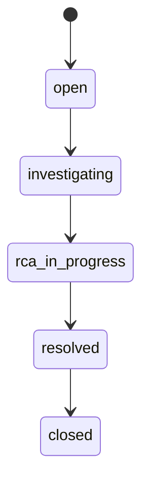

# Operational Cases

Operational cases turn a finding into a trackable investigation object.

## Lifecycle

## Example Lifecycle

1. A finding (or a behavior finding) is promoted into a case.
2. Investigation notes are added during review.
3. RCA fields are filled in when a cause is known.
4. Corrective action and outcome are recorded.
5. The case is indexed into Qdrant for future retrieval.

## AI drafts on the Root Cause and Resolution tabs

With an AI provider on, both tabs have a **Draft from case** button for Editors. It fills the box
from what the case already holds; it never decides a cause on its own and never saves.

- **Root Cause** drafts the summary from the finding, the deploy matched to it, investigation notes,
  ticket comments and how up to 3 similar past cases were fixed. If nobody recorded a cause, the
  draft says so instead of guessing.
- **Resolution** drafts the outcome summary and the corrective action from the notes, ticket
  comments and the saved root cause. When the problem stopped (a rollback, a restart) but the cause
  wasn't fixed, the corrective action can end with "Still open: …".
- Under the box, **Drafted from this case** lists the facts the draft was written from; **Undo
  draft** puts back what was there. A box with text asks before it is replaced.
- Status, Confidence, Verified, Outcome Status and Learning Outcome are never filled in. The tab's
  usual Save button saves the text.
- Before a draft is shown, a sentence is dropped if it names a number, version or name not in the
  case, says it is certain, or (Resolution only) says something was removed, fixed or changed when
  the case never says so. If nothing is left, the tab says it couldn't write a draft.
- With nothing on the case to draft from (no notes, ticket comments, matched deploy or similar past
  case), the button says so. With AI off there's no button; admins see once how to turn AI on.

How well a draft reads depends on the model: tried on a laptop with gemma3:4b and llama3.1:8b,
drafts were sometimes empty or too general, which is why each one is a draft to check.

API: `POST /api/cases/{case_id}/rca/suggest` and `/resolution/suggest` return `available`, the
draft, `sources` and, when there is none, `reason_code` (`ai_off`, `not_enough` or `failed`).

## Case Fields

- investigation status
- investigation notes
- RCA status
- RCA summary
- RCA confidence
- verification flag
- corrective action
- outcome status
- outcome summary
- memory status

## Purpose

Cases help teams preserve context across investigation, RCA, and post-resolution review.

## Ticketing Integration & Comment Promotion

When an operational case is linked to an external ticketing provider (e.g., Jira Cloud):
1. **Activity Feed Synchronization**: Remote ticket status changes and comments are synced into the case's external activity feed.
2. **1-Click Note Promotion**: Operators can elevate relevant external comments into official `investigation_notes` via `POST /api/cases/{case_id}/ticket/events/{event_id}/promote-to-note`.
   - Attaches provenance: `[{PROVIDER} note from {Author}]: {summary}`.
   - Automatically advances `investigation_status` from `not_started` to `in_progress`.
   - If the case was previously indexed in operational memory, flags `memory_status = "stale"` to ensure vector embeddings stay synchronized with PostgreSQL.
   - Enforces idempotency to prevent duplicate notes.
3. **AI Root Cause & Resolution drafts**: the drafts (see [AI drafts](#ai-drafts-on-the-root-cause-and-resolution-tabs)) include ticket comments not yet promoted to notes, so a promoted comment isn't sent twice.
4. **Zero-Click AI Comment Relevance Triage**:
   - Automated evaluation: When new comments arrive via periodic synchronization or inbound webhooks, `CommentTriageService` evaluates unpromoted comments against case telemetry using structured AI output (`CommentTriageEvaluation`).
   - High-confidence operational clues (`is_relevant_clue=True`, `confidence >= 0.75`) detailing diagnostic discoveries, root cause hypotheses, or remediation actions are automatically promoted into case notes with provenance `[{PROVIDER} clue from {Author} (AI auto-promoted)]: {summary}`.
   - Administrative noise and project management chatter (e.g., sprint assignments, meeting schedules, general acknowledgments) remain in the activity feed without cluttering official case notes.
   - On-demand triage: Operators can trigger immediate AI triage at any time via `POST /api/cases/{case_id}/ticket/triage-comments` or the `[⚡ AI Triage]` button in the UI.
   - Graceful degradation: If AI services are unavailable or fail, comment triage fails closed, leaving comments unpromoted for manual operator review without breaking ticket synchronization.

5. **Outbound Resolution Synchronization**:
   - When an operator approves and verifies an RCA and resolves/mitigates an operational case, Ops Signals atomically enqueues a transactional outbox operation (`resolve_ticket`).
   - The Jira adapter formats an Atlassian Document Format (ADF) closing resolution comment containing the verified root cause, corrective action, outcome summary, and deep link back to Ops Signals.
   - Fail-safely transitions the linked Jira ticket to "Done" / "Resolved" if an eligible transition exists in the Jira project workflow.
   - Operators can also manually trigger outbound resolution sync at any time via `POST /api/cases/{case_id}/ticket/resolve`.
6. **Instant Webhook Ingestion & Configuration**:
   - Operators can retrieve setup details and delivery health via `GET /api/integrations/ticketing/{provider}/webhook-info`.
   - Incoming Jira webhooks (`POST /api/integrations/ticketing/{provider}/webhook`) process comments and status changes instantaneously with zero polling latency, verified via HMAC-SHA256 signatures and deduped against `ticket_webhook_deliveries`.

## Filtering by Service

The **Cases** page has a **Service** dropdown next to the search box when the cases cover two or more
services. Each case keeps the service of the finding it was opened from; the tab counts follow the
filter, and the URL keeps it (`/cases?service=payments-api`). `GET /api/cases?service=` filters in the
database before applying `limit`, so a service's older cases aren't dropped when other services have
newer ones.

## Current State

Case tracking exists in the backend models, standalone web frontend, and operational memory pipeline.
