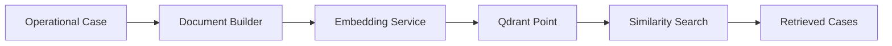

# Operational Memory

## Purpose

Operational memory captures a case document, embeds it, and stores it in Qdrant for semantic retrieval.

In the web UI it shows up on the **Recurring problems** page (`/recurring-problems`, formerly
Operational Memory): past cases grouped into problems that keep coming back, monitoring coverage of
imported incidents, and - folded away for admins - the indexing details and the alert-context
preview. Case Details shows **Seen before** when the case belongs to one of those groups.

## When a fix didn't stick

When a problem comes back soon after a case for it was fixed, the app says so where people are
working. The rule: the same service, a symptom at least 80% alike, and within 30 days of the old case
being resolved. If several past fixes match, the latest one is named.

- **Finding details** (web and plugin): a banner at the top, "This came back 3 days after it was
  fixed", with the old case, what the fix was and anything its resolution left "Still open".
- **Findings list:** the card's Seen before column shows **Fix didn't hold** instead of the usual
  label. **See what came back** opens the details at the banner.
- **The new case:** the same banner, naming the old case. It replaces the "Seen before" banner, and
  how often the problem happened moves into it.
- **The old case:** a **Fix didn't hold** chip and a banner linking to the case it came back in. The
  old case stays resolved; nothing reopens on its own.

Finding the match uses no AI. With an AI provider on, **Why might it not have held?** on the banner
lists up to three possible reasons, written only from the old case's saved cause and fix, how soon
it came back, the new finding and any deploy matched to it. A reason naming a number, name or fix
that isn't in those facts is dropped. Nothing is saved. A recurrence nobody opened a case for, or a
past case that was never added to memory, isn't seen.

## What happened last time: each past-case match

Each match under a finding's **Seen before?** (and under a case's **Similar Cases**) says in one line
what happened in that past case, so you can tell without opening it whether it has an answer:

- **Fixed:** the fix, then **Cause:** the root cause, when the cause was verified.
- **Likely cause (unconfirmed):** the cause, first, when nobody verified it; then the fix, if any.
- **Investigating:** what the case's guided investigation pointed at, or **Investigated: nothing
  found yet**, when the case has no cause or fix recorded.
- **Open, nothing recorded yet.** when there is nothing to go on.

The line is cut at two lines; hover it for the rest. Imported postmortems count as verified. Below
it, the case's state (**Resolved · cause verified**, **Resolved · cause not verified**, **In
progress** or **Open**) and **Case #N · Open case →**, which opens the case. Above the list, a line
says how many of the matches were fixed. In the Grafana plugin the same line and state are shown,
with the case number but no link.

## Flow

## Importing Past Incidents

Memory starts empty on a new install. Past postmortems and incidents can be imported as resolved
cases so recall works from day one; see [importing-incident-history.md](importing-incident-history.md).
Imported cases share the `operational_cases` collection with detected ones. Their payload has
`origin: imported`, and because a postmortem has no metric, recall matches them on service instead
of requiring the same metric.

## Payload Versus Document

- The document text is what gets embedded.
- The payload stores retrieval metadata.
- PostgreSQL still stores the full case record.

## Current Payload Fields

- case and finding identifiers
- service, metric, provider, category
- severity and importance score
- case lifecycle fields
- title
- embedding model
- content version
- timestamps

## Retrieval Use

The retrieval index helps surface similar cases, but it does not determine final root cause.

Memory chat (`POST /api/memory/chat`, the MCP `memory/chat` tool and the assistant's case search)
shows past cases scoring 0.40 or more by default. A match of 0.70 or more is a **strong** match;
below that it is shown as a **possible** match, and the answer says to check that it fits. Ordinary
questions about a past incident score about 0.43-0.73 for the right case, while off-topic questions
stay under 0.25, so the old 0.55 floor hid the right case for about half of ordinary questions.
Pass `minimum_score` to be stricter.

## How Recall Is Verified

[`tests/api_backend/test_memory_recall.py`](../tests/api_backend/test_memory_recall.py) runs the real
pieces: the document builder, the MiniLM embedder, Qdrant (in-memory mode) and the alert-context lookup.
Six hand-built cases are stored: two on the alert's service and metric, two with the same root cause on
another metric or service, and two unrelated. The tests check that:

- a one-line alert such as `checkout-api p95 latency above 300ms` brings back the past cases on that
  service and metric, scoring about 0.6 against the 0.3 cutoff
- a message that names a cause ranks the matching case first
- the same cause on another metric or service is not returned, since search is scoped to the alert's
  metric and service
- an alert on a metric with no past cases returns nothing
- a root cause added later is found once the case is re-indexed

[`tests/api_backend/test_memory_chat_recall.py`](../tests/api_backend/test_memory_chat_recall.py)
imports the sample incident history and checks that ordinary questions bring back the right incident
through both the API and MCP chat at the default threshold, that possible matches are labelled, and
that off-topic questions find nothing.
- if Qdrant is unavailable, the alert still gets exact-match history
- through the Alertmanager receiver, the recalled case's title and link appear in the Slack message

Limits:

- Six cases show the mechanism works. They are not an accuracy measure across many incidents.
- When an alert names only a symptom, cases on the same metric score close together (0.61 vs 0.58 in
  the tests), so the top match shown in Slack may not be the most relevant one.
- Unrelated alerts scored up to 0.29, just under the cutoff. The metric and service scope is what keeps
  them out; relaxing it would need a higher cutoff.
