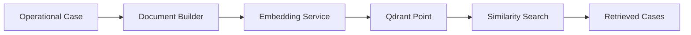

# Operational Memory

## Purpose

Operational memory captures a case document, embeds it, and stores it in Qdrant for semantic retrieval.

## Flow

## Importing Past Incidents

Memory starts empty on a new install. Past postmortems and incidents can be imported as resolved
cases so recall works from day one; see [importing-incident-history.md](importing-incident-history.md).
Imported cases share the `operational_cases` collection with detected ones. Their payload has
`origin: imported`, and because a postmortem has no metric, recall matches them on service instead
of requiring the same metric.

## Payload Versus Document

- The document text is what gets embedded.
- The payload stores retrieval metadata.
- PostgreSQL still stores the full case record.

## Current Payload Fields

- case and finding identifiers
- service, metric, provider, category
- severity and importance score
- case lifecycle fields
- title
- embedding model
- content version
- timestamps

## Retrieval Use

The retrieval index helps surface similar cases, but it does not determine final root cause.

## How Recall Is Verified

[`tests/api_backend/test_memory_recall.py`](../tests/api_backend/test_memory_recall.py) runs the real
pieces: the document builder, the MiniLM embedder, Qdrant (in-memory mode) and the alert-context lookup.
Six hand-built cases are stored: two on the alert's service and metric, two with the same root cause on
another metric or service, and two unrelated. The tests check that:

- a one-line alert such as `checkout-api p95 latency above 300ms` brings back the past cases on that
  service and metric, scoring about 0.6 against the 0.3 cutoff
- a message that names a cause ranks the matching case first
- the same cause on another metric or service is not returned, since search is scoped to the alert's
  metric and service
- an alert on a metric with no past cases returns nothing
- a root cause added later is found once the case is re-indexed
- if Qdrant is unavailable, the alert still gets exact-match history
- through the Alertmanager receiver, the recalled case's title and link appear in the Slack message

Limits:

- Six cases show the mechanism works. They are not an accuracy measure across many incidents.
- When an alert names only a symptom, cases on the same metric score close together (0.61 vs 0.58 in
  the tests), so the top match shown in Slack may not be the most relevant one.
- Unrelated alerts scored up to 0.29, just under the cutoff. The metric and service scope is what keeps
  them out; relaxing it would need a higher cutoff.
