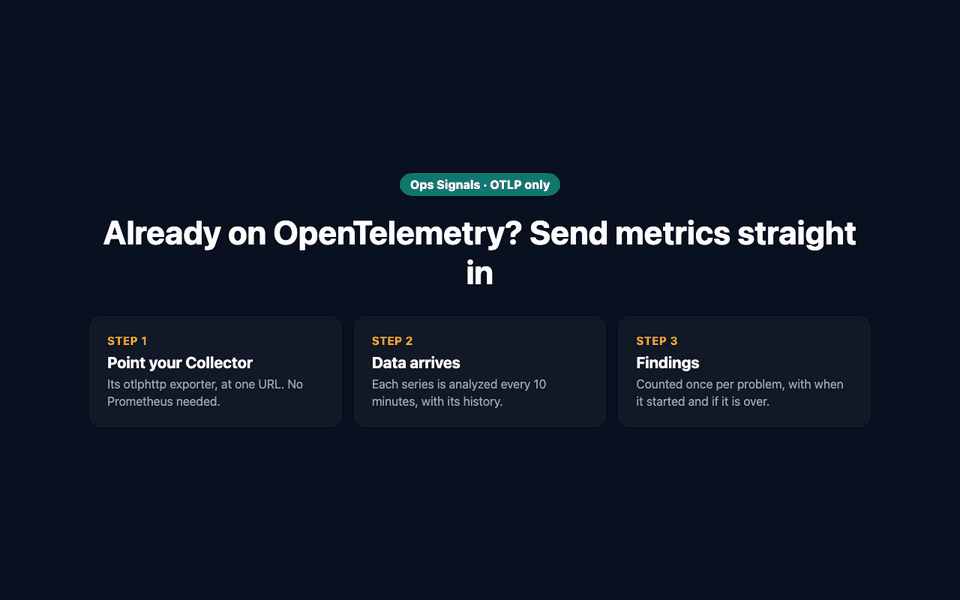

# OTLP Metrics Ingestion

Ops Signals can receive metrics pushed directly from an OpenTelemetry SDK or an OTel Collector,
in addition to CSV upload and pull-based Prometheus queries:

```
POST /api/otlp/v1/metrics
```

Both OTLP/HTTP encodings are supported (`Content-Type: application/x-protobuf` or
`application/json`). Gauge and Sum (counter) metrics are supported; Histogram,
ExponentialHistogram, and Summary points are accepted but rejected with a `partial_success`
response, not silently dropped.

## Point a Collector at Ops Signals

Point `-t otlphttp` metrics in an OTel Collector config at Ops Signals like this:

```yaml
exporters:
  otlphttp:
    endpoint: http://localhost:8001/api/otlp
```

The path is `/api/otlp`, not OTLP's spec-default root path - see
[`design/otlp-metrics-ingestion-plan.md`](design/otlp-metrics-ingestion-plan.md#3-endpoint) for why.
The design doc covers the volume and cardinality guardrails and the `GET /api/metrics`
self-observability endpoint, which also serves the active findings
([`finding-metrics.md`](finding-metrics.md)).

## Try it

To try it without setting up a real OTel Collector, send a synthetic series and watch a finding
appear in the UI:

```bash
./scripts/run_all.sh
./scripts/send_test_otlp_metrics.py --service demo-service
```

To try a real OpenTelemetry Collector instead, sending this machine's host and Docker container
metrics: `./scripts/otel_collector.sh start` (and `status`, `logs`, `stop`).

To see what an OTLP-only install looks like from scratch, without touching your running stack,
start an empty, throwaway copy with no Prometheus or Alertmanager (UI on :5184):
`./scripts/otlp_sandbox.sh up`, then `collector` for live data or `sample` for a day of data, and
`down` to remove it all.

## Using Ops Signals with OTLP only

If your metrics already flow through OpenTelemetry, from any vendor's SDK or Collector, you can
send them straight to Ops Signals without running Prometheus. This is what you get, and what you
don't, before you onboard.



[Watch the one-minute walkthrough](screenshots/videos/otlp-only.webm) (re-record with `./scripts/record_otlp_walkthrough.sh`)

| | With OTLP only |
|---|---|
| ✅ **Works** | Findings from live data, cases and ticketing, operational memory and similar past cases, Slack notifications, the assistant and MCP, behavior rules |
| ⚠️ **Partly** | Latency percentiles: OTLP histograms aren't read yet, so percentiles come only from Prometheus or CSV data |
| ➕ **Needs another source** | Autonomous analysis, drill-down by pod and Metric Usage need a Prometheus-compatible source; alert enrichment also needs Alertmanager; deploy correlation needs [deploy events](data-sources.md#deploy-and-change-events) |

The app shows the same list under **Integrations → What works with my data?**, and features that
need another source say so where you meet them.

### What to expect in the first hour

Measured with a real OTel Collector sending one laptop's host and Docker container metrics (about
300 series) to an empty install:

- The first findings appear about 10 minutes after data starts arriving.
- The first 30-40 minutes are the noisiest: each series has only minutes of history, so normal
  changes, such as containers starting up, stand out. New problems needing attention went from 35
  in the first 10 minutes to 1-6 per 10 minutes after 40 minutes.
- Expect a few hundred findings in that first hour, most of them context: about 300 problems, 57
  of them needing attention. The Overview leads with the ones needing attention ("57 Need
  Attention, +242 in context"); context findings are one click away on the Findings page. Bursty
  series such as disk and network bytes produce most of the "unusual activity" ones.
- A problem that every analysis sees again is one problem: the Overview counts it once (697
  findings in that hour were 299 problems), its card says "Started 09:00 · still happening" or
  "09:00-09:45 · over", and Slack hears about it once, and again only if it gets worse. In one
  10-minute round that was 19 Slack messages instead of 110.

### How OTLP data is analyzed

Each series' new points wait until 10 minutes have gathered (a large backfill is analyzed at once),
then are analyzed together with up to 6 hours of that series' history. Counters (a Sum that only
goes up, such as CPU time or bytes sent) are turned into per-second rates first, as Prometheus'
`rate()` does; a Sum that can go down, such as memory in use, is analyzed as a level. Tune with
`OPS_SIGNALS_OTLP_ANALYSIS_INTERVAL_MINUTES` (10), `OPS_SIGNALS_OTLP_HISTORY_HOURS` (6) and
`OPS_SIGNALS_OTLP_IMMEDIATE_BATCH_POINTS` (60).

To see all of this on your own machine, `./scripts/otlp_sandbox.sh up` starts an empty copy next
to your normal one, and `./scripts/otlp_sandbox.sh collector` sends it live data.

## Limits

OTLP metrics ingestion is single-instance only (no distributed queue), OTLP/HTTP only (no gRPC),
and metrics-only (no logs/traces) - see
[`design/otlp-metrics-ingestion-plan.md`](design/otlp-metrics-ingestion-plan.md#10-explicit-non-goals-phase-1).
