# Screenshot Gallery

Ops Signals can be used through two complementary experiences:

- A standalone operational intelligence Web UI for CSV uploads, direct Prometheus analysis, findings, cases, behavior intelligence, operational memory, and assistant retrieval.
- A Grafana plugin that fits into existing Grafana and Prometheus workflows and sends selected metric data to the Ops Signals backend analysis pipeline.

The screenshots below show the current product surfaces for an early developer preview. They are intended to help first-time users understand the workflow before running the project locally.

## Standalone Web Application

The standalone Web UI is the primary operational workspace. It is designed around investigation flow: start with data, review findings, create cases, preserve knowledge, and retrieve prior context.

### Overview Dashboard

The Overview dashboard summarizes operational health, active findings, open investigations, behavior intelligence, memory status, and recent activity.

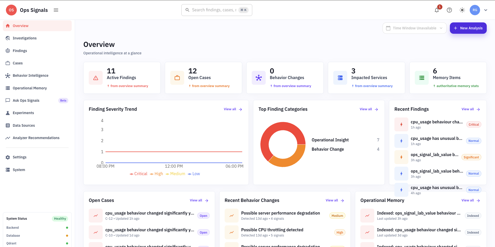

### New Analysis - CSV Upload

Users can upload, validate, preview, and analyze CSV time-series data through the standalone workflow.

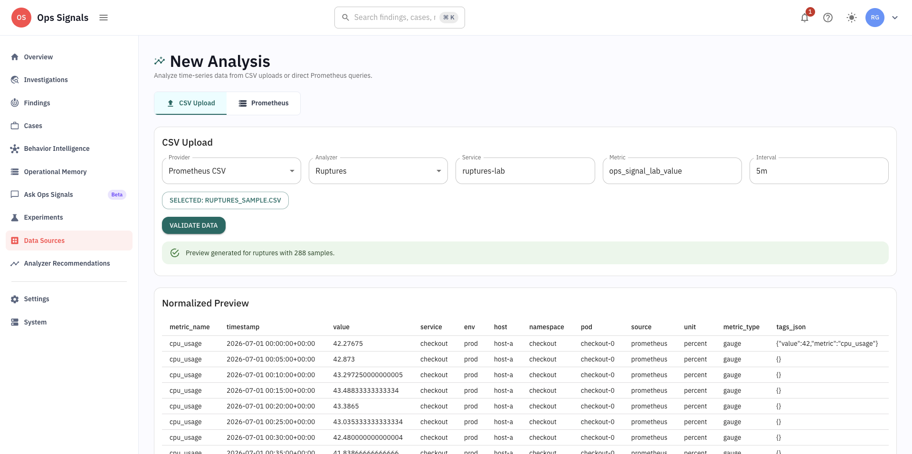

### New Analysis - Direct Prometheus

Users can connect to Prometheus, select or enter a metric query, preview the returned series, choose a time window, and run analysis.

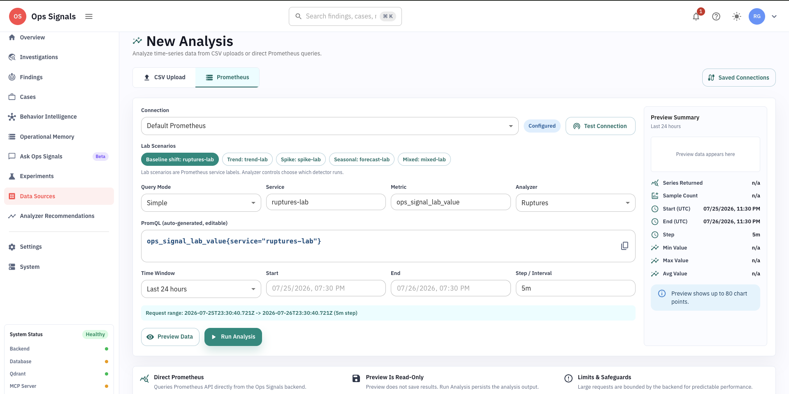

### Operational Findings

Findings show severity, confidence, evidence, affected services, timestamps, and operational explanations generated from analyzer output.

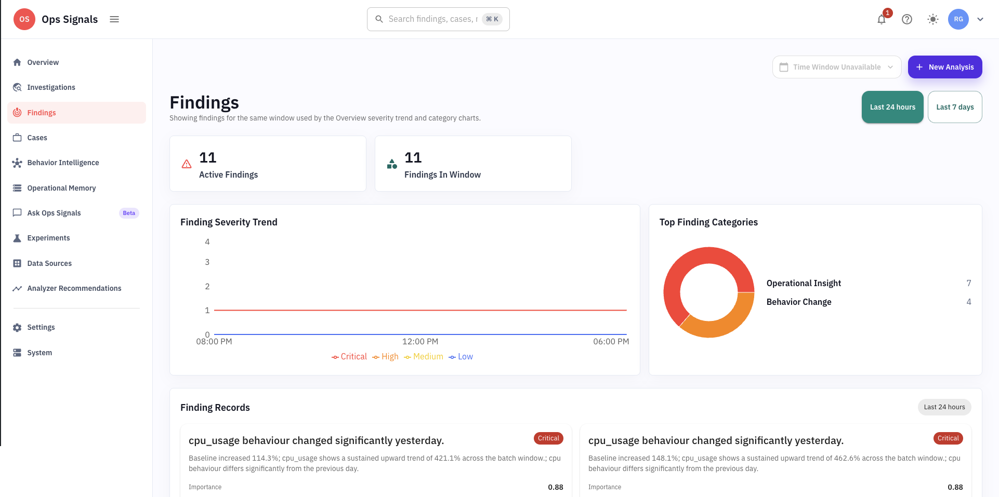

### Case Investigation

Findings can be promoted into cases where users capture investigation notes, root cause analysis, resolution, and reusable operational knowledge.

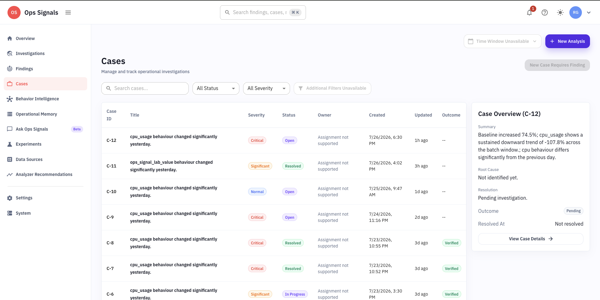

### Behavior Intelligence

Behavior intelligence combines related signals and metrics to identify higher-level operational patterns.

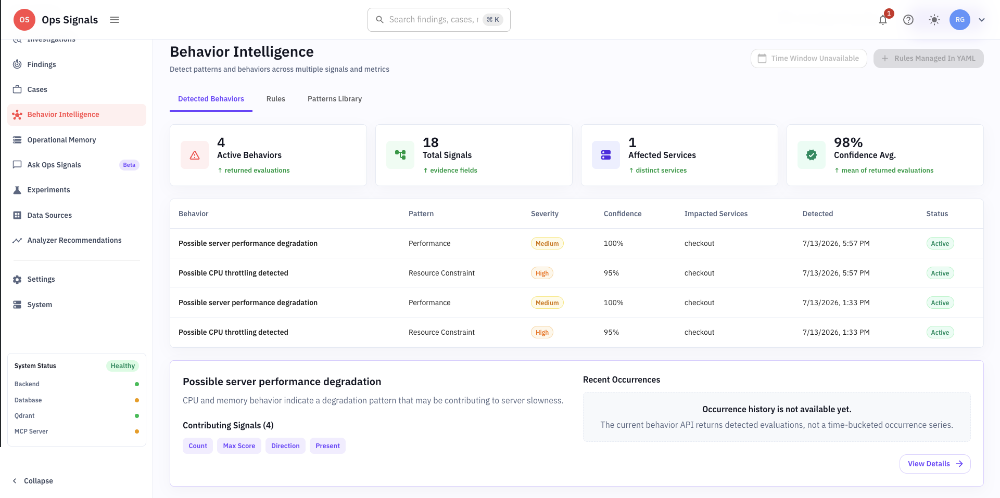

### Operational Memory

Completed investigations can be preserved as searchable operational knowledge and reused in future investigations.

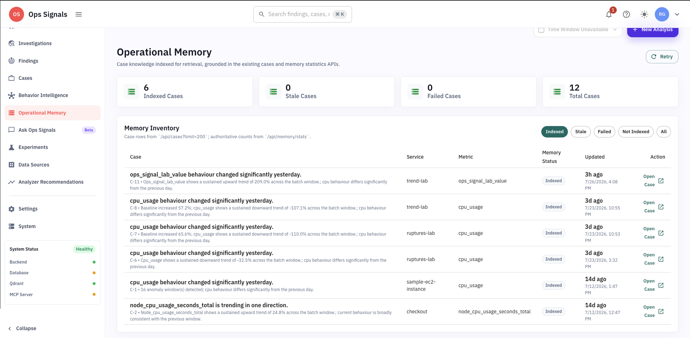

### Operational Assistant

The assistant answers grounded questions using findings, cases, behavior intelligence, operational memory, and project documentation. It is a retrieval and explanation layer, not an autonomous general-purpose AI agent.

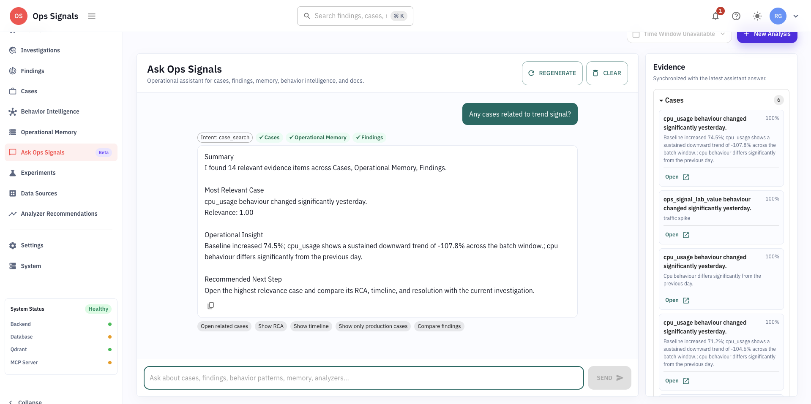

## Grafana Plugin

The Grafana plugin lets users analyze metrics without leaving Grafana by using:

- An existing Grafana data source
- Prometheus metrics
- The current Grafana time range
- The same Ops Signals backend analysis workflow

### Plugin Home

The plugin home provides the entry point for running Ops Signals analysis from inside Grafana.

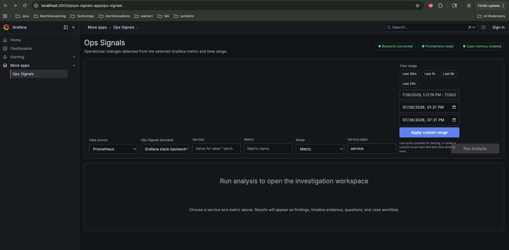

### Prometheus Metric Selection

Users select a data source, service or metric, query, and Grafana time range before analysis.

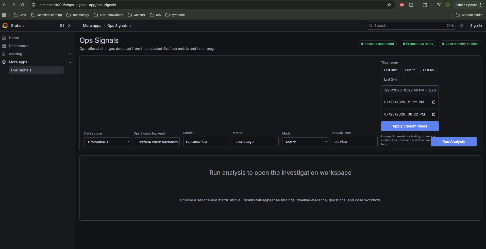

### Analysis Results

Users can review detected changes, analyzer results, findings, and summarized operational insights within Grafana.

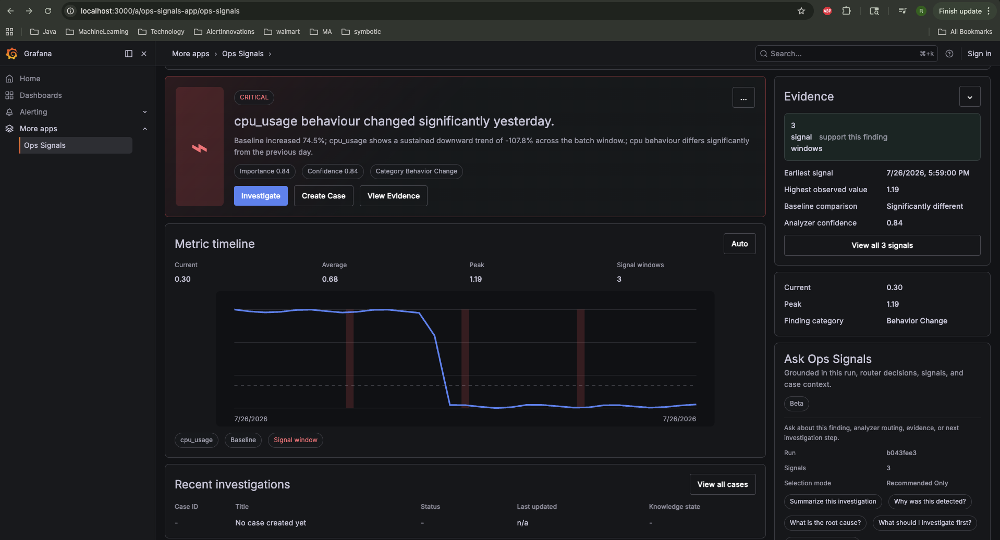

### Finding Details

Users can inspect supporting evidence, analyzer output, severity, confidence, and operational explanations from the analysis flow.

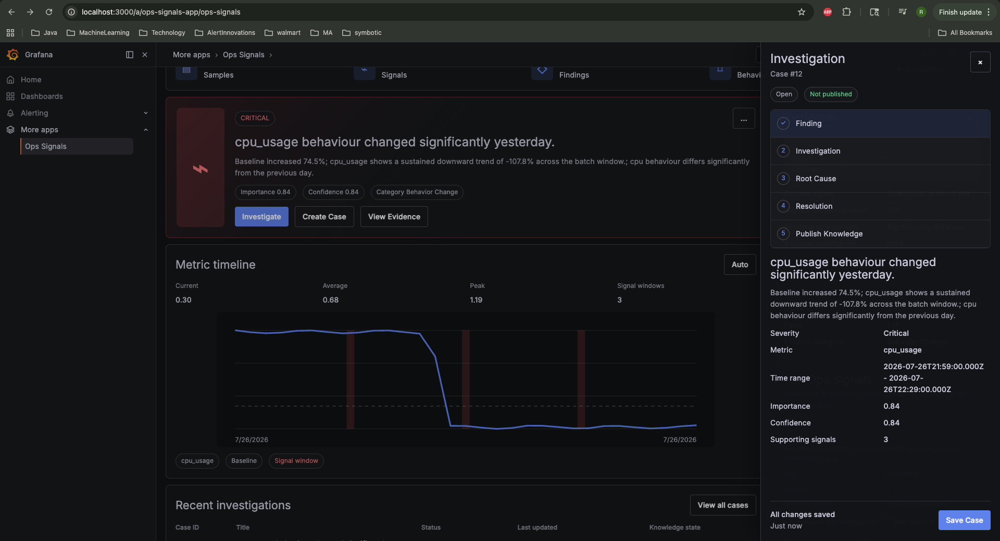

### Recent Cases

Users can review recent investigation cases connected to prior findings and operational memory.

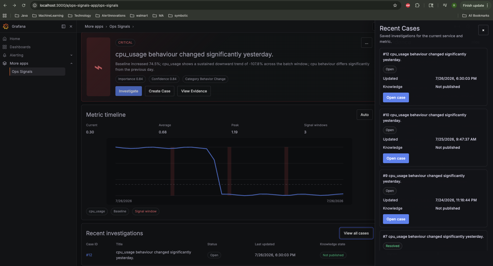

### Ask Ops Signals

Users can ask grounded questions from the Grafana plugin while staying connected to the same Ops Signals backend.

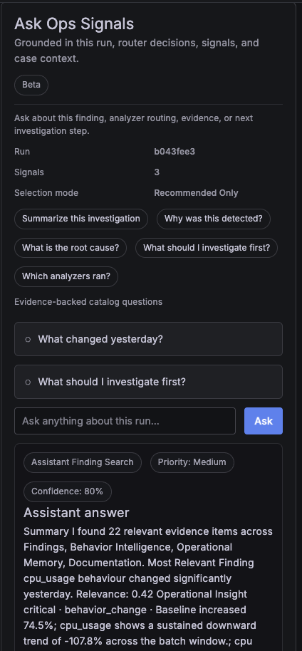

## Typical Workflow

1. Upload CSV data or query Prometheus.
2. Preview and validate the time series.
3. Run the analyzer pipeline.
4. Review generated findings.
5. Create an investigation case.
6. Record investigation notes, root cause, and resolution.
7. Publish the completed case to Operational Memory.
8. Retrieve related knowledge through the Operational Assistant.
9. Optionally run analysis directly within Grafana.

## Learn More

- [README](../README.md)
- [Standalone Overview API](17-standalone-overview-api.md)
- [Standalone Prometheus Analysis](18-standalone-prometheus-analysis.md)
- [Release Review](release-review.md)
- [Release Process](13-release-process.md)
